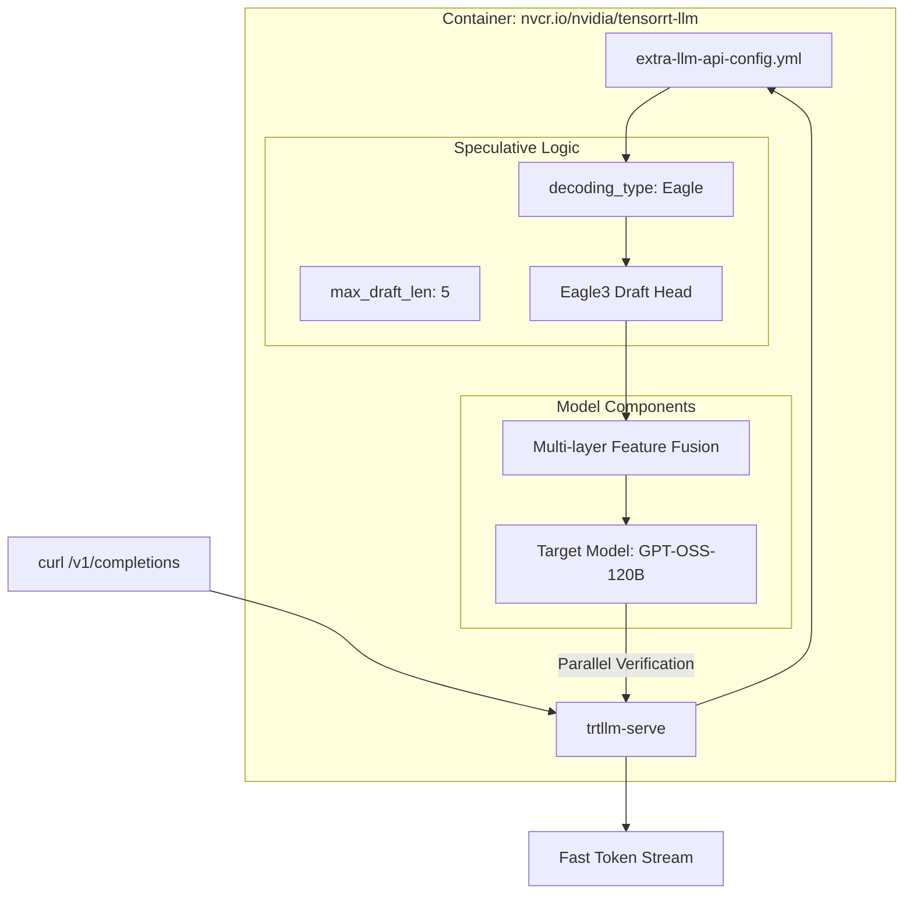
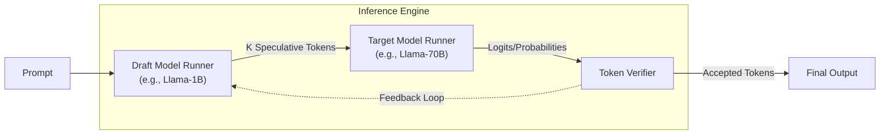

<!-- source: DeepWiki mcp.deepwiki.com · repo NVIDIA/dgx-spark-playbooks · page 8.2 Speculative Decoding · fetched 2026-10-26 -->

# Speculative Decoding

<details>
<summary>Relevant source files</summary>

The following files were used as context for generating this wiki page:

- [nvidia/speculative-decoding/README.md](nvidia/speculative-decoding/README.md)

</details>


## Purpose and Scope

Speculative decoding is a performance optimization technique that accelerates Large Language Model (LLM) inference by using a small, fast "draft" model to predict multiple tokens ahead, which are then verified or corrected by a larger "target" model in a single forward pass [nvidia/speculative-decoding/README.md:27-30](). This approach significantly reduces latency without compromising the output quality of the larger model [nvidia/speculative-decoding/README.md:30-35]().

This page covers the implementation of speculative decoding on NVIDIA DGX Spark using two primary methods: **EAGLE-3** (internal drafting head) and **Draft-Target** (separate models) [nvidia/speculative-decoding/README.md:34-35]().

**Sources**: [nvidia/speculative-decoding/README.md:25-35]()

---

## Core Concepts

Speculative decoding addresses the memory-bandwidth bottleneck of autoregressive generation. Instead of the large model predicting every token step-by-step, the system follows a "draft-then-verify" workflow.

### Implementation Methods on Spark

| Method | Description | Key Advantage |
| :--- | :--- | :--- |
| **EAGLE-3** | Uses a built-in drafting head that fuses features from multiple model layers [nvidia/speculative-decoding/README.md:160-163](). | Higher accuracy and simpler deployment (no separate model) [nvidia/speculative-decoding/README.md:160-165](). |
| **Draft-Target** | Uses a separate, smaller model (e.g., Llama-3.2-1B) to draft tokens for a larger target (e.g., Llama-3.3-70B). | Flexible pairing of different model sizes. |

### Hardware Scaling
A single DGX Spark (128 GB Unified Memory) can run models like **GPT-OSS-120B** with EAGLE-3 or **Llama-3.3-70B** with Draft-Target [nvidia/speculative-decoding/README.md:39](). For larger models like **Qwen3-235B-A22B**, two Sparks can be linked via QSFP to provide 256 GB of memory using Tensor Parallelism (TP=2) [nvidia/speculative-decoding/README.md:41-43]().

**Sources**: [nvidia/speculative-decoding/README.md:37-45](), [nvidia/speculative-decoding/README.md:158-165]()

---

## Implementation: EAGLE-3

EAGLE-3 integrates the drafting mechanism directly into the model architecture. It verifies multiple tokens in parallel per forward pass, cutting down the latency of autoregressive inference [nvidia/speculative-decoding/README.md:164-165]().

### Data Flow and Configuration


**Diagram: EAGLE-3 Internal Drafting and Verification Flow**

### Execution Example
To run EAGLE-3 with the `GPT-OSS-120B` model, use the `trtllm-serve` backend with a specific speculative configuration file [nvidia/speculative-decoding/README.md:104-142]().

```bash
# Configuration snippet (extra-llm-api-config.yml)
speculative_config:
    decoding_type: Eagle
    max_draft_len: 5
    speculative_model_dir: /opt/gpt-oss-120b-Eagle3/
```
[nvidia/speculative-decoding/README.md:125-128]()

**Sources**: [nvidia/speculative-decoding/README.md:104-142](), [nvidia/speculative-decoding/README.md:158-165]()

---

## Implementation: Draft-Target

This method pairs a high-capacity target model with a lightweight draft model. The draft model generates a sequence of "speculative" tokens, which the target model then validates in a single batch [nvidia/speculative-decoding/README.md:29-30]().

### System Architecture


**Diagram: Draft-Target Component Interaction**

**Sources**: [nvidia/speculative-decoding/README.md:25-35]()

---

## Multi-Node Speculative Decoding

For models exceeding 128 GB (e.g., **Qwen3-235B-A22B**), two Sparks are connected to act as a single logical instance [nvidia/speculative-decoding/README.md:41-43]().

### Configuration Steps
1.  **Network Setup**: Connect nodes via QSFP cable and configure IP addresses [nvidia/speculative-decoding/README.md:13]().
2.  **Tensor Parallelism**: Set `TP=2` to split model weights across both devices [nvidia/speculative-decoding/README.md:43]().
3.  **Communication**: Use **NCCL** and **OpenMPI** for high-bandwidth intermediate result exchange [nvidia/speculative-decoding/README.md:43]().
4.  **Hostfile**: Configure an OpenMPI hostfile to define the primary and secondary Spark nodes [nvidia/speculative-decoding/README.md:16]().

### Performance Benefits
*   **Double Memory**: 256 GB total capacity [nvidia/speculative-decoding/README.md:41]().
*   **Parallel Verification**: Speculative decoding (Eagle3) runs on top of the distributed TP setup to further accelerate generation [nvidia/speculative-decoding/README.md:45]().

**Sources**: [nvidia/speculative-decoding/README.md:37-45](), [nvidia/speculative-decoding/README.md:11-20]()

---

## Configuration Reference

### Key Parameters for `extra-llm-api-config.yml`

| Parameter | Description | Recommended Value |
| :--- | :--- | :--- |
| `decoding_type` | Specifies the speculative algorithm. | `Eagle` or `DraftTarget` |
| `max_draft_len` | Number of tokens to predict ahead. | `5` [nvidia/speculative-decoding/README.md:127]() |
| `free_gpu_memory_fraction` | Fraction of GPU memory reserved for KV cache. | `0.9` [nvidia/speculative-decoding/README.md:131]() |
| `cuda_graph_config` | Optimization for static execution graphs. | `max_batch_size: 1` [nvidia/speculative-decoding/README.md:124]() |

**Sources**: [nvidia/speculative-decoding/README.md:119-133]()

---

## Troubleshooting

*   **Memory Exhaustion**: Large models + KV cache + Eagle3 heads can exceed 128 GB. Use FP4 quantization or a multi-node setup [nvidia/speculative-decoding/README.md:41]().
*   **Permission Denied**: Ensure the user is in the `docker` group using `sudo usermod -aG docker $USER` [nvidia/speculative-decoding/README.md:87-92]().
*   **Network Timeouts**: Model downloads for 100B+ parameter models are significant; ensure stable connectivity or pre-download models to a shared volume [nvidia/speculative-decoding/README.md:69]().

**Sources**: [nvidia/speculative-decoding/README.md:66-70](), [nvidia/speculative-decoding/README.md:77-92]()

---

