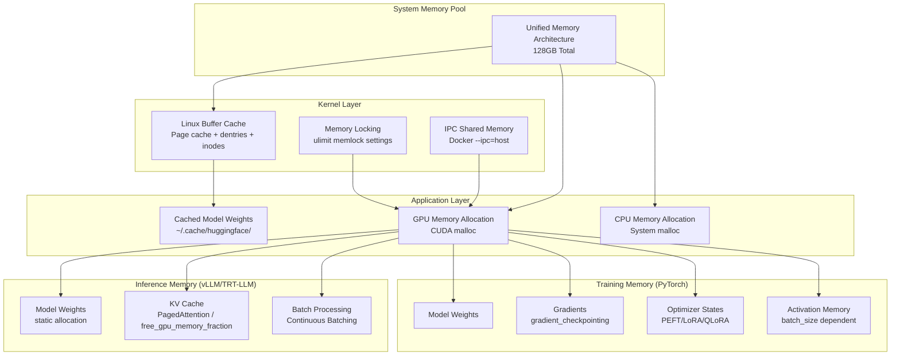
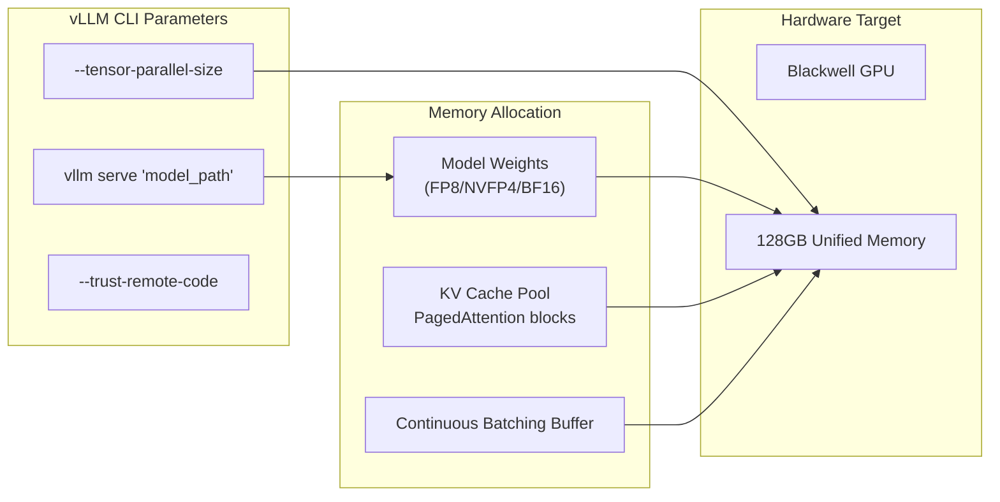

<!-- source: DeepWiki mcp.deepwiki.com · repo NVIDIA/dgx-spark-playbooks · page 8.3 Memory Management · fetched 2026-10-26 -->

# Memory Management

<details>
<summary>Relevant source files</summary>

The following files were used as context for generating this wiki page:

- [nvidia/multi-agent-chatbot/README.md](nvidia/multi-agent-chatbot/README.md)
- [nvidia/pytorch-fine-tune/README.md](nvidia/pytorch-fine-tune/README.md)
- [nvidia/trt-llm/README.md](nvidia/trt-llm/README.md)
- [nvidia/vllm/README.md](nvidia/vllm/README.md)

</details>


This document covers memory management strategies for running inference and training workloads on DGX Spark. It explains the Unified Memory Architecture, buffer cache management, batch sizing, KV cache configuration, Docker memory limits, and techniques for avoiding out-of-memory (OOM) errors during model loading and inference.

---

## Unified Memory Architecture (UMA)

DGX Spark uses Unified Memory Architecture, which enables dynamic memory sharing between the GPU and CPU from a single 128GB memory pool. Unlike traditional discrete GPU systems with separate CPU RAM and GPU VRAM, UMA allows the system to allocate memory flexibly based on workload demands [nvidia/multi-agent-chatbot/README.md:148-150]().

### UMA Characteristics

| Aspect | Traditional Architecture | DGX Spark UMA |
|--------|-------------------------|---------------|
| Total Memory | CPU RAM + GPU VRAM (separate pools) | 128GB unified pool |
| Memory Transfer | Explicit copy operations required | Transparent sharing |
| Allocation | Static per-device limits | Dynamic based on demand |
| Management | Application-controlled | System-managed with manual override |

### Buffer Cache Behavior

The Linux kernel maintains a buffer cache that can occupy significant memory. With UMA, applications may not immediately see freed memory after processes terminate because the kernel retains cached data for performance. This behavior can lead to apparent out-of-memory conditions even when total system capacity is sufficient [nvidia/multi-agent-chatbot/README.md:148-150]().

**Manual Buffer Cache Flushing**

All playbooks include this cache-clearing command for memory recovery:

```bash
sudo sh -c 'sync; echo 3 > /proc/sys/vm/drop_caches'
```
[nvidia/multi-agent-chatbot/README.md:151-153]()

This command performs three operations:
1. `sync` - Writes cached data to disk.
2. `echo 3` - Clears page cache, dentries, and inodes.
3. Redirection to `/proc/sys/vm/drop_caches` - Executes the flush.

**When to Flush Buffer Cache:**
- Before launching large model inference servers.
- After stopping containers or processes.
- When encountering OOM errors despite available capacity [nvidia/multi-agent-chatbot/README.md:149-150]().
- Between training runs or fine-tuning sessions.

Sources: [nvidia/multi-agent-chatbot/README.md:148-153]()

---

## Memory Management Components



**Memory Component Hierarchy on DGX Spark**

This diagram shows how the 128GB unified memory pool is accessed by different system layers. The kernel buffer cache sits between UMA and applications. Inference engines like `vLLM` [nvidia/vllm/README.md:19-23]() and `TensorRT-LLM` [nvidia/trt-llm/README.md:38-40]() manage memory through specific optimization techniques like PagedAttention and efficient kernels.

Sources: [nvidia/vllm/README.md:19-23](), [nvidia/trt-llm/README.md:36-40](), [nvidia/multi-agent-chatbot/README.md:148-150]()

---

## Docker Memory Configuration

Container runtime memory limits must be configured properly for GPU workloads on DGX Spark.

### Memory Lock Limits

The `memlock` (memory lock) ulimit controls how much memory a process can lock into RAM, preventing it from being swapped to disk. GPU applications require unlimited memlock to pin memory for DMA transfers.

```bash
docker run --ulimit memlock=-1 --ulimit stack=67108864 ...
```

| Parameter | Value | Purpose |
|-----------|-------|---------|
| `--ulimit memlock=-1` | Unlimited | Allows GPU memory pinning for DMA |
| `--ulimit stack=67108864` | 64MB | Stack size for deep call chains |

### IPC Namespace Sharing

PyTorch uses shared memory for efficient multi-process data loading and tensor operations. The `--ipc=host` flag enables the container to use the host's IPC namespace, avoiding shared memory limitations.

```bash
docker run --ipc=host ...
```
[nvidia/pytorch-fine-tune/README.md:86-90]()

**Without `--ipc=host`:** Default shared memory is limited to 64MB, which often causes errors in training scripts like `Llama3_70B_LoRA_finetuning.py` [nvidia/pytorch-fine-tune/README.md:123]().

### Code References for Docker Memory Configuration

**PyTorch Fine-tuning:**
```bash
docker run --gpus all -it --rm --ipc=host \
-v $HOME/.cache/huggingface:/root/.cache/huggingface \
-v ${PWD}:/workspace -w /workspace \
nvcr.io/nvidia/pytorch:25.11-py3
```
[nvidia/pytorch-fine-tune/README.md:86-90]()

**TensorRT-LLM single-node inference:**
The TRT-LLM environment relies on the NVIDIA Container Toolkit to manage GPU resources within Docker [nvidia/trt-llm/README.md:60]().

Sources: [nvidia/pytorch-fine-tune/README.md:86-90](), [nvidia/trt-llm/README.md:60]()

---

## Inference Memory Management

### vLLM Memory Configuration

vLLM uses **PagedAttention** to handle long sequences without running out of GPU memory [nvidia/vllm/README.md:21](). It also implements **continuous batching** to keep GPUs fully utilized [nvidia/vllm/README.md:22]().



**vLLM Memory and Model Serving**

The `vllm serve` command [nvidia/vllm/README.md:131-133]() initiates the model loading process. For very large models like **Nemotron-3-Super-120B**, memory management is critical as the model size approaches the Spark memory limit [nvidia/vllm/README.md:56]().

**Quantization for Memory Savings:**
Using NVFP4 or FP8 quantization significantly reduces the memory footprint of weights [nvidia/vllm/README.md:82](). For example, `Llama-3.3-70B-Instruct-NVFP4` [nvidia/vllm/README.md:61]() consumes much less memory than the BF16 equivalent.

Sources: [nvidia/vllm/README.md:19-23](), [nvidia/vllm/README.md:56-76](), [nvidia/vllm/README.md:131-133]()

### TensorRT-LLM Memory Configuration

TensorRT-LLM achieves efficiency through highly efficient kernels and advanced memory layouts [nvidia/trt-llm/README.md:38-40]().

**Multi-node Memory Considerations:**
When running on two Sparks, the memory workload is distributed. For example, `Qwen3-235B-A22B` requires two Sparks to fit the model parameters into the unified memory pool [nvidia/trt-llm/README.md:95]().

Sources: [nvidia/trt-llm/README.md:38-40](), [nvidia/trt-llm/README.md:95]()

---

## Training Memory Management

Training workloads in PyTorch require memory for model weights, gradients, optimizer states, and activations.

### Parameter-Efficient Fine-Tuning (PEFT)

PEFT techniques like **LoRA** and **QLoRA** are the primary strategies for managing memory during fine-tuning on Spark [nvidia/pytorch-fine-tune/README.md:32-33]().

| Technique | Script Example | Target Model | Memory Benefit |
|-----------|----------------|--------------|----------------|
| **LoRA** | `Llama3_8B_LoRA_finetuning.py` | Llama 3.1 8B | Only trains adapter weights [nvidia/pytorch-fine-tune/README.md:122]() |
| **QLoRA** | `Llama3_70B_qLoRA_finetuning.py` | Llama 3.1 70B | 4-bit quantization of base model [nvidia/pytorch-fine-tune/README.md:124]() |
| **Full SFT**| `Llama3_3B_full_finetuning.py` | Llama 3.2 3B | Limited to smaller models [nvidia/pytorch-fine-tune/README.md:121]() |

### Memory Reduction Parameters

The PyTorch scripts support arguments to tune memory usage:
- `--batch_size`: Controls activation memory per device [nvidia/pytorch-fine-tune/README.md:150]().
- `--gradient_accumulation_steps`: Simulates larger batches without increasing memory [nvidia/pytorch-fine-tune/README.md:153]().
- `--gradient_checkpointing`: Trades compute for memory by not storing all activations [nvidia/pytorch-fine-tune/README.md:155]().
- `--lora_rank`: Lower rank reduces the number of trainable parameters [nvidia/pytorch-fine-tune/README.md:158]().

Sources: [nvidia/pytorch-fine-tune/README.md:119-125](), [nvidia/pytorch-fine-tune/README.md:141-155]()

---

## Model Download and Cache Management

Large models consume significant disk space and can cause memory pressure during the download/loading phase.

### Hugging Face Cache

Models are typically cached in:
```bash
$HOME/.cache/huggingface
```
[nvidia/pytorch-fine-tune/README.md:87]()

**Download Impact:**
Downloading models like `gpt-oss-120B` (~63GB) can take significant time and requires substantial disk space [nvidia/multi-agent-chatbot/README.md:50]().

### Automated Download Scripts

The `model_download.sh` script in the multi-agent playbook automates the retrieval of GGUF files to the local filesystem [nvidia/multi-agent-chatbot/README.md:84-86]().

Sources: [nvidia/pytorch-fine-tune/README.md:87](), [nvidia/multi-agent-chatbot/README.md:50](), [nvidia/multi-agent-chatbot/README.md:84-86]()

---

## Troubleshooting Memory Issues

### Common OOM Scenarios and Solutions

| Symptom | Cause | Fix |
|---------|-------|-----|
| OOM during multi-agent startup | Total memory usage exceeds 128GB | Switch to a smaller supervisor model like `gpt-oss-20B` [nvidia/multi-agent-chatbot/README.md:42](). |
| Permission denied for Docker | User not in `docker` group | `sudo usermod -aG docker $USER` [nvidia/vllm/README.md:109](). |
| Apparent OOM despite available capacity | Linux buffer cache holding memory | `sudo sh -c 'sync; echo 3 > /proc/sys/vm/drop_caches'` [nvidia/multi-agent-chatbot/README.md:152](). |
| Training crash on 70B model | Full SFT attempted on large model | Use `Llama3_70B_qLoRA_finetuning.py` [nvidia/pytorch-fine-tune/README.md:124](). |

### Verification Commands

**Check GPU Memory Usage:**
```bash
nvidia-smi
```
[nvidia/trt-llm/README.md:136]()

**Check Container Status:**
```bash
docker ps --format "table {{.ID}}\t{{.Names}}\t{{.Status}}"
```
[nvidia/multi-agent-chatbot/README.md:103]()

Sources: [nvidia/multi-agent-chatbot/README.md:41-43](), [nvidia/multi-agent-chatbot/README.md:148-153](), [nvidia/vllm/README.md:101-111](), [nvidia/pytorch-fine-tune/README.md:119-125]()

---

