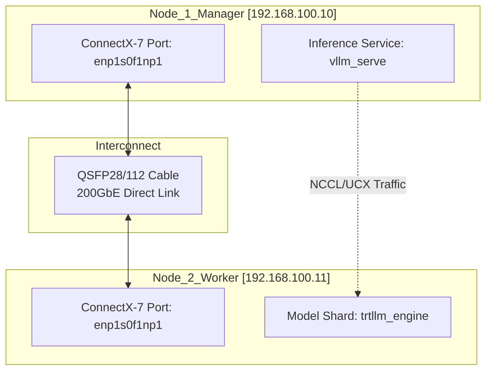
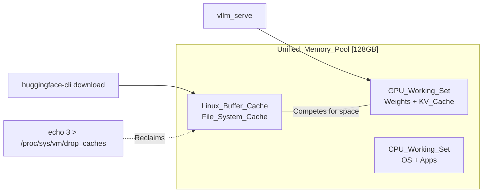

<!-- source: DeepWiki mcp.deepwiki.com · repo NVIDIA/dgx-spark-playbooks · page 9 Advanced Topics · fetched 2026-10-26 -->

# Advanced Topics

Relevant source files

The following files were used as context for generating this wiki page:

- [nvidia/connect-two-sparks/README.md](nvidia/connect-two-sparks/README.md)
- [nvidia/multi-modal-inference/README.md](nvidia/multi-modal-inference/README.md)
- [nvidia/nccl/README.md](nvidia/nccl/README.md)
- [nvidia/nim-llm/README.md](nvidia/nim-llm/README.md)
- [nvidia/tailscale/README.md](nvidia/tailscale/README.md)
- [nvidia/vss/README.md](nvidia/vss/README.md)

This section provides a high-level overview of advanced system architecture, multi-node configurations, and deep-dive technical topics for the NVIDIA DGX Spark. It serves as a gateway to specialized child pages covering memory architecture, container orchestration, and complex troubleshooting.

For fundamental single-node setups, refer to [Inference Systems](#4). For initial connectivity, see [Getting Started](#2).

---

## System Architecture and Multi-Node Infrastructure

Advanced workloads on DGX Spark often span multiple nodes to accommodate models that exceed single-device memory or to increase throughput via tensor parallelism. This infrastructure relies on high-speed physical interconnects and specific software bindings.

### Physical and Network Layer
Multi-node configurations utilize 200GbE ConnectX-7 interfaces for direct peer-to-peer communication. Each physical port on the DGX Spark is presented with dual naming conventions, though playbooks standardize on the `enp1` prefix [nvidia/connect-two-sparks/README.md:83-98]().

**Sources:** [nvidia/connect-two-sparks/README.md:17-25](), [nvidia/nccl/README.md:92-109]()

### Communication Frameworks
Distributed execution is powered by four primary libraries, each requiring explicit binding to the high-speed interface via environment variables [nvidia/vllm/README.md:164-174]():
*   **NCCL**: Handles GPU-to-GPU collective operations (`NCCL_SOCKET_IFNAME`).
*   **UCX**: Provides high-performance point-to-point communication for Ray (`UCX_NET_DEVICES`).
*   **GLOO**: Manages CPU-side coordination for PyTorch distributed groups (`GLOO_SOCKET_IFNAME`).
*   **OpenMPI**: Facilitates process launching across nodes via `mpirun` (`OMPI_MCA_btl_tcp_if_include`).

For details on interface configuration and automated discovery, see [Network Configuration](#9.3).

---

## Unified Memory Architecture (UMA)

The DGX Spark features a Unified Memory Architecture where the Blackwell GPU and ARM64 CPU share a high-bandwidth 128GB memory pool. While this enables running massive models like Llama 3.3 70B via Tensor Parallelism [nvidia/vllm/README.md:220-224](), it introduces unique challenges regarding the Linux Buffer Cache.

### Memory Pressure and Cache Management
The system's shared pool is susceptible to "Memory Pressure" where the OS page cache (buffer cache) competes with GPU allocations. This often manifests as Out-of-Memory (OOM) errors during model loading or switching [nvidia/vllm/README.md:353-359]().

**Sources:** [nvidia/vllm/README.md:353-359](), [nvidia/trt-llm/README.md:748-754]()

For optimization strategies and UMA best practices, see [Unified Memory Architecture](#9.1).

---

## Advanced Container Orchestration

Deploying production-grade AI services on DGX Spark involves advanced Docker configurations, including GPU resource advertising for Docker Swarm and complex volume mounting for model persistence.

### Orchestration Patterns
1.  **Ray Clusters**: Primarily used for `vLLM` to manage distributed inference across nodes [nvidia/vllm/README.md:129-193]().
2.  **Docker Swarm + MPI**: Utilized by `TensorRT-LLM` for launching multi-node processes while managing GPU UUID advertising [nvidia/trt-llm/README.md:443-503]().

### Resource Advertising
To enable Swarm to recognize Blackwell GPUs, the `nvidia-container-runtime` must be configured to advertise specific GPU UUIDs as generic resources [nvidia/trt-llm/README.md:443-483]().

| Feature | Configuration File | Purpose |
| :--- | :--- | :--- |
| **GPU UUID** | `/etc/docker/daemon.json` | Registers `NVIDIA_GPU` as a swarm resource |
| **Swarm Resource** | `/etc/nvidia-container-runtime/config.toml` | Enables `swarm-resource` flag for discovery |
| **IPC Mode** | `docker-compose.yml` | Sets `ipc: host` for high-speed shared memory |

For details on Swarm setup and GPU passthrough, see [Docker and Container Configuration](#9.2).

---

## Troubleshooting and System Maintenance

Advanced usage inevitably encounters edge cases involving network timeouts, container registry authentication, or hardware-specific driver issues.

### Common Failure Points
*   **Gated Model Access**: Issues with `HF_TOKEN` when accessing Llama or Nemotron models [nvidia/vllm/README.md:347-349]().
*   **Port Conflicts**: Overlapping service ports (e.g., multiple containers attempting to bind to `:8000`) [nvidia/trt-llm/README.md:653-708]().
*   **Build Failures**: Missing Blackwell-specific LLVM patches when attempting to build vLLM from source [nvidia/vllm/README.md:337-341]().

For a comprehensive matrix of symptoms and solutions, see the [Troubleshooting Guide](#9.4).

**Sources:**
*   [nvidia/connect-two-sparks/README.md:1-254]()
*   [nvidia/nccl/README.md:1-189]()
*   [nvidia/vllm/README.md:1-359]()
*   [nvidia/trt-llm/README.md:1-754]()
*   [nvidia/tailscale/README.md:1-210]()

---

