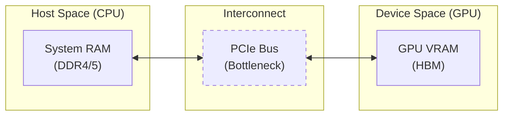
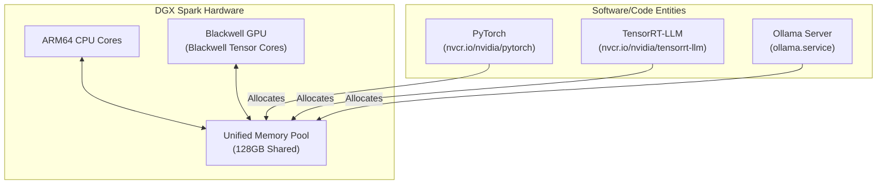
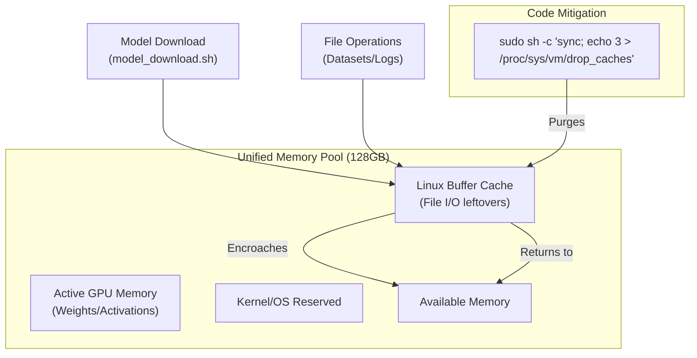

<!-- source: DeepWiki mcp.deepwiki.com · repo NVIDIA/dgx-spark-playbooks · page 9.1 Unified Memory Architecture · fetched 2026-10-26 -->

# Unified Memory Architecture

<details>
<summary>Relevant source files</summary>

The following files were used as context for generating this wiki page:

- [nvidia/multi-agent-chatbot/README.md](nvidia/multi-agent-chatbot/README.md)
- [nvidia/nvfp4-quantization/README.md](nvidia/nvfp4-quantization/README.md)
- [nvidia/pytorch-fine-tune/README.md](nvidia/pytorch-fine-tune/README.md)

</details>


## Purpose and Scope

This document provides a technical overview of the Unified Memory Architecture (UMA) in DGX Spark devices. It explains how dynamic CPU-GPU memory sharing works, its implementation within the Blackwell architecture, and provides technical guidance on managing the Linux buffer cache to prevent memory contention. This page serves as a deep dive into the system behavior described in the [Hardware Platform](1.1) and [Troubleshooting Guide](9.4) sections.

---

## Architecture Overview

DGX Spark implements a Unified Memory Architecture (UMA) that enables dynamic memory sharing between the CPU and GPU. Unlike traditional discrete GPU systems where GPU VRAM and system RAM are separate pools connected via PCIe, UMA provides a single 128GB memory pool accessible by both the Blackwell GPU and the ARM64 CPU cores.

The UMA design eliminates the traditional PCIe bottleneck for data transfers, enabling seamless memory access patterns. This is particularly critical for Large Language Models (LLMs) and Vision-Language Models (VLMs) that require substantial memory capacity for weights, KV caches, and activations.

Sources: [nvidia/multi-agent-chatbot/README.md:17-22](), [nvidia/nvfp4-quantization/README.md:17-20](), [nvidia/pytorch-fine-tune/README.md:32-34]()

### Technical Comparison: Discrete vs. Unified

#### Traditional Discrete GPU Architecture
In discrete systems, data must be explicitly copied between system RAM and GPU VRAM using CUDA memory management APIs (e.g., `cudaMemcpy`).

**Discrete Data Flow:**


#### DGX Spark Unified Memory Architecture
In DGX Spark, the Blackwell GPU and ARM64 CPU access the same physical memory pool. There is no "Host-to-Device" copy overhead in the traditional sense.

**UMA Data Flow (Code Entity Mapping):**


Sources: [nvidia/nvfp4-quantization/README.md:17-20](), [nvidia/pytorch-fine-tune/README.md:80-90](), [nvidia/multi-agent-chatbot/README.md:148-150]()

---

## Memory Capacity and Model Support

The 128GB unified pool allows DGX Spark to handle models that typically require multi-GPU setups. 

| Model Size | Precision | Memory Usage (Est.) | Capability |
|------------|-----------|---------------------|------------|
| 3B - 8B    | FP16/BF16 | 12GB - 18GB         | Full Fine-tuning / High-throughput Inference |
| 8B         | NVFP4     | ~5GB - 6GB          | Ultra-low footprint inference |
| 70B        | LoRA/QLoRA| 40GB - 80GB         | Parameter-efficient fine-tuning (PEFT) |
| 120B+      | GGUF/Quant| 100GB - 120GB       | Large model serving (e.g., gpt-oss-120B) |

### Quantization Benefits (NVFP4)
The Blackwell architecture natively supports **NVFP4** (4-bit floating point), which cuts memory use by ~3.5x compared to FP16 while maintaining accuracy within 1% of FP8. This is essential for fitting massive models like DeepSeek-R1-Distill-Llama-8B or larger variants into the 128GB pool.

Sources: [nvidia/nvfp4-quantization/README.md:17-25](), [nvidia/pytorch-fine-tune/README.md:119-124](), [nvidia/multi-agent-chatbot/README.md:40-43]()

---

## Buffer Cache Management

### The Memory Contention Challenge
A side effect of UMA is that the Linux kernel's **Buffer Cache** (which caches disk I/O to improve filesystem performance) competes for the same 128GB pool as the GPU. When large models are downloaded or processed, the kernel may fill the UMA pool with cached file data, leading to `CUDA Out of Memory` errors even if the GPU isn't actively using that memory.

**Buffer Cache Conflict Diagram:**


Sources: [nvidia/multi-agent-chatbot/README.md:148-153](), [nvidia/nvfp4-quantization/README.md:65-66](), [nvidia/pytorch-fine-tune/README.md:52-53]()

### Best Practices for Memory Flushing
To ensure maximum availability for GPU workloads, the buffer cache should be manually flushed in the following scenarios:
1. **After Model Downloads**: Commands like `model_download.sh` pull tens of gigabytes (e.g., gpt-oss-120B at ~63GB), which stay in the buffer cache.
2. **Before Training/Inference**: Especially when running large scripts like `Llama3_70B_qLoRA_finetuning.py`.
3. **Between Model Switches**: When moving from one LLM to another in the multi-agent chatbot.

**The Flush Command:**
```bash
sudo sh -c 'sync; echo 3 > /proc/sys/vm/drop_caches'
```

Sources: [nvidia/multi-agent-chatbot/README.md:81-90, 151-153](), [nvidia/pytorch-fine-tune/README.md:124-125]()

---

## Implementation in Playbooks

### PyTorch Fine-tuning
In the PyTorch playbook, UMA allows for Supervised Fine-Tuning (SFT) and Parameter-Efficient Fine-Tuning (PEFT) of models up to 70B.
- **Full SFT**: Supported for 3B models (e.g., `Llama3_3B_full_finetuning.py`).
- **LoRA/QLoRA**: Required for 70B models to stay within the 128GB UMA limit (e.g., `Llama3_70B_qLoRA_finetuning.py`).

Sources: [nvidia/pytorch-fine-tune/README.md:119-124, 131-138]()

### Multi-Agent Systems
The multi-agent chatbot leverages UMA to run a supervisor model (e.g., gpt-oss-120B) alongside downstream agents (Deepseek-Coder, Qwen-Embedding).
- **Memory Pressure**: This workload uses ~120GB of the 128GB pool.
- **Monitoring**: Users are advised to check `nvidia-smi` to ensure no other processes are consuming the shared pool.

Sources: [nvidia/multi-agent-chatbot/README.md:17-22, 40-43]()

---

## Troubleshooting Memory Issues

| Symptom | Probable Cause | Fix |
|---------|----------------|-----|
| `CUDA Out of Memory` during model load | Buffer cache is full from previous downloads. | Run the `sync; echo 3` flush command. |
| `pynvml.NVMLError_NotSupported` | Expected behavior in some Blackwell environments. | Ignore; it does not affect quantization results. |
| Model download takes 2+ hours | Network bottleneck filling cache slowly. | Ensure stable connection; flush cache after completion. |
| Slow training performance | Swapping or memory contention with other containers. | Stop all other containers using `docker stop $(docker ps -q)`. |

Sources: [nvidia/multi-agent-chatbot/README.md:143-153](), [nvidia/nvfp4-quantization/README.md:134-135](), [nvidia/pytorch-fine-tune/README.md:52-53]()

---

