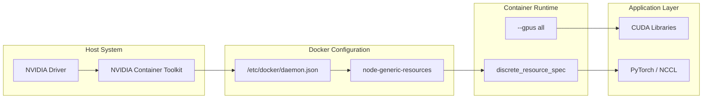
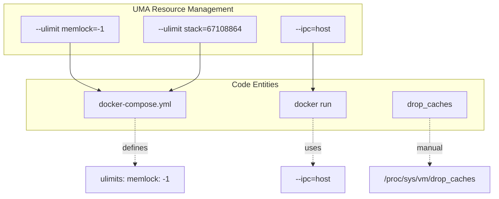

<!-- source: DeepWiki mcp.deepwiki.com · repo NVIDIA/dgx-spark-playbooks · page 9.2 Docker and Container Configuration · fetched 2026-10-26 -->

# Docker and Container Configuration

<details>
<summary>Relevant source files</summary>

The following files were used as context for generating this wiki page:

- [nvidia/multi-agent-chatbot/README.md](nvidia/multi-agent-chatbot/README.md)
- [nvidia/pytorch-fine-tune/README.md](nvidia/pytorch-fine-tune/README.md)
- [nvidia/pytorch-fine-tune/assets/docker-compose.yml](nvidia/pytorch-fine-tune/assets/docker-compose.yml)

</details>


## Purpose and Scope

This page covers advanced Docker and container configuration required for running AI workloads on DGX Spark. It documents GPU passthrough, memory management, volume mounting strategies, network configuration, and multi-node orchestration. This includes specific configurations for the Unified Memory Architecture (UMA) and Docker Swarm for distributed training and inference.

---

## Docker Permissions and User Configuration

All playbooks require proper Docker permissions to run containers without `sudo`. The standard pattern across the codebase adds users to the `docker` group.

**Permission Setup Pattern**

```bash
# Test current permissions
docker ps

# Add user to docker group if permission denied
sudo usermod -aG docker $USER
newgrp docker
```

This pattern is critical for maintaining correct file permissions on volume mounts and is documented in [nvidia/pytorch-fine-tune/README.md:60-75]() and [nvidia/multi-agent-chatbot/README.md:57-72]().

**Sources:** [nvidia/pytorch-fine-tune/README.md:60-75](), [nvidia/multi-agent-chatbot/README.md:57-72]()

---

## GPU Passthrough Configuration

All inference and training workloads require GPU access through the NVIDIA Container Toolkit. The repository uses consistent patterns for GPU passthrough to ensure CUDA visibility.

### GPU Access Architecture



**Standard GPU Passthrough Flags**

The playbook for PyTorch fine-tuning demonstrates the standard CLI approach for single-node GPU access:
`docker run --gpus all -it --rm --ipc=host` [nvidia/pytorch-fine-tune/README.md:86]().

For multi-node or Swarm deployments, the configuration shifts to `discrete_resource_spec` within a Compose file:
```yaml
reservations:
  generic_resources:
    - discrete_resource_spec:
        kind: 'NVIDIA_GPU'
        value: 1
```
[nvidia/pytorch-fine-tune/assets/docker-compose.yml:14-18]()

**Sources:** [nvidia/pytorch-fine-tune/README.md:86-90](), [nvidia/pytorch-fine-tune/assets/docker-compose.yml:13-18]()

---

## Volume Mounts and Data Persistence

Containers are ephemeral, so volume mounts provide persistent storage for models (often >50GB), datasets, and fine-tuning outputs.

### Volume Mount Mapping

| Use Case | Host Path | Container Path | Reference |
|----------|-----------|----------------|-----------|
| HuggingFace Cache | `~/.cache/huggingface/` | `/root/.cache/huggingface/` | [nvidia/pytorch-fine-tune/assets/docker-compose.yml:31]() |
| Workspace/Code | `${PWD}` | `/workspace` | [nvidia/pytorch-fine-tune/README.md:88]() |
| SSH Keys (RO) | `~/.ssh` | `/tmp/.ssh:ro` | [nvidia/pytorch-fine-tune/assets/docker-compose.yml:32]() |
| Postgres Data | Named Volume | `/var/lib/postgresql/data` | [nvidia/multi-agent-chatbot/README.md:132]() |

**Best Practices**
1. **Model Persistence**: Always mount the HuggingFace cache to avoid multi-hour downloads for large models like `gpt-oss-120B` [nvidia/multi-agent-chatbot/README.md:89-90]().
2. **Read-Only Mounts**: Sensitive files like SSH keys should be mounted as read-only (`:ro`) [nvidia/pytorch-fine-tune/assets/docker-compose.yml:32]().

**Sources:** [nvidia/pytorch-fine-tune/README.md:86-90](), [nvidia/pytorch-fine-tune/assets/docker-compose.yml:28-32](), [nvidia/multi-agent-chatbot/README.md:132]()

---

## Memory Management and UMA Configuration

DGX Spark's Unified Memory Architecture (UMA) requires specific container configurations to prevent allocation failures and optimize performance.

### Memory Optimization Pattern



**Required Memory Flags**
- **`memlock: -1`**: Disables the limit on locked memory, essential for CUDA pinned memory allocations [nvidia/pytorch-fine-tune/assets/docker-compose.yml:34]().
- **`stack: 67108864`**: Increases the stack size to 64MB to handle deep recursion in complex LLM frameworks [nvidia/pytorch-fine-tune/assets/docker-compose.yml:35]().
- **`--ipc=host`**: Allows the container to use the host's shared memory, which is critical for multi-process training (e.g., PyTorch DataLoaders) [nvidia/pytorch-fine-tune/README.md:86]().

**Buffer Cache Management**
Due to UMA sharing memory between CPU and GPU, the Linux buffer cache can occasionally starve GPU processes. Manual flushing is recommended:
`sudo sh -c 'sync; echo 3 > /proc/sys/vm/drop_caches'` [nvidia/multi-agent-chatbot/README.md:152]().

**Sources:** [nvidia/pytorch-fine-tune/README.md:86-90](), [nvidia/pytorch-fine-tune/assets/docker-compose.yml:33-35](), [nvidia/multi-agent-chatbot/README.md:148-153]()

---

## Multi-Node Container Orchestration (Docker Swarm)

For workloads spanning multiple DGX Spark devices, Docker Swarm is used to manage container placement and networking.

### Distributed Training Configuration

When running on two or more Sparks, the environment must be configured for the specific network interface used for GPU-to-GPU communication (e.g., `enp1s0f1np1`).

**Environment Variables for Distributed Workloads:**
- `UCX_NET_DEVICES`: Specifies the network interface for UCX communication [nvidia/pytorch-fine-tune/assets/docker-compose.yml:20]().
- `NCCL_SOCKET_IFNAME`: Defines the interface for the NVIDIA Collective Communications Library [nvidia/pytorch-fine-tune/assets/docker-compose.yml:21]().
- `NCCL_DEBUG=INFO`: Enables verbose logging for troubleshooting interconnect issues [nvidia/pytorch-fine-tune/assets/docker-compose.yml:22]().

**Swarm Deployment Workflow:**
1. **Initialize Swarm**: On the manager node [nvidia/pytorch-fine-tune/README.md:14]().
2. **Resource Advertising**: Configure `daemon.json` to advertise the GPU as a generic resource [nvidia/pytorch-fine-tune/README.md:13]().
3. **Deploy Stack**: Use `docker stack deploy` with a Compose file specifying replicas and resource reservations [nvidia/pytorch-fine-tune/assets/docker-compose.yml:6-18]().

**Sources:** [nvidia/pytorch-fine-tune/README.md:9-19](), [nvidia/pytorch-fine-tune/assets/docker-compose.yml:19-26]()

---

## Network Configuration and Port Mapping

Containers interact with the host and other nodes via specific network modes.

| Mode | Usage | Reference |
|------|-------|-----------|
| `host` | Used for multi-node training to eliminate network abstraction overhead. | [nvidia/pytorch-fine-tune/assets/docker-compose.yml:37]() |
| `bridge` | Default for local multi-container apps (e.g., Chatbot UI + API). | [nvidia/multi-agent-chatbot/README.md:96]() |

**Common Port Allocations:**
- **3000**: Frontend UI for Multi-Agent Chatbot [nvidia/multi-agent-chatbot/README.md:108]().
- **8000**: Backend API for Multi-Agent Chatbot [nvidia/multi-agent-chatbot/README.md:111]().

**Sources:** [nvidia/pytorch-fine-tune/assets/docker-compose.yml:36-47](), [nvidia/multi-agent-chatbot/README.md:108-113]()

---

## Troubleshooting Container Issues

| Symptom | Probable Cause | Fix |
|---------|----------------|-----|
| `Permission denied` on `docker ps` | User not in `docker` group | Run `sudo usermod -aG docker $USER` [nvidia/pytorch-fine-tune/README.md:73](). |
| Out of Memory (OOM) | UMA Buffer cache saturation | Run `sync; echo 3 > /proc/sys/vm/drop_caches` [nvidia/multi-agent-chatbot/README.md:152](). |
| NCCL Connection Timeout | Incorrect `NCCL_SOCKET_IFNAME` | Verify interface name with `ip addr` and update Compose [nvidia/pytorch-fine-tune/assets/docker-compose.yml:21](). |
| Container cannot find GPU | Missing `--gpus all` flag | Ensure NVIDIA runtime is default or flag is present [nvidia/pytorch-fine-tune/README.md:86](). |

**Sources:** [nvidia/pytorch-fine-tune/README.md:70-75](), [nvidia/multi-agent-chatbot/README.md:148-153](), [nvidia/pytorch-fine-tune/assets/docker-compose.yml:21]()

---

