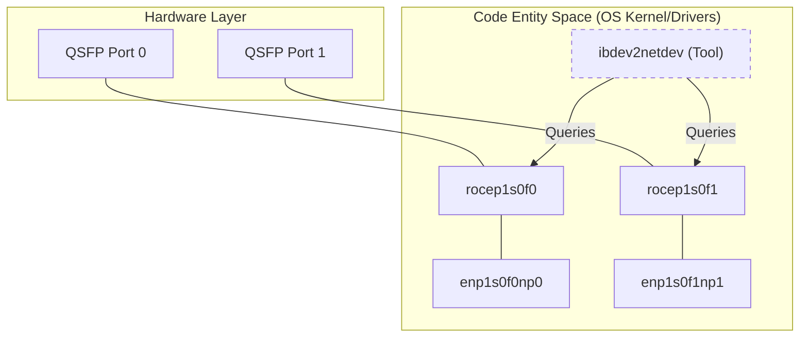
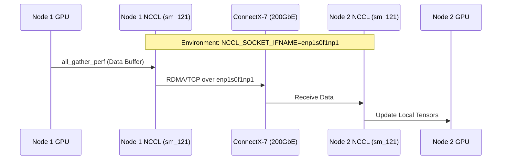

<!-- source: DeepWiki mcp.deepwiki.com · repo NVIDIA/dgx-spark-playbooks · page 9.3 Network Configuration · fetched 2026-10-26 -->

# Network Configuration

<details>
<summary>Relevant source files</summary>

The following files were used as context for generating this wiki page:

- [nvidia/connect-two-sparks/README.md](nvidia/connect-two-sparks/README.md)
- [nvidia/connect-two-sparks/assets/performance_benchmarking_guide.md](nvidia/connect-two-sparks/assets/performance_benchmarking_guide.md)
- [nvidia/multi-modal-inference/README.md](nvidia/multi-modal-inference/README.md)
- [nvidia/nccl/README.md](nvidia/nccl/README.md)

</details>


This page provides advanced technical details for configuring networking on DGX Spark systems, focusing on multi-node connectivity, high-speed interface management via ConnectX-7 (CX-7), and optimization of the NVIDIA Collective Communications Library (NCCL).

## Network Interface Architecture

DGX Spark devices utilize ConnectX-7 (CX-7) adapters providing 200GbE throughput. A critical aspect of the configuration is identifying the correct logical interface associated with the physical QSFP ports.

### Physical to Logical Mapping

Each physical QSFP port is represented by two sets of interface names in the OS. For consistent configuration, the primary naming convention (`enp1...`) should be used.

| Physical Port | Primary Interface Name | Alternate Interface Name | RoCE Device |
| :--- | :--- | :--- | :--- |
| **QSFP Port 0** | `enp1s0f0np0` | `enP2p1s0f0np0` | `rocep1s0f0` |
| **QSFP Port 1** | `enp1s0f1np1` | `enP2p1s0f1np1` | `rocep1s0f1` |

**Sources:** [nvidia/connect-two-sparks/README.md:84-102](), [nvidia/nccl/README.md:92-109]()

### Interface Discovery and Status
The `ibdev2netdev` utility is the authoritative tool for mapping InfiniBand/RoCE devices to Ethernet interfaces and checking link status.


**Sources:** [nvidia/connect-two-sparks/README.md:92-97](), [nvidia/nccl/README.md:92-107]()

---

## Multi-Node Setup and IP Assignment

Connecting multiple Spark devices requires specific IP configurations to enable NCCL and MPI communication.

### Configuration Methods

#### 1. Netplan (Persistent)
Netplan is used for persistent configuration across reboots. For two-node setups, manual static assignment is recommended to ensure deterministic addressing for `mpirun` and `Ray` clusters.

**Example Static Config (`/etc/netplan/40-cx7.yaml`):**
```yaml
network:
  version: 2
  ethernets:
    enp1s0f1np1:
      addresses:
        - 192.168.100.10/24
      dhcp4: no
```
**Sources:** [nvidia/connect-two-sparks/README.md:136-168]()

#### 2. Runtime Assignment (Ephemeral)
For testing, IPs can be assigned directly via the `ip` utility. This configuration is lost upon reboot.
```bash
sudo ip addr add 192.168.100.10/24 dev enp1s0f1np1
sudo ip link set enp1s0f1np1 up
```
**Sources:** [nvidia/connect-two-sparks/README.md:203-238]()

---

## NCCL and Communication Frameworks

The NVIDIA Collective Communication Library (NCCL) is the backbone for multi-node GPU workloads. On DGX Spark, NCCL must be built with Blackwell architecture support (`sm_121`).

### Building NCCL for Blackwell
To enable high-performance communication on Spark, NCCL must be compiled targeting the Blackwell compute capability.

```bash
git clone -b v2.28.9-1 https://github.com/NVIDIA/nccl.git
cd nccl/
make -j src.build NVCC_GENCODE="-gencode=arch=compute_121,code=sm_121"
```
**Sources:** [nvidia/nccl/README.md:62-79]()

### Environment Variable Optimization
To ensure traffic flows over the 200GbE CX-7 interfaces rather than the 1GbE management network, several environment variables must be explicitly exported.

| Variable | Recommended Value | Description |
| :--- | :--- | :--- |
| `NCCL_SOCKET_IFNAME` | `enp1s0f1np1` | Forces NCCL to use the CX-7 interface for socket bootstrap. |
| `UCX_NET_DEVICES` | `enp1s0f1np1` | Directs UCX (Unified Communication X) to the high-speed port. |
| `OMPI_MCA_btl_tcp_if_include` | `enp1s0f1np1` | Ensures OpenMPI traffic stays on the high-speed fabric. |

**Sources:** [nvidia/nccl/README.md:140-150]()

### Multi-Node Data Flow


**Sources:** [nvidia/nccl/README.md:131-165](), [nvidia/connect-two-sparks/assets/performance_benchmarking_guide.md:34-35]()

---

## Port Management and Firewall

When running distributed inference (e.g., vLLM or TensorRT-LLM), specific ports must be open between nodes.

| Service / Framework | Port Range | Protocol | Description |
| :--- | :--- | :--- | :--- |
| **SSH** | `22` | TCP | Required for `mpirun` and `discover-sparks.sh`. |
| **vLLM / TRT-LLM** | `8000` | TCP | Standard OpenAI-compatible API port. |
| **Ray (Head Node)** | `6379` | TCP | GCS Service for distributed scheduling. |
| **Ray Dashboard** | `8265` | TCP | Web UI for cluster monitoring. |

### Passwordless SSH
Multi-node playbooks require passwordless SSH between the same username on all nodes. The `discover-sparks.sh` script automates the distribution of `~/.ssh/id_rsa.pub` to the `authorized_keys` of peer nodes.

**Sources:** [nvidia/connect-two-sparks/README.md:60-81](), [nvidia/connect-two-sparks/assets/discover-sparks:1-45]()

---

## Troubleshooting and Validation

### Connectivity Verification
Before running large-scale workloads, validate the raw bandwidth between nodes using `nccl-tests`.

```bash
# Example mpirun for bandwidth validation
mpirun -np 2 -H <IP_NODE1>:1,<IP_NODE2>:1 \
  -x NCCL_SOCKET_IFNAME=enp1s0f1np1 \
  $HOME/nccl-tests/build/all_gather_perf -b 8G -e 16G -f 2
```
**Sources:** [nvidia/nccl/README.md:145-165]()

### Common Failure Modes

| Symptom | Probable Cause | Resolution |
| :--- | :--- | :--- |
| `mpirun` hangs | SSH key mismatch or Firewall | Verify `ssh <remote_ip>` works without a password. |
| Low bandwidth (<10 Gbps) | Traffic routed to 1GbE | Check `NCCL_SOCKET_IFNAME` and `UCX_NET_DEVICES`. |
| Interface "Down" | Physical cable or driver | Re-seat QSFP cable; check `ibdev2netdev`. |

**Sources:** [nvidia/nccl/README.md:181-190](), [nvidia/connect-two-sparks/README.md:99-101]()

---

