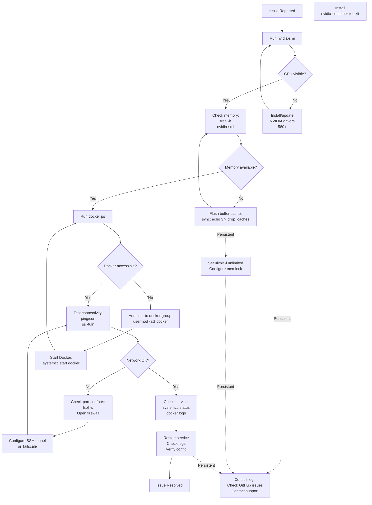
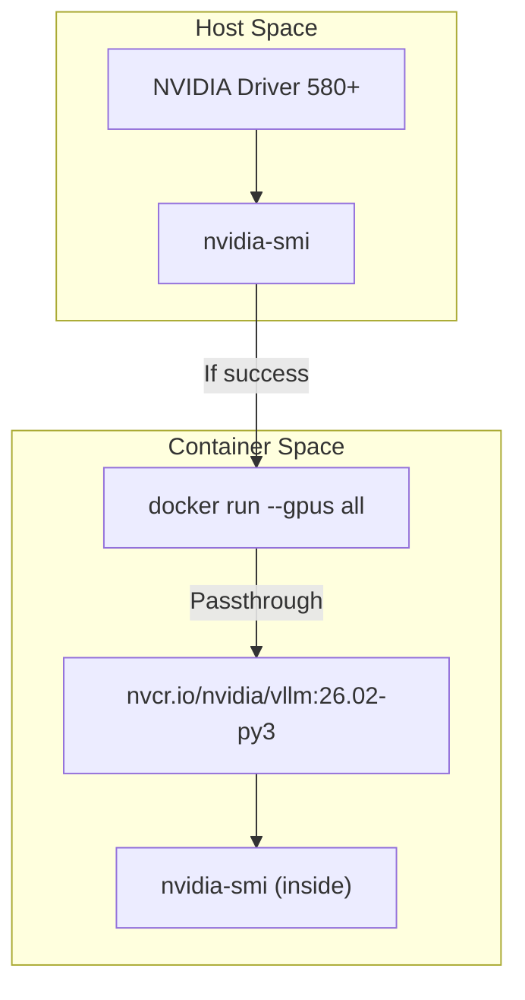
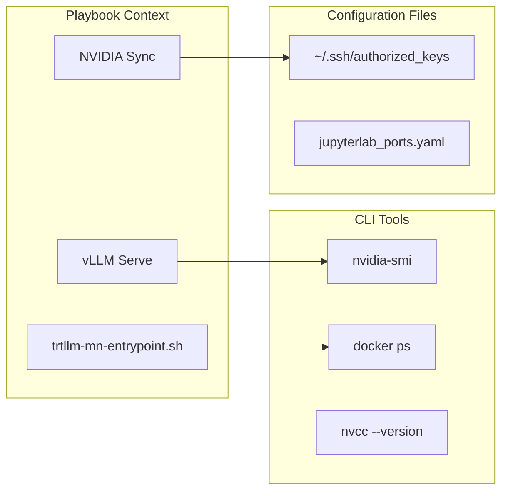

<!-- source: DeepWiki mcp.deepwiki.com · repo NVIDIA/dgx-spark-playbooks · page 9.4 Troubleshooting Guide · fetched 2026-10-26 -->

# Troubleshooting Guide

<details>
<summary>Relevant source files</summary>

The following files were used as context for generating this wiki page:

- [nvidia/connect-to-your-spark/README.md](nvidia/connect-to-your-spark/README.md)
- [nvidia/open-webui/README.md](nvidia/open-webui/README.md)
- [nvidia/trt-llm/README.md](nvidia/trt-llm/README.md)
- [nvidia/vllm/README.md](nvidia/vllm/README.md)

</details>


## Purpose and Scope

This page provides systematic troubleshooting procedures for common issues encountered on DGX Spark devices. It covers diagnostic commands, root cause analysis, and resolution steps for memory management, container operations, GPU access, networking, and service-specific problems.

For advanced networking configuration beyond basic troubleshooting, see [9.3 Network Configuration](). For understanding the underlying Unified Memory Architecture behavior, see [9.1 Unified Memory Architecture](). For Docker configuration beyond troubleshooting, see [9.2 Docker and Container Configuration]().

---

## Diagnostic Workflow

The following diagram illustrates the systematic approach to diagnosing and resolving common DGX Spark issues:

**Systematic Diagnosis Flow**


**Sources:** 
- [nvidia/vllm/README.md:11-12]()
- [nvidia/trt-llm/README.md:28]()
- [nvidia/connect-to-your-spark/README.md:10]()
- [nvidia/open-webui/README.md:10]()

---

## Memory Management Issues

DGX Spark's Unified Memory Architecture (UMA) enables dynamic memory sharing between GPU and CPU, but requires manual intervention for optimal performance due to buffer cache behavior.

### Symptom: Out of Memory Errors Despite Available Capacity

**Root Cause:** Buffer cache not releasing memory to applications.

**Diagnostic Commands:**
```bash
# Check total memory status
free -h

# Check GPU memory specifically
nvidia-smi
```

**Resolution:**
```bash
# Flush buffer cache (requires sudo)
sudo sh -c 'sync; echo 3 > /proc/sys/vm/drop_caches'
```

### Symptom: Container Fails with "Cannot allocate memory"

**Root Cause:** Memory locking (`memlock`) limits too restrictive for large model loading or lack of shared memory.

**Resolution:**

Add `--ulimit memlock=-1` and increase `--shm-size` to Docker run commands. For high-throughput inference like vLLM, ensuring sufficient shared memory is critical [nvidia/vllm/README.md:158-164]().

---

## Docker and Container Issues

### Docker Permission Errors

The following table summarizes Docker permission issues and their resolutions:

| Symptom | Diagnostic Command | Root Cause | Resolution |
|---------|-------------------|------------|------------|
| `permission denied while trying to connect to Docker daemon socket` | `docker ps` | User not in `docker` group | `sudo usermod -aG docker $USER && newgrp docker` [nvidia/vllm/README.md:108-111]() |
| `Cannot connect to Docker daemon` | `systemctl status docker` | Docker service not running | `sudo systemctl start docker` |

**Sources:**
- [nvidia/vllm/README.md:106-111]()
- [nvidia/trt-llm/README.md:122-127]()
- [nvidia/open-webui/README.md:59-64]()

### GPU Not Accessible in Container

**Diagnostic Workflow:**

**Container GPU Access Logic**


**Sources:**
- [nvidia/vllm/README.md:131-133]()
- [nvidia/trt-llm/README.md:135-141]()

### Container Build Failures

| Symptom | Cause | Resolution |
|---------|-------|------------|
| `Cannot access gated repo` | Missing `HF_TOKEN` | Set `export HF_TOKEN=<your-token>` [nvidia/trt-llm/README.md:147]() |
| `ARM64 errors` | Using x86_64 image | Ensure image is for ARM64/SBSA architecture [nvidia/vllm/README.md:41]() |

---

## GPU Driver Issues

### NVIDIA Driver Not Found

**Symptom:** `nvidia-smi` command fails or shows no devices.

**Diagnostic Commands:**
```bash
# Check if drivers are installed
nvidia-smi

# Check toolkit version
nvcc --version
```

**Sources:**
- [nvidia/vllm/README.md:42]()
- [nvidia/trt-llm/README.md:59]()

---

## Network and Connectivity Issues

### SSH and mDNS Failures

**Symptom:** Cannot connect via `spark-abcd.local`.

**Diagnostic Commands:**
```bash
# Test mDNS resolution
ping spark-abcd.local

# Verify SSH alias (if using NVIDIA Sync)
cat ~/.ssh/config
```

**Sources:**
- [nvidia/connect-to-your-spark/README.md:38-42]()
- [nvidia/connect-to-your-spark/README.md:132-137]()

### Port Conflicts

**Common Port Mappings:**
- **DGX Dashboard:** 11000 [nvidia/connect-to-your-spark/README.md:136]()
- **vLLM:** 8000 [nvidia/vllm/README.md:131]()
- **TensorRT-LLM:** 8355 (LLM), 8356 (VLM) [nvidia/trt-llm/README.md:64]()
- **Open WebUI:** 12000 [nvidia/open-webui/README.md:97]()

---

## Service-Specific Issues

### vLLM Loading Issues

**Symptom:** vLLM fails to load specific models.

**Checklist:**
1. **Trust Remote Code:** Phi-4 models require `--trust-remote-code` [nvidia/vllm/README.md:78-79]().
2. **Quantization Support:** Ensure architecture supports NVFP4 if using it [nvidia/vllm/README.md:84]().

### Open WebUI Delay

**Symptom:** Web interface shows 404 or fails to load on first launch.

**Root Cause:** Model downloads occurring in background [nvidia/open-webui/README.md:153-155]().

**Resolution:** Wait 5-10 minutes and refresh the browser [nvidia/open-webui/README.md:154]().

---

## Diagnostic Commands Reference

### Code Entity Association

**Diagnostic Entity Map**


**Sources:**
- [nvidia/connect-to-your-spark/README.md:154]()
- [nvidia/vllm/README.md:133]()
- [nvidia/trt-llm/README.md:70]()

### Quick Reference Table

| Task | Command | Source |
|------|---------|--------|
| Check Docker | `docker ps` | [nvidia/vllm/README.md:103]() |
| Test vLLM API | `curl http://localhost:8000/v1/chat/completions` | [nvidia/vllm/README.md:144]() |
| Check GPU Driver | `nvidia-smi` | [nvidia/trt-llm/README.md:136]() |
| Verify TRT-LLM | `python -c "import tensorrt_llm"` | [nvidia/trt-llm/README.md:157]() |

**Sources:**
- [nvidia/vllm/README.md:103-144]()
- [nvidia/trt-llm/README.md:136-157]()

---

