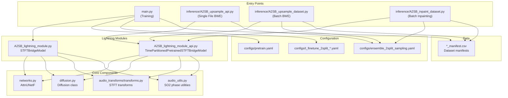
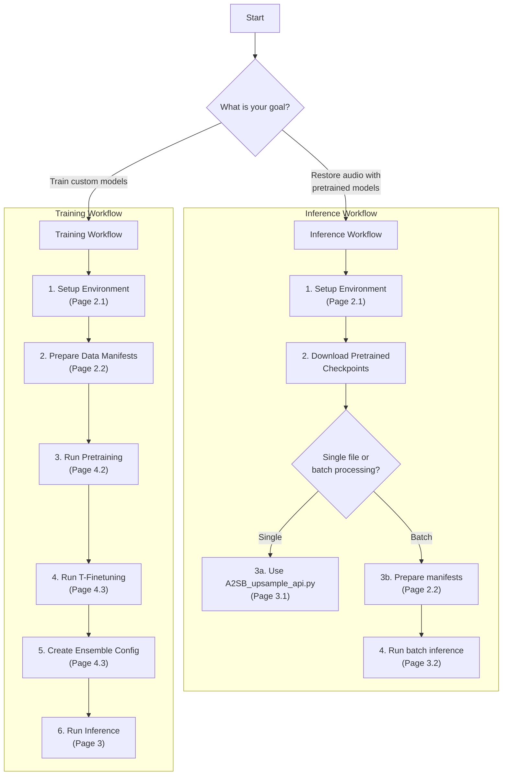

<!-- source: DeepWiki mcp.deepwiki.com · repo NVIDIA/diffusion-audio-restoration · page 2 Getting Started · fetched 2026-10-26 -->

# Getting Started

<details>
<summary>Relevant source files</summary>

The following files were used as context for generating this wiki page:

- [DockerFile](DockerFile)
- [README.md](README.md)

</details>


## Purpose and Scope

This page provides an initial orientation to the A2SB (Audio-to-Audio Schrödinger Bridge) system and guides you through the first steps of setup and usage. It covers the high-level system structure, prerequisites, and typical workflows for both training and inference tasks.

For detailed installation instructions, see [Installation and Environment Setup](#2.1). For data format specifications, see [Data Preparation](#2.2). For ready-to-run examples, see [Quick Start Examples](#2.3).

For architectural details and theoretical concepts, see [Architecture and Core Concepts](#5).

Sources: [README.md:1-104]()

## What is A2SB?

A2SB is an end-to-end, vocoder-free audio restoration model designed for high-resolution music at 44.1kHz. The system performs two main restoration tasks:

| Task | Description | Key Feature |
|------|-------------|-------------|
| **Bandwidth Extension** | Predicts high-frequency components (upsampling) | Automatic rolloff detection |
| **Inpainting** | Re-generates missing temporal segments | Configurable gap parameters |

The system is capable of processing hour-long audio files without boundary artifacts, using a Schrödinger Bridge diffusion formulation operating on STFT representations.

Sources: [README.md:19-24]()

## System Architecture Overview

The A2SB system consists of two distinct operational modes with separate code paths:



**Entry Point to Code Entity Mapping**

Sources: [README.md:27-76]()

## Directory Structure

The repository is organized as follows:

| Directory/File | Purpose | Key Contents |
|----------------|---------|--------------|
| `main.py` | Training entry point | PyTorch Lightning CLI orchestration |
| `inference/` | Inference scripts | `A2SB_upsample_api.py`, `A2SB_upsample_dataset.py`, `A2SB_inpaint_dataset.py` |
| `configs/` | YAML configuration files | `pretrain.yaml`, `t_finetune_*.yaml`, `ensemble_2split_sampling.yaml` |
| `A2SB_lightning_module.py` | Training Lightning module | `STFTBridgeModel` class |
| `A2SB_lightning_module_api.py` | Inference Lightning module | `TimePartitionedPretrainedSTFTBridgeModel` class |
| `networks.py` | Neural network architectures | `AttnUNetF`, `SinusoidalTemporalEmbedding` |
| `diffusion.py` | Diffusion process implementation | `Diffusion` class, `q_sample`, `p_posterior` |
| `audio_transforms/` | Audio processing transforms | STFT, magnitude-phase conversions, Griffin-Lim |
| `audio_utils.py` | Audio utility functions | STFT helpers, SO(2) phase matrices |
| `DockerFile` | Container definition | PyTorch 2.2.2, CUDA 12.1, dependencies |

Sources: [README.md:1-104](), [DockerFile:1-11]()

## Prerequisites

### Hardware Requirements

- **GPU**: NVIDIA GPU with CUDA support (CUDA 12.1 compatible)
- **Memory**: Sufficient VRAM for batch processing (configuration-dependent)
- **Storage**: Space for datasets, model checkpoints, and output audio

### Software Requirements

The system requires:

- **Docker** (recommended) or manual environment setup
- **PyTorch 2.2.2** with CUDA 12.1 and cuDNN 8
- **Python packages**: See dependency list below

### Python Dependencies

```
numpy, scipy, matplotlib, jsonargparse, librosa, soundfile
torch, torchaudio, einops, pytorch_lightning
rotary_embedding_torch, ssr_eval
```

Sources: [README.md:77-81](), [DockerFile:1-11]()

## Typical Workflows

The system supports two primary workflows:



**Workflow Decision Tree**

Sources: [README.md:27-76]()

## Configuration System Overview

A2SB uses YAML configuration files to control all aspects of training and inference:

### Training Configurations

| Configuration File | Purpose | Key Parameters |
|-------------------|---------|----------------|
| `configs/pretrain.yaml` | Initial pretraining phase | Full `t` range [0.0, 1.0], all datasets |
| `configs/t_finetune_2split_0.0_0.5.yaml` | First split T-finetuning | `model.train_t_min=0.0`, `model.train_t_max=0.5` |
| `configs/t_finetune_2split_0.5_1.0.yaml` | Second split T-finetuning | `model.train_t_min=0.5`, `model.train_t_max=1.0` |

### Inference Configuration

| Configuration File | Purpose | Key Parameters |
|-------------------|---------|----------------|
| `configs/ensemble_2split_sampling.yaml` | Ensemble inference with multiple models | `t_cutoffs`, checkpoint paths, sampling parameters |

**Configuration Flow Diagram**

```mermaid
graph LR
    subgraph "Phase 1: Pretraining"
        pretrain_yaml["pretrain.yaml"]
        pretrain_run["python main.py fit<br/>--config pretrain.yaml"]
        pretrain_ckpt["pretrain_checkpoint.ckpt"]
        
        pretrain_yaml --> pretrain_run
        pretrain_run --> pretrain_ckpt
    end
    
    subgraph "Phase 2: T-Finetuning"
        tfinetune1_yaml["t_finetune_2split_0.0_0.5.yaml<br/>train_t_min: 0.0<br/>train_t_max: 0.5"]
        tfinetune2_yaml["t_finetune_2split_0.5_1.0.yaml<br/>train_t_min: 0.5<br/>train_t_max: 1.0"]
        
        tfinetune1_run["python main.py fit<br/>--config t_finetune_*.yaml"]
        tfinetune2_run["python main.py fit<br/>--config t_finetune_*.yaml"]
        
        split1_ckpt["split1_checkpoint.ckpt"]
        split2_ckpt["split2_checkpoint.ckpt"]
        
        pretrain_ckpt --> tfinetune1_yaml
        pretrain_ckpt --> tfinetune2_yaml
        
        tfinetune1_yaml --> tfinetune1_run
        tfinetune2_yaml --> tfinetune2_run
        
        tfinetune1_run --> split1_ckpt
        tfinetune2_run --> split2_ckpt
    end
    
    subgraph "Phase 3: Inference"
        ensemble_yaml["ensemble_2split_sampling.yaml<br/>checkpoint_list: [split1, split2]<br/>t_cutoffs: [0.5]"]
        inference_run["A2SB_upsample_*.py<br/>-exp ensemble_2split_sampling"]
        output["Restored Audio"]
        
        split1_ckpt --> ensemble_yaml
        split2_ckpt --> ensemble_yaml
        ensemble_yaml --> inference_run
        inference_run --> output
    end
```



**Training to Inference Pipeline with Configurations**

Sources: [README.md:45-76]()

## Two-Phase Training Strategy

A2SB employs a unique two-phase training approach:

### Phase 1: Pretraining

Train a single model across the full diffusion timestep range `t ∈ [0.0, 1.0]` using:

```bash
python main.py fit --config configs/pretrain.yaml
```

See [Pretraining](#4.2) for detailed guidance.

### Phase 2: T-Finetuning (Time-Partitioned Training)

Train specialized models for different timestep ranges. For the 2-split approach:

**Split 1** (`t ∈ [0.0, 0.5]`):
```bash
python main.py fit --config configs/t_finetune_2split_0.0_0.5.yaml
```

**Split 2** (`t ∈ [0.5, 1.0]`):
Modify configuration with `model.train_t_min=0.5` and `model.train_t_max=1.0`, then run training.

See [T-Finetuning and Split Training](#4.3) for detailed guidance.

### Why Time Partitioning?

Different diffusion timesteps have different restoration characteristics:
- Early steps (`t ≈ 1.0`): High-level structure and global features
- Late steps (`t ≈ 0.0`): Fine details and local refinement

Training separate models allows each to specialize in its timestep range, improving overall quality.

Sources: [README.md:47-58]()

## Data Format Requirements

A2SB uses CSV manifest files to organize datasets. Each manifest must follow this format:

```
split,file_path,duration
train,PATH/TO/AUDIO.wav,10.0
train,PATH/TO/AUDIO2.wav,15.2
validation,PATH/TO/VAL_AUDIO.wav,10.0
test,PATH/TO/TEST_AUDIO.wav,8.5
```

**Manifest Structure:**
- **Column 1 (`split`)**: Dataset split identifier (`train`, `validation`, or `test`)
- **Column 2 (`file_path`)**: Absolute or relative path to audio file
- **Column 3 (`duration`)**: Audio duration in seconds

Multiple manifests can be used for different datasets, and various audio formats are supported (WAV, FLAC, etc.) as long as `SoundFile` can read them.

See [Data Preparation](#2.2) for complete specifications and examples.

Sources: [README.md:29-43]()

## Pretrained Checkpoints

NVIDIA provides pretrained checkpoints on HuggingFace:

- **1-split model**: [nvidia/audio_to_audio_schrodinger_bridge](https://huggingface.co/nvidia/audio_to_audio_schrodinger_bridge)
- **2-split ensemble**: [nvidia/audio_to_audio_schrodinger_bridge](https://huggingface.co/nvidia/audio_to_audio_schrodinger_bridge)

These checkpoints are trained on permissively licensed datasets including FMA, Medley-Solos-DB, MUSAN, Musical Instrument, MusicNet, Slakh, FreeSound, FSD50K, GTZAN, and NSynth.

Sources: [README.md:13-14](), [README.md:43]()

## Quick Reference Commands

### Inference Commands

**Single file bandwidth extension:**
```bash
cd inference/
python A2SB_upsample_api.py -f DEGRADED.wav -o RESTORED.wav -n N_STEPS
```

**Batch bandwidth extension:**
```bash
cd inference/
python A2SB_upsample_dataset.py -dn DATASET_NAME -exp ensemble_2split_sampling -cf 4000
```

**Batch inpainting:**
```bash
cd inference/
python A2SB_inpaint_dataset.py -dn DATASET_NAME -exp ensemble_2split_sampling -inp_len 0.3 -inp_every 5.0
```

### Training Commands

**Pretraining:**
```bash
python main.py fit --config configs/pretrain.yaml
```

**T-finetuning:**
```bash
python main.py fit --config configs/t_finetune_2split_0.0_0.5.yaml
```

See [Quick Start Examples](#2.3) for detailed parameter explanations.

Sources: [README.md:47-75]()

## Next Steps

Now that you understand the system structure and workflows, proceed to:

1. **[Installation and Environment Setup](#2.1)** - Set up Docker and dependencies
2. **[Data Preparation](#2.2)** - Format your datasets as manifest CSV files
3. **[Quick Start Examples](#2.3)** - Run your first inference or training job

For deeper understanding:
- **[Inference Guide](#3)** - Comprehensive inference documentation
- **[Training Guide](#4)** - Complete training workflow
- **[Architecture and Core Concepts](#5)** - Theoretical foundations

Sources: [README.md:1-104]()

## License and Ethical Considerations

**License**: The model is provided under the NVIDIA OneWay NonCommercial License. The code is under the NVIDIA Source Code License - Non Commercial. Some components are adapted from other sources under their respective licenses (I2SB, Improved Diffusion).

**Ethical Considerations**: NVIDIA believes Trustworthy AI is a shared responsibility. Developers should work with their internal teams to ensure models meet requirements for their industry and use case. Report security vulnerabilities or AI concerns through NVIDIA's official channels.

For business inquiries, visit [NVIDIA Research Licensing](https://www.nvidia.com/en-us/research/inquiries/).

Sources: [README.md:94-104]()

---

