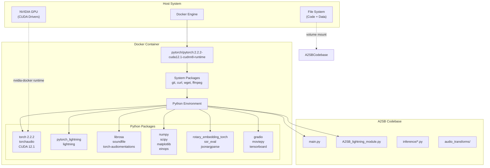
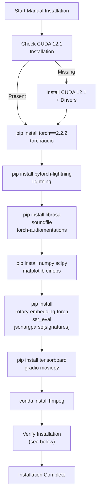
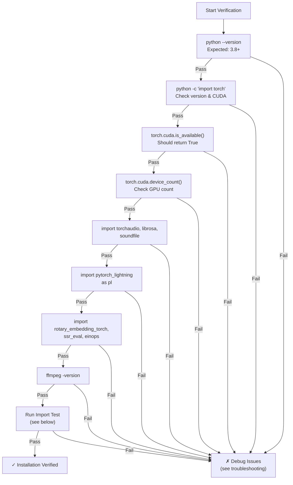

<!-- source: DeepWiki mcp.deepwiki.com · repo NVIDIA/diffusion-audio-restoration · page 2.1 Installation and Environment Setup · fetched 2026-10-26 -->

# Installation and Environment Setup

<details>
<summary>Relevant source files</summary>

The following files were used as context for generating this wiki page:

- [DockerFile](DockerFile)
- [README.md](README.md)

</details>


## Purpose and Scope

This page provides detailed instructions for setting up the development and runtime environment for the A2SB Audio Restoration System. It covers Docker-based installation (recommended), manual installation, dependency management, and environment verification. For information about preparing audio datasets and manifest files after installation, see [Data Preparation](#2.2). For running your first inference or training job, see [Quick Start Examples](#2.3).

## System Requirements

### Hardware Requirements

| Component | Minimum | Recommended |
|-----------|---------|-------------|
| **GPU** | NVIDIA GPU with CUDA Compute Capability ≥ 7.0 | NVIDIA A100 or H100 |
| **VRAM** | 16 GB | 40+ GB for large batch training |
| **RAM** | 32 GB | 64+ GB |
| **Storage** | 100 GB free | 500+ GB for datasets and checkpoints |

### Software Requirements

| Component | Version |
|-----------|---------|
| **CUDA** | 12.1 |
| **cuDNN** | 8.x |
| **Docker** | 20.10+ (if using Docker setup) |
| **Python** | 3.8+ (if using manual setup) |

**Sources:** [DockerFile:1](), [README.md:78-81]()

---

## Docker-Based Setup (Recommended)

The A2SB system provides a pre-configured Docker environment that ensures reproducibility and eliminates dependency conflicts. This is the recommended setup method.

### Docker Environment Architecture



**Sources:** [DockerFile:1-11]()

### Building the Docker Image

1. **Clone the repository:**
   ```bash
   git clone https://github.com/NVIDIA/diffusion-audio-restoration.git
   cd diffusion-audio-restoration
   ```

2. **Build the Docker image:**
   ```bash
   docker build -t a2sb:latest -f DockerFile .
   ```

   The build process installs:
   - Base PyTorch image with CUDA 12.1 and cuDNN 8
   - System packages: `git`, `curl`, `wget`, `bzip2`, `libx11-6`, `ca-certificates`
   - Python packages via pip (see [Dependency Overview](#dependency-overview))
   - `ffmpeg` via conda

3. **Run the container:**
   ```bash
   docker run --gpus all \
     -v /path/to/audio/data:/data \
     -v /path/to/experiment/outputs:/outputs \
     -v $(pwd):/workspace/a2sb \
     -it a2sb:latest bash
   ```

   Volume mount recommendations:
   - Mount your audio dataset directory to `/data`
   - Mount experiment output directory to `/outputs`
   - Mount the A2SB codebase to `/workspace/a2sb`

**Sources:** [DockerFile:1-11]()

### Docker Environment Layers

```mermaid
graph LR
    subgraph "Layer 1: Base OS"
        Ubuntu["Ubuntu<br/>(from PyTorch base)"]
    end
    
    subgraph "Layer 2: CUDA Stack"
        CUDA["CUDA 12.1"]
        cuDNN["cuDNN 8"]
    end
    
    subgraph "Layer 3: Python Runtime"
        Python["Python 3.x"]
        Conda["Conda"]
    end
    
    subgraph "Layer 4: PyTorch"
        PyTorchCore["torch 2.2.2"]
        TorchAudio["torchaudio"]
    end
    
    subgraph "Layer 5: ML/Audio Libraries"
        Lightning["lightning"]
        Librosa["librosa"]
        SoundFile["soundfile"]
    end
    
    subgraph "Layer 6: A2SB Dependencies"
        Rotary["rotary_embedding_torch"]
        SSR["ssr_eval"]
        JsonArg["jsonargparse"]
        Einops["einops"]
    end
    
    subgraph "Layer 7: Optional Tools"
        TensorBoard["tensorboard"]
        Gradio["gradio"]
        FFmpeg["ffmpeg"]
    end
    
    Ubuntu --> CUDA
    CUDA --> cuDNN
    cuDNN --> Python
    Python --> Conda
    Conda --> PyTorchCore
    PyTorchCore --> TorchAudio
    TorchAudio --> Lightning
    Lightning --> Librosa
    Librosa --> SoundFile
    SoundFile --> Rotary
    Rotary --> SSR
    SSR --> JsonArg
    JsonArg --> Einops
    Einops --> TensorBoard
    TensorBoard --> Gradio
    Gradio --> FFmpeg
```



**Sources:** [DockerFile:1-11]()

---

## Manual Installation

For users who prefer not to use Docker or need to integrate A2SB into an existing environment, manual installation is possible.

### Prerequisites

Ensure the following are installed on your system:
- NVIDIA GPU drivers with CUDA 12.1 support
- Python 3.8 or later
- pip package manager
- Conda (optional, for ffmpeg)

### Installation Steps

1. **Install PyTorch with CUDA support:**
   ```bash
   pip install torch==2.2.2 torchaudio --index-url https://download.pytorch.org/whl/cu121
   ```

2. **Install core dependencies:**
   ```bash
   pip install pytorch-lightning lightning numpy scipy matplotlib
   ```

3. **Install audio processing libraries:**
   ```bash
   pip install librosa soundfile torch-audiomentations
   ```

4. **Install A2SB-specific dependencies:**
   ```bash
   pip install rotary-embedding-torch \
                jsonargparse[signatures] \
                einops \
                ssr_eval
   ```

5. **Install optional packages:**
   ```bash
   pip install tensorboard gradio moviepy inflect lmdb h5py
   ```

6. **Install ffmpeg (required for audio I/O):**
   ```bash
   # Using conda (recommended)
   conda install ffmpeg
   
   # Or using apt (Ubuntu/Debian)
   sudo apt-get install ffmpeg
   ```

### Dependency Installation Workflow



**Sources:** [README.md:78-81](), [DockerFile:9-10]()

---

## Dependency Overview

The A2SB system depends on multiple categories of packages, each serving a specific role in the training and inference pipeline.

### Dependency Categories and Code Mapping

| Category | Packages | Used By (Code Entities) |
|----------|----------|-------------------------|
| **Deep Learning Framework** | `torch` 2.2.2, `torchaudio` | All modules, especially [networks.py](), [diffusion.py]() |
| **Training Orchestration** | `pytorch_lightning`, `lightning` | [main.py](), [A2SB_lightning_module.py](), [A2SB_lightning_module_api.py]() |
| **Audio Processing** | `librosa`, `soundfile`, `torch-audiomentations` | [audio_utils.py](), [audio_transforms/transforms.py]() |
| **Numerical Computing** | `numpy`, `scipy` | [audio_utils.py](), phase computation functions |
| **Model Components** | `rotary_embedding_torch`, `einops` | [networks.py]() (AttnUNetF architecture) |
| **Audio Evaluation** | `ssr_eval` | [A2SB_lightning_module.py]() validation methods |
| **Configuration** | `jsonargparse[signatures]` | [main.py]() CLI argument parsing |
| **Visualization** | `matplotlib`, `tensorboard` | Training logging and debugging |
| **Audio I/O** | `ffmpeg` (via conda) | Backend for `librosa` and `torchaudio` |
| **Optional Tools** | `gradio`, `moviepy`, `inflect`, `lmdb`, `h5py` | Demos, video processing, data storage |

### Package-to-Module Mapping

```mermaid
graph TB
    subgraph "Core A2SB Modules"
        Main["main.py<br/>(Entry Point)"]
        LMTrain["A2SB_lightning_module.py<br/>(Training)"]
        LMAPI["A2SB_lightning_module_api.py<br/>(Inference)"]
        Networks["networks.py<br/>(AttnUNetF)"]
        Diffusion["diffusion.py<br/>(Schrödinger Bridge)"]
        AudioUtils["audio_utils.py<br/>(STFT, SO2 Phase)"]
        Transforms["audio_transforms/transforms.py<br/>(ComplexSpectrogram, etc.)"]
    end
    
    subgraph "Deep Learning"
        Torch["torch 2.2.2"]
        TorchAudio["torchaudio"]
        Lightning["pytorch_lightning"]
    end
    
    subgraph "Audio Processing"
        Librosa["librosa"]
        SoundFile["soundfile"]
        FFmpeg["ffmpeg"]
        TorchAudiomentations["torch-audiomentations"]
    end
    
    subgraph "Scientific Computing"
        NumPy["numpy"]
        SciPy["scipy"]
    end
    
    subgraph "Model Utilities"
        Rotary["rotary_embedding_torch"]
        Einops["einops"]
    end
    
    subgraph "Evaluation & Config"
        SSR["ssr_eval"]
        JsonArg["jsonargparse"]
    end
    
    subgraph "Visualization"
        TensorBoard["tensorboard"]
        Matplotlib["matplotlib"]
    end
    
    Main --> Lightning
    Main --> JsonArg
    
    LMTrain --> Lightning
    LMTrain --> SSR
    LMTrain --> TensorBoard
    
    LMAPI --> Lightning
    
    Networks --> Torch
    Networks --> Rotary
    Networks --> Einops
    
    Diffusion --> Torch
    Diffusion --> NumPy
    
    AudioUtils --> TorchAudio
    AudioUtils --> NumPy
    AudioUtils --> SciPy
    
    Transforms --> TorchAudio
    Transforms --> Librosa
    Transforms --> SoundFile
    Transforms --> TorchAudiomentations
    
    Librosa --> FFmpeg
    TorchAudio --> FFmpeg
```



**Sources:** [README.md:78-81](), [DockerFile:9-10]()

---

## Verifying Installation

After installation (Docker or manual), verify that all components are properly configured.

### Verification Checklist



### 1. Check Python and PyTorch

```bash
python -c "import torch; print(f'PyTorch: {torch.__version__}')"
python -c "import torch; print(f'CUDA Available: {torch.cuda.is_available()}')"
python -c "import torch; print(f'CUDA Version: {torch.version.cuda}')"
python -c "import torch; print(f'GPU Count: {torch.cuda.device_count()}')"
```

Expected output:
```
PyTorch: 2.2.2+cu121
CUDA Available: True
CUDA Version: 12.1
GPU Count: 1 (or more)
```

### 2. Check Audio Libraries

```bash
python -c "import torchaudio; print(f'TorchAudio: {torchaudio.__version__}')"
python -c "import librosa; print(f'Librosa: {librosa.__version__}')"
python -c "import soundfile; print('SoundFile: OK')"
ffmpeg -version | head -n 1
```

### 3. Check A2SB Dependencies

```bash
python -c "import pytorch_lightning as pl; print(f'Lightning: {pl.__version__}')"
python -c "import rotary_embedding_torch; print('Rotary Embedding: OK')"
python -c "import ssr_eval; print('SSR Eval: OK')"
python -c "import einops; print('Einops: OK')"
python -c "from jsonargparse import CLI; print('JsonArgParse: OK')"
```

### 4. Run A2SB Import Test

Create a test script `test_imports.py`:

```python
# test_imports.py
import torch
import torchaudio
import pytorch_lightning as pl
from networks import AttnUNetF, SinusoidalTemporalEmbedding
from diffusion import Diffusion
from A2SB_lightning_module import STFTBridgeModel
from audio_transforms.transforms import ComplexSpectrogram
from audio_utils import compute_stft, inverse_stft

print("✓ All A2SB modules imported successfully")
print(f"  PyTorch: {torch.__version__}")
print(f"  CUDA: {torch.cuda.is_available()}")
print(f"  Lightning: {pl.__version__}")
```

Run the test:
```bash
python test_imports.py
```

### 5. Verify GPU Memory

```bash
python -c "import torch; print(torch.cuda.get_device_properties(0))"
```

This displays GPU name, compute capability, and total memory. For training, ensure at least 16 GB VRAM is available.

**Sources:** [README.md:78-81]()

---

## Environment Configuration

### Environment Variables

The A2SB system respects standard PyTorch and CUDA environment variables:

| Variable | Purpose | Recommended Value |
|----------|---------|-------------------|
| `CUDA_VISIBLE_DEVICES` | Restrict visible GPUs | `"0,1,2,3"` (for multi-GPU) |
| `PYTORCH_CUDA_ALLOC_CONF` | CUDA memory allocator settings | `"max_split_size_mb:512"` |
| `OMP_NUM_THREADS` | OpenMP threads for CPU ops | `"8"` |
| `NUMEXPR_NUM_THREADS` | NumExpr threads | `"8"` |

Example `.bashrc` or container startup:
```bash
export CUDA_VISIBLE_DEVICES=0,1,2,3
export PYTORCH_CUDA_ALLOC_CONF=max_split_size_mb:512
export OMP_NUM_THREADS=8
export NUMEXPR_NUM_THREADS=8
```

### File System Structure

After installation, the recommended directory structure is:

```
workspace/
├── a2sb/                          # A2SB codebase (this repo)
│   ├── main.py
│   ├── A2SB_lightning_module.py
│   ├── networks.py
│   ├── diffusion.py
│   ├── audio_utils.py
│   ├── audio_transforms/
│   ├── inference/
│   └── configs/
├── data/                          # Audio datasets
│   ├── manifests/
│   │   ├── dataset1_manifest.csv
│   │   └── dataset2_manifest.csv
│   └── audio_files/
└── experiments/                   # Training outputs
    ├── pretrain/
    │   └── checkpoints/
    ├── t_finetune_split1/
    │   └── checkpoints/
    └── t_finetune_split2/
        └── checkpoints/
```

**Sources:** [README.md:29-41]()

---

## Troubleshooting

### Common Issues

**Issue: `torch.cuda.is_available()` returns `False`**

- **Docker:** Ensure `nvidia-docker` runtime is installed and container is launched with `--gpus all`
- **Manual:** Verify NVIDIA drivers match CUDA 12.1 requirements
- Check: `nvidia-smi` should show GPUs and CUDA version ≥ 12.1

**Issue: `ImportError: libsndfile.so` or similar audio library errors**

- **Docker:** Rebuild image to ensure system packages installed
- **Manual:** Install system audio libraries:
  ```bash
  sudo apt-get install libsndfile1 libsndfile1-dev
  ```

**Issue: `ffmpeg` not found**

- **Docker:** Verify `conda install ffmpeg` completed successfully in DockerFile
- **Manual:** Install via `conda install ffmpeg` or `apt-get install ffmpeg`

**Issue: Out of memory during training**

- Reduce `batch_size` in config files under [configs/]()
- Increase `accumulate_grad_batches` in config files
- Ensure `PYTORCH_CUDA_ALLOC_CONF=max_split_size_mb:512` is set

**Issue: `jsonargparse` configuration errors**

- Ensure `jsonargparse[signatures]` is installed (note the `[signatures]` extra)
- Verify YAML config files syntax (see [Configuration Files](#4.4) for details)

**Sources:** [DockerFile:1-11](), [README.md:59]()

---

## Next Steps

After successfully installing and verifying the environment:

1. **Prepare your data:** Follow [Data Preparation](#2.2) to create manifest CSV files for your audio datasets
2. **Run inference:** See [Quick Start Examples](#2.3) for simple bandwidth extension and inpainting examples
3. **Train models:** Refer to [Training Guide](#4) for pretraining and T-finetuning workflows

For detailed information about the development workflow and contributing to the codebase, see [Development Environment](#7.1).

**Sources:** [README.md:27-76]()

---

