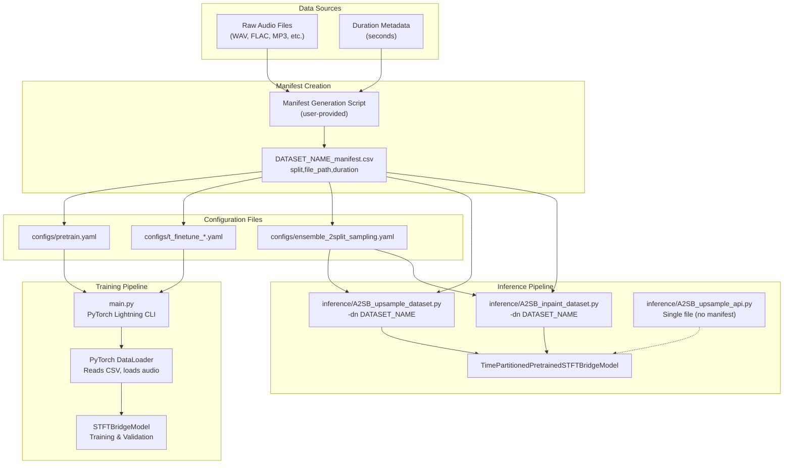

<!-- source: DeepWiki mcp.deepwiki.com · repo NVIDIA/diffusion-audio-restoration · page 2.2 Data Preparation · fetched 2026-10-26 -->

# Data Preparation

<details>
<summary>Relevant source files</summary>

The following files were used as context for generating this wiki page:

- [README.md](README.md)

</details>


## Purpose and Scope

This document explains how to prepare audio datasets for training and inference with A2SB. It covers the manifest CSV format, supported audio formats, configuration file setup, and best practices for organizing your data. For information about running training with prepared data, see [Training Overview](#4.1). For inference workflows, see [Inference Guide](#3).

---

## Manifest CSV Format

A2SB uses CSV manifest files to organize audio datasets. Each manifest file acts as an index that maps audio files to their splits (train/validation/test) and metadata.

### Required Columns

All manifest files must contain exactly three columns in the following order:

| Column Name | Type | Description |
|------------|------|-------------|
| `split` | string | Dataset split: `train`, `validation`, or `test` |
| `file_path` | string | Absolute or relative path to the audio file |
| `duration` | float | Audio duration in seconds |

### Example Manifest File

```csv
split,file_path,duration
train,/datasets/fma/audio/000/000002.mp3,166.0
train,/datasets/fma/audio/000/000005.mp3,262.0
validation,/datasets/fma/audio/000/000010.mp3,230.0
validation,/datasets/fma/audio/000/000017.mp3,248.0
test,/datasets/fma/audio/000/000134.mp3,219.0
test,/datasets/fma/audio/000/000137.mp3,252.0
```

### Naming Convention

Manifest files must follow the naming pattern:
```
{DATASET_NAME}_manifest.csv
```

For example:
- `fma_manifest.csv`
- `musicnet_manifest.csv`
- `slakh_manifest.csv`

The `DATASET_NAME` portion will be referenced in configuration files and inference scripts.

**Sources:** [README.md:29-43]()

---

## Creating Manifest Files

### Step 1: Collect Audio File Paths

Gather all audio files you want to include in your dataset. A2SB supports any audio format that the `SoundFile` library can read, including:

- WAV (`.wav`)
- FLAC (`.flac`)
- MP3 (`.mp3`)
- OGG (`.ogg`)
- Other formats supported by libsndfile

### Step 2: Calculate Durations

For each audio file, calculate its duration in seconds. You can use libraries like `librosa`, `soundfile`, or `torchaudio`:

```python
import soundfile as sf

# Get duration
info = sf.info('path/to/audio.wav')
duration = info.duration  # in seconds
```

### Step 3: Assign Splits

Decide which files belong to which split:
- **`train`**: Files used for model training (typically 70-90% of data)
- **`validation`**: Files used for validation during training (typically 5-15% of data)
- **`test`**: Files held out for final evaluation (typically 5-15% of data)

### Step 4: Generate CSV

Create the CSV file with proper formatting:

```python
import csv
import soundfile as sf
from pathlib import Path

def create_manifest(audio_dir, output_csv, split_ratios=(0.8, 0.1, 0.1)):
    """
    Create a manifest CSV from a directory of audio files.
    
    Args:
        audio_dir: Directory containing audio files
        output_csv: Output manifest CSV path
        split_ratios: Tuple of (train, validation, test) ratios
    """
    audio_files = list(Path(audio_dir).rglob('*.wav'))
    
    # Shuffle and split
    import random
    random.shuffle(audio_files)
    
    n_train = int(len(audio_files) * split_ratios[0])
    n_val = int(len(audio_files) * split_ratios[1])
    
    splits = ['train'] * n_train + ['validation'] * n_val + ['test'] * (len(audio_files) - n_train - n_val)
    
    with open(output_csv, 'w', newline='') as f:
        writer = csv.writer(f)
        writer.writerow(['split', 'file_path', 'duration'])
        
        for audio_file, split in zip(audio_files, splits):
            info = sf.info(str(audio_file))
            writer.writerow([split, str(audio_file.absolute()), info.duration])
```

**Sources:** [README.md:29-43]()

---

## Manifest Data Flow

The following diagram shows how manifest files flow through the A2SB system:



**Sources:** [README.md:29-43](), [README.md:47-58](), [README.md:64-75]()

---

## Multi-Dataset Configuration

A2SB supports training on multiple datasets simultaneously. Each dataset requires its own manifest file, and all datasets are specified in the configuration files.

### Multiple Manifest Files

Organize your manifests in a consistent location:

```
/data/manifests/
├── fma_manifest.csv
├── musicnet_manifest.csv
├── slakh_manifest.csv
├── medley_solos_db_manifest.csv
└── musan_manifest.csv
```

### Configuration File Integration

Configuration files under `configs/` specify which manifests to use. While the exact structure of the config files is covered in [Configuration Files](#4.4), the key concept is that you reference both the dataset name and the manifest path.

Example conceptual structure:
```yaml
data:
  datasets:
    - name: fma
      manifest: /data/manifests/fma_manifest.csv
    - name: musicnet
      manifest: /data/manifests/musicnet_manifest.csv
    - name: slakh
      manifest: /data/manifests/slakh_manifest.csv
```

During training, the system will load and combine samples from all specified datasets. During inference, you specify which dataset to process using the `-dn DATASET_NAME` flag.

**Sources:** [README.md:41-43](), [README.md:67-68]()

---

## Dataset Organization Best Practices

### Directory Structure

Recommended organization for clarity and maintainability:

```
project_root/
├── data/
│   ├── raw_audio/
│   │   ├── fma/
│   │   │   └── audio/
│   │   │       ├── 000/
│   │   │       ├── 001/
│   │   │       └── ...
│   │   ├── musicnet/
│   │   │   ├── train/
│   │   │   ├── validation/
│   │   │   └── test/
│   │   └── slakh/
│   └── manifests/
│       ├── fma_manifest.csv
│       ├── musicnet_manifest.csv
│       └── slakh_manifest.csv
├── configs/
│   ├── pretrain.yaml
│   ├── t_finetune_2split_0.0_0.5.yaml
│   └── ensemble_2split_sampling.yaml
└── experiments/
    └── [training outputs]
```

### File Path Considerations

**Absolute vs Relative Paths:** 
- **Absolute paths** (e.g., `/data/audio/file.wav`) are more portable across different execution contexts
- **Relative paths** (e.g., `../data/audio/file.wav`) can work but may break if scripts are run from different directories

**Recommendation:** Use absolute paths in manifest files for maximum reliability.

### Split Distribution Guidelines

| Split | Recommended Ratio | Purpose |
|-------|------------------|---------|
| `train` | 70-90% | Model learns from these samples during training |
| `validation` | 5-15% | Used for hyperparameter tuning and early stopping |
| `test` | 5-15% | Final evaluation on unseen data |

For smaller datasets (< 1000 files), consider using a higher validation/test ratio to ensure robust evaluation.

**Sources:** [README.md:29-43]()

---

## Supported Audio Formats

A2SB processes audio files through the `SoundFile` library, which provides an interface to libsndfile. The following formats are supported:

| Format | Extensions | Notes |
|--------|-----------|-------|
| WAV | `.wav` | Uncompressed, lossless |
| FLAC | `.flac` | Compressed, lossless |
| OGG Vorbis | `.ogg` | Lossy compression |
| MP3 | `.mp3` | Lossy compression (via ffmpeg backend) |

### Sample Rate Handling

A2SB is designed for **44.1 kHz** audio. During processing:
- Input audio at different sample rates will be resampled to 44.1 kHz
- Output audio is always at 44.1 kHz
- The system handles resampling automatically during the STFT transform pipeline

### Audio Quality Recommendations

For best results:
- Use lossless formats (WAV, FLAC) when possible
- If using lossy formats (MP3, OGG), use high bitrates (≥320 kbps)
- Ensure audio files are not corrupted (verify with `soundfile` or similar tools)
- Minimum recommended duration: 1-2 seconds per file
- Maximum duration: No hard limit; A2SB can process hour-long audio

**Sources:** [README.md:41](), Architecture diagrams (44.1kHz specification)

---

## Training Datasets Reference

The original A2SB models were trained on permissively licensed subsets of the following datasets:

| Dataset | Type | Description |
|---------|------|-------------|
| FMA | Music | Free Music Archive |
| Medley-Solos-DB | Music | Solo instrument recordings |
| MUSAN | Music/Noise/Speech | Multi-genre audio dataset |
| Musical Instrument | Music | Instrument samples |
| MusicNet | Music | Classical music with annotations |
| Slakh | Music | Multi-track MIDI-synthesized music |
| FreeSound | General Audio | User-uploaded sound effects |
| FSD50K | General Audio | Freesound Dataset 50K |
| GTZAN | Music | Genre classification dataset |
| NSynth | Music | Neural audio synthesis dataset |

**Note:** These datasets are listed for reference. You can train A2SB on any audio dataset by following the manifest creation process described in this document.

**Sources:** [README.md:43]()

---

## Manifest Validation

Before using manifests for training or inference, validate them to catch common issues:

### Validation Checklist

- [ ] CSV file has exactly 3 columns: `split`, `file_path`, `duration`
- [ ] All file paths exist and are accessible
- [ ] All audio files can be opened by `soundfile`
- [ ] Durations match actual audio file lengths
- [ ] Splits are spelled correctly: `train`, `validation`, `test` (case-sensitive)
- [ ] No missing values in any column
- [ ] File paths don't contain special characters that could cause issues

### Example Validation Script

```python
import csv
import soundfile as sf
from pathlib import Path

def validate_manifest(manifest_path):
    """Validate a manifest CSV file."""
    errors = []
    
    with open(manifest_path, 'r') as f:
        reader = csv.DictReader(f)
        
        # Check header
        if reader.fieldnames != ['split', 'file_path', 'duration']:
            errors.append(f"Invalid header: {reader.fieldnames}")
            return errors
        
        for i, row in enumerate(reader, start=2):  # Line 2 is first data row
            # Check split validity
            if row['split'] not in ['train', 'validation', 'test']:
                errors.append(f"Line {i}: Invalid split '{row['split']}'")
            
            # Check file exists
            file_path = Path(row['file_path'])
            if not file_path.exists():
                errors.append(f"Line {i}: File not found: {row['file_path']}")
                continue
            
            # Check file can be opened and duration matches
            try:
                info = sf.info(str(file_path))
                stated_duration = float(row['duration'])
                if abs(info.duration - stated_duration) > 0.1:  # 100ms tolerance
                    errors.append(
                        f"Line {i}: Duration mismatch - "
                        f"stated {stated_duration}s, actual {info.duration}s"
                    )
            except Exception as e:
                errors.append(f"Line {i}: Error reading audio: {e}")
    
    return errors
```

**Sources:** [README.md:29-43]()

---

## CSV to PyTorch DataLoader Pipeline

The following diagram shows how manifest CSV files are processed into training batches:

```mermaid
graph LR
    subgraph "Manifest File"
        CSV["DATASET_NAME_manifest.csv"]
    end
    
    subgraph "Config YAML"
        Config["configs/pretrain.yaml<br/>or t_finetune_*.yaml"]
        DatasetList["data.datasets list<br/>[{name, manifest}, ...]"]
    end
    
    subgraph "Data Loading"
        Reader["CSV Reader<br/>pandas/csv module"]
        Filter["Split Filter<br/>(train/validation/test)"]
        AudioLoader["SoundFile Loader<br/>Load waveform"]
        Sampler["Random Sampler<br/>Batch construction"]
    end
    
    subgraph "Audio Processing"
        Waveform["Raw Waveform<br/>44.1kHz tensor"]
        STFT["ComplexSpectrogram<br/>STFT Transform"]
        MagPhase["MagInstPhase<br/>Magnitude + cos/sin"]
        Batch["Training Batch<br/>[B, C, F, T]"]
    end
    
    CSV --> Config
    Config --> DatasetList
    DatasetList --> Reader
    Reader --> Filter
    Filter --> AudioLoader
    AudioLoader --> Sampler
    Sampler --> Waveform
    Waveform --> STFT
    STFT --> MagPhase
    MagPhase --> Batch
```



This pipeline is executed by PyTorch Lightning's data loading system when you run training via `main.py`. For detailed information on the audio transform pipeline, see [Audio Processing Pipeline](#6.2).

**Sources:** [README.md:29-43](), [README.md:47-58]()

---

## Inference Dataset Usage

When running inference on datasets, you specify the dataset name (without the `_manifest.csv` suffix):

### Bandwidth Extension on Dataset

```bash
cd inference/
python A2SB_upsample_dataset.py -dn DATASET_NAME -exp ensemble_2split_sampling -cf 4000
```

### Inpainting on Dataset

```bash
cd inference/
python A2SB_inpaint_dataset.py -dn DATASET_NAME -exp ensemble_2split_sampling -inp_len 0.3 -inp_every 5.0
```

The `-dn` flag tells the inference script which manifest to load. The script will:
1. Look for `DATASET_NAME_manifest.csv` in the configured manifest directory
2. Filter for the `test` split (typically)
3. Process each audio file in that split
4. Save restored audio to the output directory

For processing single files without a manifest, see [Single File API](#3.1).

**Sources:** [README.md:64-69]()

---

## Summary

Data preparation for A2SB involves:

1. **Creating manifest CSV files** with columns: `split`, `file_path`, `duration`
2. **Naming manifests** as `DATASET_NAME_manifest.csv`
3. **Supporting multiple datasets** by creating multiple manifests
4. **Referencing manifests** in configuration files under `configs/`
5. **Using standard audio formats** (WAV, FLAC, MP3, etc.) at any sample rate
6. **Validating manifests** before training/inference

Once manifests are prepared, you can proceed to [Quick Start Examples](#2.3) to begin training or inference, or dive deeper into [Training Guide](#4) and [Inference Guide](#3).

---

