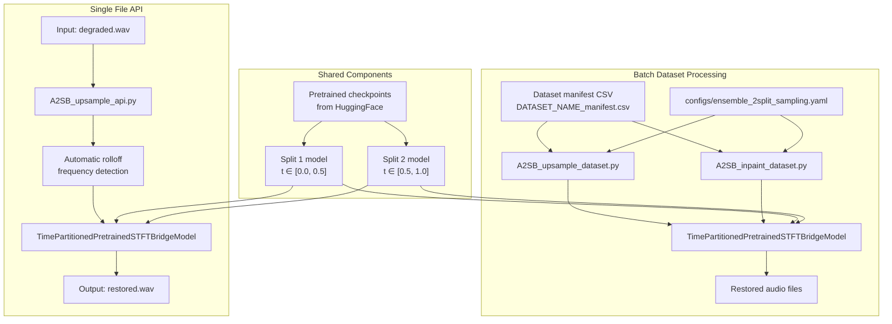
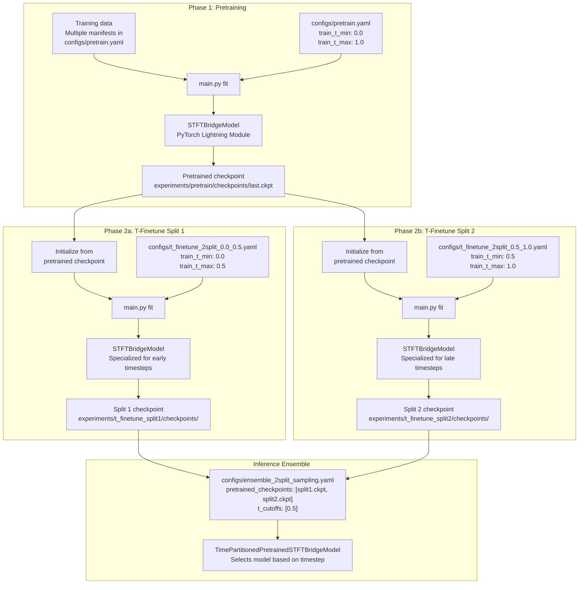
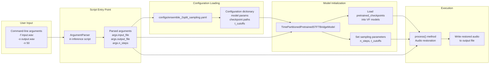

<!-- source: DeepWiki mcp.deepwiki.com · repo NVIDIA/diffusion-audio-restoration · page 2.3 Quick Start Examples · fetched 2026-10-26 -->

# Quick Start Examples

<details>
<summary>Relevant source files</summary>

The following files were used as context for generating this wiki page:

- [README.md](README.md)
- [configs/ensemble_2split_sampling.yaml](configs/ensemble_2split_sampling.yaml)

</details>


This page provides copy-paste command examples to get started with A2SB quickly. It covers the most common use cases for both inference (audio restoration) and training (model development).

For detailed setup instructions, see [Installation and Environment Setup](#2.1). For data preparation requirements, see [Data Preparation](#2.2). For comprehensive inference documentation, see [Inference Guide](#3). For comprehensive training documentation, see [Training Guide](#4).

## Prerequisites

Before running these examples, ensure you have:

1. Installed the Docker environment or all dependencies (see [Installation and Environment Setup](#2.1))
2. Downloaded pretrained checkpoints from [HuggingFace](https://huggingface.co/nvidia/audio_to_audio_schrodinger_bridge)
3. Prepared your data manifests in CSV format (see [Data Preparation](#2.2))

## Inference Examples

Most users will want to start with inference to restore degraded audio using pretrained models.

### Single File Bandwidth Extension

The simplest way to restore a single audio file with automatic rolloff frequency detection:

```bash
cd inference/
python A2SB_upsample_api.py -f input_degraded.wav -o output_restored.wav -n 50
```

**Key Parameters:**
- `-f`: Path to input degraded audio file
- `-o`: Path to output restored audio file
- `-n`: Number of diffusion steps (higher = better quality, slower; typical range: 20-100)

The `A2SB_upsample_api.py` script automatically detects the rolloff frequency of the input audio and performs bandwidth extension to restore high-frequency content up to 22.05 kHz (Nyquist frequency for 44.1 kHz sampling rate).

Sources: [README.md:72-75](), [inference/A2SB_upsample_api.py]()

### Batch Dataset Bandwidth Extension

To process an entire dataset listed in a manifest CSV file:

```bash
cd inference/
python A2SB_upsample_dataset.py -dn DATASET_NAME -exp ensemble_2split_sampling -cf 4000
```

**Key Parameters:**
- `-dn`: Dataset name (must match the key in your config file's `mix_dataset_config`)
- `-exp`: Experiment config name (corresponds to `configs/ensemble_2split_sampling.yaml`)
- `-cf`: Cutoff frequency in Hz (frequency below which audio is preserved, above which it's restored)

Sources: [README.md:64-68]()

### Batch Dataset Inpainting

To restore missing audio segments (e.g., removing artifacts or filling gaps):

```bash
cd inference/
python A2SB_inpaint_dataset.py -dn DATASET_NAME -exp ensemble_2split_sampling -inp_len 0.3 -inp_every 5.0
```

**Key Parameters:**
- `-dn`: Dataset name (must match the key in your config file's `mix_dataset_config`)
- `-exp`: Experiment config name (corresponds to `configs/ensemble_2split_sampling.yaml`)
- `-inp_len`: Length of each missing segment in seconds (e.g., 0.3 = 300ms gaps)
- `-inp_every`: Interval between missing segments in seconds (e.g., 5.0 = gaps every 5 seconds)

Sources: [README.md:64-68]()

### Inference Workflow Diagram



Sources: [README.md:64-75](), [configs/ensemble_2split_sampling.yaml](), [inference/A2SB_upsample_api.py](), [inference/A2SB_upsample_dataset.py](), [inference/A2SB_inpaint_dataset.py]()

## Training Examples

These examples show how to train A2SB models from scratch using the two-phase training strategy.

### Phase 1: Pretraining

Train a single model across the full diffusion timestep range `t ∈ [0.0, 1.0]`:

```bash
python main.py fit --config configs/pretrain.yaml
```

This creates a checkpoint that will be used as initialization for t-finetuning. The pretrained model learns general audio restoration capabilities across all diffusion timesteps.

**Before running:** Ensure `configs/pretrain.yaml` contains:
- Correct paths to your training data manifests in `data.mix_dataset_config`
- Appropriate `model.train_t_min: 0.0` and `model.train_t_max: 1.0`
- Hardware configuration matching your setup (batch size, num devices, num nodes)

Sources: [README.md:47-49](), [main.py]()

### Phase 2: T-Finetuning (2-Split Strategy)

After pretraining, train two specialized models for different diffusion timestep ranges.

#### Split 1: Early Timesteps (t ∈ [0.0, 0.5])

```bash
# First, copy pretrained checkpoint to t-finetune experiment folder
cp experiments/pretrain/checkpoints/last.ckpt experiments/t_finetune_split1/checkpoints/

# Run t-finetuning for split 1
python main.py fit --config configs/t_finetune_2split_0.0_0.5.yaml
```

#### Split 2: Late Timesteps (t ∈ [0.5, 1.0])

```bash
# Copy pretrained checkpoint to second split experiment folder
cp experiments/pretrain/checkpoints/last.ckpt experiments/t_finetune_split2/checkpoints/

# Create config file t_finetune_2split_0.5_1.0.yaml with modified parameters:
# - model.train_t_min: 0.5
# - model.train_t_max: 1.0
# - Different experiment name/path

# Run t-finetuning for split 2
python main.py fit --config configs/t_finetune_2split_0.5_1.0.yaml
```

**Key Configuration Differences:**
- Split 1: `model.train_t_min: 0.0`, `model.train_t_max: 0.5`
- Split 2: `model.train_t_min: 0.5`, `model.train_t_max: 1.0`
- Each split should have a unique experiment folder path

Sources: [README.md:51-57]()

### Training Workflow Diagram



Sources: [README.md:45-57](), [main.py](), [A2SB_lightning_module.py]()

## Common Parameter Reference

### Inference Parameters

| Parameter | Script | Description | Typical Values |
|-----------|--------|-------------|----------------|
| `-n` / `--n_steps` | `A2SB_upsample_api.py` | Number of diffusion steps | 20-100 (50 recommended) |
| `-cf` / `--cutoff_freq` | `A2SB_upsample_dataset.py` | Cutoff frequency for bandwidth extension (Hz) | 4000, 8000, 11025 |
| `-inp_len` | `A2SB_inpaint_dataset.py` | Duration of missing segments (seconds) | 0.1-1.0 |
| `-inp_every` | `A2SB_inpaint_dataset.py` | Interval between missing segments (seconds) | 2.0-10.0 |
| `-dn` / `--dataset_name` | `A2SB_upsample_dataset.py`, `A2SB_inpaint_dataset.py` | Dataset identifier from config | Any key from `mix_dataset_config` |
| `-exp` / `--experiment` | `A2SB_upsample_dataset.py`, `A2SB_inpaint_dataset.py` | Config file name (without .yaml) | `ensemble_2split_sampling` |

Sources: [inference/A2SB_upsample_api.py](), [inference/A2SB_upsample_dataset.py](), [inference/A2SB_inpaint_dataset.py]()

### Training Configuration Parameters

| Parameter | Location in Config | Description | Pretrain Value | T-Finetune Values |
|-----------|-------------------|-------------|----------------|-------------------|
| `model.train_t_min` | `model` section | Minimum diffusion timestep for training | 0.0 | Split 1: 0.0, Split 2: 0.5 |
| `model.train_t_max` | `model` section | Maximum diffusion timestep for training | 1.0 | Split 1: 0.5, Split 2: 1.0 |
| `trainer.devices` | `trainer` section | Number of GPUs per node | 8 (adjust to hardware) | 8 (adjust to hardware) |
| `trainer.num_nodes` | `trainer` section | Number of compute nodes | 1-4 (adjust to hardware) | 1-4 (adjust to hardware) |
| `data.batch_size` | `data` section | Batch size per device | 4-8 (adjust to GPU memory) | 4-8 (adjust to GPU memory) |
| `trainer.accumulate_grad_batches` | `trainer` section | Gradient accumulation steps | 2-4 | 2-4 |

Sources: [configs/pretrain.yaml](), [configs/t_finetune_2split_0.0_0.5.yaml]()

## Command-Line Parameter Flow



Sources: [inference/A2SB_upsample_api.py](), [A2SB_lightning_module_api.py](), [configs/ensemble_2split_sampling.yaml]()

## Hardware Considerations

The examples above may need adjustment based on your hardware:

**GPU Memory Requirements:**
- Pretraining: ~32GB per GPU (batch_size=4, accumulate_grad_batches=2)
- T-finetuning: ~32GB per GPU (batch_size=4, accumulate_grad_batches=2)
- Inference: ~16GB for batch processing, ~8GB for single-file API

**Adjusting for Different Hardware:**

If you have less GPU memory:
```yaml
# In config files:
data:
  batch_size: 2  # Reduce from 4 to 2
trainer:
  accumulate_grad_batches: 4  # Increase from 2 to 4 to maintain effective batch size
```

If you have more GPUs:
```yaml
# In config files:
trainer:
  devices: 8  # Set to number of GPUs per node
  num_nodes: 2  # Set to number of compute nodes
  strategy: ddp  # Distributed Data Parallel
```

Sources: [README.md:59](), [configs/pretrain.yaml](), [configs/ensemble_2split_sampling.yaml]()

## Next Steps

After running these quick start examples:

- For detailed inference options and advanced features, see [Inference Guide](#3)
  - [Single File API](#3.1) for automatic rolloff detection details
  - [Batch Processing Datasets](#3.2) for manifest-based processing
  - [Bandwidth Extension](#3.3) for BWE best practices
  - [Inpainting](#3.4) for inpainting best practices

- For comprehensive training documentation, see [Training Guide](#4)
  - [Training Overview](#4.1) for the two-phase strategy explanation
  - [Pretraining](#4.2) for pretraining configuration details
  - [T-Finetuning and Split Training](#4.3) for split strategy details
  - [Configuration Files](#4.4) for all available parameters

- For understanding the underlying architecture, see [Architecture and Core Concepts](#5)
  - [A2SB Model Overview](#5.1) for high-level architecture
  - [Schrödinger Bridge Diffusion](#5.2) for diffusion theory
  - [Time-Partitioned Ensemble](#5.4) for why the 2-split strategy works

Sources: [README.md:27-76]()

---

