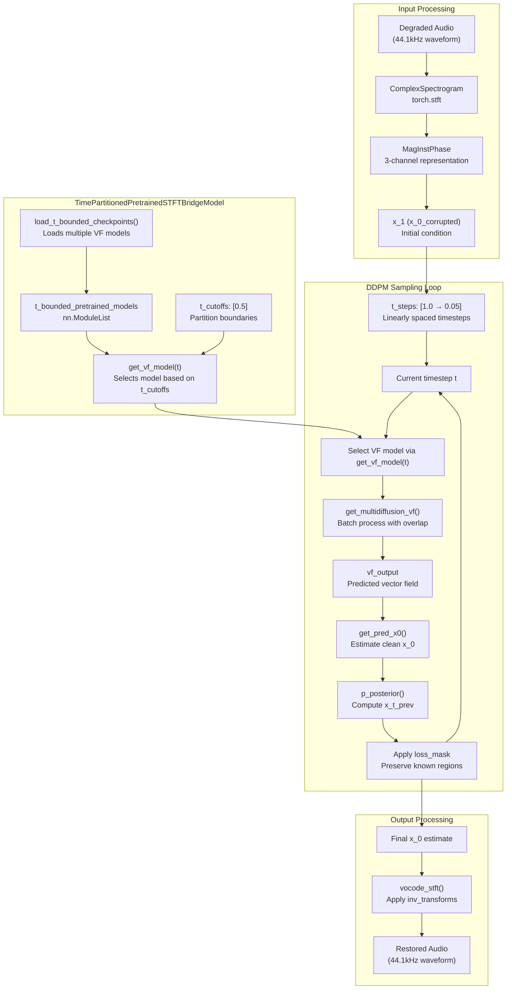
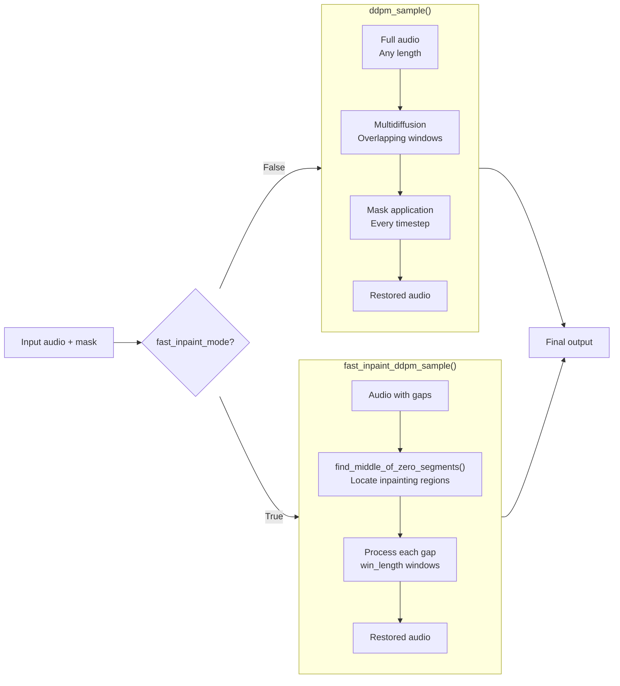
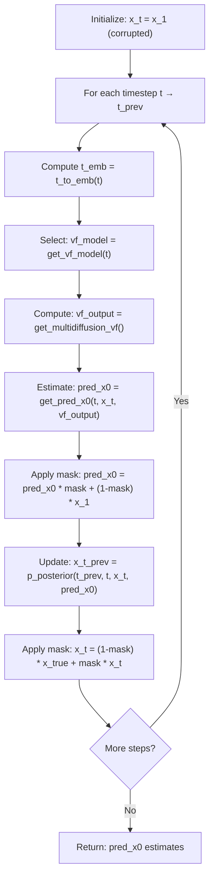
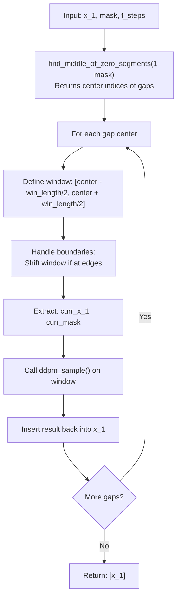
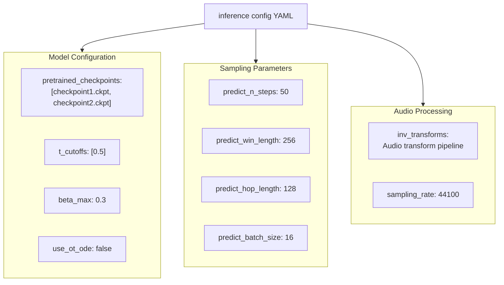
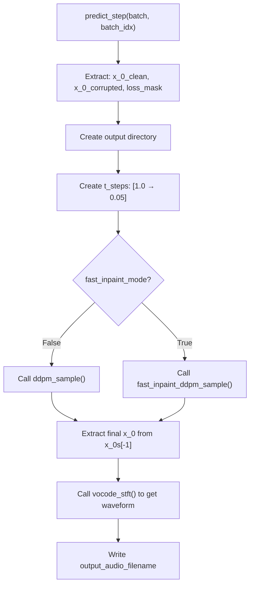
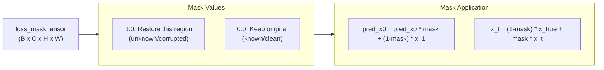

<!-- source: DeepWiki mcp.deepwiki.com · repo NVIDIA/diffusion-audio-restoration · page 3 Inference Guide · fetched 2026-10-26 -->

# Inference Guide

<details>
<summary>Relevant source files</summary>

The following files were used as context for generating this wiki page:

- [A2SB_lightning_module_api.py](A2SB_lightning_module_api.py)
- [README.md](README.md)

</details>


This document provides comprehensive guidance for using A2SB models to perform audio restoration tasks. It covers the inference architecture, available inference modes, configuration options, and practical usage examples.

For detailed information about specific restoration tasks, see [Bandwidth Extension](#3.3) and [Inpainting](#3.4). For information about training models from scratch, see [Training Guide](#4). For architectural details about the underlying diffusion process, see [Schrödinger Bridge Diffusion](#5.2).

## Overview

A2SB inference uses pretrained models to restore degraded audio through iterative refinement via the Schrödinger Bridge diffusion process. The system supports two primary restoration tasks:

| Task | Description | Entry Point |
|------|-------------|-------------|
| Bandwidth Extension | Predict high-frequency content to upsample audio | `inference/A2SB_upsample_api.py`, `inference/A2SB_upsample_dataset.py` |
| Inpainting | Restore missing temporal segments in audio | `inference/A2SB_inpaint_dataset.py` |

All inference modes operate in the STFT (spectrogram) domain and produce end-to-end waveform outputs without requiring a separate vocoder. The system is capable of processing hour-long audio files by leveraging multidiffusion techniques.

**Sources:** [README.md:19-24](), [README.md:62-75]()

## Inference Architecture

### TimePartitionedPretrainedSTFTBridgeModel

The inference system is centered around `TimePartitionedPretrainedSTFTBridgeModel`, a specialized Lightning module that loads multiple pretrained vector field models and selects between them based on diffusion timestep values.



**TimePartitionedPretrainedSTFTBridgeModel Architecture**

**Sources:** [A2SB_lightning_module_api.py:35-89]()

### Key Components

The inference architecture consists of the following components:

| Component | Type | Purpose |
|-----------|------|---------|
| `pretrained_checkpoints` | List[str] | Paths to pretrained model checkpoints |
| `t_cutoffs` | List[float] | Timestep boundaries for model selection (e.g., `[0.5]` for 2-split) |
| `t_bounded_pretrained_models` | nn.ModuleList | Loaded vector field models |
| `get_vf_model(t)` | Method | Returns appropriate VF model for timestep `t` |
| `ddpm_sample()` | Method | Executes iterative DDPM sampling |
| `vocode_stft()` | Method | Converts spectrogram to waveform |

The `get_vf_model(t)` method [A2SB_lightning_module_api.py:84-89]() implements the time-partitioning logic:

```python
def get_vf_model(self, t: float):
    model_idx = 0
    for idx, thresh in enumerate(self.t_cutoffs):
        if t >= thresh:
            model_idx = idx + 1
    return self.t_bounded_pretrained_models[model_idx]
```

For a 2-split ensemble with `t_cutoffs=[0.5]`:
- `t ∈ [0.5, 1.0]` uses `model_idx=1` (trained on high-t range)
- `t ∈ [0.0, 0.5)` uses `model_idx=0` (trained on low-t range)

**Sources:** [A2SB_lightning_module_api.py:35-89](), [A2SB_lightning_module_api.py:67-89]()

### Sampling Methods

The model provides two sampling strategies:



**Inference Sampling Strategy Selection**

| Method | When to Use | Efficiency |
|--------|-------------|------------|
| `ddpm_sample()` | General purpose, bandwidth extension, dense inpainting | Standard |
| `fast_inpaint_ddpm_sample()` | Sparse inpainting with well-separated gaps | Optimized |

**Sources:** [A2SB_lightning_module_api.py:106-149](), [A2SB_lightning_module_api.py:152-183]()

## Sampling Process Details

### DDPM Sampling Loop

The core sampling logic in `ddpm_sample()` [A2SB_lightning_module_api.py:106-149]() performs iterative refinement:



**DDPM Sampling Loop Flow**

The sampling process uses the following key operations:

| Step | Function | Purpose |
|------|----------|---------|
| Time embedding | `t_to_emb(t)` | Convert scalar timestep to 128-dim embedding |
| Model selection | `get_vf_model(t)` | Select appropriate VF model for current timestep |
| Vector field | `get_multidiffusion_vf()` | Predict denoising direction with overlapping windows |
| Clean estimate | `get_pred_x0(t, x_t, vf_output)` | Estimate clean spectrogram from noisy input |
| Posterior | `p_posterior(t_prev, t, x_t, pred_x0)` | Compute x_{t_prev} from x_t |
| Masking | Preserve known regions | Enforce boundary conditions |

**Sources:** [A2SB_lightning_module_api.py:106-149]()

### Multidiffusion for Long Audio

The `get_multidiffusion_vf()` function [diffusion.py]() enables processing of arbitrarily long audio by:

1. **Padding:** Add temporal padding to input via `multidiffusion_pad_inputs()` [diffusion.py]()
2. **Windowing:** Process audio in overlapping windows of size `win_length`
3. **Stride:** Advance by `hop_length` samples per window
4. **Aggregation:** Average predictions in overlapping regions
5. **Unpadding:** Remove padding via `multidiffusion_unpad_outputs()` [diffusion.py]()

When `hop_length < win_length`, overlapping predictions are averaged, reducing boundary artifacts. This allows processing hour-long audio without memory constraints.

**Sources:** [A2SB_lightning_module_api.py:106-149](), [diffusion.py:1-200]()

### Fast Inpainting Mode

The `fast_inpaint_ddpm_sample()` method [A2SB_lightning_module_api.py:152-183]() optimizes for sparse inpainting:



**Fast Inpainting Process Flow**

This mode assumes:
- Each masked segment is shorter than `win_length`
- Gaps are sufficiently separated
- Most of the audio is known (not masked)

Under these conditions, it processes only the windowed regions around gaps rather than the entire audio, significantly reducing computation.

**Sources:** [A2SB_lightning_module_api.py:152-183](), [utils.py:find_middle_of_zero_segments]()

## Configuration

Inference configuration is specified via YAML files. The reference configuration is `configs/ensemble_2split_sampling.yaml`.

### Essential Parameters



**Inference Configuration Structure**

| Parameter | Type | Purpose | Typical Value |
|-----------|------|---------|---------------|
| `pretrained_checkpoints` | List[str] | Paths to model checkpoints | `["path/to/split0.ckpt", "path/to/split1.ckpt"]` |
| `t_cutoffs` | List[float] | Time partition boundaries | `[0.5]` for 2-split |
| `predict_n_steps` | int | Number of diffusion steps | `50` (more = higher quality, slower) |
| `predict_win_length` | int | Window size (temporal frames) | `256` |
| `predict_hop_length` | int | Stride between windows | `128` (overlap = win - hop) |
| `predict_batch_size` | int | Batch size for multidiffusion | `16` |
| `beta_max` | float | Maximum noise schedule value | `0.3` |
| `use_ot_ode` | bool | Use ODE vs SDE formulation | `false` |
| `fast_inpaint_mode` | bool | Enable fast inpainting | `false` (set `true` for sparse gaps) |

**Sources:** [A2SB_lightning_module_api.py:35-49](), [README.md:62-75]()

### Audio Transforms Configuration

The `inv_transforms` list specifies the inverse transformation pipeline to convert model outputs (spectrograms) back to waveforms. This typically includes:

1. Power descaling (inverse of power=0.25 scaling)
2. DC term restoration
3. SO(2) phase correction via `audio_utils.svd_fix_phase_channels()`
4. Complex spectrogram reconstruction
5. Inverse STFT via `torch.istft()`

For details on the audio processing pipeline, see [Audio Processing Pipeline](#6.2).

**Sources:** [A2SB_lightning_module_api.py:92-103](), [audio_transforms/transforms.py:1-300]()

## Inference Modes

### Single File API

For processing individual audio files with automatic rolloff detection, use `inference/A2SB_upsample_api.py`:

```bash
cd inference/
python A2SB_upsample_api.py -f DEGRADED.wav -o RESTORED.wav -n N_STEPS
```

| Argument | Description | Example |
|----------|-------------|---------|
| `-f`, `--input-file` | Path to degraded input audio | `degraded.wav` |
| `-o`, `--output-file` | Path to save restored audio | `restored.wav` |
| `-n`, `--n-steps` | Number of diffusion steps | `50` |

This API automatically:
1. Detects the rolloff frequency in the input
2. Constructs an appropriate loss mask for bandwidth extension
3. Loads the ensemble model
4. Performs inference
5. Saves the restored waveform

For detailed usage, see [Single File API](#3.1).

**Sources:** [README.md:71-75]()

### Batch Dataset Processing

For processing entire datasets, two scripts are provided:

#### Bandwidth Extension

```bash
cd inference/
python A2SB_upsample_dataset.py -dn DATASET_NAME -exp ensemble_2split_sampling -cf 4000
```

| Argument | Description | Example |
|----------|-------------|---------|
| `-dn`, `--dataset-name` | Dataset manifest name | `test_set` |
| `-exp`, `--experiment` | Config name (in `configs/`) | `ensemble_2split_sampling` |
| `-cf`, `--cutoff-freq` | Bandwidth limit (Hz) | `4000` |

This script:
1. Loads the dataset manifest (`DATASET_NAME_manifest.csv`)
2. For each audio file, creates a low-pass filtered version (cutoff at `cf` Hz)
3. Constructs a frequency mask above the cutoff
4. Runs inference to restore high frequencies
5. Saves restored audio to the output directory

For detailed usage, see [Batch Processing Datasets](#3.2) and [Bandwidth Extension](#3.3).

**Sources:** [README.md:66-68]()

#### Inpainting

```bash
cd inference/
python A2SB_inpaint_dataset.py -dn DATASET_NAME -exp ensemble_2split_sampling -inp_len 0.3 -inp_every 5.0
```

| Argument | Description | Example |
|----------|-------------|---------|
| `-dn`, `--dataset-name` | Dataset manifest name | `test_set` |
| `-exp`, `--experiment` | Config name | `ensemble_2split_sampling` |
| `-inp_len` | Gap duration (seconds) | `0.3` |
| `-inp_every` | Gap spacing (seconds) | `5.0` |

This script:
1. Loads the dataset manifest
2. For each audio file, creates gaps of duration `inp_len` every `inp_every` seconds
3. Constructs a temporal mask for the gaps
4. Runs inference to inpaint the missing segments
5. Saves restored audio to the output directory

For detailed usage, see [Batch Processing Datasets](#3.2) and [Inpainting](#3.4).

**Sources:** [README.md:68-69]()

## Predict Step

The Lightning module's `predict_step()` method [A2SB_lightning_module_api.py:186-210]() is called for each batch during prediction:



**predict_step() Execution Flow**

The `predict_step()` assumes:
- Batch size of 1 (processes one audio file at a time)
- Input batch contains `x_0_clean`, `x_0_corrupted`, `loss_mask`, `outdir`, `output_sr`

The restored audio is written to `self.output_audio_filename`, which is set during model initialization.

**Sources:** [A2SB_lightning_module_api.py:186-210]()

## Memory and Performance Considerations

### Window Size Trade-offs

| Parameter | Small Value | Large Value |
|-----------|-------------|-------------|
| `predict_win_length` | Faster, less memory, more boundary artifacts | Slower, more memory, fewer artifacts |
| `predict_hop_length` | More overlap, smoother, slower | Less overlap, faster, potential discontinuities |
| `predict_batch_size` | Lower memory usage | Higher throughput |

Recommended configurations:

| Use Case | win_length | hop_length | batch_size |
|----------|------------|------------|------------|
| High quality, ample GPU memory | 512 | 256 | 32 |
| Balanced | 256 | 128 | 16 |
| Limited memory | 128 | 128 | 8 |

**Sources:** [A2SB_lightning_module_api.py:106-149]()

### Number of Steps

The `predict_n_steps` parameter controls the diffusion trajectory discretization:

- **Fewer steps (e.g., 25):** Faster inference, slightly lower quality
- **More steps (e.g., 50-100):** Higher quality, slower inference

The timestep schedule is linear from `t=1.0` to `t=0.05` [A2SB_lightning_module_api.py:195](). The minimum value of 0.05 (not 0.0) is used to avoid numerical instability.

**Sources:** [A2SB_lightning_module_api.py:195-203]()

## Masking Strategy

The inference system uses `loss_mask` (also called `fill_mask`) to control which regions are restored:



**Mask Application Strategy**

During sampling:
1. **After prediction:** `pred_x0` is masked to preserve known regions [A2SB_lightning_module_api.py:137]()
2. **After posterior update:** `x_t` is masked to maintain boundary conditions [A2SB_lightning_module_api.py:142-147]()

For bandwidth extension, the mask is typically:
- `1.0` in high-frequency regions (above cutoff)
- `0.0` in low-frequency regions (below cutoff)

For inpainting, the mask is:
- `1.0` in temporal gaps
- `0.0` in known segments

**Sources:** [A2SB_lightning_module_api.py:106-149]()

## Output Format

All inference modes output audio in WAV format at 44.1kHz sampling rate. The output directory structure depends on the inference mode:

| Mode | Output Path |
|------|-------------|
| Single file API | Specified via `-o` argument |
| Batch processing | `{experiment_dir}/{dataset_name}/{outdir}/recon.wav` |

The restored audio is full-resolution (44.1kHz) and does not require any post-processing vocoder.

**Sources:** [A2SB_lightning_module_api.py:205-209](), [README.md:19-24]()

---

