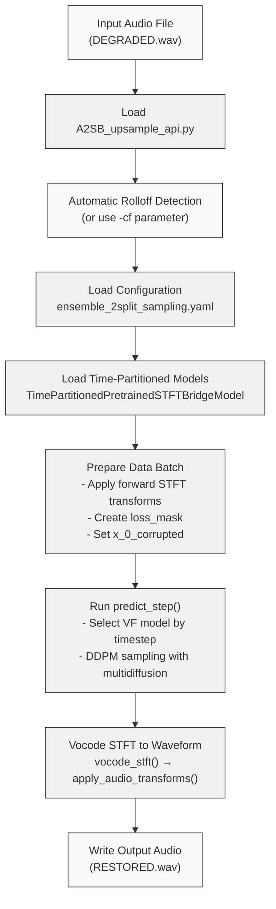
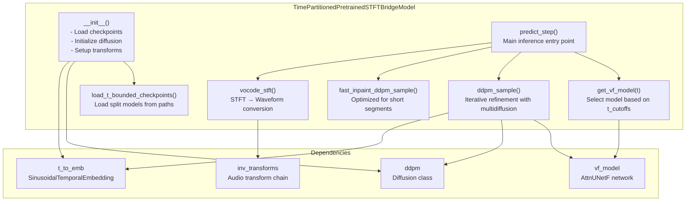
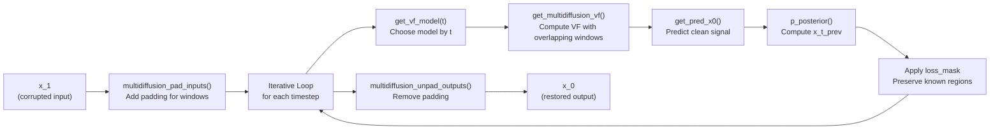
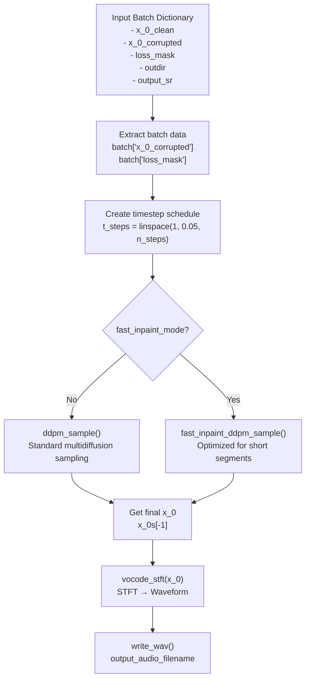
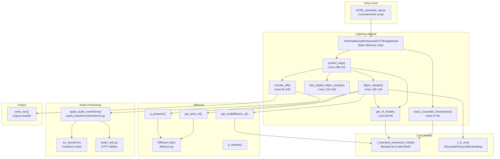
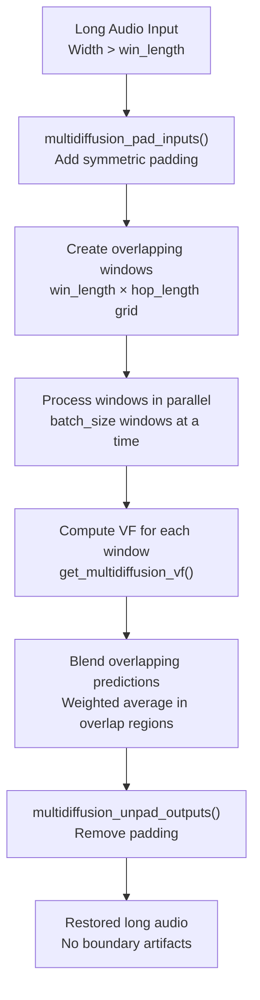
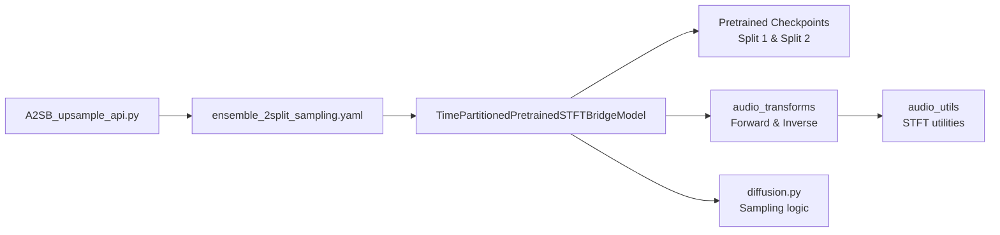

<!-- source: DeepWiki mcp.deepwiki.com · repo NVIDIA/diffusion-audio-restoration · page 3.1 Single File API · fetched 2026-10-26 -->

# Single File API

<details>
<summary>Relevant source files</summary>

The following files were used as context for generating this wiki page:

- [A2SB_lightning_module_api.py](A2SB_lightning_module_api.py)
- [README.md](README.md)

</details>


## Purpose and Scope

This page documents the single file API (`A2SB_upsample_api.py`) for processing individual audio files using A2SB. This API is designed for interactive use and supports automatic rolloff frequency detection for bandwidth extension tasks. It can handle arbitrarily long audio files without boundary artifacts.

For batch processing of multiple files from a manifest, see [Batch Processing Datasets](#3.2). For detailed parameter tuning and task-specific guidance, see [Bandwidth Extension](#3.3) and [Inpainting](#3.4).

## Overview

The single file API provides a command-line interface for restoring individual audio files. It is primarily designed for bandwidth extension (upsampling low-resolution audio to 44.1kHz) but can be configured for other restoration tasks. The API automatically detects the rolloff frequency of degraded input and applies the appropriate restoration model.

**Key Features:**
- Processes single audio files via command line
- Automatic rolloff frequency detection
- Handles hour-long audio without boundary artifacts
- Uses time-partitioned ensemble models for improved quality
- Supports multidiffusion for long sequences
- Configurable number of diffusion steps

## Command-Line Usage

### Basic Invocation

```bash
cd inference/
python A2SB_upsample_api.py -f DEGRADED.wav -o RESTORED.wav -n N_STEPS
```

### Parameters

| Parameter | Short Flag | Description | Default |
|-----------|------------|-------------|---------|
| `--input_file` | `-f` | Path to input degraded audio file | Required |
| `--output_file` | `-o` | Path to output restored audio file | Required |
| `--n_steps` | `-n` | Number of diffusion sampling steps | 50 |
| `--cutoff_freq` | `-cf` | Manual rolloff frequency (Hz) for bandwidth extension | Auto-detected |
| `--config` | | Path to configuration YAML file | `configs/ensemble_2split_sampling.yaml` |

Sources: [README.md:71-75](), [inference/A2SB_upsample_api.py]()

## High-Level Workflow



Sources: [A2SB_lightning_module_api.py:35-210](), [README.md:71-75]()

## Core Components

### TimePartitionedPretrainedSTFTBridgeModel

The single file API is built on the `TimePartitionedPretrainedSTFTBridgeModel` class, which provides inference capabilities with time-partitioned ensemble models.



Sources: [A2SB_lightning_module_api.py:35-210]()

### Key Methods

#### Initialization

The model is initialized with configuration parameters including pretrained checkpoint paths and time cutoffs:

```python
TimePartitionedPretrainedSTFTBridgeModel(
    vf_model: torch.nn.Module,
    pretrained_checkpoints: List[str],  # Paths to split models
    t_cutoffs: List[float],             # e.g., [0.5] for 2-split
    predict_n_steps: int,               # Number of diffusion steps
    predict_hop_length: int,            # Multidiffusion hop length
    predict_win_length: int,            # Multidiffusion window length
    predict_batch_size: int,            # Batch size for processing
    output_audio_filename: str          # Output file path
)
```

Sources: [A2SB_lightning_module_api.py:36-49]()

#### Model Selection by Timestep

The `get_vf_model()` method selects the appropriate vector field model based on the current diffusion timestep:

```python
def get_vf_model(self, t: float):
    """
    Selects model based on t_cutoffs.
    For 2-split with t_cutoffs=[0.5]:
    - t < 0.5: returns model 0
    - t >= 0.5: returns model 1
    """
```

Sources: [A2SB_lightning_module_api.py:84-89]()

#### DDPM Sampling with Multidiffusion

The `ddpm_sample()` method implements the iterative refinement process with multidiffusion support for long audio:



**Key Parameters:**
- `win_length`: Temporal window length of input spectrogram (default: 256)
- `hop_length`: Step size for multidiffusion; if `hop_length < win_length`, overlapping windows are used
- `batch_size`: Number of windows processed in parallel

Sources: [A2SB_lightning_module_api.py:106-149](), [diffusion.py]()

#### Vocoding

The `vocode_stft()` method converts the restored STFT representation back to waveform:

```python
def vocode_stft(self, spec_out):
    """
    Applies inverse transforms to map spectrograms to waveforms.
    Processes each sample in the batch individually.
    Returns: List of waveform tensors
    """
```

The method iterates through batch samples and applies the inverse transform chain defined in `self.inv_transforms`.

Sources: [A2SB_lightning_module_api.py:92-103]()

## Processing Pipeline

### Data Flow Through predict_step()



Sources: [A2SB_lightning_module_api.py:186-210]()

### Batch Structure

The input batch dictionary contains:

| Key | Type | Description |
|-----|------|-------------|
| `x_0_clean` | Tensor | Clean reference spectrogram (B × C × H × W) |
| `x_0_corrupted` | Tensor | Degraded input spectrogram (B × C × H × W) |
| `loss_mask` | Tensor | Binary mask indicating regions to restore (1=restore, 0=preserve) |
| `outdir` | List[str] | Output directory paths |
| `output_sr` | int | Output sample rate (44100 Hz) |
| `x_0_wav` | Tensor | Clean reference waveform (optional, for metrics) |

Sources: [A2SB_lightning_module_api.py:186-210]()

## Configuration

### Configuration File Structure

The API loads configuration from YAML files (typically `configs/ensemble_2split_sampling.yaml`):

```yaml
model:
  class_path: A2SB_lightning_module_api.TimePartitionedPretrainedSTFTBridgeModel
  init_args:
    pretrained_checkpoints:
      - path/to/split1_checkpoint.ckpt
      - path/to/split2_checkpoint.ckpt
    t_cutoffs: [0.5]
    predict_n_steps: 50
    predict_hop_length: 128
    predict_win_length: 256
    predict_batch_size: 16
    beta_max: 0.3
    use_ot_ode: false
    fast_inpaint_mode: false
    sampling_rate: 44100
    n_timestep_channels: 128
    inv_transforms:
      # Transform chain configuration
```

### Key Configuration Parameters

| Parameter | Description | Typical Value |
|-----------|-------------|---------------|
| `pretrained_checkpoints` | List of checkpoint paths for ensemble models | 2 paths for 2-split |
| `t_cutoffs` | Timestep boundaries for model selection | `[0.5]` for 2-split |
| `predict_n_steps` | Number of diffusion sampling steps | 50 (higher = better quality) |
| `predict_win_length` | STFT window length for multidiffusion | 256 |
| `predict_hop_length` | Hop length for multidiffusion | 128 (smaller = more overlap) |
| `predict_batch_size` | Batch size for parallel processing | 16 |
| `beta_max` | Diffusion noise schedule parameter | 0.3 |
| `use_ot_ode` | Use ODE formulation instead of SDE | false |
| `fast_inpaint_mode` | Enable fast inpainting optimization | false |

Sources: [A2SB_lightning_module_api.py:36-49](), [configs/ensemble_2split_sampling.yaml]()

## Code Entity Relationships



Sources: [A2SB_lightning_module_api.py:35-210](), [diffusion.py](), [audio_transforms/transforms.py](), [audio_utils.py]()

## Multidiffusion for Long Audio

The API handles arbitrarily long audio files through a multidiffusion approach that processes audio in overlapping windows and blends the results.

### Multidiffusion Processing Steps



### Window Parameters

The relationship between `win_length` and `hop_length` determines the overlap:

- **`hop_length == win_length`**: No overlap, standard processing
- **`hop_length < win_length`**: Overlapping windows, multidiffusion blending enabled
- **Overlap amount**: `win_length - hop_length` frames

**Example with 2-split ensemble:**
- `win_length = 256`: Each window is 256 STFT frames (~1.5 seconds at 44.1kHz)
- `hop_length = 128`: 50% overlap between consecutive windows
- `batch_size = 16`: Process 16 windows simultaneously

Sources: [A2SB_lightning_module_api.py:106-149](), [diffusion.py]()

## Fast Inpainting Mode

When `fast_inpaint_mode=True`, the API uses an optimized algorithm that processes only the regions around gaps rather than the entire audio:

### Fast Inpaint Algorithm

1. Identifies middle points of zero segments in the mask
2. For each gap, extracts a window centered on the gap
3. Runs standard `ddpm_sample()` only on that window
4. Stitches the restored segments back into the full audio

**Use Case:** Efficient for tasks where missing segments are short and well-separated (e.g., click removal, short dropout restoration).

**Limitation:** Assumes each masked segment is shorter than `win_length` and sufficiently separated from other segments.

Sources: [A2SB_lightning_module_api.py:152-183](), [utils.py]()

## Example Workflow

### Bandwidth Extension Example

```bash
# Process a 16kHz degraded file, upsample to 44.1kHz
python A2SB_upsample_api.py \
    -f degraded_16k.wav \
    -o restored_44k.wav \
    -n 50 \
    -cf 8000  # Specify rolloff at 8kHz
```

**Processing Steps:**
1. Load degraded audio
2. Apply forward STFT transforms
3. Create bandwidth extension mask (frequencies above 8kHz)
4. Load 2-split ensemble models
5. Run 50-step DDPM sampling with multidiffusion
6. Apply inverse STFT transforms
7. Write restored 44.1kHz audio

### Hour-Long Audio Example

```bash
# Process hour-long concert recording
python A2SB_upsample_api.py \
    -f concert_degraded.wav \
    -o concert_restored.wav \
    -n 100  # More steps for higher quality
```

**Key Features:**
- Multidiffusion handles the long duration seamlessly
- No boundary artifacts between windows
- Memory-efficient processing through batched window computation

Sources: [README.md:71-75](), [A2SB_lightning_module_api.py:106-149]()

## Performance Considerations

### Computational Trade-offs

| Parameter | Effect on Quality | Effect on Speed | Recommended Range |
|-----------|-------------------|-----------------|-------------------|
| `predict_n_steps` | Higher = better quality | Lower = faster | 50-100 |
| `predict_hop_length` | Smaller = smoother blending | Smaller = slower | 64-256 |
| `predict_batch_size` | No direct effect | Higher = faster (GPU memory permitting) | 8-32 |

### Memory Usage

Memory consumption scales with:
- `predict_win_length`: Larger windows require more memory
- `predict_batch_size`: More parallel windows increase GPU memory usage
- Audio length: Managed automatically through batched processing

**Recommended for Long Audio:**
- Use default `win_length=256`, `hop_length=128`
- Reduce `batch_size` if encountering OOM errors
- The API automatically handles arbitrarily long files through windowing

Sources: [A2SB_lightning_module_api.py:106-149]()

## Integration with Other Components



**Related Systems:**
- For batch processing, see [Batch Processing Datasets](#3.2)
- For training these models, see [Training Guide](#4)
- For understanding the architecture, see [A2SB Model Overview](#5.1)
- For the 2-split strategy, see [Time-Partitioned Ensemble](#5.4)

Sources: [A2SB_lightning_module_api.py:35-210](), [configs/](), [audio_transforms/transforms.py](), [audio_utils.py](), [diffusion.py]()

---

