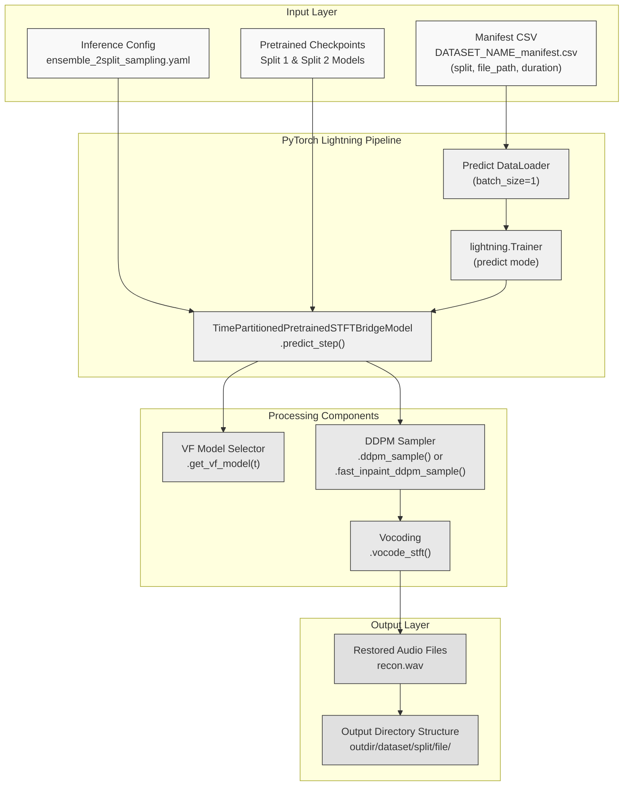
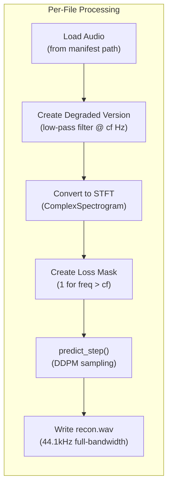
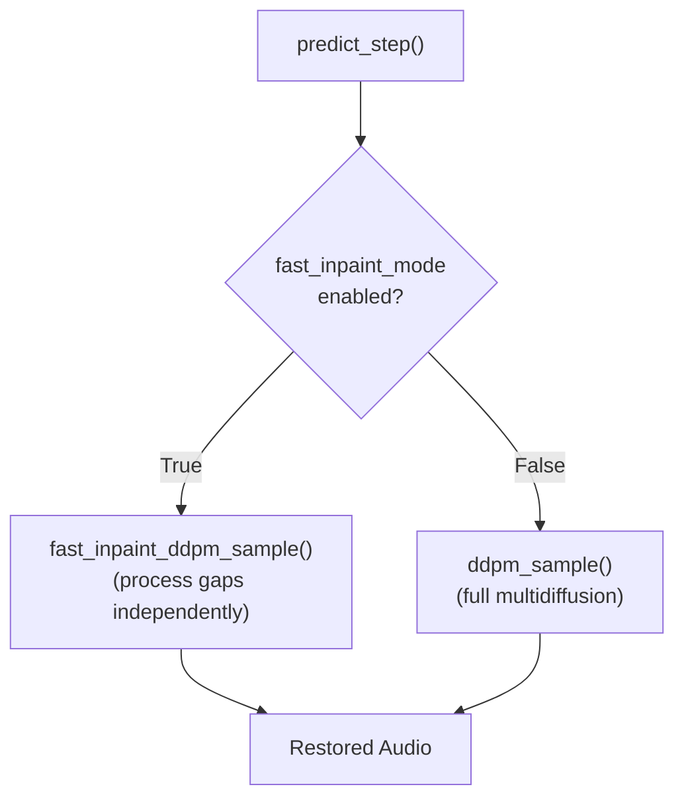
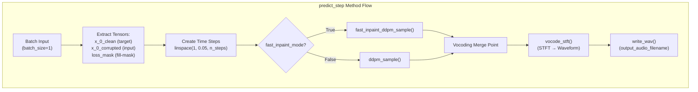
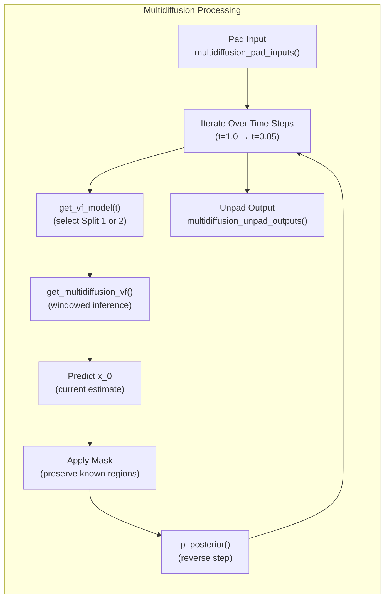
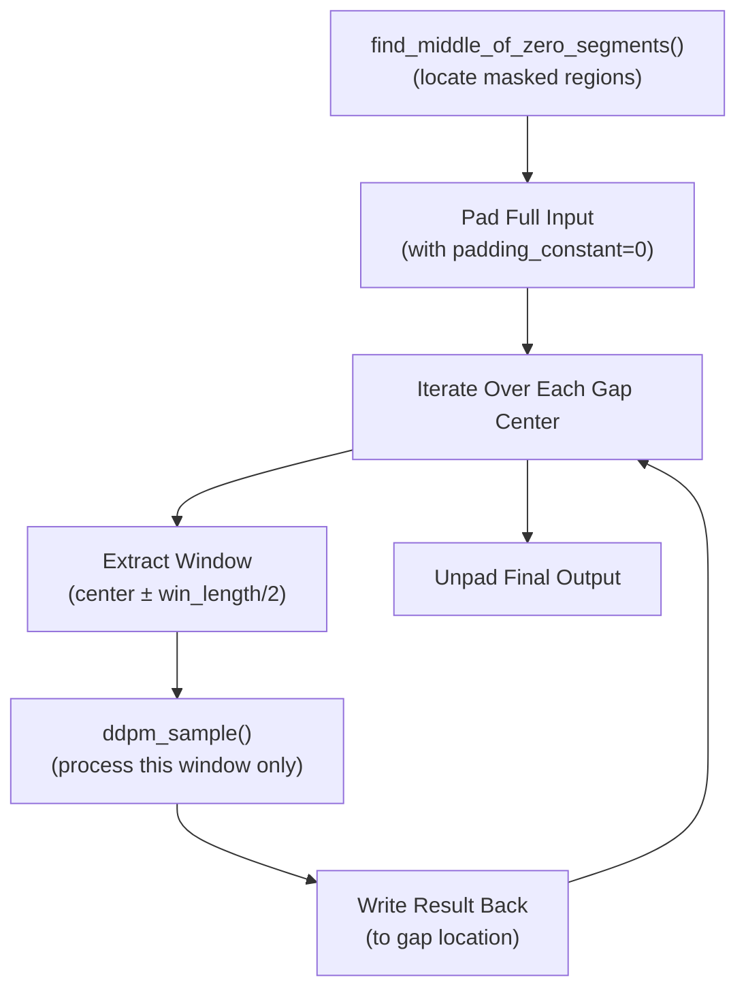

<!-- source: DeepWiki mcp.deepwiki.com · repo NVIDIA/diffusion-audio-restoration · page 3.2 Batch Processing Datasets · fetched 2026-10-26 -->

# Batch Processing Datasets

<details>
<summary>Relevant source files</summary>

The following files were used as context for generating this wiki page:

- [A2SB_lightning_module_api.py](A2SB_lightning_module_api.py)
- [README.md](README.md)

</details>


This page describes how to process entire datasets of audio files using A2SB's batch processing scripts. These scripts leverage PyTorch Lightning's prediction pipeline to efficiently restore multiple audio files in parallel, organizing outputs in a structured manner.

For processing individual audio files with automatic rolloff detection, see [Single File API](#3.1). For detailed information about the bandwidth extension and inpainting tasks themselves, see [Bandwidth Extension](#3.3) and [Inpainting](#3.4).

## Overview

A2SB provides two batch processing scripts for dataset-level audio restoration:

| Script | Purpose | Task Type |
|--------|---------|-----------|
| `inference/A2SB_upsample_dataset.py` | Batch bandwidth extension | Upsampling from low-frequency to full-frequency audio |
| `inference/A2SB_inpaint_dataset.py` | Batch inpainting | Filling in missing/corrupted temporal segments |

Both scripts use the same underlying architecture:
- Read audio file paths from manifest CSV files
- Load pretrained ensemble models via `TimePartitionedPretrainedSTFTBridgeModel`
- Process files through PyTorch Lightning's `Trainer.predict()` pipeline
- Write restored audio to organized output directories

**Sources:** [README.md:64-69]()

## Batch Processing Architecture



**Sources:** [A2SB_lightning_module_api.py:35-210](), [README.md:64-69]()

## Bandwidth Extension Dataset Processing

### Command Line Usage

The `A2SB_upsample_dataset.py` script processes entire datasets for bandwidth extension:

```bash
cd inference/
python A2SB_upsample_dataset.py -dn DATASET_NAME -exp ensemble_2split_sampling -cf 4000
```

**Parameters:**

| Parameter | Flag | Description | Default |
|-----------|------|-------------|---------|
| Dataset Name | `-dn` | Name matching `DATASET_NAME_manifest.csv` | Required |
| Experiment Config | `-exp` | Config file name (without `.yaml`) | Required |
| Cutoff Frequency | `-cf` | Low-pass cutoff frequency in Hz | Required |

### Processing Flow



The script creates a degraded version by applying a low-pass filter at the specified cutoff frequency, then uses the model to predict the missing high-frequency content. The loss mask is set to 1 for frequencies above the cutoff, indicating which spectral regions need restoration.

**Sources:** [README.md:64-68](), [A2SB_lightning_module_api.py:186-210]()

## Inpainting Dataset Processing

### Command Line Usage

The `A2SB_inpaint_dataset.py` script processes datasets for temporal inpainting:

```bash
cd inference/
python A2SB_inpaint_dataset.py -dn DATASET_NAME -exp ensemble_2split_sampling -inp_len 0.3 -inp_every 5.0
```

**Parameters:**

| Parameter | Flag | Description | Default |
|-----------|------|-------------|---------|
| Dataset Name | `-dn` | Name matching `DATASET_NAME_manifest.csv` | Required |
| Experiment Config | `-exp` | Config file name (without `.yaml`) | Required |
| Inpaint Length | `-inp_len` | Duration of each gap in seconds | Required |
| Inpaint Interval | `-inp_every` | Interval between gaps in seconds | Required |

### Fast Inpainting Mode

The inpainting script can operate in two modes:

1. **Standard Mode:** Uses full multidiffusion with overlapping windows for high quality
2. **Fast Inpainting Mode:** Processes each gap independently for faster inference

The mode is controlled by the `fast_inpaint_mode` parameter in the config YAML and affects which method is called:



**Sources:** [A2SB_lightning_module_api.py:64](), [A2SB_lightning_module_api.py:152-183](), [A2SB_lightning_module_api.py:196-203]()

## Core Prediction Pipeline

The batch processing scripts delegate the actual restoration to the `predict_step()` method of `TimePartitionedPretrainedSTFTBridgeModel`:



Key implementation details from `predict_step()`:

- **Batch Size:** Only supports `batch_size=1` for now [A2SB_lightning_module_api.py:188]()
- **Output Directory:** Organized by batch's `outdir` field [A2SB_lightning_module_api.py:190]()
- **Sampling Steps:** Defaults to `predict_n_steps` parameter (e.g., 50) [A2SB_lightning_module_api.py:195]()
- **Multidiffusion Parameters:** Uses `predict_win_length` and `predict_hop_length` [A2SB_lightning_module_api.py:198-199]()

**Sources:** [A2SB_lightning_module_api.py:186-210]()

## DDPM Sampling Methods

The batch processing uses sophisticated sampling strategies for long audio:

### Standard DDPM Sampling

The `ddpm_sample()` method implements multidiffusion for processing arbitrarily long spectrograms:



**Key Features:**
- **Window Length:** `predict_win_length` (default 256 frames) [A2SB_lightning_module_api.py:107]()
- **Hop Length:** `predict_hop_length` (default 128 frames) [A2SB_lightning_module_api.py:108]()
- **Batch Processing:** Vector field computed in batches of `predict_batch_size` (default 16) [A2SB_lightning_module_api.py:109]()
- **Padding:** Input padded to ensure complete coverage [A2SB_lightning_module_api.py:118-119]()

### Fast Inpainting Sampling

The `fast_inpaint_ddpm_sample()` method optimizes for sparse inpainting:



**Assumptions:**
- Each masked segment is shorter than `win_length` [A2SB_lightning_module_api.py:157]()
- Masked segments are sufficiently separated [A2SB_lightning_module_api.py:157]()
- Faster than standard mode but may have lower quality at gap boundaries

**Sources:** [A2SB_lightning_module_api.py:106-149](), [A2SB_lightning_module_api.py:152-183]()

## Configuration Parameters

Both batch processing scripts load configuration from YAML files (e.g., `ensemble_2split_sampling.yaml`). Key parameters:

### Model Configuration

| Parameter | Description | Typical Value |
|-----------|-------------|---------------|
| `pretrained_checkpoints` | List of checkpoint paths for ensemble | `[split1.ckpt, split2.ckpt]` |
| `t_cutoffs` | Time partition boundaries | `[0.5]` for 2-split |
| `predict_n_steps` | Number of diffusion steps | 50 |
| `beta_max` | Maximum noise schedule parameter | 0.3 |
| `use_ot_ode` | Use ODE vs SDE formulation | False (SDE) |

### Processing Configuration

| Parameter | Description | Typical Value |
|-----------|-------------|---------------|
| `predict_win_length` | Temporal window size (frames) | 256 |
| `predict_hop_length` | Multidiffusion hop size (frames) | 128 |
| `predict_batch_size` | Batch size for VF computation | 16 |
| `fast_inpaint_mode` | Use fast inpainting optimization | False |
| `output_audio_filename` | Template for output paths | `"output/recon.wav"` |

**Sources:** [A2SB_lightning_module_api.py:36-49](), [README.md:41-42]()

## Output Organization

The batch processing scripts organize outputs in a structured directory hierarchy:

```
output_dir/
├── DATASET_NAME/
│   ├── train/
│   │   ├── file1/
│   │   │   └── recon.wav
│   │   ├── file2/
│   │   │   └── recon.wav
│   ├── validation/
│   │   └── ...
│   └── test/
│       └── ...
```

The directory structure is determined by:
- `predict_output_dir`: Base output directory [A2SB_lightning_module_api.py:51]()
- `batch['outdir']`: Per-sample subdirectory path [A2SB_lightning_module_api.py:190]()
- `output_audio_filename`: Final output filename [A2SB_lightning_module_api.py:207]()

Each processed file gets its own subdirectory containing the restored audio at 44.1kHz sampling rate.

**Sources:** [A2SB_lightning_module_api.py:190-191](), [A2SB_lightning_module_api.py:207]()

## Data Preparation Requirements

Both batch processing scripts require properly formatted manifest files. See [Data Preparation](#2.2) for details on the manifest CSV format:

```csv
split,file_path,duration
train,PATH/TO/AUDIO.wav,10.0
validation,PATH/TO/AUDIO.wav,10.0
test,PATH/TO/AUDIO.wav,10.0
```

The scripts will process files from the specified split (train/validation/test) as defined in the manifest.

**Sources:** [README.md:30-40]()

## Performance Considerations

### Memory Management

- **Batch Size 1:** Current implementation processes one file at a time to handle arbitrarily long audio [A2SB_lightning_module_api.py:188]()
- **Multidiffusion Batching:** VF model operates on `predict_batch_size` windows simultaneously [A2SB_lightning_module_api.py:132-134]()
- **GPU Memory:** Adjust `predict_batch_size` based on available VRAM

### Computational Efficiency

- **Fast Inpainting:** Use `fast_inpaint_mode=True` for sparse inpainting with multiple small gaps [A2SB_lightning_module_api.py:200-203]()
- **Standard Mode:** Better quality for dense inpainting or overlapping gaps [A2SB_lightning_module_api.py:196-199]()
- **Multi-GPU:** PyTorch Lightning's DDP strategy can be configured for distributed processing

**Sources:** [A2SB_lightning_module_api.py:188](), [A2SB_lightning_module_api.py:109](), [A2SB_lightning_module_api.py:196-203]()

---

