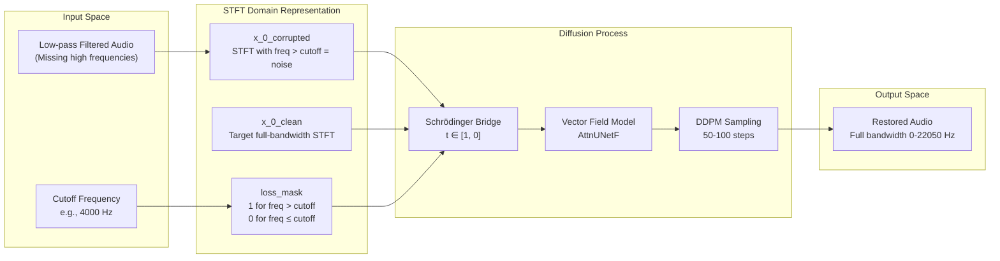
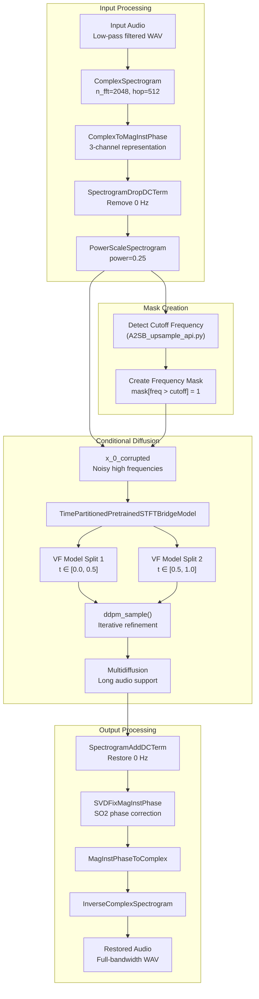
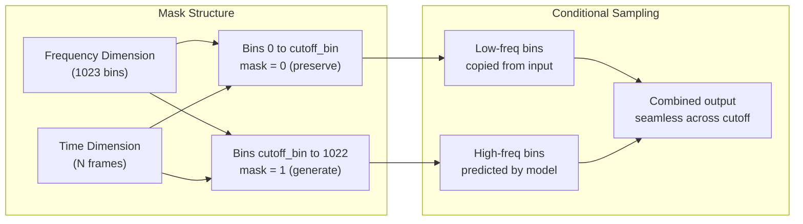
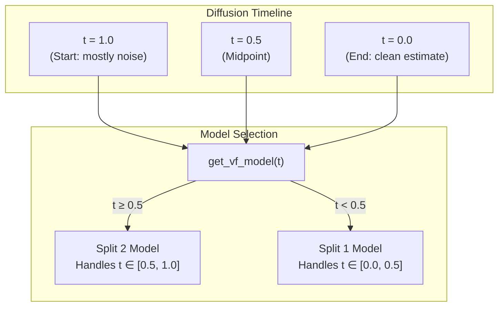
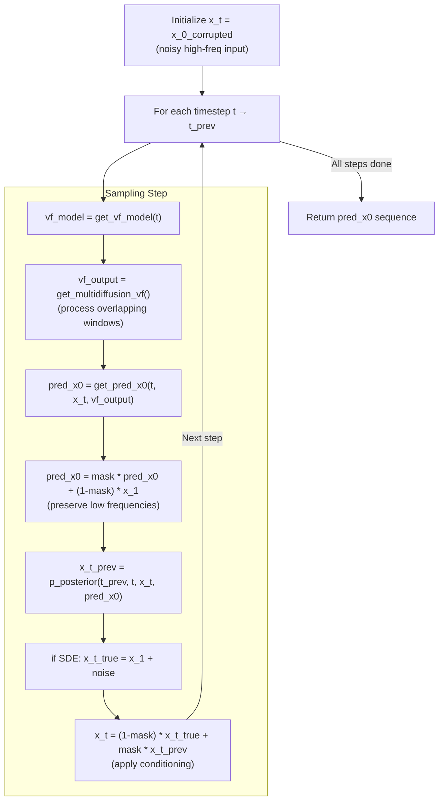
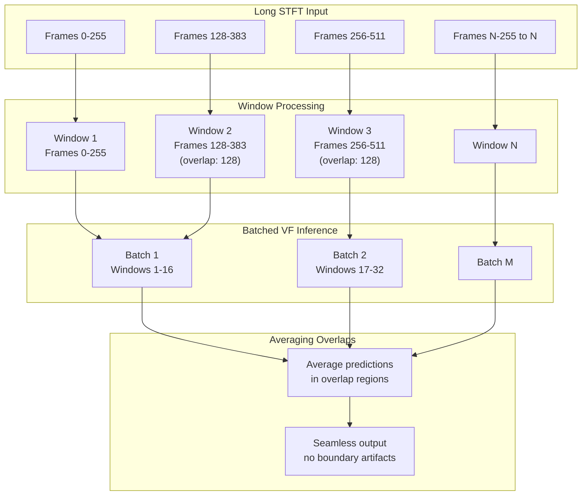
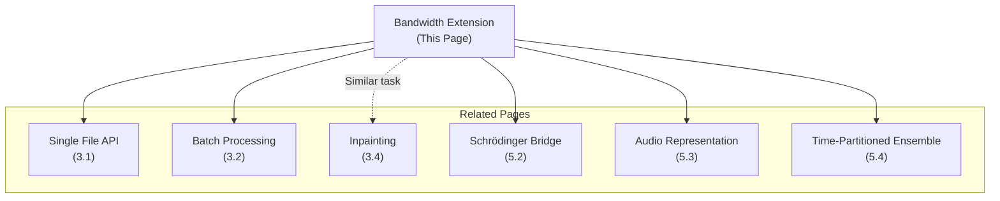

<!-- source: DeepWiki mcp.deepwiki.com · repo NVIDIA/diffusion-audio-restoration · page 3.3 Bandwidth Extension · fetched 2026-10-26 -->

# Bandwidth Extension

<details>
<summary>Relevant source files</summary>

The following files were used as context for generating this wiki page:

- [A2SB_lightning_module_api.py](A2SB_lightning_module_api.py)
- [README.md](README.md)
- [configs/ensemble_2split_sampling.yaml](configs/ensemble_2split_sampling.yaml)

</details>


## Purpose and Scope

This page provides a technical deep-dive into the **bandwidth extension** (BWE) task in A2SB, including its formulation, key parameters, and implementation details. Bandwidth extension is one of two primary restoration tasks supported by A2SB, where the model predicts missing high-frequency components to restore full-bandwidth audio from low-pass filtered inputs.

For practical usage instructions, see [Single File API](#3.1) for processing individual files or [Batch Processing Datasets](#3.2) for processing entire datasets. For implementation details of the other restoration task, see [Inpainting](#3.4). For the underlying diffusion formulation, see [Schrödinger Bridge Diffusion](#5.2).

**Sources:** [README.md:19-19](), [README.md:64-75]()

## Overview of Bandwidth Extension

Bandwidth extension restores high-frequency content in audio signals that have been degraded by low-pass filtering or bandwidth limitations. This is particularly relevant for:

- **Telephony audio**: Restoring music or speech recorded through bandwidth-limited channels
- **Compressed audio**: Recovering frequencies lost in lossy compression
- **Historical recordings**: Enhancing old recordings with limited frequency response
- **Real-world degradations**: Handling audio captured with equipment limitations

A2SB formulates bandwidth extension as a **conditional diffusion problem** where the model generates high-frequency components while preserving the existing low-frequency information. The task operates entirely in the STFT (spectrogram) domain, treating frequency bands above a specified cutoff as missing data to be inpainted.

**Key characteristics:**
- **Frequency-selective**: Only regenerates content above the cutoff frequency
- **Conditional preservation**: Low-frequency content is kept intact through masking
- **End-to-end**: Operates directly on spectrograms without requiring a separate vocoder
- **Arbitrary length**: Can process hour-long audio through multidiffusion

**Sources:** [README.md:17-25](), [A2SB_lightning_module_api.py:105-149]()

## Task Formulation as Masked Diffusion

Bandwidth extension is formulated as a **frequency-masked diffusion problem** where:



### Mask Structure

The bandwidth extension mask is a **binary frequency mask** in the STFT domain:

| Frequency Component | Mask Value | Behavior |
|---------------------|------------|----------|
| Below cutoff frequency | `0` (False) | Preserved from input |
| Above cutoff frequency | `1` (True) | Generated by diffusion |
| DC term (0 Hz) | Removed | Handled separately |

The mask is applied as:
- **During sampling**: `x_t = (1 - mask) * x_t_true + mask * x_t_predicted` at each timestep
- **On predictions**: `pred_x0 = pred_x0 * mask + (1 - mask) * x_1` to ensure low frequencies remain unchanged

**Sources:** [A2SB_lightning_module_api.py:106-149](), [A2SB_lightning_module_api.py:186-209]()

## Key Parameters

### Cutoff Frequency (`-cf`, `cutoff_freq`)

The **cutoff frequency** defines the boundary between preserved and restored frequency content:

| Parameter | Typical Values | Effect |
|-----------|---------------|--------|
| `-cf 4000` | 4000 Hz | Restore frequencies above 4 kHz (telephony-like) |
| `-cf 8000` | 8000 Hz | Restore frequencies above 8 kHz (more challenging) |
| `-cf 11025` | 11025 Hz (Nyquist/2) | Extreme bandwidth extension |

The cutoff frequency is converted to a **frequency bin index** in the STFT representation:
```
cutoff_bin = int(cutoff_freq * n_fft / sampling_rate)
```

For A2SB's default settings (44.1 kHz, 2048 FFT):
- 4000 Hz → bin ~186 (out of 1024 frequency bins)
- 8000 Hz → bin ~372
- 11025 Hz → bin ~512

**Sources:** [README.md:67-68]()

### Number of Sampling Steps (`-n`, `predict_n_steps`)

The number of diffusion steps controls the quality-speed tradeoff:

| Steps | Quality | Speed | Use Case |
|-------|---------|-------|----------|
| 25-50 | Good | Fast | Quick previews, real-time applications |
| 50-100 | Better | Medium | Standard quality restoration |
| 100-200 | Best | Slow | Maximum quality, offline processing |

The timestep schedule is typically linear: `t ∈ [1.0, 1.0/n_steps]`

**Sources:** [A2SB_lightning_module_api.py:43-43](), [A2SB_lightning_module_api.py:195-195]()

### Multidiffusion Parameters

For processing long audio without boundary artifacts:

| Parameter | Default | Description |
|-----------|---------|-------------|
| `predict_win_length` | 256 | Temporal window length in STFT frames |
| `predict_hop_length` | 128 | Step size (< win_length enables overlap) |
| `predict_batch_size` | 16 | GPU batch size for parallel windows |

When `hop_length < win_length`, overlapping windows are averaged, eliminating discontinuities in hour-long audio.

**Sources:** [A2SB_lightning_module_api.py:44-46](), [A2SB_lightning_module_api.py:105-134](), [configs/ensemble_2split_sampling.yaml:1-123]()

## Implementation Architecture

The bandwidth extension pipeline involves several components working together:



**Sources:** [A2SB_lightning_module_api.py:35-90](), [configs/ensemble_2split_sampling.yaml:63-78](), [configs/ensemble_2split_sampling.yaml:105-119]()

## Frequency Domain Masking Details

### STFT Representation

A2SB represents audio as a **3-channel STFT tensor** with shape `[batch, 3, height, width]`:

| Channel | Content | Range |
|---------|---------|-------|
| 0 | Magnitude (scaled) | [0, ∞) after power scaling |
| 1 | Instantaneous phase (cos) | [-1, 1] |
| 2 | Instantaneous phase (sin) | [-1, 1] |

Where:
- `height` = 1023 frequency bins (DC term removed, Nyquist included)
- `width` = number of temporal frames

**Sources:** [configs/ensemble_2split_sampling.yaml:105-119]()

### Frequency Mask Application

The mask has the same spatial dimensions as the STFT:



The mask ensures **perfect preservation** of low-frequency content while allowing the diffusion model to generate high-frequency content that is:
- **Coherent** with the low-frequency components
- **Temporally consistent** across frames
- **Perceptually plausible** for the given musical context

**Sources:** [A2SB_lightning_module_api.py:136-147]()

## Ensemble Model Selection

For bandwidth extension, the **time-partitioned ensemble** automatically selects the appropriate vector field model based on the diffusion timestep:



This specialization allows each model to focus on a specific phase of the restoration:
- **Split 2** (high t): Coarse structure and overall frequency content
- **Split 1** (low t): Fine details and perceptual quality refinement

The cutoffs are configurable via `t_cutoffs` in the configuration file.

**Sources:** [A2SB_lightning_module_api.py:83-89](), [A2SB_lightning_module_api.py:131-131](), [configs/ensemble_2split_sampling.yaml:83-86]()

## Conditional Sampling Algorithm

The core sampling loop implements **masked Schrödinger Bridge sampling**:



**Key implementation details:**

1. **Model selection**: `get_vf_model(t)` chooses between split models based on current timestep
2. **Multidiffusion**: Processes long audio in overlapping windows, averaging predictions
3. **Masked prediction**: Ensures low frequencies are never modified in `pred_x0`
4. **Conditional update**: Reintroduces low-frequency ground truth at each step
5. **SDE vs ODE**: Optionally adds noise for stochastic sampling (controlled by `use_ot_ode`)

**Sources:** [A2SB_lightning_module_api.py:105-149](), [diffusion.py:compute_gaussian_product_coef](), [diffusion.py:get_multidiffusion_vf]()

## Multidiffusion for Long Audio

To process arbitrarily long audio without boundary artifacts, A2SB employs **multidiffusion** with overlapping windows:



**Algorithm parameters:**
- `win_length`: 256 frames (default) ≈ 3 seconds at 44.1 kHz
- `hop_length`: 128 frames (50% overlap)
- `batch_size`: 16 windows processed in parallel on GPU

This approach enables hour-long audio restoration while maintaining:
- **Temporal coherence**: Overlapping windows ensure smooth transitions
- **GPU efficiency**: Batched processing maximizes hardware utilization  
- **Memory efficiency**: Processes audio in chunks rather than full sequence

**Sources:** [A2SB_lightning_module_api.py:105-149](), [diffusion.py:get_multidiffusion_vf](), [diffusion.py:multidiffusion_pad_inputs](), [diffusion.py:multidiffusion_unpad_outputs]()

## Usage Examples

### Single File Processing

See [Single File API](#3.1) for complete documentation. Basic usage:

```bash
cd inference/
python A2SB_upsample_api.py -f degraded_audio.wav -o restored_audio.wav -n 50
```

The API automatically detects the cutoff frequency in the input audio.

### Batch Dataset Processing

See [Batch Processing Datasets](#3.2) for complete documentation. Basic usage:

```bash
cd inference/
python A2SB_upsample_dataset.py -dn DATASET_NAME -exp ensemble_2split_sampling -cf 4000
```

Processes all test samples in the specified dataset manifest with a 4 kHz cutoff.

**Sources:** [README.md:64-75]()

## Configuration Reference

Key configuration options for bandwidth extension in `ensemble_2split_sampling.yaml`:

| Section | Parameter | Value | Purpose |
|---------|-----------|-------|---------|
| `model` | `pretrained_checkpoints` | List of paths | Paths to split model checkpoints |
| `model` | `t_cutoffs` | `[0.5]` | Timestep boundaries for model selection |
| `model` | `predict_n_steps` | 50 | Number of diffusion sampling steps |
| `model` | `predict_win_length` | 256 | Multidiffusion window size |
| `model` | `predict_hop_length` | 128 | Multidiffusion hop size |
| `model` | `predict_batch_size` | 16 | Parallel window batch size |
| `model` | `beta_max` | 1.0 | Maximum noise schedule parameter |
| `model` | `use_ot_ode` | false | Use ODE (true) or SDE (false) sampling |
| `model` | `sampling_rate` | 44100 | Output audio sampling rate |

**Sources:** [configs/ensemble_2split_sampling.yaml:46-86]()

## Performance Characteristics

### Computational Requirements

| Audio Length | Processing Time (A100) | Peak Memory | Multidiffusion |
|--------------|------------------------|-------------|----------------|
| 10 seconds | ~5-10 seconds | <8 GB | Optional |
| 1 minute | ~30-60 seconds | <8 GB | Recommended |
| 1 hour | ~30-45 minutes | <16 GB | Required |

Times assume 50 sampling steps with default multidiffusion parameters.

### Quality Considerations

Bandwidth extension quality depends on:

1. **Cutoff frequency**: Lower cutoffs (more missing content) are more challenging
2. **Input audio complexity**: Dense polyphonic music is harder than simple tones
3. **Number of steps**: More steps generally improve quality with diminishing returns
4. **Training data**: Model performs best on music similar to training distribution

**Sources:** [README.md:17-25]()

## Relationship to Other Components



**Sources:** [README.md:1-123]()

---

