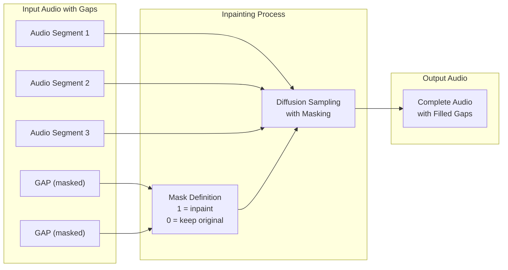
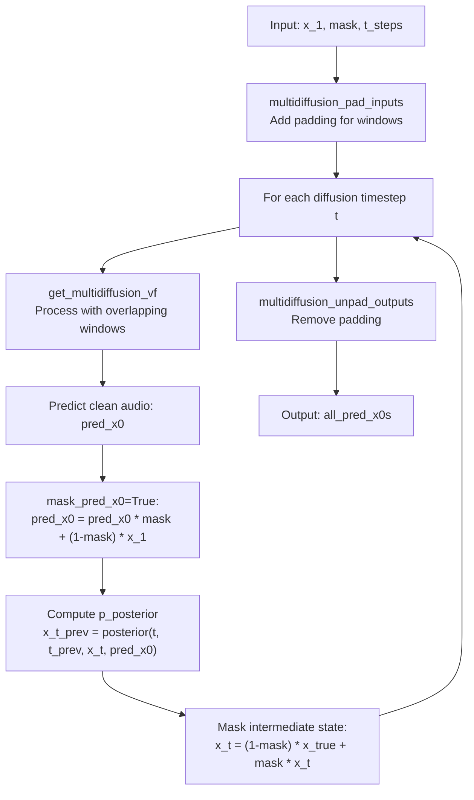
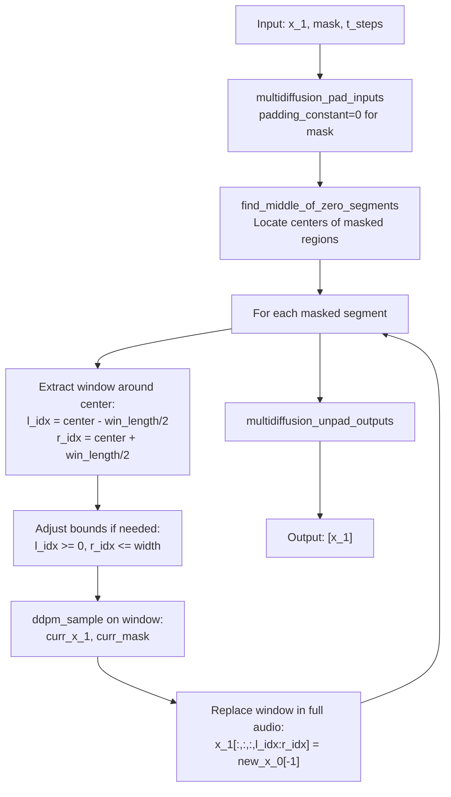
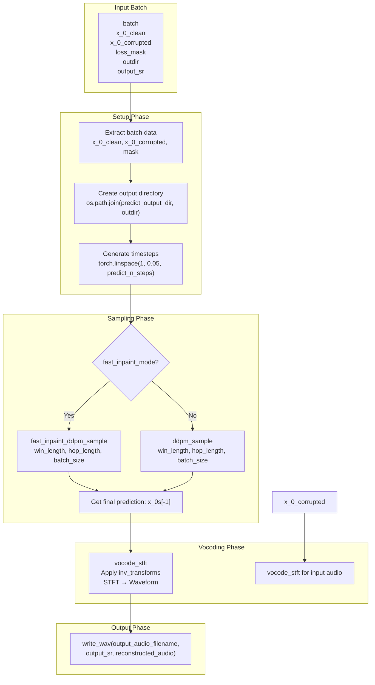

<!-- source: DeepWiki mcp.deepwiki.com · repo NVIDIA/diffusion-audio-restoration · page 3.4 Inpainting · fetched 2026-10-26 -->

# Inpainting

<details>
<summary>Relevant source files</summary>

The following files were used as context for generating this wiki page:

- [A2SB_lightning_module_api.py](A2SB_lightning_module_api.py)
- [README.md](README.md)

</details>


## Purpose and Scope

This page provides detailed information about the inpainting task in A2SB, which regenerates missing temporal segments of audio. For information about bandwidth extension (predicting high-frequency components), see [Bandwidth Extension](#3.3). For general inference setup and dataset preparation, see [Batch Processing Datasets](#3.2).

Inpainting in A2SB uses diffusion sampling with masking to reconstruct arbitrary-length gaps in audio signals while maintaining natural transitions and acoustic consistency with surrounding context.

Sources: [README.md:1-105]()

## What is Inpainting?

Inpainting is the task of reconstructing missing temporal segments within an audio signal. Unlike bandwidth extension which focuses on frequency content, inpainting operates on the time axis to fill in gaps where audio data has been removed or corrupted.



Sources: [README.md:19-19](), [A2SB_lightning_module_api.py:186-210]()

## Mask-Based Inpainting Process

The inpainting process relies on a binary mask that defines which regions of the audio spectrogram should be regenerated. The mask, referred to as `loss_mask` in the code, has the following semantics:

| Mask Value | Meaning | Diffusion Behavior |
|------------|---------|-------------------|
| `1` | Region to inpaint | Model predicts this region |
| `0` | Known audio | Original audio is preserved |

During the diffusion sampling process, masked regions undergo iterative refinement while unmasked regions are replaced with the original (corrupted) audio at each timestep. This ensures that the generated content respects the boundary conditions provided by the surrounding context.

### Mask Application During Sampling

At each diffusion timestep `t`, the sampling process applies masking in two locations:

1. **Predicted x0 Masking** (optional): After predicting the clean audio, the prediction is masked to preserve original content in unmasked regions:
   ```
   pred_x0 = pred_x0 * mask + (1 - mask) * x_1
   ```

2. **Intermediate State Masking**: After computing the posterior, the intermediate diffusion state is constrained:
   ```
   x_t = (1 - mask) * x_true + mask * x_t
   ```

This dual masking strategy ensures both the final prediction and the diffusion trajectory respect the known audio regions.

Sources: [A2SB_lightning_module_api.py:136-147](), [A2SB_lightning_module_api.py:178-180]()

## Inpainting Modes

A2SB provides two inpainting modes optimized for different use cases.

### Standard Inpainting with Multidiffusion

The standard inpainting mode processes the entire audio using the multidiffusion algorithm, which enables long-form audio processing by dividing the spectrogram into overlapping windows.



**Key characteristics:**
- Handles arbitrary-length gaps at any location
- Processes the full spectrogram width with overlapping windows
- Window size controlled by `predict_win_length` parameter
- Overlap controlled by `predict_hop_length` parameter
- Suitable for complex masking patterns with multiple gaps

Sources: [A2SB_lightning_module_api.py:106-149]()

### Fast Inpainting Mode

Fast inpainting mode (`fast_inpaint_mode=True`) is an optimized variant that assumes each masked segment is shorter than the window length and well-separated from other masked segments.



**Key characteristics:**
- Only processes small windows around each masked segment
- Significantly faster than standard mode for sparse gaps
- Requires: each gap < `win_length`, gaps sufficiently separated
- Uses `find_middle_of_zero_segments` to locate gap centers
- Returns a single result rather than trajectory of intermediate predictions

**Performance trade-off:** Fast mode is more efficient but less flexible. Use standard mode for overlapping gaps or when gap length approaches window size.

Sources: [A2SB_lightning_module_api.py:40-41](), [A2SB_lightning_module_api.py:152-183](), [A2SB_lightning_module_api.py:196-203]()

## Inference Pipeline

The complete inpainting inference pipeline implemented in `TimePartitionedPretrainedSTFTBridgeModel.predict_step`:



**Pipeline steps:**

1. **Input Extraction**: Extract spectrogram representations and mask from batch
2. **Output Directory Setup**: Create output directory structure based on `batch['outdir']`
3. **Timestep Schedule**: Generate linearly spaced timesteps from 1.0 to 0.05
4. **Mode Selection**: Choose between fast and standard inpainting based on `fast_inpaint_mode` flag
5. **Diffusion Sampling**: Execute the selected sampling algorithm with multidiffusion parameters
6. **Waveform Reconstruction**: Apply inverse transforms to convert final spectrogram to waveform
7. **Audio Writing**: Save reconstructed audio to disk at specified sample rate

Sources: [A2SB_lightning_module_api.py:186-210]()

## Parameters and Configuration

### Core Inpainting Parameters

The following table describes key parameters for configuring inpainting behavior:

| Parameter | Type | Location | Description |
|-----------|------|----------|-------------|
| `inp_len` | float | CLI argument | Length of each inpainted segment in seconds |
| `inp_every` | float | CLI argument | Spacing between inpainted segments in seconds |
| `fast_inpaint_mode` | bool | Model config | Enable fast inpainting optimization |
| `predict_n_steps` | int | Model config | Number of diffusion sampling steps (default: 50) |
| `predict_win_length` | int | Model config | Window length for multidiffusion (default: 256) |
| `predict_hop_length` | int | Model config | Hop length for multidiffusion (default: 128) |
| `predict_batch_size` | int | Model config | Batch size for multidiffusion windows (default: 16) |

### inp_len

The `inp_len` parameter specifies the duration (in seconds) of each segment to be inpainted. This parameter directly controls the temporal extent of gaps that will be regenerated in the audio.

**Typical values:**
- `0.1` - 0.5 seconds: Short gaps, suitable for removing brief artifacts
- `0.3` seconds: Recommended default for general-purpose inpainting
- `0.5` - 1.0 seconds: Longer gaps for more substantial restoration

**Relationship to spectrogram:**
```
num_frames = inp_len * sampling_rate / hop_length_stft
```

For 44.1kHz audio with 512-sample hop:
- `inp_len=0.3` → ~26 frames in spectrogram

Sources: [README.md:68-68]()

### inp_every

The `inp_every` parameter controls the spacing (in seconds) between consecutive inpainted segments. This creates a regular pattern of gaps throughout the audio.

**Usage patterns:**

1. **Regular interval testing:**
   ```
   inp_every = 5.0  # Inpaint every 5 seconds
   ```
   Creates gaps at: 0-0.3s, 5-5.3s, 10-10.3s, etc.

2. **Dense inpainting:**
   ```
   inp_every = 1.0  # Frequent gaps
   ```
   More challenging restoration task

3. **Sparse inpainting:**
   ```
   inp_every = 10.0  # Infrequent gaps
   ```
   Easier restoration with more context

**Important constraint for fast mode:**
```
inp_every > inp_len + margin
```
Where margin ensures gaps don't overlap or come too close together.

Sources: [README.md:68-68]()

### Multidiffusion Parameters

These parameters control how long audio is processed using overlapping windows:

**predict_win_length:**
- Specifies the width (in spectrogram frames) of each processing window
- Default: 256 frames (~3 seconds at 44.1kHz with 512 hop)
- Must be ≥ maximum gap length for fast inpainting mode
- Larger values: more context but more memory usage

**predict_hop_length:**
- Specifies the step size between consecutive windows
- Default: 128 frames (50% overlap)
- When `hop_length < win_length`, multidiffusion blending is applied
- Smaller values: smoother transitions but slower processing

**predict_batch_size:**
- Number of windows processed in parallel during multidiffusion
- Default: 16
- Adjust based on GPU memory availability
- Does not affect output quality, only processing speed

Sources: [A2SB_lightning_module_api.py:43-46]()

## Usage Examples

### Basic Dataset Inpainting

Inpaint gaps on an entire dataset using standard mode:

```bash
cd inference/
python A2SB_inpaint_dataset.py \
    -dn DATASET_NAME \
    -exp ensemble_2split_sampling \
    -inp_len 0.3 \
    -inp_every 5.0
```

This command:
- Processes all test split files in `DATASET_NAME_manifest.csv`
- Inpaints 0.3-second gaps every 5 seconds
- Uses the 2-split ensemble model configuration
- Outputs restored audio to experiment directory

Sources: [README.md:68-68]()

### Fast Inpainting Mode

For sparse, short gaps, enable fast mode in the configuration YAML:

```yaml
model:
  class_path: A2SB_lightning_module_api.TimePartitionedPretrainedSTFTBridgeModel
  init_args:
    fast_inpaint_mode: true
    predict_win_length: 256
    # Ensure inp_len * sr / hop_length < predict_win_length
```

Fast mode is appropriate when:
- Each gap is shorter than the window length
- Gaps are well-separated (spacing > window length)
- Processing speed is critical

Sources: [A2SB_lightning_module_api.py:40-41](), [A2SB_lightning_module_api.py:64-64]()

### Custom Timestep Schedule

Modify the number of sampling steps in `predict_step` logic:

```python
# In TimePartitionedPretrainedSTFTBridgeModel.predict_step
t_steps = torch.linspace(1, 0.05, int(self.predict_n_steps))
```

Higher `predict_n_steps` values:
- More refinement iterations
- Better quality but slower inference
- Typical range: 25-100 steps

Sources: [A2SB_lightning_module_api.py:195-195]()

## Best Practices and Recommendations

### Choosing Inpainting Parameters

**For short, sparse gaps:**
- Use `fast_inpaint_mode=True`
- Set `inp_len=0.1` to `0.3` seconds
- Set `inp_every=5.0` to `10.0` seconds
- Use default window parameters

**For longer or dense gaps:**
- Use standard inpainting mode
- Set `inp_len=0.3` to `1.0` seconds  
- Set `inp_every=1.0` to `3.0` seconds
- Consider increasing `predict_win_length` to 512

**For complex masking patterns:**
- Standard mode required (fast mode won't work)
- Prepare custom mask in dataset preprocessing
- Ensure mask is properly aligned with STFT frame boundaries

### Memory and Performance Optimization

**GPU Memory Management:**
- Reduce `predict_batch_size` if encountering OOM errors
- Reduce `predict_win_length` for very long audio files
- Process very long files in segments with overlap

**Speed Optimization:**
- Use fast inpainting mode when applicable (10-50x speedup possible)
- Increase `predict_hop_length` toward `predict_win_length` (less overlap)
- Decrease `predict_n_steps` to minimum acceptable quality (25-50 steps often sufficient)

**Quality Optimization:**
- Increase `predict_n_steps` to 100+ for highest quality
- Use smaller `predict_hop_length` (64-128) for smoother transitions
- Use 2-split ensemble models rather than 1-split models
- Ensure adequate context around gaps (at least 1-2 seconds on each side)

### Mask Design Guidelines

When creating custom masks:

1. **Binary values:** Mask should contain only 0.0 (keep) and 1.0 (inpaint)
2. **Spectrogram alignment:** Mask dimensions must match spectrogram: `[B, C, H, W]`
3. **Temporal dimension:** Inpainting operates on width dimension (time axis)
4. **Smooth boundaries:** Abrupt mask transitions are handled naturally by diffusion
5. **Context preservation:** Leave sufficient unmasked context around gaps

### Common Pitfalls

**Fast mode limitations:**
- Will not work correctly if gaps overlap or are too close
- Assumes gaps are shorter than window length
- May miss gaps if spacing is irregular

**Multidiffusion artifacts:**
- Can occur if `hop_length` is too large relative to `win_length`
- Use at least 25-50% overlap (e.g., hop=128, win=256)

**Boundary effects:**
- Audio at file boundaries may have reduced quality
- Use padding in dataset preparation if needed

**Mask synchronization:**
- Ensure mask is generated at correct STFT frame rate
- Verify mask dimensions match processed spectrogram

Sources: [A2SB_lightning_module_api.py:106-210]()

---

## Code Entity Reference

Key classes and functions for inpainting:

| Entity | Location | Purpose |
|--------|----------|---------|
| `TimePartitionedPretrainedSTFTBridgeModel` | [A2SB_lightning_module_api.py:35-211]() | Main inference model with ensemble support |
| `predict_step` | [A2SB_lightning_module_api.py:186-210]() | Entry point for inference pipeline |
| `ddpm_sample` | [A2SB_lightning_module_api.py:106-149]() | Standard diffusion sampling with masking |
| `fast_inpaint_ddpm_sample` | [A2SB_lightning_module_api.py:152-183]() | Optimized sampling for sparse gaps |
| `get_multidiffusion_vf` | [diffusion.py]() | Process vector field with overlapping windows |
| `find_middle_of_zero_segments` | [utils.py]() | Locate centers of masked regions |
| `multidiffusion_pad_inputs` | [diffusion.py]() | Add padding for window processing |
| `multidiffusion_unpad_outputs` | [diffusion.py]() | Remove padding after processing |
| `vocode_stft` | [A2SB_lightning_module_api.py:92-103]() | Convert spectrograms to waveforms |
| `apply_audio_transforms` | [audio_transforms/transforms.py]() | Apply inverse transform pipeline |

Sources: [A2SB_lightning_module_api.py:1-535]()

---

