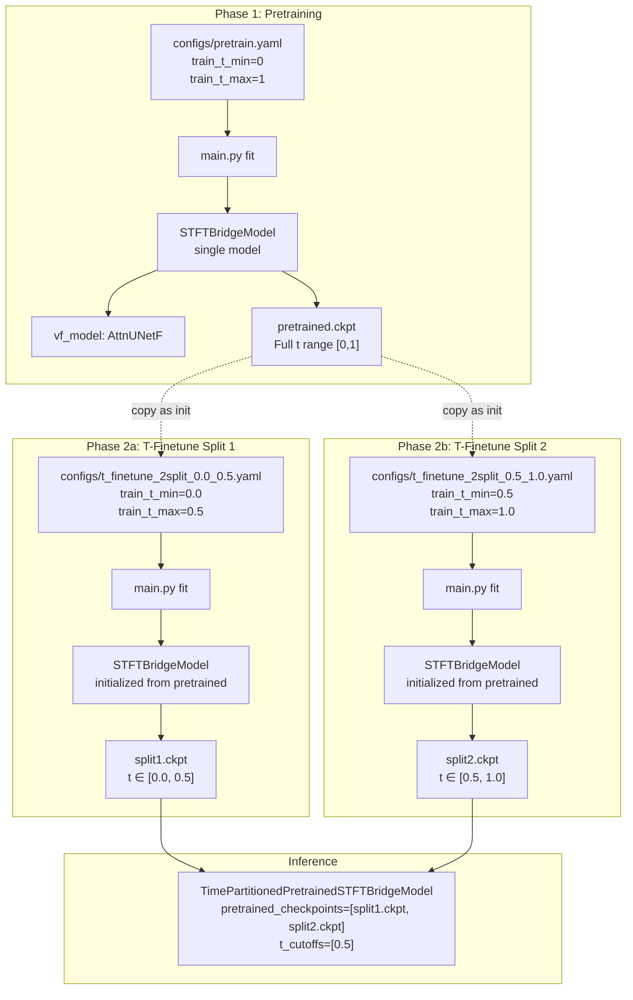
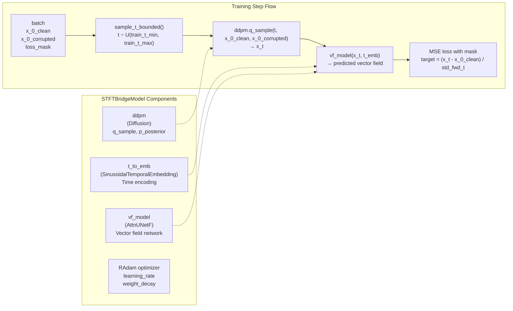
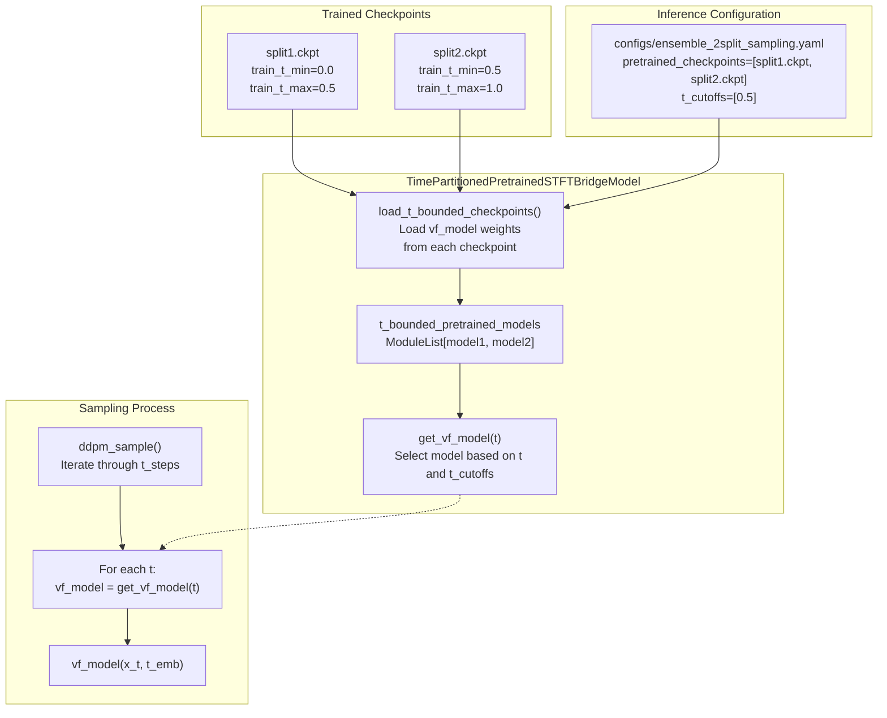
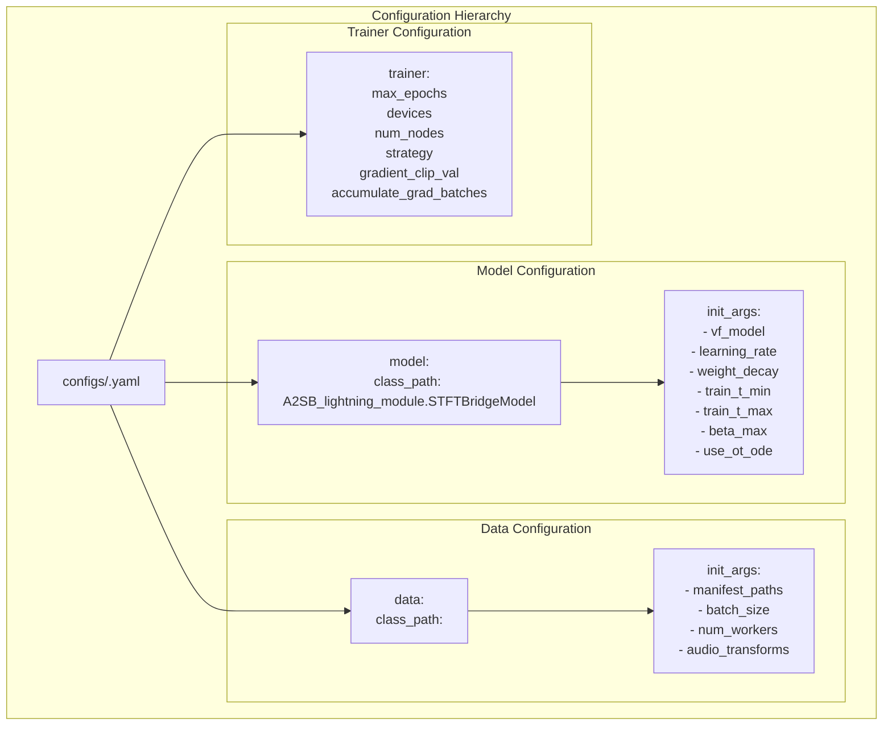

<!-- source: DeepWiki mcp.deepwiki.com · repo NVIDIA/diffusion-audio-restoration · page 4 Training Guide · fetched 2026-10-26 -->

# Training Guide

<details>
<summary>Relevant source files</summary>

The following files were used as context for generating this wiki page:

- [A2SB_lightning_module.py](A2SB_lightning_module.py)
- [README.md](README.md)

</details>


This document provides a comprehensive guide to training A2SB models from scratch. It covers the two-phase training process (pretraining and T-finetuning), configuration parameters, and practical considerations for training on your own datasets.

For information about using pre-trained models for inference, see [Inference Guide](#3). For theoretical background on the 2-split ensemble approach, see [Time-Partitioned Ensemble](#5.4).

---

## Training Overview

A2SB uses a two-phase training strategy that enables the model to specialize across different diffusion timestep ranges:

1. **Pretraining Phase**: Train a single model on the full diffusion timestep range `t ∈ [0, 1]`
2. **T-Finetuning Phase**: Train separate specialized models for specific timestep ranges (e.g., `t ∈ [0.0, 0.5]` and `t ∈ [0.5, 1.0]`)

The T-finetuning phase creates an ensemble of models that can be combined during inference, where each model handles its specialized timestep range more effectively than a single model trained on the full range.

### Training Flow Diagram



**Sources:** [README.md:45-60](), [A2SB_lightning_module.py:208-243](), [A2SB_lightning_module.py:34-86]()

---

## Pretraining

The pretraining phase trains a single `STFTBridgeModel` on the full diffusion timestep range. This model serves as the initialization for subsequent T-finetuning.

### Pretraining Command

```bash
python main.py fit --config configs/pretrain.yaml
```

### STFTBridgeModel Architecture

The `STFTBridgeModel` class in [A2SB_lightning_module.py:208-243]() is a PyTorch Lightning module that orchestrates the training process:



**Sources:** [A2SB_lightning_module.py:208-243](), [A2SB_lightning_module.py:370-402]()

### Training Step Details

The training process ([A2SB_lightning_module.py:374-402]()) follows these steps:

1. **Sample Timestep**: Sample `t` uniformly from `[train_t_min, train_t_max]` using `sample_t_bounded()`
2. **Encode Time**: Convert `t` to a 128-dimensional embedding using `t_to_emb()`
3. **Forward Diffusion**: Compute `x_t` by interpolating between `x_0_clean` and `x_0_corrupted` with noise via `ddpm.q_sample()`
4. **Predict Vector Field**: Pass `x_t` and time embedding through `vf_model`
5. **Compute Loss**: MSE between predicted and target vector field, masked by `loss_mask`
6. **Gradient Clipping**: Clip gradients to max norm of 0.5

| Parameter | Default Value | Purpose |
|-----------|--------------|---------|
| `learning_rate` | 1e-4 | Learning rate for RAdam optimizer |
| `weight_decay` | 1e-8 | Weight decay (L2 regularization) |
| `beta_max` | 0.3 | Maximum diffusion noise level |
| `use_ot_ode` | False | Use ODE formulation (vs SDE) |
| `train_t_min` | 0 | Minimum timestep for training |
| `train_t_max` | 1 | Maximum timestep for training |

**Sources:** [A2SB_lightning_module.py:374-402](), [A2SB_lightning_module.py:208-243](), [A2SB_lightning_module.py:370-372]()

### Validation During Pretraining

The validation step ([A2SB_lightning_module.py:434-476]()) evaluates the model at multiple fixed timesteps and performs full sampling:

1. **Multi-timestep Validation**: Compute validation loss at `t = [0.01, 0.25, 0.50, 0.75, 0.99]`
2. **Full Sampling**: Run 25-step DDPM sampling to generate restored audio
3. **Audio Metrics**: Evaluate using metrics from `ssr_eval` library (LSD, SI-SDR, etc.)
4. **Logging**: Log losses and metrics to TensorBoard

**Sources:** [A2SB_lightning_module.py:434-476]()

### Expected Pretraining Outputs

After pretraining completes, you should have:

- Checkpoint file: `<experiment_path>/checkpoints/last.ckpt` or `epoch=X-step=Y.ckpt`
- Training logs in TensorBoard showing decreasing loss
- Validation metrics (LSD, SI-SDR) improving over time
- The checkpoint contains the full Lightning module state including `vf_model` weights

**Sources:** [README.md:45-49]()

---

## T-Finetuning and Split Training

T-finetuning trains specialized models for specific timestep ranges, enabling better performance through model ensembling.

### T-Finetuning Setup

**Step 1: Copy Pretrained Checkpoint**

Copy the pretrained checkpoint to your T-finetuning experiment directory as initialization:

```bash
cp <pretrain_experiment>/checkpoints/last.ckpt <t_finetune_experiment>/init.ckpt
```

**Step 2: Train Split 1 (t ∈ [0.0, 0.5])**

```bash
python main.py fit --config configs/t_finetune_2split_0.0_0.5.yaml
```

Key configuration for Split 1:
```yaml
model:
  train_t_min: 0.0
  train_t_max: 0.5
```

**Step 3: Train Split 2 (t ∈ [0.5, 1.0])**

Create a new config file with modified parameters:

```bash
python main.py fit --config configs/t_finetune_2split_0.5_1.0.yaml
```

Key configuration for Split 2:
```yaml
model:
  train_t_min: 0.5
  train_t_max: 1.0
```

**Sources:** [README.md:51-58]()

### Time-Bounded Sampling

During T-finetuning, the `sample_t_bounded()` method ([A2SB_lightning_module.py:370-372]()) restricts timestep sampling to the configured range:

```
t_range = train_t_max - train_t_min
t ~ Uniform(0, 1) * t_range + train_t_min
```

This ensures each split model only sees timesteps within its designated range during training.

**Sources:** [A2SB_lightning_module.py:370-372](), [A2SB_lightning_module.py:374-402]()

### Creating Ensemble Models for Inference

After T-finetuning both splits, you create an ensemble by loading both checkpoints into `TimePartitionedPretrainedSTFTBridgeModel`:



**Sources:** [A2SB_lightning_module.py:34-86](), [A2SB_lightning_module.py:63-86]()

### Model Selection Logic

The `get_vf_model()` method ([A2SB_lightning_module.py:80-86]()) selects which model to use based on the current timestep:

```
model_idx = 0
for each threshold in t_cutoffs:
    if t >= threshold:
        model_idx += 1
return t_bounded_pretrained_models[model_idx]
```

For a 2-split ensemble with `t_cutoffs=[0.5]`:
- `t ∈ [0.0, 0.5)` → uses `t_bounded_pretrained_models[0]` (Split 1 model)
- `t ∈ [0.5, 1.0]` → uses `t_bounded_pretrained_models[1]` (Split 2 model)

**Sources:** [A2SB_lightning_module.py:80-86]()

### Why Split Training Works

Training separate models for different timestep ranges provides several benefits:

1. **Specialization**: Each model optimizes for a narrower range of noise levels
2. **Better Capacity Utilization**: Model parameters aren't stretched across the full diffusion process
3. **Reduced Interference**: Early-stage denoising (high t) has different characteristics than late-stage refinement (low t)

For more theoretical details, see [Schrödinger Bridge Diffusion](#5.2) and [Time-Partitioned Ensemble](#5.4).

**Sources:** [README.md:51-58]()

---

## Configuration Files

A2SB uses YAML configuration files to control all aspects of training. The configuration is processed by PyTorch Lightning CLI.

### Configuration Structure



**Sources:** [README.md:41-60]()

### Key Configuration Parameters

#### Model Parameters

| Parameter | Type | Description | Pretrain Default | T-Finetune Range |
|-----------|------|-------------|-----------------|------------------|
| `vf_model` | Module | Vector field network (AttnUNetF) | Required | Inherited |
| `learning_rate` | float | Learning rate for RAdam | 1e-4 | Same or lower |
| `weight_decay` | float | L2 regularization | 1e-8 | Same |
| `train_t_min` | float | Minimum training timestep | 0.0 | Split-specific |
| `train_t_max` | float | Maximum training timestep | 1.0 | Split-specific |
| `beta_max` | float | Max diffusion noise level | 0.3 | Same |
| `use_ot_ode` | bool | Use ODE vs SDE formulation | False | Same |
| `n_timestep_channels` | int | Time embedding dimension | 128 | Same |

**Sources:** [A2SB_lightning_module.py:208-243]()

#### Trainer Parameters

| Parameter | Description | Typical Values |
|-----------|-------------|----------------|
| `max_epochs` | Number of training epochs | 100-500 |
| `devices` | Number of GPUs per node | 4-8 |
| `num_nodes` | Number of compute nodes | 1-4 |
| `strategy` | Distributed strategy | "ddp" |
| `gradient_clip_val` | Gradient clipping threshold | 0.5 |
| `accumulate_grad_batches` | Gradient accumulation steps | 1-4 |

**Sources:** [README.md:59-60]()

#### Data Parameters

Configuration for data loading includes:

- **manifest_paths**: List of CSV manifest file paths
- **batch_size**: Samples per batch per GPU
- **num_workers**: Data loading workers
- **audio_transforms**: Forward and inverse transform specifications

For details on data preparation, see [Data Preparation](#2.2).

**Sources:** [README.md:29-43]()

### Example: Pretrain Configuration

```yaml
model:
  class_path: A2SB_lightning_module.STFTBridgeModel
  init_args:
    vf_model:
      class_path: networks.AttnUNetF
      init_args:
        # ... network architecture params ...
    learning_rate: 1.0e-4
    weight_decay: 1.0e-8
    train_t_min: 0.0
    train_t_max: 1.0
    beta_max: 0.3
    use_ot_ode: false

trainer:
  max_epochs: 200
  devices: 8
  num_nodes: 1
  strategy: ddp
  gradient_clip_val: 0.5
```

**Sources:** [README.md:47-49]()

### Example: T-Finetune Split 1 Configuration

```yaml
model:
  class_path: A2SB_lightning_module.STFTBridgeModel
  init_args:
    # Same vf_model configuration
    train_t_min: 0.0      # Split 1: early timesteps
    train_t_max: 0.5      # Split 1: early timesteps
    # Other params same as pretrain

ckpt_path: <pretrain_experiment>/checkpoints/last.ckpt
```

The `ckpt_path` can be specified in the config or via command line to initialize from the pretrained checkpoint.

**Sources:** [README.md:51-58]()

### Modifying Configurations

To adapt training for your setup:

1. **Adjust Batch Size**: Scale based on GPU memory (`batch_size` in data config)
2. **Multi-GPU Setup**: Set `devices` and `num_nodes` in trainer config
3. **Gradient Accumulation**: Use `accumulate_grad_batches` for effective larger batches
4. **Time Range**: Modify `train_t_min` and `train_t_max` for T-finetuning splits
5. **Learning Rate**: May need adjustment based on batch size changes

**Sources:** [README.md:59-60]()

---

## Training Best Practices

### Hardware Requirements

- **GPU Memory**: Minimum 16GB per GPU (24GB+ recommended)
- **Multi-GPU**: Training benefits significantly from multi-GPU setups (use DDP strategy)
- **Storage**: Fast storage for dataset access (SSD recommended)

### Training Time Estimates

Actual training time depends on dataset size, GPU configuration, and model size. Typical training:

- **Pretraining**: Several days on 8 GPUs
- **T-Finetuning**: 1-2 days per split on 8 GPUs

### Monitoring Training

Monitor these metrics during training:

1. **Training Loss** (`train/loss`): Should decrease steadily
2. **Gradient Norm** (`train/gradient_norm`): Should be stable (clipped at 0.5)
3. **Validation Loss at Multiple t**: Check `val_loss_t=0.01`, `val_loss_t=0.25`, etc.
4. **Audio Metrics**: Monitor LSD, SI-SDR during validation
5. **Global Step**: Track training progress

**Sources:** [A2SB_lightning_module.py:374-402](), [A2SB_lightning_module.py:434-476]()

### Checkpoint Management

- Save checkpoints frequently (configure in trainer)
- Keep multiple checkpoint versions for safety
- The pretrained checkpoint is essential for T-finetuning initialization
- Each split checkpoint can be used independently or combined in an ensemble

**Sources:** [README.md:51-58]()

### Troubleshooting

| Issue | Possible Cause | Solution |
|-------|----------------|----------|
| NaN loss | Learning rate too high | Reduce learning rate |
| Loss not decreasing | Model not converging | Check data, increase training time |
| OOM errors | Batch size too large | Reduce batch size or use gradient accumulation |
| Slow training | Data loading bottleneck | Increase `num_workers` |

**Sources:** [A2SB_lightning_module.py:392-394]()

---

## Advanced Training Topics

### Custom Time Range Splits

You can create more than 2 splits by training multiple models with different `train_t_min` and `train_t_max` values. For example, a 3-split configuration:

- Split 1: `train_t_min=0.0, train_t_max=0.33`
- Split 2: `train_t_min=0.33, train_t_max=0.67`
- Split 3: `train_t_min=0.67, train_t_max=1.0`

Then set `t_cutoffs=[0.33, 0.67]` in the inference configuration.

**Sources:** [A2SB_lightning_module.py:80-86](), [README.md:51-58]()

### ODE vs SDE Formulation

The `use_ot_ode` parameter switches between two diffusion formulations:

- **SDE (default)**: Stochastic differential equation with noise injection
- **ODE**: Ordinary differential equation, deterministic sampling

The choice affects both training (via `q_sample()`) and inference sampling. Most experiments use the SDE formulation.

**Sources:** [A2SB_lightning_module.py:214-235](), [A2SB_lightning_module.py:54-57]()

### Custom Loss Masking

The `loss_mask` in each batch controls which regions contribute to the loss calculation. This is used for:

- Bandwidth extension: mask high frequencies during training
- Inpainting: mask specific time segments

The mask is applied in the training step: `loss = (((vf_output - target) ** 2) * loss_mask).sum() / loss_mask.sum()`

**Sources:** [A2SB_lightning_module.py:374-402]()

---

For next steps after training, see [Inference Guide](#3) to learn how to use your trained models for audio restoration tasks.

---

