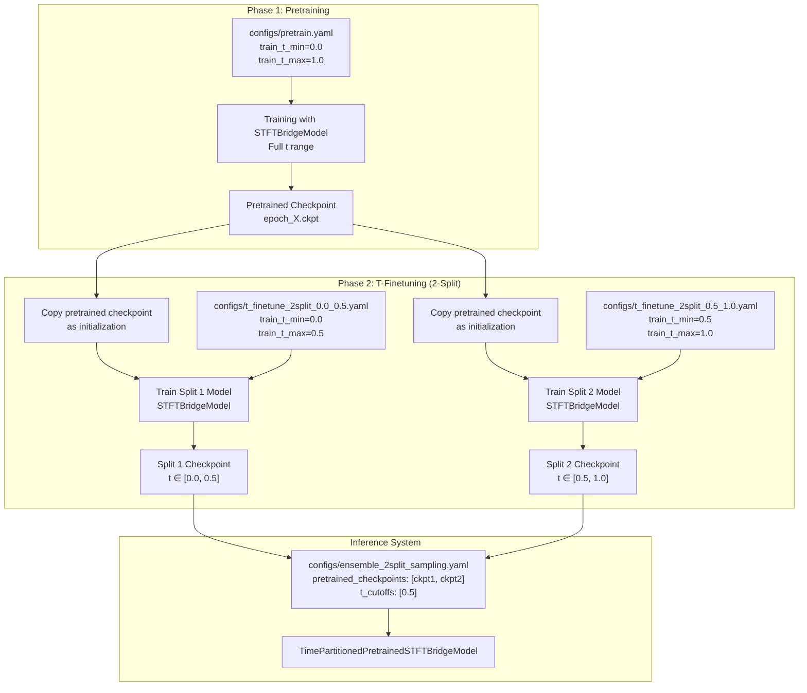
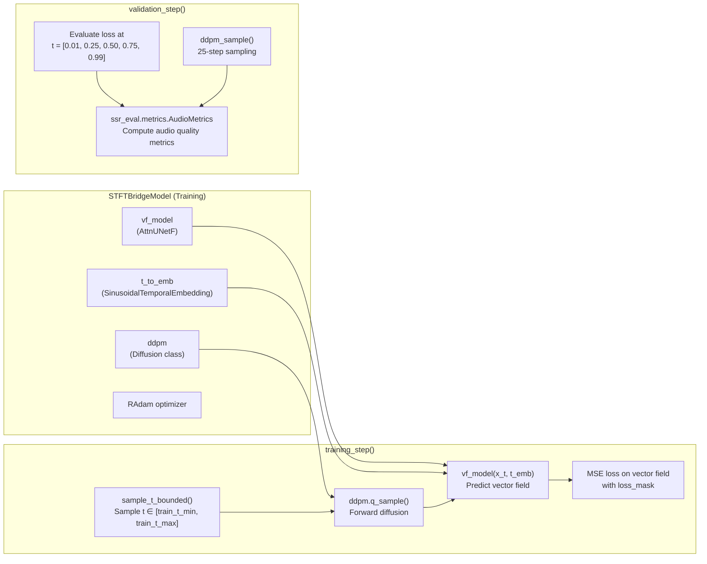
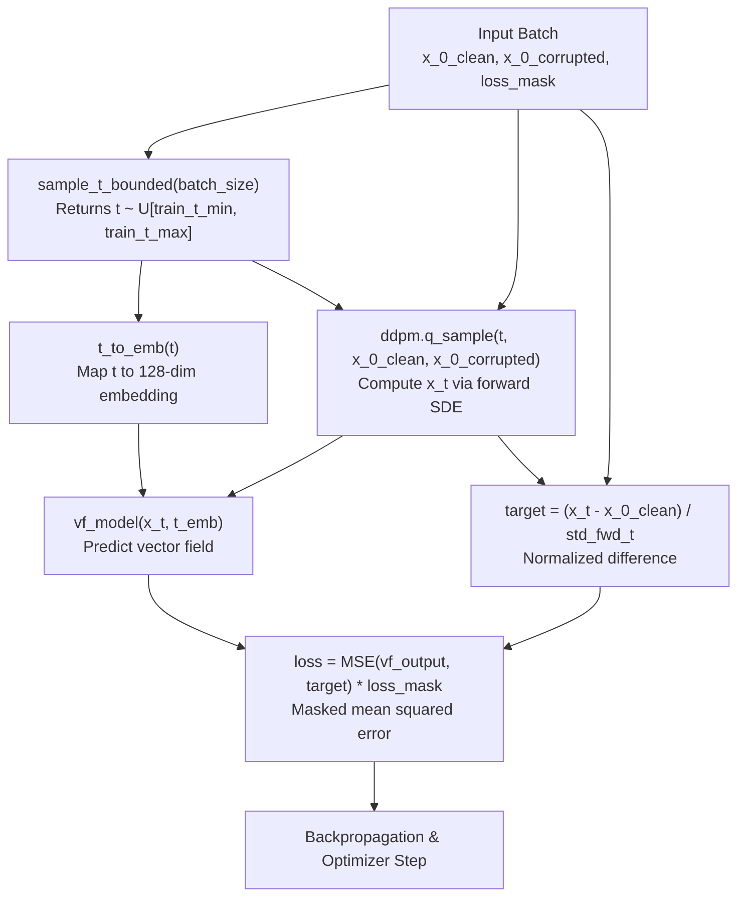
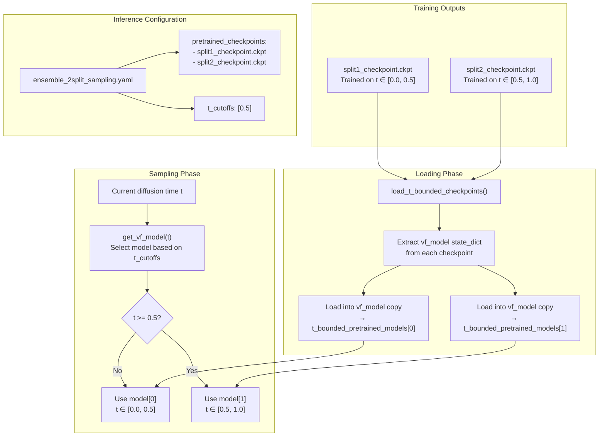
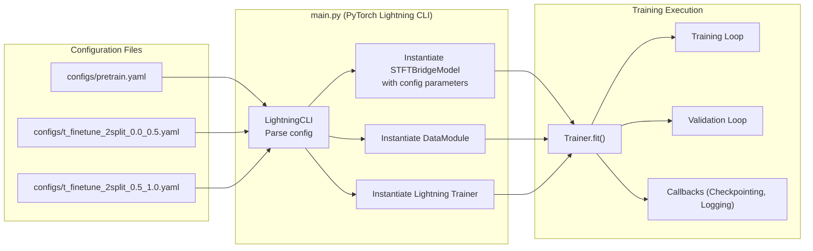

<!-- source: DeepWiki mcp.deepwiki.com · repo NVIDIA/diffusion-audio-restoration · page 4.1 Training Overview · fetched 2026-10-26 -->

# Training Overview

<details>
<summary>Relevant source files</summary>

The following files were used as context for generating this wiki page:

- [A2SB_lightning_module.py](A2SB_lightning_module.py)
- [README.md](README.md)

</details>


This page provides a comprehensive overview of the A2SB training process, including the two-phase training strategy (pretraining and T-finetuning), the time-partitioned ensemble approach, and how trained models are used during inference. For specific configuration details, see [Configuration Files](#4.4). For architectural concepts behind the training approach, see [Time-Partitioned Ensemble](#5.4).

## Purpose and Scope

The A2SB training pipeline consists of two distinct phases that work together to produce high-quality audio restoration models:

1. **Pretraining**: Training a single vector field model across the entire diffusion time range (t ∈ [0, 1])
2. **T-Finetuning**: Training specialized models on specific time ranges (e.g., t ∈ [0.0, 0.5] and t ∈ [0.5, 1.0])

This document explains how these phases relate, what happens during each phase, and how the resulting checkpoints are combined during inference to form an ensemble model.

Sources: [README.md:45-58](), [A2SB_lightning_module.py:208-237]()

## Two-Phase Training Strategy



**Figure 1: End-to-End Training Pipeline**

The training process follows this sequence:

1. **Pretraining**: Train a single model across all diffusion timesteps to establish baseline capabilities
2. **Checkpoint Copy**: Manually copy the pretrained checkpoint to initialize T-finetuning experiments
3. **T-Finetuning**: Train separate models on different time ranges, starting from the pretrained checkpoint
4. **Ensemble Assembly**: Configure inference to load multiple checkpoints and route predictions based on diffusion time

Sources: [README.md:45-58](), [A2SB_lightning_module.py:34-87]()

## Training Components

### Core Training Module: STFTBridgeModel

The `STFTBridgeModel` class in `A2SB_lightning_module.py` handles all training and validation logic. It is a PyTorch Lightning module that orchestrates:



**Figure 2: STFTBridgeModel Architecture and Methods**

Sources: [A2SB_lightning_module.py:208-237](), [A2SB_lightning_module.py:374-402](), [A2SB_lightning_module.py:434-476]()

### Key Training Parameters

The following table shows the critical parameters that control training behavior:

| Parameter | Purpose | Typical Values | Location |
|-----------|---------|----------------|----------|
| `train_t_min` | Minimum diffusion time for training | 0.0 (pretrain), 0.0 or 0.5 (finetune) | `STFTBridgeModel.__init__` |
| `train_t_max` | Maximum diffusion time for training | 1.0 (pretrain), 0.5 or 1.0 (finetune) | `STFTBridgeModel.__init__` |
| `learning_rate` | Optimizer learning rate | 1e-4 | `STFTBridgeModel.__init__` |
| `beta_max` | Maximum noise schedule parameter | 0.3 | `Diffusion.__init__` |
| `use_ot_ode` | Use ODE vs SDE formulation | False (SDE default) | `STFTBridgeModel.__init__` |

Sources: [A2SB_lightning_module.py:209-236]()

## Phase 1: Pretraining

During pretraining, the model learns to perform diffusion-based audio restoration across the entire time range [0, 1]. The training objective is to predict the vector field that describes the Schrödinger Bridge between degraded and clean audio.

### Pretraining Command

```bash
python main.py fit --config configs/pretrain.yaml
```

### Training Step Details

The training process at each step follows this algorithm:



**Figure 3: Training Step Flow**

The key equation being learned is:

**Vector Field Target**: `(x_t - x_0_clean) / std_fwd_t`

where `x_t` is the noisy state at time `t`, `x_0_clean` is the clean target, and `std_fwd_t` is the forward diffusion standard deviation at time `t`.

Sources: [A2SB_lightning_module.py:374-402]()

### Validation During Training

Validation runs every N training steps (configured in the YAML) and performs two key evaluations:

1. **Loss at Multiple Time Points**: Evaluates training loss at `t = [0.01, 0.25, 0.50, 0.75, 0.99]` to monitor model performance across the time range
2. **Full Sampling and Metrics**: Runs 25-step DDPM sampling and computes audio quality metrics using `ssr_eval`

Sources: [A2SB_lightning_module.py:434-476]()

## Phase 2: T-Finetuning and Time Partitioning

After pretraining establishes a baseline model, T-finetuning trains specialized models for specific diffusion time ranges. This allows each model to specialize in different stages of the restoration process.

### Time-Bounded Training

The `sample_t_bounded()` method ensures that during T-finetuning, time values are only sampled from the specified range:

```python
def sample_t_bounded(self, n_samples):
    t_range = self.train_t_max - self.train_t_min
    return torch.rand(n_samples) * t_range + self.train_t_min
```

For a 2-split strategy:
- **Split 1**: `train_t_min=0.0`, `train_t_max=0.5` → samples t ∈ [0.0, 0.5]
- **Split 2**: `train_t_min=0.5`, `train_t_max=1.0` → samples t ∈ [0.5, 1.0]

Sources: [A2SB_lightning_module.py:370-372]()

### T-Finetuning Commands

```bash
# Split 1: Early diffusion steps (t ∈ [0.0, 0.5])
python main.py fit --config configs/t_finetune_2split_0.0_0.5.yaml

# Split 2: Late diffusion steps (t ∈ [0.5, 1.0])
# Modify config: train_t_min=0.5, train_t_max=1.0
python main.py fit --config configs/t_finetune_2split_0.5_1.0.yaml
```

### Why Time Partitioning?

Time partitioning provides several benefits:

1. **Specialization**: Different time ranges require different modeling strategies (early steps handle high-frequency details, late steps handle coarse structure)
2. **Improved Quality**: Specialized models outperform a single model trained on all timesteps
3. **Computational Efficiency**: Each model can be optimized for its specific time range

For more details on the theoretical foundation, see [Time-Partitioned Ensemble](#5.4).

Sources: [README.md:52-57]()

## From Training to Inference

The trained checkpoints are loaded during inference by the `TimePartitionedPretrainedSTFTBridgeModel` class, which implements model selection based on the current diffusion time.



**Figure 4: Checkpoint Loading and Model Selection**

### Model Selection Logic

The `get_vf_model()` method selects the appropriate model for the current diffusion time:

```python
def get_vf_model(self, t: float):
    model_idx = 0
    for idx, thresh in enumerate(self.t_cutoffs):
        if t >= thresh:
            model_idx = idx + 1
    return self.t_bounded_pretrained_models[model_idx]
```

For a 2-split configuration with `t_cutoffs=[0.5]`:
- If `t < 0.5`: Use `t_bounded_pretrained_models[0]` (trained on [0.0, 0.5])
- If `t >= 0.5`: Use `t_bounded_pretrained_models[1]` (trained on [0.5, 1.0])

Sources: [A2SB_lightning_module.py:64-87]()

## Training vs Inference Architecture

The following table summarizes the key differences between the training and inference Lightning modules:

| Aspect | Training (`STFTBridgeModel`) | Inference (`TimePartitionedPretrainedSTFTBridgeModel`) |
|--------|------------------------------|-------------------------------------------------------|
| File | `A2SB_lightning_module.py:208-476` | `A2SB_lightning_module.py:34-206` |
| Vector Field Models | Single `vf_model` | Multiple models in `t_bounded_pretrained_models` |
| Time Range | Bounded by `train_t_min/max` | Full range [0, 1] with model switching |
| Optimizer | RAdam with gradient clipping | None (inference only) |
| Loss Computation | MSE on vector field target | None |
| Sampling | Simple `ddpm_sample()` for validation | Optimized with multidiffusion support |
| Checkpoint Handling | Saves checkpoints during training | Loads multiple pretrained checkpoints |

Sources: [A2SB_lightning_module.py:34-206](), [A2SB_lightning_module.py:208-476]()

## Training Configuration Workflow

The configuration system drives the entire training process:



**Figure 5: Configuration-Driven Training Workflow**

The command `python main.py fit --config configs/pretrain.yaml` triggers this entire workflow, with PyTorch Lightning CLI handling the configuration parsing and model/trainer instantiation.

Sources: [README.md:47-57]()

## Checkpoint Management

### Checkpoint Structure

Training checkpoints contain the full Lightning module state:

```
checkpoint.ckpt
├── state_dict
│   ├── vf_model.*          # Vector field model weights
│   ├── ddpm.*              # Diffusion engine state (beta_max)
│   ├── t_to_emb.*          # Time embedding weights
│   └── ...
├── optimizer_states
├── lr_schedulers
└── epoch, global_step, etc.
```

### Checkpoint Initialization for T-Finetuning

The README specifies: "For T-finetuning, first copy the pretrained checkpoint to the T-finetune experiment folder as initialization. Then, T-finetuning resumes from this checkpoint."

This manual copy step ensures:
1. T-finetuning starts from a good initialization
2. Separate experiments don't interfere with each other
3. Multiple splits can be trained in parallel from the same pretrained checkpoint

Sources: [README.md:51-52](), [A2SB_lightning_module.py:64-78]()

## Summary

The A2SB training process consists of:

1. **Pretraining**: Train a general-purpose model across all diffusion timesteps
2. **Checkpoint Copy**: Manually copy the pretrained checkpoint for initialization
3. **T-Finetuning**: Train specialized models on specific time ranges (e.g., 2-split: [0.0, 0.5] and [0.5, 1.0])
4. **Inference Assembly**: Load multiple checkpoints into `TimePartitionedPretrainedSTFTBridgeModel` for time-based model selection

This approach allows A2SB to achieve state-of-the-art audio restoration quality by specializing different models for different stages of the diffusion process. For detailed configuration options, see [Configuration Files](#4.4). For the next steps in the training pipeline, see [Pretraining](#4.2) and [T-Finetuning and Split Training](#4.3).

Sources: [README.md:45-58](), [A2SB_lightning_module.py:34-476]()

---

