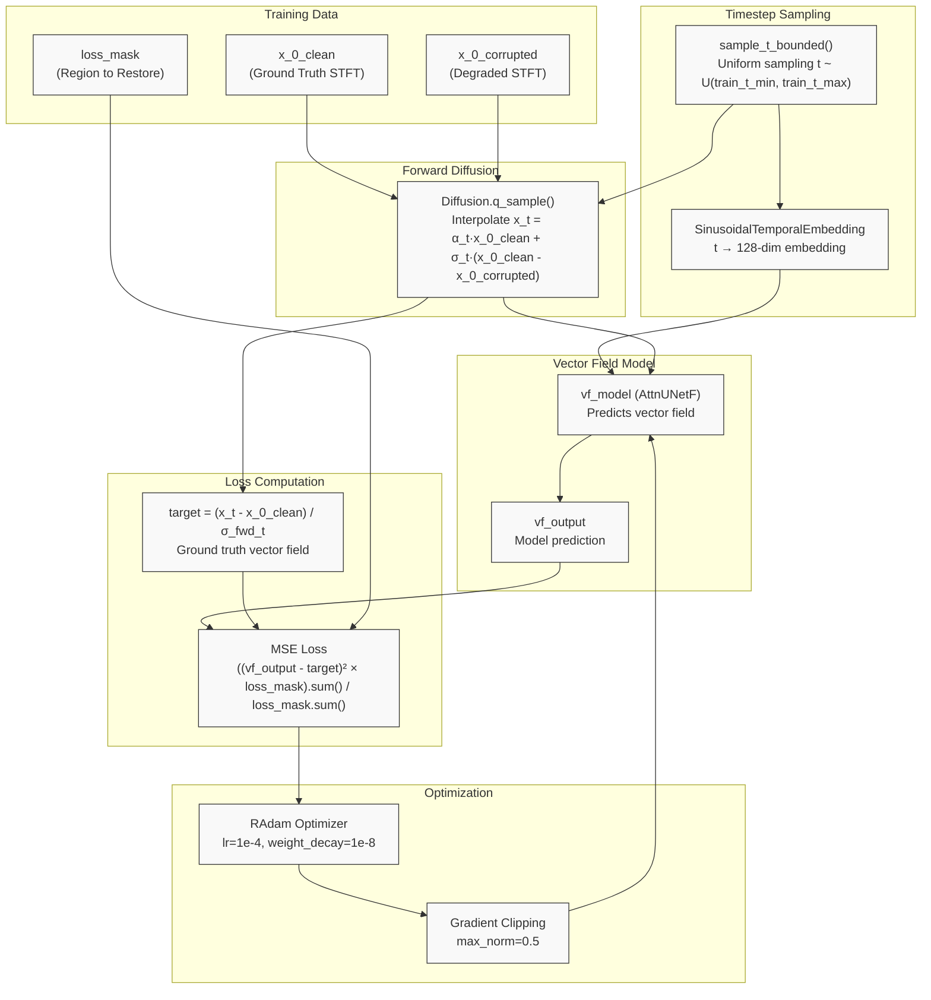
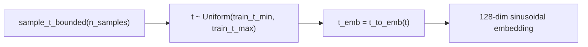
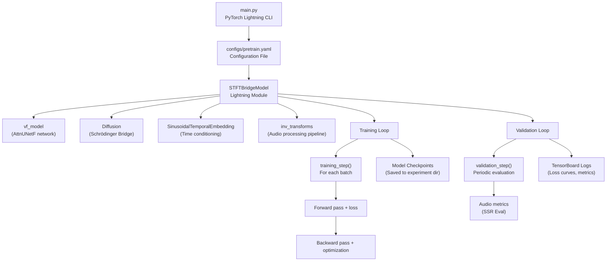
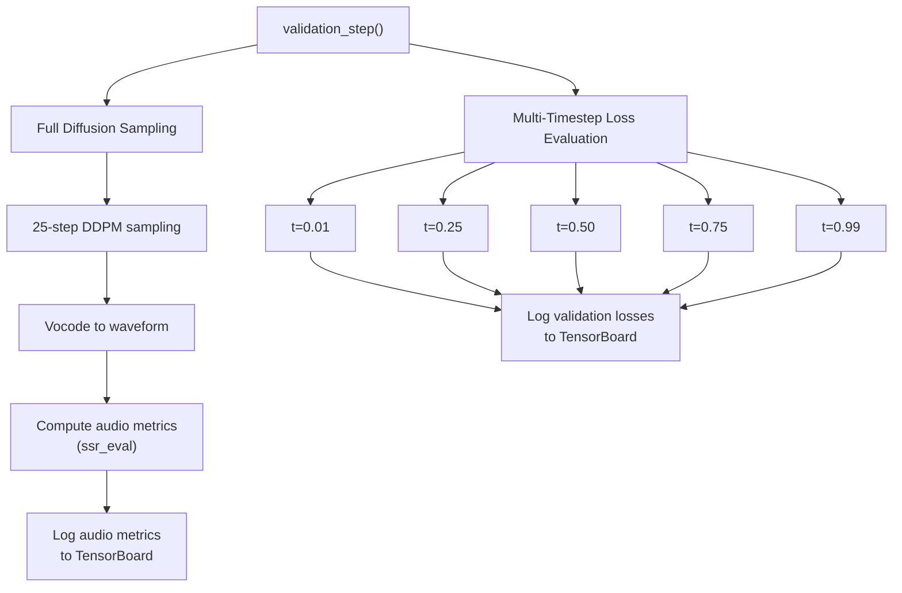

<!-- source: DeepWiki mcp.deepwiki.com · repo NVIDIA/diffusion-audio-restoration · page 4.2 Pretraining · fetched 2026-10-26 -->

# Pretraining

<details>
<summary>Relevant source files</summary>

The following files were used as context for generating this wiki page:

- [A2SB_lightning_module.py](A2SB_lightning_module.py)
- [README.md](README.md)

</details>


## Purpose and Scope

This page covers the **pretraining phase** of the A2SB training process, which is the first step in training A2SB models from scratch. Pretraining trains a single vector field model across the full diffusion timestep range (t ∈ [0, 1]). 

For information about the subsequent training phase that specializes models to specific timestep ranges, see [T-Finetuning and Split Training](#4.3). For a high-level overview of the complete two-phase training strategy, see [Training Overview](#4.1). For details on configuration parameters, see [Configuration Files](#4.4).

**Sources:** [README.md:45-58]()

---

## Overview

Pretraining is the initial training phase where a single `STFTBridgeModel` learns to predict vector fields across all diffusion timesteps. The model learns to map corrupted audio (e.g., bandwidth-limited) to clean audio through the Schrödinger Bridge diffusion process.

During pretraining:
- The model is trained on the complete timestep range `t ∈ [train_t_min, train_t_max]`, typically `[0.0, 1.0]`
- Random timesteps are sampled uniformly from this range for each training batch
- The model learns a single vector field that works across all diffusion steps
- Training produces a checkpoint that serves as initialization for subsequent T-finetuning

The pretrained model provides a strong general-purpose initialization that can later be specialized to specific timestep ranges through T-finetuning, enabling the 2-split ensemble approach.

**Sources:** [A2SB_lightning_module.py:208-242](), [README.md:45-58]()

---

## Pretraining Architecture



**Figure 1: Pretraining Forward Pass and Loss Computation**

**Sources:** [A2SB_lightning_module.py:374-402]()

---

## Training Step Process

The training process is implemented in the `training_step` method of `STFTBridgeModel`. Each training iteration follows these steps:

### 1. Timestep Sampling



The `sample_t_bounded` method samples random timesteps uniformly from the configured range:

```python
def sample_t_bounded(self, n_samples):
    t_range = self.train_t_max - self.train_t_min
    return torch.rand(n_samples) * t_range + self.train_t_min
```

For pretraining, `train_t_min=0` and `train_t_max=1`, so timesteps span the complete diffusion process.

**Sources:** [A2SB_lightning_module.py:370-372](), [A2SB_lightning_module.py:374-381]()

### 2. Forward Diffusion (q_sample)

The forward diffusion process creates noisy intermediate states `x_t` by interpolating between clean and corrupted audio:

```
x_t = α(t) · x_0_clean + σ_fwd(t) · (x_0_clean - x_0_corrupted)
```

Where:
- `α(t)` is the signal coefficient that decreases from 1 to 0 as t goes from 1 to 0
- `σ_fwd(t)` is the noise coefficient based on the Schrödinger Bridge schedule
- `x_0_clean` is the ground truth STFT representation
- `x_0_corrupted` is the degraded input STFT

This is handled by `Diffusion.q_sample()`.

**Sources:** [A2SB_lightning_module.py:381]()

### 3. Vector Field Prediction

The model predicts the vector field that points from the current state `x_t` toward the clean state:

```
vf_output = vf_model(x_t, t_emb)
```

The vector field model (`AttnUNetF`) takes:
- Input: `x_t` (noisy STFT, shape: [B, C, H, W])
- Conditioning: `t_emb` (time embedding, shape: [B, 128])
- Output: `vf_output` (predicted vector field, same shape as `x_t`)

**Sources:** [A2SB_lightning_module.py:383]()

### 4. Loss Computation

The training target is the normalized displacement from `x_t` to `x_0_clean`:

```
target = (x_t - x_0_clean) / σ_fwd(t)
```

The loss is masked mean squared error:

```
loss = ((vf_output - target)² × loss_mask).sum() / loss_mask.sum()
```

The `loss_mask` allows training to focus on specific regions (e.g., high-frequency bands for bandwidth extension, or missing segments for inpainting).

**Sources:** [A2SB_lightning_module.py:384-388]()

### 5. Gradient Updates

Gradients are clipped to `max_norm=0.5` to stabilize training, then applied via the RAdam optimizer:

```python
grad_norm = torch.nn.utils.clip_grad_norm_(self.parameters(), max_norm=0.5)
```

**Sources:** [A2SB_lightning_module.py:399-400]()

---

## Code Entity Mapping

| Concept | Code Entity | Location |
|---------|-------------|----------|
| Training Module | `STFTBridgeModel` | [A2SB_lightning_module.py:208-477]() |
| Training Loop | `training_step()` | [A2SB_lightning_module.py:374-402]() |
| Timestep Sampling | `sample_t_bounded()` | [A2SB_lightning_module.py:370-372]() |
| Time Embedding | `SinusoidalTemporalEmbedding` | [A2SB_lightning_module.py:223]() |
| Forward Diffusion | `Diffusion.q_sample()` | [A2SB_lightning_module.py:381]() |
| Vector Field Model | `vf_model` (AttnUNetF) | [A2SB_lightning_module.py:210]() |
| Optimizer | `torch.optim.RAdam` | [A2SB_lightning_module.py:240-241]() |
| Validation | `validation_step()` | [A2SB_lightning_module.py:434-476]() |

**Sources:** [A2SB_lightning_module.py:208-477]()

---

## Configuration Parameters

Key configuration parameters for pretraining in `configs/pretrain.yaml`:

| Parameter | Description | Typical Value |
|-----------|-------------|---------------|
| `model.train_t_min` | Minimum timestep for training | `0.0` |
| `model.train_t_max` | Maximum timestep for training | `1.0` |
| `model.learning_rate` | Initial learning rate | `1e-4` |
| `model.weight_decay` | Weight decay for regularization | `1e-8` |
| `model.beta_max` | Maximum β for diffusion schedule | `0.3` |
| `model.use_ot_ode` | Use ODE vs SDE formulation | `false` |
| `model.n_timestep_channels` | Time embedding dimensions | `128` |
| `model.sampling_rate` | Audio sampling rate | `44100` |

For pretraining, the critical setting is `train_t_min=0.0` and `train_t_max=1.0`, which enables training across the full diffusion timestep range.

**Sources:** [A2SB_lightning_module.py:209-216](), [README.md:45-60]()

---

## Running Pretraining

### Command

```bash
python main.py fit --config configs/pretrain.yaml
```

This command:
1. Initializes the `STFTBridgeModel` with a randomly initialized `vf_model`
2. Loads training and validation datasets specified in the config
3. Begins training with PyTorch Lightning's distributed training support
4. Saves checkpoints periodically to the experiment directory

**Sources:** [README.md:47-49]()

### Entry Point Flow



**Figure 2: Pretraining Execution Flow from main.py**

**Sources:** [README.md:47-49](), [A2SB_lightning_module.py:208-242]()

---

## Validation During Pretraining

The `validation_step` method evaluates model performance during training:

### Multi-Timestep Loss Evaluation

Validation computes loss at multiple fixed timesteps to monitor learning across the diffusion process:

```python
scales = [0.01, 0.25, 0.50, 0.75, 0.99]
for scale in scales:
    t = scale * torch.ones(x_0_clean.shape[0]).to(x_0_clean.device)
    # Compute and log loss at this timestep
```

This provides insight into which parts of the diffusion process the model handles well.

**Sources:** [A2SB_lightning_module.py:442-453]()

### Audio Quality Metrics

Validation also performs full sampling (25 steps) and computes audio quality metrics:

```python
t_steps = torch.linspace(1, 1.0/n_steps, int(n_steps)).unsqueeze(0)
x_0s = self.ddpm_sample(x_0_corrupted, t_steps=t_steps, mask=loss_mask, mask_pred_x0=True)
inpainted_audio = self.vocode_stft(x_0s[-1].cpu())
metrics = ssr_eval.metrics.AudioMetrics(rate=self.sampling_rate)
```

Metrics are computed using the `ssr_eval` library and logged to TensorBoard.

**Sources:** [A2SB_lightning_module.py:455-470]()

### Validation Flow



**Figure 3: Validation Process During Pretraining**

**Sources:** [A2SB_lightning_module.py:434-476]()

---

## Training Outputs

### Model Checkpoints

Pretraining produces PyTorch Lightning checkpoint files containing:
- `state_dict`: Complete model weights including `vf_model`, `t_to_emb`, etc.
- `optimizer_states`: Optimizer state for resuming training
- `hparams`: Hyperparameters used during training
- `callbacks`: Callback states

Checkpoints are saved to the experiment directory specified in the config.

**Sources:** [README.md:51-52]()

### Checkpoint Usage

The pretrained checkpoint serves as initialization for T-finetuning:

```bash
# Copy pretrained checkpoint to T-finetune experiment folder
cp pretrain_experiment/checkpoints/last.ckpt t_finetune_experiment/init.ckpt

# T-finetuning will resume from this checkpoint
python main.py fit --config configs/t_finetune_2split_0.0_0.5.yaml
```

When loading for T-finetuning, the `train_t_min` and `train_t_max` parameters are changed to restrict the timestep range, but the model architecture and weights remain the same.

**Sources:** [README.md:51-57]()

### TensorBoard Logs

Training produces TensorBoard logs including:
- `train/loss`: Training loss per step
- `train/gradient_norm`: Gradient norm per step
- `val_loss_t={scale}`: Validation loss at specific timesteps
- `val_{metric}`: Audio quality metrics (e.g., `val_lsd`, `val_si_sdr`)

**Sources:** [A2SB_lightning_module.py:391](), [A2SB_lightning_module.py:400](), [A2SB_lightning_module.py:453](), [A2SB_lightning_module.py:470]()

---

## Monitoring Training Progress

### Key Metrics to Watch

| Metric | What It Indicates | Expected Behavior |
|--------|-------------------|-------------------|
| `train/loss` | Training MSE loss | Should decrease steadily |
| `train/gradient_norm` | Gradient magnitude | Should stabilize (clipped at 0.5) |
| `val_loss_t=0.01` | Early timestep loss | Harder region (higher initial loss) |
| `val_loss_t=0.50` | Mid timestep loss | Moderate difficulty |
| `val_loss_t=0.99` | Late timestep loss | Easier region (lower loss) |
| `val_lsd` | Log-spectral distance | Should decrease (lower is better) |
| `val_si_sdr` | Signal-to-distortion ratio | Should increase (higher is better) |

### Training Stability

The gradient clipping (`max_norm=0.5`) helps stabilize training. If you observe:
- NaN losses: Training will skip the batch automatically ([A2SB_lightning_module.py:392-394]())
- Exploding gradients: Check `train/gradient_norm` - should be clipped
- Slow convergence: May need to adjust learning rate or batch size

**Sources:** [A2SB_lightning_module.py:374-476]()

---

## Pretraining vs T-Finetuning

| Aspect | Pretraining | T-Finetuning |
|--------|-------------|--------------|
| **Timestep Range** | `train_t_min=0.0`, `train_t_max=1.0` | Restricted range (e.g., [0.0, 0.5]) |
| **Model Initialization** | Random initialization | Pretrained checkpoint |
| **Purpose** | Learn general vector field | Specialize to timestep range |
| **Output** | Single general model | Split-specialized models |
| **Ensemble** | Not applicable | Combined in inference |

After pretraining, the checkpoint is used to initialize T-finetuning, which creates specialized models for different timestep ranges. For details on T-finetuning, see [T-Finetuning and Split Training](#4.3).

**Sources:** [README.md:45-58](), [A2SB_lightning_module.py:370-372]()

---

## Summary

Pretraining establishes the foundation of the A2SB model by training a vector field predictor across the complete diffusion timestep range. Key aspects:

1. **Single model**: Trains one `vf_model` (AttnUNetF) that handles all timesteps
2. **Full range**: Samples timesteps uniformly from `t ∈ [0.0, 1.0]`
3. **MSE loss**: Trains to predict the vector field via masked MSE loss
4. **Validation**: Monitors loss at multiple timesteps and audio quality metrics
5. **Output**: Produces checkpoint files that initialize T-finetuning

The pretrained model provides strong general-purpose initialization that can be specialized through T-finetuning to create the 2-split ensemble for improved audio restoration quality.

**Sources:** [A2SB_lightning_module.py:208-477](), [README.md:45-58]()

---

