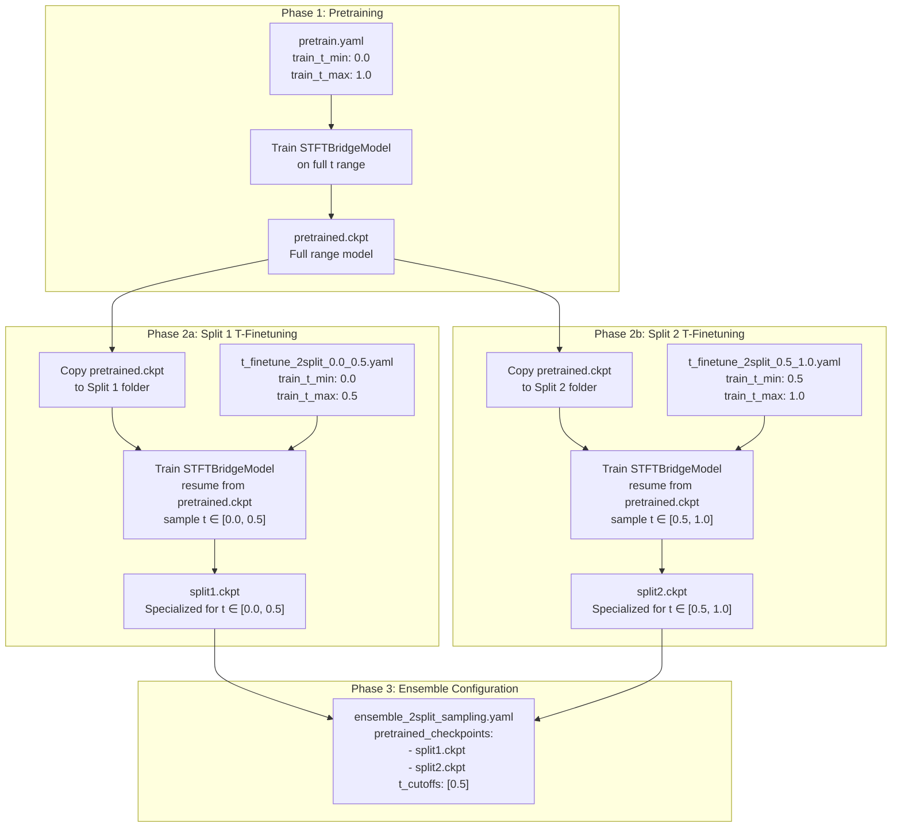
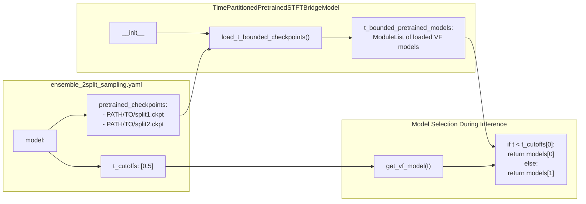
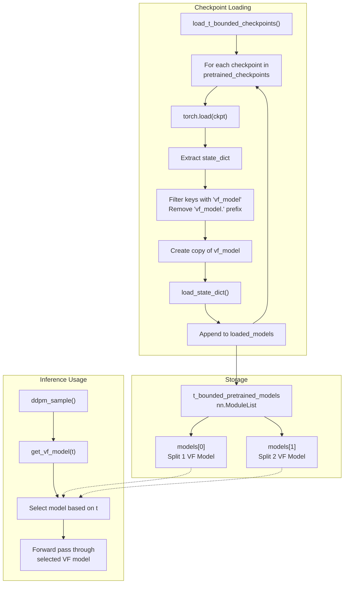
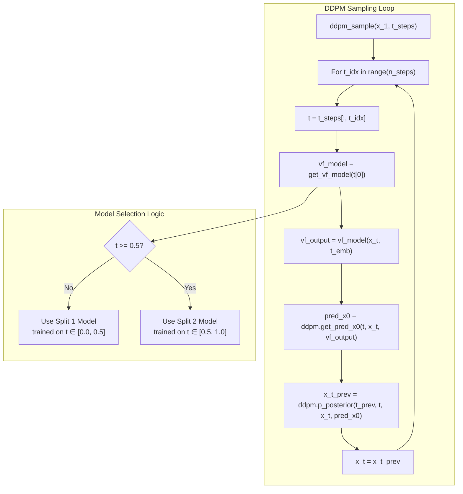

<!-- source: DeepWiki mcp.deepwiki.com · repo NVIDIA/diffusion-audio-restoration · page 4.3 T-Finetuning and Split Training · fetched 2026-10-26 -->

# T-Finetuning and Split Training

<details>
<summary>Relevant source files</summary>

The following files were used as context for generating this wiki page:

- [A2SB_lightning_module.py](A2SB_lightning_module.py)
- [README.md](README.md)
- [configs/ensemble_2split_sampling.yaml](configs/ensemble_2split_sampling.yaml)

</details>


## Purpose and Scope

This page explains the T-finetuning phase of A2SB training, which involves training separate models on restricted diffusion timestep ranges. This specialized training strategy allows each model to focus on a specific portion of the diffusion process, improving overall performance when combined as an ensemble during inference.

For information about the initial pretraining phase, see [Pretraining](#4.2). For details on how the ensemble models are used during inference, see [Time-Partitioned Ensemble](#5.4). For configuration file reference, see [Configuration Files](#4.4).

## Overview

T-finetuning (time-finetuning) is the second phase of A2SB training where models are trained on restricted diffusion timestep ranges. The process works as follows:

1. **Pretraining** produces a checkpoint trained on the full timestep range `t ∈ [0, 1]`
2. **T-finetuning** creates specialized models by continuing training from the pretrained checkpoint, but restricting the training timestep range
3. **Inference** uses an ensemble that switches between the specialized models based on the current diffusion timestep

The most common configuration is a **2-split ensemble**:
- Split 1: `t ∈ [0.0, 0.5]` - handles the early/middle diffusion steps
- Split 2: `t ∈ [0.5, 1.0]` - handles the later diffusion steps

This specialization allows each model to learn more precise vector field predictions for its designated timestep range.

**Sources:** [README.md:45-57](), [A2SB_lightning_module.py:208-236]()

## Training Configuration Parameters

The `STFTBridgeModel` class uses two key parameters to control timestep-bounded training:

| Parameter | Type | Purpose | Pretrain Value | Split 1 Example | Split 2 Example |
|-----------|------|---------|----------------|-----------------|-----------------|
| `train_t_min` | float | Minimum timestep for training samples | 0.0 | 0.0 | 0.5 |
| `train_t_max` | float | Maximum timestep for training samples | 1.0 | 0.5 | 1.0 |

During training, timesteps are sampled uniformly from the range `[train_t_min, train_t_max]` using the `sample_t_bounded` method:

```python
def sample_t_bounded(self, n_samples):
    t_range = self.train_t_max - self.train_t_min
    return torch.rand(n_samples) * t_range + self.train_t_min
```

This method is called during each training step to generate timesteps for the diffusion process.

**Sources:** [A2SB_lightning_module.py:215](), [A2SB_lightning_module.py:370-372](), [A2SB_lightning_module.py:374-402]()

## Training Workflow for 2-Split Ensemble



**Sources:** [README.md:45-57](), [configs/ensemble_2split_sampling.yaml:83-86]()

### Step-by-Step Training Process

#### Step 1: Pretrain the Base Model

Train a model on the full timestep range:

```bash
python main.py fit --config configs/pretrain.yaml
```

This creates a checkpoint (e.g., `pretrained.ckpt`) that serves as initialization for all splits.

#### Step 2: Prepare Split 1 Training

1. Create a new experiment directory for Split 1
2. Copy `pretrained.ckpt` to this directory as initialization
3. Create or modify the config file (e.g., `t_finetune_2split_0.0_0.5.yaml`):

```yaml
model:
  train_t_min: 0.0
  train_t_max: 0.5
  # ... other parameters same as pretrain
```

#### Step 3: Train Split 1

```bash
python main.py fit --config configs/t_finetune_2split_0.0_0.5.yaml
```

This trains the model exclusively on timesteps `t ∈ [0.0, 0.5]`, allowing it to specialize in the early-to-middle portion of the diffusion process.

#### Step 4: Prepare Split 2 Training

1. Create a separate experiment directory for Split 2
2. Copy the same `pretrained.ckpt` to this directory
3. Create a config file with different timestep bounds:

```yaml
model:
  train_t_min: 0.5
  train_t_max: 1.0
  # ... other parameters same as pretrain
```

#### Step 5: Train Split 2

```bash
python main.py fit --config configs/t_finetune_2split_0.5_1.0.yaml
```

This trains the model exclusively on timesteps `t ∈ [0.5, 1.0]`, specializing in the later portion of the diffusion process.

**Note:** The two splits can be trained in parallel on different GPUs or sequentially.

**Sources:** [README.md:45-57]()

## Ensemble Model Configuration

After T-finetuning, the specialized checkpoints are combined into an ensemble for inference using the `TimePartitionedPretrainedSTFTBridgeModel` class.

### Ensemble Configuration Structure



**Sources:** [configs/ensemble_2split_sampling.yaml:83-86](), [A2SB_lightning_module.py:34-86]()

### Key Configuration Parameters

| Parameter | Type | Description | Example for 2-Split |
|-----------|------|-------------|---------------------|
| `pretrained_checkpoints` | List[str] | Paths to the T-finetuned checkpoint files | `["split1.ckpt", "split2.ckpt"]` |
| `t_cutoffs` | List[float] | Timestep thresholds for switching between models | `[0.5]` |

**Critical Constraint:** The number of checkpoints must equal the number of cutoffs plus one:
```python
assert(len(t_cutoffs) + 1 == len(pretrained_checkpoints))
```

### How Model Selection Works

The `get_vf_model(t)` method selects the appropriate model based on the current timestep:

```python
@torch.no_grad()
def get_vf_model(self, t: float):
    model_idx = 0
    for idx, thresh in enumerate(self.t_cutoffs):
        if t >= thresh:
            model_idx = idx + 1
    return self.t_bounded_pretrained_models[model_idx]
```

**Example with 2-split configuration (`t_cutoffs = [0.5]`):**
- If `t < 0.5`: Returns `t_bounded_pretrained_models[0]` (Split 1 model)
- If `t >= 0.5`: Returns `t_bounded_pretrained_models[1]` (Split 2 model)

**Sources:** [A2SB_lightning_module.py:81-86](), [A2SB_lightning_module.py:59]()

## Ensemble Model Loading Process



**Sources:** [A2SB_lightning_module.py:64-78]()

### Loading Implementation Details

The `load_t_bounded_checkpoints` method performs the following steps for each checkpoint:

1. **Load checkpoint file:** Loads the full PyTorch Lightning state dict from disk
2. **Extract VF model weights:** Filters for keys containing `'vf_model'`
3. **Rename keys:** Removes the `'vf_model.'` prefix to match the standalone model structure
4. **Create model copy:** Deep copies the base `vf_model` architecture
5. **Load weights:** Loads the extracted state dict into the copied model
6. **Store in ModuleList:** Appends to `t_bounded_pretrained_models`

The resulting `nn.ModuleList` ensures proper device placement and gradient tracking for all loaded models.

**Sources:** [A2SB_lightning_module.py:64-78]()

## Timestep-Aware Sampling During Inference

During the DDPM sampling process, the ensemble automatically switches between models at each timestep:



**Sources:** [A2SB_lightning_module.py:103-146](), [A2SB_lightning_module.py:127-131]()

### Example Sampling Timeline

For a 50-step sampling process with `t_steps = linspace(1.0, 0.05, 50)`:

| Step Range | Timestep Range | Active Model | Reasoning |
|------------|----------------|--------------|-----------|
| 0-25 | t ∈ [1.0, 0.5] | Split 2 (`models[1]`) | `t >= 0.5`, uses high-t specialized model |
| 25-50 | t ∈ [0.5, 0.05] | Split 1 (`models[0]`) | `t < 0.5`, uses low-t specialized model |

The transition between models is seamless - each model receives the same `x_t` state and continues the denoising process from where the previous model left off.

**Sources:** [A2SB_lightning_module.py:122-138]()

## Advantages of Split Training

### Specialization Benefits

1. **Focused Learning:** Each model learns vector field predictions optimized for a specific timestep range
2. **Reduced Interference:** Training on restricted ranges avoids averaging gradients across dissimilar diffusion states
3. **Better Convergence:** Models can achieve lower validation loss within their designated ranges

### Practical Benefits

1. **Scalability:** Can train 3+ splits for even finer specialization
2. **Parallel Training:** Different splits can be trained simultaneously on separate resources
3. **Modular Updates:** Individual splits can be retrained or improved without affecting others

**Sources:** [README.md:17-25](), [A2SB_lightning_module.py:34-86]()

## Advanced Configuration Examples

### 3-Split Ensemble

For finer timestep specialization:

```yaml
model:
  pretrained_checkpoints:
    - PATH/TO/split1.ckpt  # t ∈ [0.0, 0.33]
    - PATH/TO/split2.ckpt  # t ∈ [0.33, 0.67]
    - PATH/TO/split3.ckpt  # t ∈ [0.67, 1.0]
  t_cutoffs: [0.33, 0.67]
```

### Single Model (No Splits)

For comparison or debugging:

```yaml
model:
  pretrained_checkpoints:
    - PATH/TO/pretrained.ckpt  # Full range t ∈ [0.0, 1.0]
  t_cutoffs: []
```

**Sources:** [configs/ensemble_2split_sampling.yaml:83-86](), [A2SB_lightning_module.py:59]()

## Training Hyperparameters

During T-finetuning, most hyperparameters remain the same as pretraining. The key differences:

| Parameter | Pretrain | T-Finetune |
|-----------|----------|------------|
| `train_t_min` | 0.0 | Split-specific (e.g., 0.0 or 0.5) |
| `train_t_max` | 1.0 | Split-specific (e.g., 0.5 or 1.0) |
| Learning rate | Often standard (e.g., 1e-4) | May be reduced for fine-tuning |
| Number of epochs | Full training schedule | Typically fewer epochs |
| Initialization | Random or from scratch | From pretrained checkpoint |

**Note:** Adjust batch size, number of devices, and gradient accumulation based on available GPU resources.

**Sources:** [README.md:59](), [A2SB_lightning_module.py:215](), [A2SB_lightning_module.py:239-242]()

---

