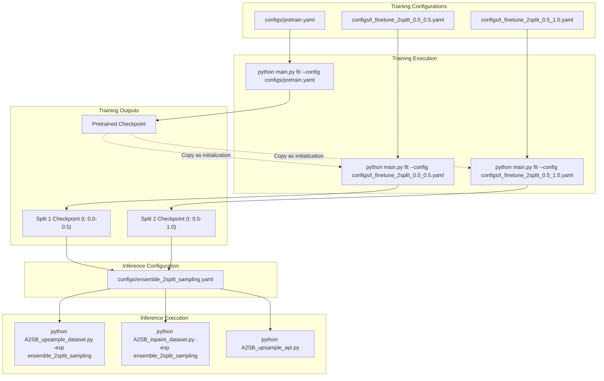
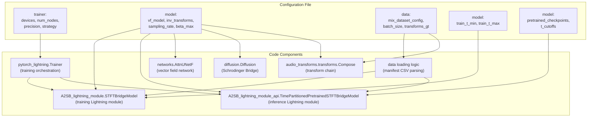

<!-- source: DeepWiki mcp.deepwiki.com · repo NVIDIA/diffusion-audio-restoration · page 4.4 Configuration Files · fetched 2026-10-26 -->

# Configuration Files

<details>
<summary>Relevant source files</summary>

The following files were used as context for generating this wiki page:

- [README.md](README.md)
- [configs/ensemble_2split_sampling.yaml](configs/ensemble_2split_sampling.yaml)

</details>


This page provides a comprehensive reference for A2SB's YAML configuration files and how to customize them for training and inference. Configuration files control all aspects of model architecture, training hyperparameters, data loading, and sampling strategies.

For information about the training workflow itself, see [Training Overview](#4.1). For details on how to use these configurations during pretraining and T-finetuning, see [Pretraining](#4.2) and [T-Finetuning and Split Training](#4.3).

**Sources:** [README.md:41-60](), [configs/ensemble_2split_sampling.yaml:1-123]()

---

## Configuration System Overview

A2SB uses YAML configuration files to define all training and inference parameters. The system leverages PyTorch Lightning's CLI configuration framework, which allows for structured, type-safe configuration with inheritance and overrides.

Configuration files are organized by purpose:
- **`configs/pretrain.yaml`**: Pretraining configuration for the full diffusion timestep range
- **`configs/t_finetune_*.yaml`**: T-finetuning configurations for specific timestep ranges (e.g., `t_finetune_2split_0.0_0.5.yaml`)
- **`configs/ensemble_2split_sampling.yaml`**: Inference configuration for loading and combining multiple checkpoints

**Sources:** [README.md:41](), [README.md:49-57]()

---

## Configuration File Types and Usage

The following diagram shows how different configuration files are used across the A2SB workflow:



**Sources:** [README.md:47-69]()

---

## Configuration Structure

All configuration files follow a hierarchical structure with three main sections:

| Section | Purpose | Key Components |
|---------|---------|----------------|
| `trainer` | PyTorch Lightning trainer settings | Hardware (GPUs, nodes), precision, checkpointing, logging |
| `model` | Model architecture and training parameters | Network definition, transforms, diffusion parameters, timestep ranges |
| `data` | Dataset configuration and loading | Dataset paths, batch size, augmentation transforms |

Additionally, the top-level `seed_everything` parameter controls random seed for reproducibility.

**Sources:** [configs/ensemble_2split_sampling.yaml:2-123]()

---

## Trainer Configuration

The `trainer` section configures PyTorch Lightning's training orchestration. This section is identical for training and inference configurations, though some parameters are only relevant during training.

### Hardware Configuration

| Parameter | Type | Description | Training Default | Inference Default |
|-----------|------|-------------|-----------------|-------------------|
| `accelerator` | string | Hardware type | `gpu` | `gpu` |
| `strategy` | string | Distributed strategy | `ddp` | `ddp` |
| `devices` | int | Number of GPUs per node | Variable | `1` |
| `num_nodes` | int | Number of compute nodes | Variable | `1` |
| `precision` | string | Floating point precision | `32-true` | `32-true` |

**Sources:** [configs/ensemble_2split_sampling.yaml:3-8](), [README.md:59]()

### Training Loop Configuration

| Parameter | Type | Description | Notes |
|-----------|------|-------------|-------|
| `max_steps` | int | Maximum training steps | Set to `-1` for unlimited |
| `val_check_interval` | int | Steps between validation | Typical: `1000` |
| `accumulate_grad_batches` | int | Gradient accumulation steps | Used to simulate larger batch sizes |
| `gradient_clip_val` | float | Gradient clipping value | Typical: `0.5` |
| `gradient_clip_algorithm` | string | Clipping method | `norm` or `value` |

The README notes: "you may need to adjust batch size, num devices, num nodes, and gradient accumulation in the configs based on your GPU configurations."

**Sources:** [configs/ensemble_2split_sampling.yaml:14-31](), [README.md:59]()

### SLURM Integration

For cluster environments, the configuration includes SLURM plugin settings:

```yaml
plugins:
  - class_path: lightning.fabric.plugins.environments.SLURMEnvironment
    init_args:
      auto_requeue: true
      requeue_signal: null
```

This enables automatic job requeuing on preemptible cluster nodes.

**Sources:** [configs/ensemble_2split_sampling.yaml:39-43]()

---

## Model Configuration

The `model` section defines the neural network architecture, audio transformations, and diffusion parameters. The structure differs between training and inference configurations.

### Vector Field Model Architecture

The `vf_model` parameter specifies the network architecture using PyTorch Lightning's class path syntax:

```yaml
vf_model:
  class_path: networks.AttnUNetF
  init_args:
    n_updown_levels: 5
    in_channels: 3
    hidden_channels: [128, 256, 512, 768, 1024, 2048]
    out_channels: 3
    emb_channels: 128
    rotary_dims: 16
    band_embedding_dim: 16
    n_attn_heads: 8
    attention_levels: [3, 4]
    use_attn_input_norm: true
    num_res_blocks: 2
```

This configuration instantiates the `AttnUNetF` class from `networks.py`. Key architecture parameters:

| Parameter | Description | Typical Value |
|-----------|-------------|---------------|
| `n_updown_levels` | Number of encoder/decoder levels | `5` |
| `in_channels` | Input STFT channels (mag + cos + sin) | `3` |
| `hidden_channels` | Channel counts at each level | `[128, 256, 512, 768, 1024, 2048]` |
| `emb_channels` | Time embedding dimension | `128` |
| `attention_levels` | Which levels use attention | `[3, 4]` (deeper levels) |
| `rotary_dims` | Rotary position embedding dims | `16` |

**Sources:** [configs/ensemble_2split_sampling.yaml:47-62]()

### Audio Transform Pipeline

The `inv_transforms` parameter defines the inverse transformation pipeline for converting model outputs back to waveforms:


Each transform is specified with its class path and initialization arguments:

```yaml
inv_transforms:
  - class_path: audio_transforms.transforms.PowerScaleSpectrogram
    init_args:
      power: 4
      channels: [0]
      eps: 1.0e-09
  - class_path: audio_transforms.transforms.SpectrogramAddDCTerm
  - class_path: audio_transforms.transforms.SVDFixMagInstPhase
  - class_path: audio_transforms.transforms.MagInstPhaseToComplex
  - class_path: audio_transforms.transforms.InverseComplexSpectrogram
    init_args:
      n_fft: 2048
      win_length: 2048
      hop_length: 512
      eps: 1.0e-09
```

The forward transforms (applied during data loading) are specified in the `data.transforms_gt` section.

**Sources:** [configs/ensemble_2split_sampling.yaml:63-78]()

### Diffusion Parameters

| Parameter | Description | Training Value | Inference Value |
|-----------|-------------|---------------|-----------------|
| `sampling_rate` | Audio sampling rate (Hz) | `44100` | `44100` |
| `n_timestep_channels` | Time embedding dimension | `128` | `128` |
| `use_ot_ode` | Use OT-ODE solver | `false` | `false` |
| `beta_max` | Maximum noise schedule parameter | `1.0` | `1.0` |

**Sources:** [configs/ensemble_2split_sampling.yaml:79-82]()

### T-Finetuning Parameters (Training Only)

For T-finetuning configurations, additional parameters control the diffusion timestep range:

| Parameter | Description | Split 1 Example | Split 2 Example |
|-----------|-------------|-----------------|-----------------|
| `train_t_min` | Minimum training timestep | `0.0` | `0.5` |
| `train_t_max` | Maximum training timestep | `0.5` | `1.0` |

The README states: "For the second split, copy this config and modify `model.train_t_min -> 0.5, model.train_t_max -> 1.0`, setup a different experiment name and path, and run training in a similar way."

**Sources:** [README.md:57]()

### Ensemble Parameters (Inference Only)

For inference configurations, the ensemble setup is specified:

```yaml
pretrained_checkpoints:
  - PATH/TO/FIRST/SPLIT.ckpt
  - PATH/TO/SECOND/SPLIT.ckpt
t_cutoffs: [0.5]
```

| Parameter | Description | Example |
|-----------|-------------|---------|
| `pretrained_checkpoints` | List of checkpoint paths | Two checkpoints for 2-split ensemble |
| `t_cutoffs` | Timestep boundaries between models | `[0.5]` means split 1 handles t<0.5, split 2 handles t≥0.5 |

**Sources:** [configs/ensemble_2split_sampling.yaml:83-86]()

---

## Data Configuration

The `data` section controls dataset loading, augmentation, and batching.

### Dataset Specification

Datasets are specified in the `mix_dataset_config` dictionary, where each key is a dataset name:

```yaml
data:
  mix_dataset_config:
    EVAL_DATASET_NAME:
      root_folder: PATH/TO/MANIFEST/FOLDER
      filename: 'EVAL_DATASET_NAME_manifest.csv'
    EVAL_DATASET_NAME_TWO:
      root_folder: PATH/TO/MANIFEST/FOLDER
      filename: 'EVAL_DATASET_NAME_TWO_manifest.csv'
```

Each dataset requires:
- `root_folder`: Directory containing the manifest CSV file
- `filename`: Name of the manifest file (must follow format described in [Data Preparation](#2.2))

The README notes: "You could have multiple manifests, one for each dataset, and you could use different audio formats as long as `SoundFile` supports it."

**Sources:** [configs/ensemble_2split_sampling.yaml:88-94](), [README.md:31-43]()

### Data Loading Parameters

| Parameter | Description | Training Typical | Inference Typical |
|-----------|-------------|------------------|-------------------|
| `segment_length` | Audio segment length in samples | `130560` (~3 seconds) | `130560` |
| `sampling_rate` | Audio sampling rate | `44100` | `44100` |
| `num_workers` | DataLoader worker processes | `23` | `23` |
| `batch_size` | Batch size per GPU | Variable | `4` |

The segment length of 130560 samples at 44.1kHz corresponds to approximately 2.96 seconds of audio.

**Sources:** [configs/ensemble_2split_sampling.yaml:96-99]()

### Data Augmentation Transforms

Three separate transform lists control augmentation at different stages:

| Transform List | When Applied | Purpose |
|----------------|--------------|---------|
| `transforms_aug` | Training input | Degradation augmentation (e.g., lowpass filtering) |
| `transforms_aug_val` | Validation input | Fixed degradation for consistent metrics |
| `eval_transforms_aug` | Inference input | Degradation to restore (empty for pre-degraded data) |

Example (empty for evaluation):
```yaml
transforms_aug: []
transforms_aug_val: []
eval_transforms_aug: []
```

**Sources:** [configs/ensemble_2split_sampling.yaml:101-103]()

### Ground Truth Transforms

The `transforms_gt` list defines the forward transformation pipeline applied to ground truth audio:

```yaml
transforms_gt:
  - class_path: audio_transforms.transforms.ComplexSpectrogram
    init_args:
      n_fft: 2048
      win_length: 2048
      hop_length: 512
      eps: 1.0e-09
  - class_path: audio_transforms.transforms.ComplexToMagInstPhase
  - class_path: audio_transforms.transforms.SpectrogramDropDCTerm
  - class_path: audio_transforms.transforms.PowerScaleSpectrogram
    init_args:
      power: 0.25
      channels: [0]
      eps: 1.0e-09
```

This pipeline converts waveforms to the 3-channel magnitude-instantaneous phase STFT representation used by the model. Note that `power: 0.25` here corresponds to `power: 4` in `inv_transforms` (inverse operation).

**Sources:** [configs/ensemble_2split_sampling.yaml:105-119]()

### Dataset Size Limits

| Parameter | Description | Training | Validation | Inference |
|-----------|-------------|----------|------------|-----------|
| `train_max_samples` | Maximum training samples per epoch | `null` (unlimited) | N/A | N/A |
| `val_max_samples` | Maximum validation samples | N/A | `256` | `256` |
| `predict_filelist` | Specific files for prediction | N/A | N/A | `[]` (use manifest) |

**Sources:** [configs/ensemble_2split_sampling.yaml:120-122]()

---

## Configuration Parameter Mapping to Code

The following diagram shows how configuration parameters flow into specific code components:



**Sources:** [configs/ensemble_2split_sampling.yaml:1-123](), [README.md:49-57]()

---

## Customization Guide

### Creating a New Training Configuration

To create a custom training configuration:

1. **Copy a base configuration:**
   - For pretraining: copy `configs/pretrain.yaml`
   - For T-finetuning: copy `configs/t_finetune_2split_0.0_0.5.yaml`

2. **Adjust hardware settings** based on your GPU setup:
   ```yaml
   trainer:
     devices: 8  # Number of GPUs per node
     num_nodes: 4  # Number of nodes
     accumulate_grad_batches: 1  # Increase if batch size is too large
   ```

3. **Modify dataset configuration:**
   ```yaml
   data:
     mix_dataset_config:
       YOUR_DATASET_NAME:
         root_folder: /path/to/your/manifests
         filename: 'your_dataset_manifest.csv'
     batch_size: 16  # Adjust based on GPU memory
   ```

4. **For T-finetuning, set the timestep range:**
   ```yaml
   model:
     train_t_min: 0.0  # For split 1: 0.0, for split 2: 0.5
     train_t_max: 0.5  # For split 1: 0.5, for split 2: 1.0
   ```

**Sources:** [README.md:57-59]()

### Creating a New Inference Configuration

To create a custom inference configuration:

1. **Copy the ensemble configuration:**
   ```bash
   cp configs/ensemble_2split_sampling.yaml configs/my_inference.yaml
   ```

2. **Update checkpoint paths:**
   ```yaml
   model:
     pretrained_checkpoints:
       - /path/to/your/split1.ckpt
       - /path/to/your/split2.ckpt
     t_cutoffs: [0.5]  # Boundary between models
   ```

3. **Configure evaluation datasets:**
   ```yaml
   data:
     mix_dataset_config:
       YOUR_TEST_SET:
         root_folder: /path/to/test/manifests
         filename: 'test_manifest.csv'
     val_max_samples: null  # Remove limit for full evaluation
   ```

4. **Use the configuration:**
   ```bash
   cd inference/
   python A2SB_upsample_dataset.py -exp my_inference -dn YOUR_TEST_SET
   ```

**Sources:** [README.md:64-69](), [configs/ensemble_2split_sampling.yaml:83-94]()

### Common Customization Scenarios

| Scenario | Parameters to Modify | Typical Values |
|----------|---------------------|----------------|
| **Limited GPU memory** | `data.batch_size`, `trainer.accumulate_grad_batches` | Reduce batch_size, increase accumulation |
| **Faster training** | `data.num_workers`, `trainer.devices` | Increase workers, use more GPUs |
| **Different audio length** | `data.segment_length` | Must be multiple of hop_length (512) |
| **Different STFT parameters** | `n_fft`, `win_length`, `hop_length` in transforms | Keep consistent across forward/inverse |
| **3-split ensemble** | `model.t_cutoffs`, `model.pretrained_checkpoints` | `t_cutoffs: [0.33, 0.67]`, 3 checkpoints |
| **Single model (no ensemble)** | `model.pretrained_checkpoints`, `model.t_cutoffs` | 1 checkpoint, empty `t_cutoffs: []` |

**Sources:** [README.md:59](), [configs/ensemble_2split_sampling.yaml:96-122]()

---

## Parameter Reference Tables

### Complete Trainer Parameters

| Parameter | Type | Default | Description |
|-----------|------|---------|-------------|
| `accelerator` | str | `"gpu"` | Hardware accelerator type |
| `strategy` | str | `"ddp"` | Distributed training strategy |
| `devices` | int | `1` | Number of devices per node |
| `num_nodes` | int | `1` | Number of compute nodes |
| `precision` | str | `"32-true"` | Floating point precision |
| `max_steps` | int | `-1` | Maximum training steps (-1 = unlimited) |
| `val_check_interval` | int | `1000` | Steps between validation runs |
| `accumulate_grad_batches` | int | `2` | Gradient accumulation steps |
| `gradient_clip_val` | float | `0.5` | Gradient clipping threshold |
| `gradient_clip_algorithm` | str | `"norm"` | Clipping method (norm/value) |
| `inference_mode` | bool | `true` | Enable inference optimizations |
| `deterministic` | bool | `null` | Enable deterministic algorithms |
| `benchmark` | bool | `null` | Enable cuDNN benchmark mode |

**Sources:** [configs/ensemble_2split_sampling.yaml:3-43]()

### Complete Model Parameters

| Parameter | Type | Required | Description |
|-----------|------|----------|-------------|
| `vf_model` | dict | Yes | Vector field model architecture specification |
| `inv_transforms` | list | Yes | Inverse transformation pipeline |
| `sampling_rate` | int | Yes | Audio sampling rate (Hz) |
| `n_timestep_channels` | int | Yes | Time embedding dimension |
| `use_ot_ode` | bool | Yes | Use OT-ODE solver |
| `beta_max` | float | Yes | Maximum noise schedule parameter |
| `train_t_min` | float | Training only | Minimum training timestep (T-finetuning) |
| `train_t_max` | float | Training only | Maximum training timestep (T-finetuning) |
| `pretrained_checkpoints` | list | Inference only | Paths to model checkpoints |
| `t_cutoffs` | list | Inference only | Timestep boundaries for ensemble |

**Sources:** [configs/ensemble_2split_sampling.yaml:46-86](), [README.md:57]()

### Complete Data Parameters

| Parameter | Type | Required | Description |
|-----------|------|----------|-------------|
| `mix_dataset_config` | dict | Yes | Dataset specifications (name -> {root_folder, filename}) |
| `segment_length` | int | Yes | Audio segment length in samples |
| `sampling_rate` | int | Yes | Audio sampling rate (Hz) |
| `num_workers` | int | Yes | DataLoader worker processes |
| `batch_size` | int | Yes | Batch size per device |
| `transforms_aug` | list | Yes | Training input augmentation transforms |
| `transforms_aug_val` | list | Yes | Validation input augmentation transforms |
| `eval_transforms_aug` | list | Yes | Evaluation input augmentation transforms |
| `transforms_gt` | list | Yes | Ground truth transformation pipeline |
| `train_max_samples` | int/null | No | Maximum training samples per epoch |
| `val_max_samples` | int/null | No | Maximum validation samples |
| `predict_filelist` | list | No | Specific files for prediction |

**Sources:** [configs/ensemble_2split_sampling.yaml:87-122]()

---

