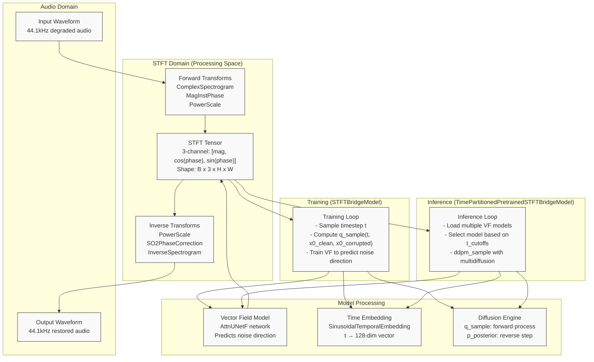
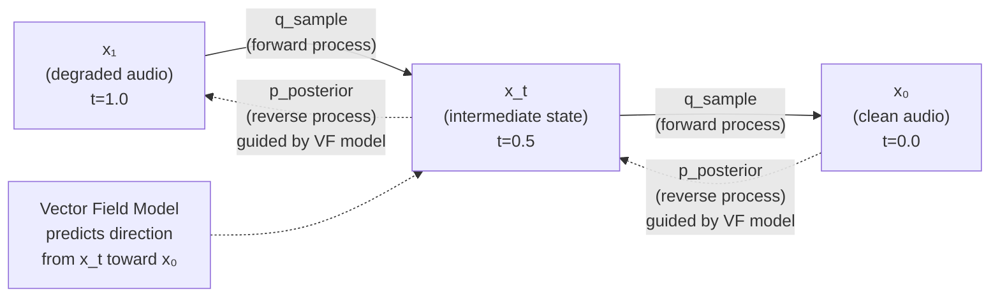
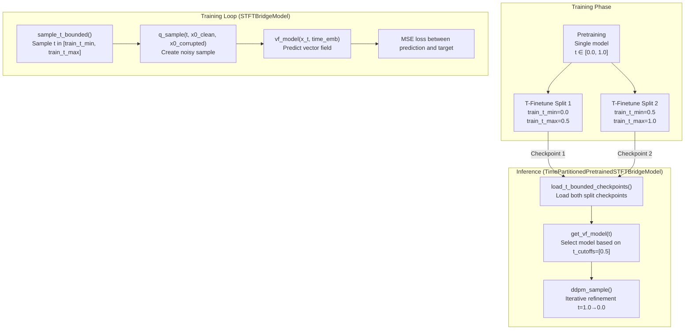
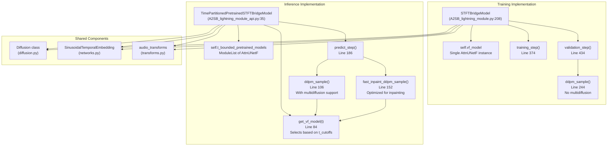
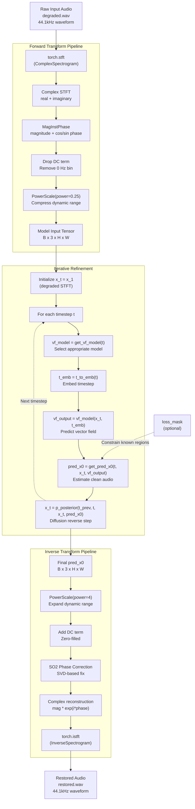
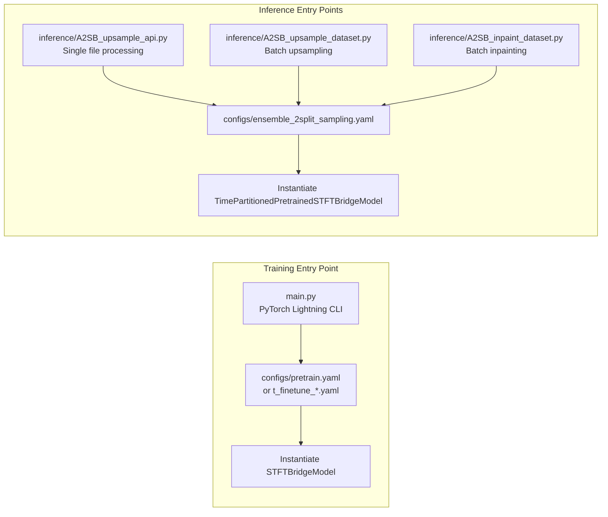

<!-- source: DeepWiki mcp.deepwiki.com · repo NVIDIA/diffusion-audio-restoration · page 5 Architecture and Core Concepts · fetched 2026-10-26 -->

# Architecture and Core Concepts

<details>
<summary>Relevant source files</summary>

The following files were used as context for generating this wiki page:

- [A2SB_lightning_module.py](A2SB_lightning_module.py)
- [A2SB_lightning_module_api.py](A2SB_lightning_module_api.py)
- [README.md](README.md)

</details>


## Purpose and Scope

This page provides a comprehensive overview of A2SB's architecture and the core concepts that enable vocoder-free, end-to-end audio restoration at 44.1kHz. It explains how the major components interact and bridges high-level system design to concrete code implementations.

For detailed explanations of specific subsystems, see:
- [A2SB Model Overview](#5.1) - High-level model design and unique characteristics
- [Schrödinger Bridge Diffusion](#5.2) - Diffusion formulation and sampling algorithms
- [Audio Representation](#5.3) - STFT, magnitude-instantaneous phase, and SO(2) matrices
- [Time-Partitioned Ensemble](#5.4) - The 2-split training and inference strategy

## System Architecture Overview

A2SB consists of three primary subsystems that work together to perform audio restoration:

1. **Training System** - Learns vector field models on degraded-to-clean audio pairs
2. **Diffusion Engine** - Implements Schrödinger Bridge formulation for stochastic interpolation
3. **Audio Processing Pipeline** - Converts between waveform and STFT representations

### High-Level Component Interaction



**Sources:**
- [A2SB_lightning_module.py:208-476]() - `STFTBridgeModel` training implementation
- [A2SB_lightning_module_api.py:35-210]() - `TimePartitionedPretrainedSTFTBridgeModel` inference implementation
- [README.md:17-25]() - System capabilities overview

## Core Concepts

### Vector Field Model

The vector field model is the core neural network that learns to predict the direction from a noisy/degraded audio sample toward the clean target. It is implemented as an attention-based U-Net architecture.

| Component | Implementation | Purpose |
|-----------|---------------|---------|
| Network Architecture | `AttnUNetF` in [networks.py]() | U-Net with attention mechanisms for processing 3-channel STFT |
| Input | STFT tensor (B x 3 x H x W) + time embedding (128-dim) | Current noisy state + diffusion timestep |
| Output | STFT tensor (B x 3 x H x W) | Predicted noise direction (vector field) |
| Training Target | `(x_t - x_0_clean) / std_fwd_t` | Normalized direction from clean to noisy |

The vector field formulation differs from standard diffusion models that predict noise directly. During training, the model learns:

```
vf_output = VectorFieldModel(x_t, time_embedding(t))
target = (x_t - x_0_clean) / std_fwd_t
loss = MSE(vf_output, target) * loss_mask
```

**Sources:**
- [A2SB_lightning_module.py:374-402]() - Training step implementation
- [networks.py]() - Neural network architectures

### Schrödinger Bridge Diffusion

A2SB uses a Schrödinger Bridge formulation rather than standard DDPM. This enables:

1. **Deterministic endpoints**: The forward process interpolates between degraded audio (x₁) and clean audio (x₀)
2. **Flexible scheduling**: Can be formulated as either SDE or ODE (controlled by `use_ot_ode` parameter)
3. **Masked sampling**: Supports inpainting by keeping known regions fixed during sampling

The `Diffusion` class implements:

| Method | Purpose | Key Parameters |
|--------|---------|---------------|
| `q_sample(t, x_0, x_1)` | Forward diffusion: interpolate from x₀ to x₁ at time t | `beta_max=0.3` controls noise schedule |
| `p_posterior(t_prev, t, x_t, pred_x0)` | Reverse diffusion: one step backward | `ot_ode` flag switches SDE/ODE |
| `get_pred_x0(t, x_t, vf_output)` | Recover clean prediction from vector field | Inverts the forward process |



**Sources:**
- [diffusion.py]() - `Diffusion` class implementation
- [A2SB_lightning_module.py:381-388]() - Forward process in training
- [A2SB_lightning_module.py:244-278]() - Reverse process in sampling

### STFT-Based Audio Representation

A2SB processes audio in the STFT domain using a factorized representation that separates magnitude and phase:

**Representation Pipeline:**

```mermaid
graph LR
    Waveform["Waveform<br/>1D time-domain signal"]
    Complex["Complex STFT<br/>complex-valued<br/>frequency-time"]
    MagPhase["Magnitude + Inst. Phase<br/>3 channels:<br/>[mag, cos(φ), sin(φ)]"]
    Processed["Processed<br/>DC term dropped<br/>power=0.25 scaling"]
    Model["Model Input<br/>B x 3 x H x W"]
    
    Waveform -->|"torch.stft"| Complex
    Complex -->|"MagInstPhase transform"| MagPhase
    MagPhase -->|"Drop DC + PowerScale"| Processed
    Processed --> Model
    
    Model -->|"PowerScale^-1"| Processed2["Processed<br/>power=4 scaling"]
    Processed2 -->|"Add DC + SO2 fix"| MagPhase2["Magnitude + Phase"]
    MagPhase2 -->|"Reconstruct complex"| Complex2["Complex STFT"]
    Complex2 -->|"torch.istft"| Waveform2["Waveform"]
```



The key innovation is representing phase as points on the SO(2) manifold (unit circle) using `[cos(φ), sin(φ)]` rather than raw phase angles. This avoids phase wrapping discontinuities.

**Transform Chain:**

| Transform | Direction | Implementation | Purpose |
|-----------|-----------|----------------|---------|
| `ComplexSpectrogram` | Forward | STFT with hann window | Convert waveform to frequency domain |
| `MagInstPhase` | Forward | Separate magnitude and phase | Extract amplitude and instantaneous phase |
| `PowerScale` | Bidirectional | Magnitude^power | Compress dynamic range (power=0.25 forward) |
| `SO2PhaseCorrection` | Inverse | SVD-based correction | Ensure phase vectors lie on unit circle |
| `InverseSpectrogram` | Inverse | iSTFT | Convert back to waveform |

**Sources:**
- [audio_transforms/transforms.py]() - Transform implementations
- [audio_utils.py]() - STFT and SO(2) utilities
- [README.md:21]() - Factorized audio representation mention

### Time-Partitioned Training Strategy

A2SB's most distinctive architectural feature is training separate models for different diffusion timestep ranges, then combining them during inference.

**Two-Split Configuration:**

| Split | Timestep Range | Parameter | Checkpoint |
|-------|---------------|-----------|------------|
| Split 1 | t ∈ [0.0, 0.5] | `train_t_min=0.0, train_t_max=0.5` | Model specialized for denoising |
| Split 2 | t ∈ [0.5, 1.0] | `train_t_min=0.5, train_t_max=1.0` | Model specialized for structure recovery |



During inference, the `get_vf_model(t)` method selects which model to use based on the current timestep:

```python
# Simplified from A2SB_lightning_module_api.py:84-89
def get_vf_model(self, t: float):
    model_idx = 0
    for idx, thresh in enumerate(self.t_cutoffs):  # [0.5]
        if t >= thresh:
            model_idx = idx + 1
    return self.t_bounded_pretrained_models[model_idx]
```

**Sources:**
- [A2SB_lightning_module.py:370-376]() - `sample_t_bounded()` method
- [A2SB_lightning_module_api.py:64-81]() - `load_t_bounded_checkpoints()` method
- [A2SB_lightning_module_api.py:83-89]() - `get_vf_model()` model selection
- [configs/t_finetune_2split_0.0_0.5.yaml]() - Split 1 configuration

## Training vs Inference Architecture

A2SB maintains two separate Lightning Module implementations optimized for their respective purposes:

### Code Entity Mapping



### Key Architectural Differences

| Aspect | Training (`STFTBridgeModel`) | Inference (`TimePartitionedPretrainedSTFTBridgeModel`) |
|--------|------------------------------|-------------------------------------------------------|
| Vector Field Models | Single `vf_model` | Multiple models in `t_bounded_pretrained_models` |
| Model Selection | N/A | `get_vf_model(t)` based on `t_cutoffs` |
| Sampling | Simple `ddpm_sample()` | Enhanced with multidiffusion, fast inpainting |
| Purpose | Optimize model parameters | Generate restored audio |
| Batch Processing | Supports any batch size | Typically batch_size=1 for long audio |
| Configuration | `train_t_min`, `train_t_max` | `pretrained_checkpoints`, `t_cutoffs` |

**Sources:**
- [A2SB_lightning_module.py:208-476]() - Training module implementation
- [A2SB_lightning_module_api.py:35-210]() - Inference module implementation

## Audio Processing Data Flow

The following diagram traces how audio data flows through the system during inference:



**Key Processing Functions:**

| Stage | Function/Class | File Location | Purpose |
|-------|---------------|---------------|---------|
| STFT Forward | `ComplexSpectrogram` | [audio_transforms/transforms.py]() | Convert waveform to complex spectrogram |
| Phase Representation | `MagInstPhase` | [audio_transforms/transforms.py]() | Split into magnitude and SO(2) phase |
| Model Input Prep | `apply_audio_transforms()` | [audio_transforms/transforms.py]() | Apply forward transform chain |
| Sampling Loop | `ddpm_sample()` | [A2SB_lightning_module_api.py:106-149]() | Iterative refinement |
| Model Selection | `get_vf_model()` | [A2SB_lightning_module_api.py:84-89]() | Choose model based on timestep |
| Vocoding | `vocode_stft()` | [A2SB_lightning_module_api.py:92-103]() | Apply inverse transforms |
| STFT Inverse | `InverseSpectrogram` | [audio_transforms/transforms.py]() | Convert back to waveform |

**Sources:**
- [A2SB_lightning_module_api.py:106-149]() - `ddpm_sample()` implementation
- [A2SB_lightning_module_api.py:186-210]() - `predict_step()` orchestration
- [audio_transforms/transforms.py]() - Transform pipeline
- [audio_utils.py]() - Utility functions for STFT and phase

## Entry Points and Configuration

### Main Entry Points



### Configuration Parameters

Key configuration parameters that control architecture:

| Parameter | Location | Purpose | Typical Value |
|-----------|----------|---------|---------------|
| `beta_max` | Model config | Controls noise schedule strength | 0.3 |
| `use_ot_ode` | Model config | SDE vs ODE formulation | false (SDE) |
| `n_timestep_channels` | Model config | Dimensionality of time embedding | 128 |
| `train_t_min`, `train_t_max` | Training config | Timestep range for T-finetuning | [0.0, 0.5] or [0.5, 1.0] |
| `pretrained_checkpoints` | Inference config | List of model checkpoint paths | [split1.ckpt, split2.ckpt] |
| `t_cutoffs` | Inference config | Boundaries between model splits | [0.5] |
| `predict_n_steps` | Inference config | Number of diffusion steps | 50 |
| `predict_win_length` | Inference config | Window size for multidiffusion | 256 |
| `predict_hop_length` | Inference config | Hop size for multidiffusion | 128 |

**Sources:**
- [main.py]() - Training entry point
- [inference/A2SB_upsample_api.py]() - API entry point
- [configs/]() - Configuration files
- [A2SB_lightning_module.py:209-219]() - `STFTBridgeModel.__init__` parameters
- [A2SB_lightning_module_api.py:36-49]() - `TimePartitionedPretrainedSTFTBridgeModel.__init__` parameters

## Summary

A2SB's architecture achieves state-of-the-art audio restoration through:

1. **Vector field formulation** - Learning the direction from degraded to clean rather than predicting noise directly
2. **Schrödinger Bridge** - Flexible SDE/ODE formulation with deterministic endpoints
3. **Factorized STFT representation** - Magnitude + SO(2) phase for stable training
4. **Time-partitioned ensemble** - Specialized models for different diffusion timestep ranges
5. **Separation of concerns** - Distinct training and inference implementations optimized for their purposes

The architecture supports both bandwidth extension (predicting high frequencies) and inpainting (filling gaps) within a unified framework, processing audio in the STFT domain without requiring a separate vocoder.

---

