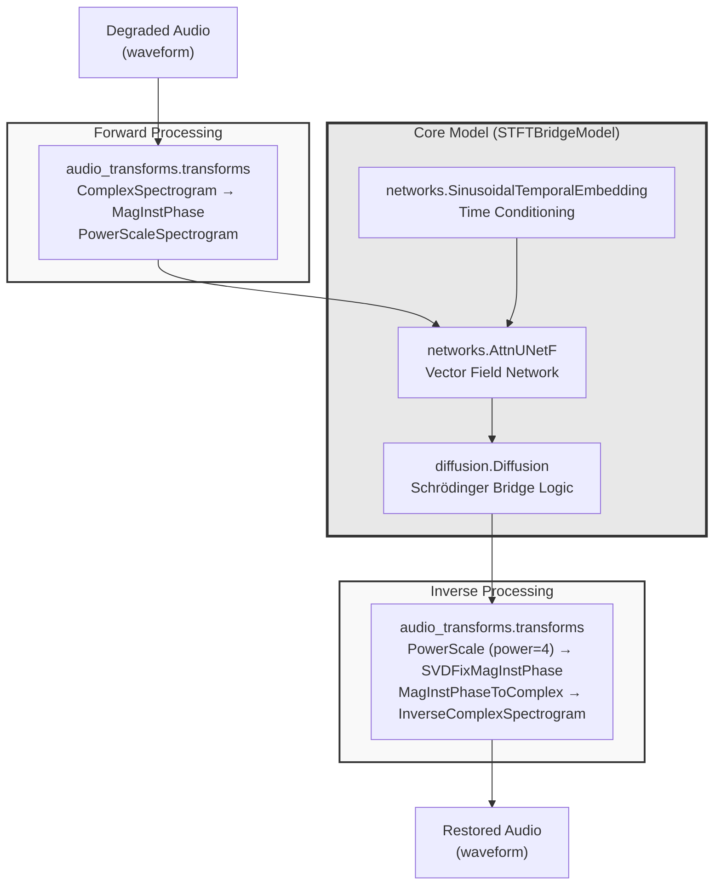
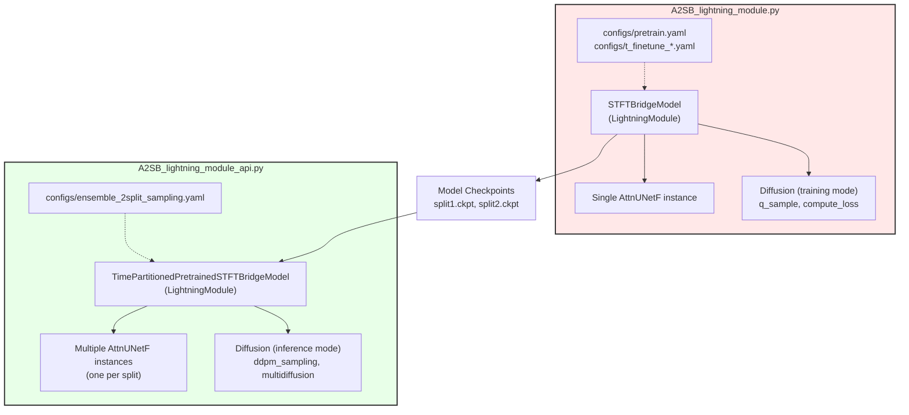
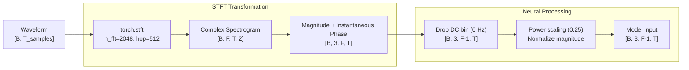
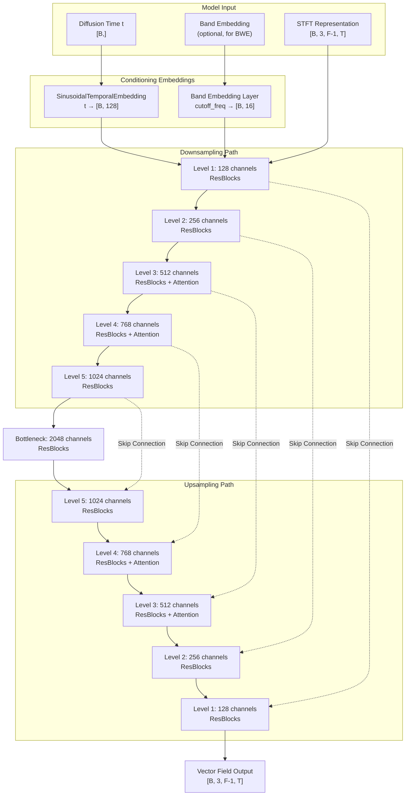
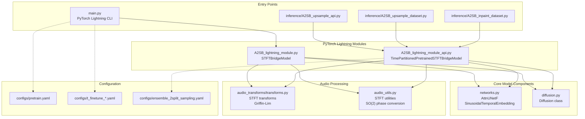
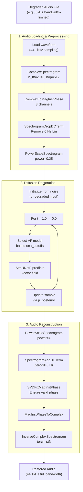

<!-- source: DeepWiki mcp.deepwiki.com · repo NVIDIA/diffusion-audio-restoration · page 5.1 A2SB Model Overview · fetched 2026-10-26 -->

# A2SB Model Overview

<details>
<summary>Relevant source files</summary>

The following files were used as context for generating this wiki page:

- [README.md](README.md)
- [configs/ensemble_2split_sampling.yaml](configs/ensemble_2split_sampling.yaml)

</details>


## Purpose and Scope

This page provides a high-level overview of the A2SB (Audio-to-Audio Schrödinger Bridge) architecture, explaining its unique characteristics and core components. For detailed information about the Schrödinger Bridge diffusion formulation, see [Schrödinger Bridge Diffusion](#5.2). For the audio representation strategy (STFT, magnitude-instantaneous phase), see [Audio Representation](#5.3). For the time-partitioned ensemble approach, see [Time-Partitioned Ensemble](#5.4).

## What is A2SB?

A2SB is an end-to-end diffusion model for music restoration at 44.1kHz that operates without requiring a separate vocoder. The system directly processes and generates audio waveforms through a learned Schrödinger Bridge diffusion process operating on STFT representations.

**Key capabilities:**
- **Bandwidth Extension**: Predicting high-frequency components from band-limited inputs
- **Inpainting**: Reconstructing missing temporal segments in audio
- **Long-form Processing**: Handling hour-long audio without boundary artifacts
- **Multi-task**: Single model for multiple restoration tasks

**Distinguishing features:**
- Vocoder-free: Direct waveform generation via invertible STFT transforms
- End-to-end: No separate modules for different frequency bands
- State-of-the-art quality on out-of-distribution music datasets

Sources: [README.md:17-26]()

## Core Architecture Components

The A2SB system consists of five primary components working together to form a complete restoration pipeline:



Sources: [audio_transforms/transforms.py](), [networks.py](), [diffusion.py](), [configs/ensemble_2split_sampling.yaml:105-119](), [configs/ensemble_2split_sampling.yaml:63-78]()

### Component Breakdown

| Component | Implementation | Purpose |
|-----------|----------------|---------|
| **Audio Encoder** | `ComplexSpectrogram`, `ComplexToMagInstPhase`, `SpectrogramDropDCTerm`, `PowerScaleSpectrogram` | Converts waveform to 3-channel STFT representation (magnitude, cos phase, sin phase) |
| **Vector Field Model** | `AttnUNetF` | Neural network that predicts the vector field for diffusion |
| **Diffusion Engine** | `Diffusion` | Implements Schrödinger Bridge sampling and training logic |
| **Time Embedding** | `SinusoidalTemporalEmbedding` | Encodes diffusion timestep `t` into conditioning signal |
| **Audio Decoder** | `PowerScaleSpectrogram` (inverse), `SVDFixMagInstPhase`, `MagInstPhaseToComplex`, `InverseComplexSpectrogram` | Reconstructs waveform from STFT representation |

Sources: [configs/ensemble_2split_sampling.yaml:105-119](), [configs/ensemble_2split_sampling.yaml:63-78]()

## Training vs Inference Architecture

A2SB uses different PyTorch Lightning modules for training and inference, optimized for their respective tasks:



### Key Differences

| Aspect | Training (`STFTBridgeModel`) | Inference (`TimePartitionedPretrainedSTFTBridgeModel`) |
|--------|------------------------------|--------------------------------------------------------|
| **Vector Field Models** | Single `AttnUNetF` instance | Multiple `AttnUNetF` instances (one per time partition) |
| **Diffusion Methods** | `q_sample()`, `compute_loss()` | `ddpm_sampling()`, `multidiffusion()`, `fast_inpaint()` |
| **Time Range** | Configurable via `train_t_min`, `train_t_max` | Full `t ∈ [0, 1]` with model switching at `t_cutoffs` |
| **Checkpoint Loading** | Trains from scratch or resumes | Loads pretrained checkpoints via `pretrained_checkpoints` |
| **Optimization** | Includes optimizer, learning rate scheduler | No optimization components |
| **Primary Use** | Training new models | Running inference on degraded audio |

Sources: [A2SB_lightning_module.py](), [A2SB_lightning_module_api.py](), [configs/ensemble_2split_sampling.yaml:83-86]()

## Factorized Audio Representation

A2SB operates on a 3-channel STFT representation rather than raw waveforms, enabling efficient processing and invertible transformations:



**Channels breakdown:**
- **Channel 0**: Log-magnitude (scaled by power=0.25)
- **Channel 1**: `cos(phase)` - Real part of unit phasor
- **Channel 2**: `sin(phase)` - Imaginary part of unit phasor

This representation ensures:
- **Invertibility**: Exact reconstruction via inverse STFT when combined with `SVDFixMagInstPhase`
- **Bounded range**: Magnitude is power-scaled; phase is represented on the unit circle
- **Efficiency**: 3 channels capture all necessary information

For detailed information on SO(2) phase representation and STFT utilities, see [Audio Representation](#5.3) and [STFT and SO(2) Phase Utilities](#6.5).

Sources: [audio_transforms/transforms.py](), [configs/ensemble_2split_sampling.yaml:105-119]()

## AttnUNetF Vector Field Network

The core neural network in A2SB is `AttnUNetF`, a U-Net architecture with attention mechanisms that predicts the vector field for the Schrödinger Bridge diffusion process:



**Architecture parameters** (from config):
- **Levels**: 5 downsampling/upsampling levels
- **Channels**: `[128, 256, 512, 768, 1024, 2048]`
- **Attention**: Applied at levels 3 and 4 (8 heads, 16 rotary dims)
- **Input/Output**: 3 channels (magnitude, cos phase, sin phase)
- **Embedding**: 128-dim time embedding + 16-dim band embedding

Sources: [configs/ensemble_2split_sampling.yaml:47-62](), [networks.py]()

## Design Principles

### 1. End-to-End Processing

Unlike traditional audio restoration systems that use separate models for different stages (e.g., separate enhancement and vocoding), A2SB processes audio end-to-end:

**Traditional approach:**
```
Degraded Audio → Enhancement Model → Enhanced Spectrogram → Vocoder → Restored Audio
```

**A2SB approach:**
```
Degraded Audio → STFT → Diffusion Model → Inverse STFT → Restored Audio
```

The key is using **invertible STFT transforms** with phase-aware processing (via SO(2) representation), eliminating the need for a learned vocoder.

Sources: [README.md:19-24]()

### 2. Multi-Task Architecture

A2SB handles both bandwidth extension and inpainting through the same core architecture, with task-specific conditioning:

| Task | Conditioning Method | Implementation |
|------|---------------------|----------------|
| **Bandwidth Extension** | Band embedding (cutoff frequency) | `band_embedding_dim=16` in `AttnUNetF` |
| **Inpainting** | Masking in multidiffusion | `fast_inpaint()` method in inference |

The diffusion process naturally handles both tasks through conditional sampling.

Sources: [configs/ensemble_2split_sampling.yaml:56](), [A2SB_lightning_module_api.py]()

### 3. Long-Form Audio Processing

A2SB can process hour-long audio without boundary artifacts using:

- **Chunk processing**: Audio is processed in overlapping chunks
- **Multidiffusion**: Overlapping regions are averaged during sampling
- **Consistent conditioning**: Time embedding ensures coherent generation across chunks

This is implemented in the inference scripts but not the core training module.

Sources: [README.md:23-24](), [inference/A2SB_upsample_api.py]()

## Model File Organization

The A2SB codebase is organized into distinct modules for different concerns:



**Module responsibilities:**

| Module | Primary Classes/Functions | Responsibility |
|--------|---------------------------|----------------|
| `networks.py` | `AttnUNetF`, `SinusoidalTemporalEmbedding` | Neural network architectures |
| `diffusion.py` | `Diffusion` | Schrödinger Bridge logic, sampling algorithms |
| `A2SB_lightning_module.py` | `STFTBridgeModel` | Training logic, optimization, validation |
| `A2SB_lightning_module_api.py` | `TimePartitionedPretrainedSTFTBridgeModel` | Inference logic, ensemble handling |
| `audio_transforms/transforms.py` | `ComplexSpectrogram`, `MagInstPhase*`, etc. | STFT and audio transformations |
| `audio_utils.py` | Various STFT and phase utilities | Low-level audio processing |

Sources: [main.py](), [A2SB_lightning_module.py](), [A2SB_lightning_module_api.py](), [networks.py](), [diffusion.py](), [audio_transforms/transforms.py](), [audio_utils.py]()

## How A2SB Works: Complete Pipeline

Here's how the complete restoration process works from input to output:



**Process summary:**

1. **Preprocessing**: Convert waveform to 3-channel STFT representation with proper scaling
2. **Diffusion**: Iteratively denoise/restore using vector field predictions from `AttnUNetF`
3. **Postprocessing**: Convert STFT back to waveform with phase correction

The middle step (diffusion) is where the core restoration happens, guided by the learned Schrödinger Bridge. For details on the diffusion algorithm, see [Schrödinger Bridge Diffusion](#5.2).

Sources: [configs/ensemble_2split_sampling.yaml:105-119](), [configs/ensemble_2split_sampling.yaml:63-78](), [diffusion.py]()

## Summary

A2SB achieves state-of-the-art audio restoration through:

1. **Vocoder-free design**: Direct waveform generation via invertible STFT
2. **Factorized representation**: 3-channel magnitude + instantaneous phase encoding
3. **Attention-based U-Net**: `AttnUNetF` predicts vector fields for diffusion
4. **Schrödinger Bridge**: Principled diffusion formulation for audio-to-audio translation
5. **Time-partitioned training**: Separate models for different diffusion timesteps (see [Time-Partitioned Ensemble](#5.4))
6. **Multi-task capability**: Handles bandwidth extension and inpainting with same architecture

The separation between training (`STFTBridgeModel`) and inference (`TimePartitionedPretrainedSTFTBridgeModel`) modules allows for efficient training and flexible deployment strategies.

Sources: [README.md:17-26](), [A2SB_lightning_module.py](), [A2SB_lightning_module_api.py]()

---

