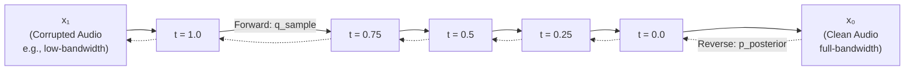
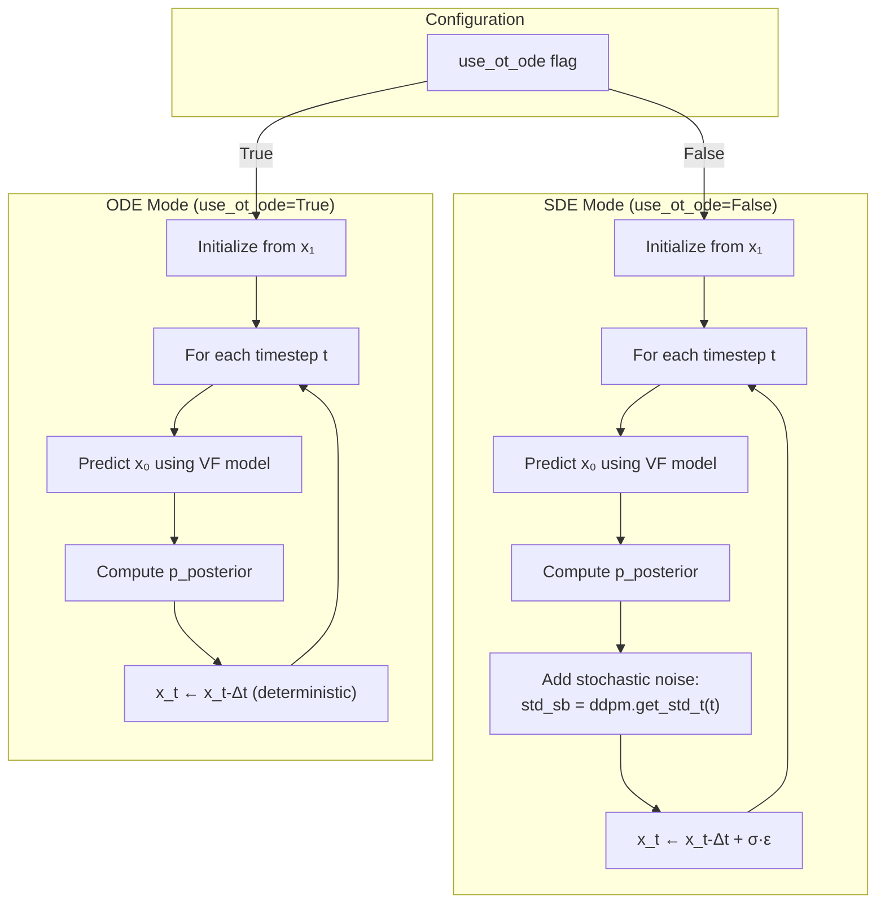
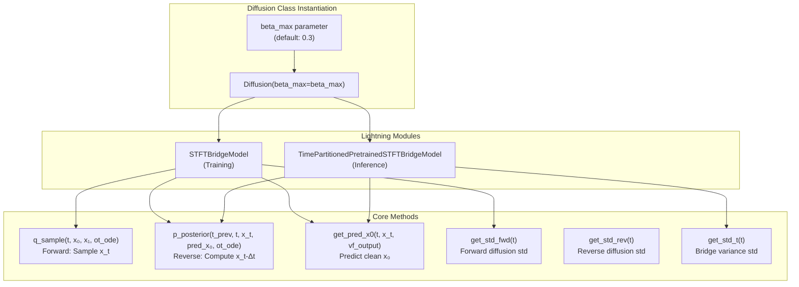
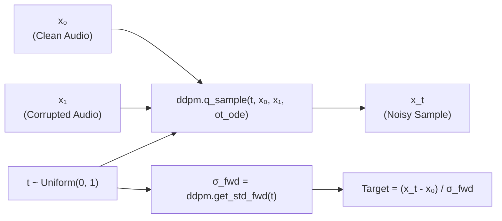
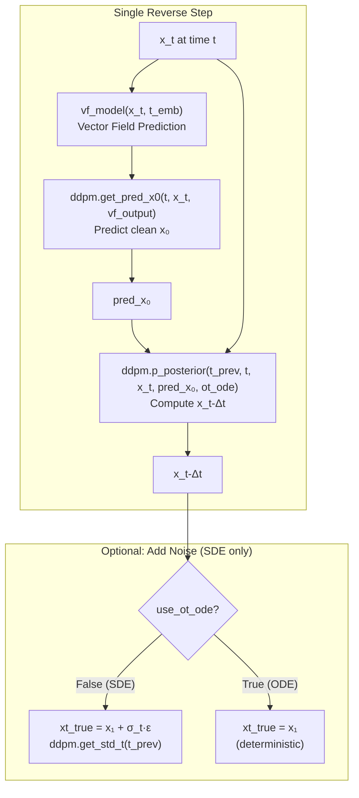
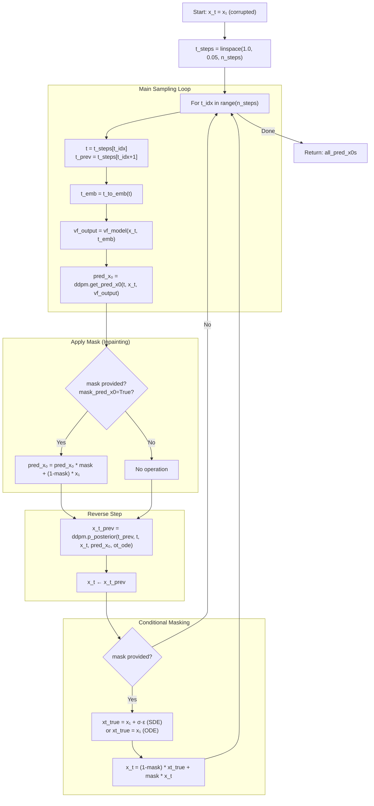
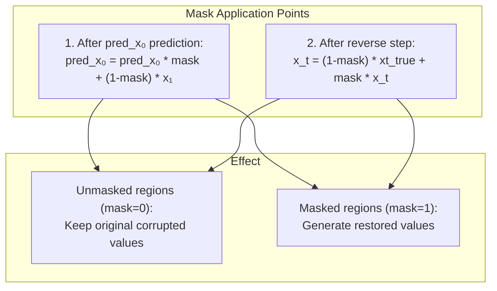
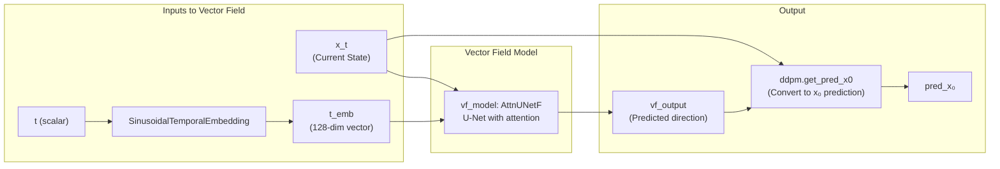

<!-- source: DeepWiki mcp.deepwiki.com · repo NVIDIA/diffusion-audio-restoration · page 5.2 Schrödinger Bridge Diffusion · fetched 2026-10-26 -->

# Schrödinger Bridge Diffusion

<details>
<summary>Relevant source files</summary>

The following files were used as context for generating this wiki page:

- [A2SB_lightning_module.py](A2SB_lightning_module.py)
- [A2SB_lightning_module_api.py](A2SB_lightning_module_api.py)

</details>


## Purpose and Scope

This page explains the Schrödinger Bridge diffusion formulation used in A2SB, including the mathematical foundations, implementation details, and the differences between SDE (Stochastic Differential Equation) and ODE (Ordinary Differential Equation) sampling modes. This document covers the core diffusion mechanics implemented in the `Diffusion` class and how it is used during training and inference.

For the overall A2SB architecture, see [A2SB Model Overview](#5.1). For details on the audio representation that the diffusion operates on, see [Audio Representation](#5.3). For information about how multiple diffusion models are combined during inference, see [Time-Partitioned Ensemble](#5.4).

## What is Schrödinger Bridge?

A Schrödinger Bridge (SB) is a diffusion process that connects two probability distributions through a series of intermediate distributions. Unlike standard diffusion models that bridge clean data to Gaussian noise, A2SB uses the Schrödinger Bridge formulation to directly bridge **corrupted audio** (x₁) to **clean audio** (x₀).



**Sources:** [A2SB_lightning_module.py:381-382](), [A2SB_lightning_module.py:262]()

### Key Characteristics

| Aspect | Standard Diffusion | Schrödinger Bridge (A2SB) |
|--------|-------------------|---------------------------|
| **Starting distribution** | Gaussian noise | Corrupted audio (x₁) |
| **Target distribution** | Clean data (x₀) | Clean audio (x₀) |
| **Forward process** | Add noise to data | Bridge from x₀ to x₁ |
| **Reverse process** | Denoise from noise | Bridge from x₁ to x₀ |
| **Application** | Unconditional generation | Conditional restoration |

**Sources:** [A2SB_lightning_module.py:374-402]()

## SDE vs ODE Formulations

A2SB supports two formulations controlled by the `use_ot_ode` parameter:

### SDE (Stochastic Differential Equation)

The default formulation includes stochastic noise during sampling, making the reverse process probabilistic. At each timestep during reverse sampling, Gaussian noise is added according to the bridge variance:

```
x_{t-Δt} = p_posterior(t, x_t, pred_x₀) + σ_t · ε,  where ε ~ N(0, I)
```

**Sources:** [A2SB_lightning_module.py:232-235](), [A2SB_lightning_module.py:270-271]()

### ODE (Ordinary Differential Equation)

When `use_ot_ode=True`, the sampling becomes deterministic by removing the stochastic component. This is based on Optimal Transport (OT) theory and provides a deterministic mapping from x₁ to x₀:

```
x_{t-Δt} = p_posterior(t, x_t, pred_x₀)  [no noise added]
```

**Sources:** [A2SB_lightning_module.py:54-56](), [A2SB_lightning_module.py:232-235]()



**Sources:** [A2SB_lightning_module.py:244-278](), [A2SB_lightning_module.py:268-276]()

## Diffusion Class Implementation

The core diffusion mechanics are implemented in the `Diffusion` class, which is instantiated with a `beta_max` parameter that controls the diffusion strength:



**Sources:** [A2SB_lightning_module.py:220](), [A2SB_lightning_module.py:51](), [diffusion.py:16]()

### Key Parameters

- **beta_max**: Controls the maximum diffusion strength. Default is 0.3. Higher values lead to stronger diffusion but may be harder to reverse.
- **use_ot_ode**: Boolean flag to switch between SDE (False) and ODE (True) formulations.

**Sources:** [A2SB_lightning_module.py:214](), [A2SB_lightning_module.py:38]()

## Forward Diffusion Process (q_sample)

During training, the forward process samples noisy intermediate states x_t by interpolating between clean audio x₀ and corrupted audio x₁. The `q_sample` method implements this:

### Training Forward Process



The forward process creates training pairs where:
1. A random timestep **t** is sampled from the range `[train_t_min, train_t_max]`
2. The noisy state **x_t** is computed using `q_sample`
3. The vector field target is computed as **(x_t - x₀) / σ_fwd**

**Sources:** [A2SB_lightning_module.py:374-389]()

### Implementation in Training Step

[A2SB_lightning_module.py:374-402]() shows the complete training step:

```python
t = self.sample_t_bounded(x_0_clean.shape[0]).to(x_0_clean.device)
t_emb = self.t_to_emb(t)
x_t = self.ddpm.q_sample(t, x_0_clean, x_0_corrupted, ot_ode=self.use_ot_ode)
std_fwd_t = self.ddpm.get_std_fwd(t)
vf_output = self.vf_model(x_t, t_emb)
std_fwd_t_expanded = std_fwd_t.view(std_fwd_t.shape[0], 1, 1, 1)
target = (x_t - x_0_clean)/std_fwd_t_expanded
loss = (((vf_output - target.detach()) ** 2) * loss_mask).sum() / loss_mask.sum()
```

**Sources:** [A2SB_lightning_module.py:379-388]()

## Reverse Diffusion Process (p_posterior)

The reverse process moves from corrupted audio x₁ back to clean audio x₀ by iteratively applying the learned vector field. The `p_posterior` method computes the previous timestep state:



**Sources:** [A2SB_lightning_module.py:251-277]()

### Prediction of Clean Audio (get_pred_x0)

At each reverse timestep, the model first predicts what the clean audio x₀ should be, given the current noisy state x_t and the vector field output. This prediction is used to guide the reverse step.

**Sources:** [A2SB_lightning_module.py:257](), [A2SB_lightning_module.py:132]()

## DDPM Sampling Loop

The complete reverse sampling procedure is implemented in the `ddpm_sample` method, which iterates backwards from t=1.0 to t≈0.0:



**Sources:** [A2SB_lightning_module.py:244-278](), [A2SB_lightning_module_api.py:106-149]()

### Timestep Schedule

The sampling typically uses a linear schedule from t=1.0 down to t=0.05 (or 1/n_steps). Common values:
- **Training**: n_steps = 25 during validation
- **Inference**: n_steps = 50 for better quality

**Sources:** [A2SB_lightning_module.py:411](), [A2SB_lightning_module.py:192]()

## Masked Conditional Sampling

A2SB supports conditional generation through masking, which is critical for inpainting and bandwidth extension tasks. The mask indicates which regions should be preserved (mask=0) and which should be generated (mask=1).

### Masking Strategy



**Sources:** [A2SB_lightning_module.py:258-259](), [A2SB_lightning_module.py:265-276]()

### Implementation Details

[A2SB_lightning_module.py:258-276]() shows two mask applications:

1. **Mask pred_x₀**: Forces predicted clean audio to match corrupted audio in unmasked regions
2. **Mask x_t**: After each reverse step, replaces unmasked regions with the known corrupted values (with appropriate noise in SDE mode)

This ensures that only the masked regions are restored while preserving the known good regions.

**Sources:** [A2SB_lightning_module.py:258-276]()

## Vector Field Model Integration

The Schrödinger Bridge requires a vector field model that predicts the direction to move at each timestep. A2SB uses the `AttnUNetF` architecture (see [Model Architecture Details](#6.3)):



**Sources:** [A2SB_lightning_module.py:223](), [A2SB_lightning_module.py:256-257](), [A2SB_lightning_module.py:383]()

### Time Embedding

The `SinusoidalTemporalEmbedding` converts scalar timestep values into 128-dimensional vectors that can be processed by the neural network:

**Sources:** [A2SB_lightning_module.py:223](), [networks.py]()

## Training vs Inference Usage

### Training Mode (STFTBridgeModel)

During training, the diffusion is used to:
1. Generate training pairs (x_t, target) via `q_sample`
2. Compute the vector field target: **(x_t - x₀) / σ_fwd**
3. Train the model to predict this target

**Sources:** [A2SB_lightning_module.py:374-402]()

### Inference Mode (TimePartitionedPretrainedSTFTBridgeModel)

During inference, the diffusion is used to:
1. Start from corrupted audio x₁
2. Iteratively apply `ddpm_sample` to move toward clean audio
3. Use time-partitioned ensemble models (see [Time-Partitioned Ensemble](#5.4))
4. Support long-form audio via multidiffusion

**Sources:** [A2SB_lightning_module.py:103-146](), [A2SB_lightning_module_api.py:106-149]()

```mermaid
graph TB
    subgraph "Training Usage"
        TDataset["Training Batch:<br/>x₀_clean, x₀_corrupted"]
        TSample["t ~ sample_t_bounded"]
        TForward["x_t = ddpm.q_sample(t, x₀, x₁)"]
        TPredict["vf_output = vf_model(x_t, t_emb)"]
        TTarget["target = (x_t - x₀) / σ_fwd"]
        TLoss["MSE Loss"]
        
        TDataset --> TSample
        TSample --> TForward
        TForward --> TPredict
        TForward --> TTarget
        TPredict --> TLoss
        TTarget --> TLoss
    end
    
    subgraph "Inference Usage"
        IInput["x₁ (corrupted)"]
        ISteps["t_steps = linspace(1.0, 0.05, 50)"]
        ILoop["For each timestep"]
        IVF["vf_model = get_vf_model(t)<br/>(ensemble selector)"]
        IPredict["vf_output = vf_model(x_t, t_emb)"]
        IPredX0["pred_x₀ = ddpm.get_pred_x0"]
        IReverse["x_t ← ddpm.p_posterior"]
        IOutput["x₀ (restored)"]
        
        IInput --> ISteps
        ISteps --> ILoop
        ILoop --> IVF
        IVF --> IPredict
        IPredict --> IPredX0
        IPredX0 --> IReverse
        IReverse --> ILoop
        ILoop --> IOutput
    end
```



**Sources:** [A2SB_lightning_module.py:374-402](), [A2SB_lightning_module_api.py:106-149](), [A2SB_lightning_module_api.py:81-89]()

## Variance Schedules and Beta_max

The `beta_max` parameter controls the strength of the diffusion process. The forward and reverse variances are computed as functions of time t and beta_max:

| Method | Purpose | Usage |
|--------|---------|-------|
| `get_std_fwd(t)` | Forward diffusion standard deviation | Training target normalization |
| `get_std_rev(t)` | Reverse diffusion standard deviation | Alternative sampling (not primary) |
| `get_std_t(t)` | Bridge variance standard deviation | SDE stochastic noise |

**Sources:** [A2SB_lightning_module.py:382](), [A2SB_lightning_module.py:270](), [diffusion.py]()

### Beta_max Configuration

The default `beta_max=0.3` is specified in configuration files and passed to the `Diffusion` class:

**Sources:** [A2SB_lightning_module.py:214](), [A2SB_lightning_module.py:38](), [configs/pretrain.yaml]()

## Alternative Sampling Methods

The codebase includes alternative sampling implementations that are not the primary methods but are available for experimentation:

### ddpm_sample_i2sb_way

An alternative sampling method that computes Gaussian product coefficients differently:

**Sources:** [A2SB_lightning_module.py:280-316]()

### ddpm_sample_i2sb_change_order

Another variant that changes the order of mask application:

**Sources:** [A2SB_lightning_module.py:318-355]()

These methods use `compute_gaussian_product_coef` to compute variance from forward and reverse standard deviations:

**Sources:** [A2SB_lightning_module.py:305](), [A2SB_lightning_module.py:341](), [diffusion.py:16]()

## Summary

The Schrödinger Bridge diffusion in A2SB:

1. **Bridges corrupted to clean audio** rather than noise to data
2. **Supports both SDE and ODE** formulations via `use_ot_ode`
3. **Uses vector field prediction** to learn the reverse process
4. **Enables conditional generation** through masking for inpainting/BWE
5. **Integrates with time-partitioned ensemble** for better quality
6. **Controlled by beta_max** parameter for diffusion strength

The core implementation resides in the `Diffusion` class with key methods `q_sample` (forward), `p_posterior` (reverse), and `get_pred_x0` (clean prediction), orchestrated by the `ddpm_sample` sampling loop.

**Sources:** [A2SB_lightning_module.py:208-476](), [A2SB_lightning_module_api.py:35-209](), [diffusion.py]()

---

