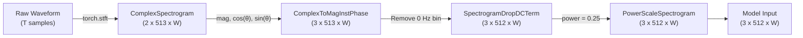
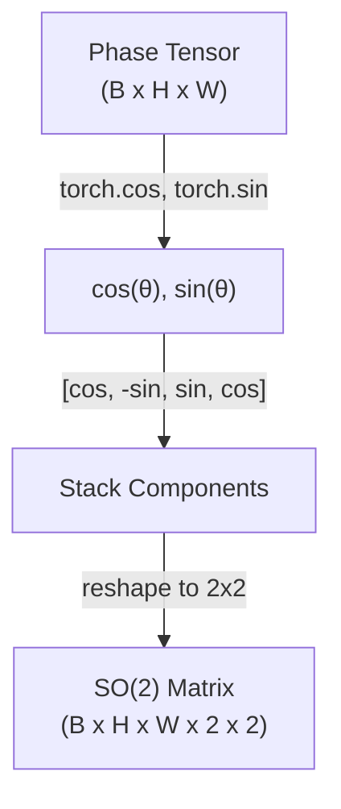
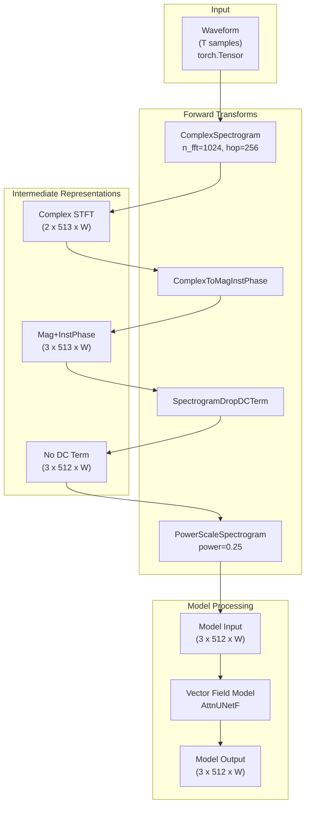
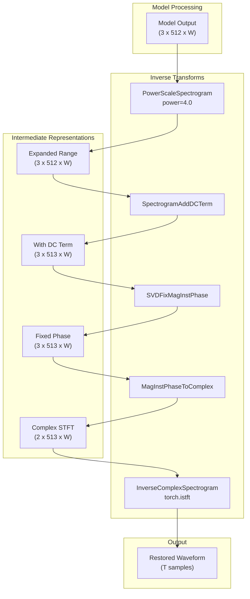
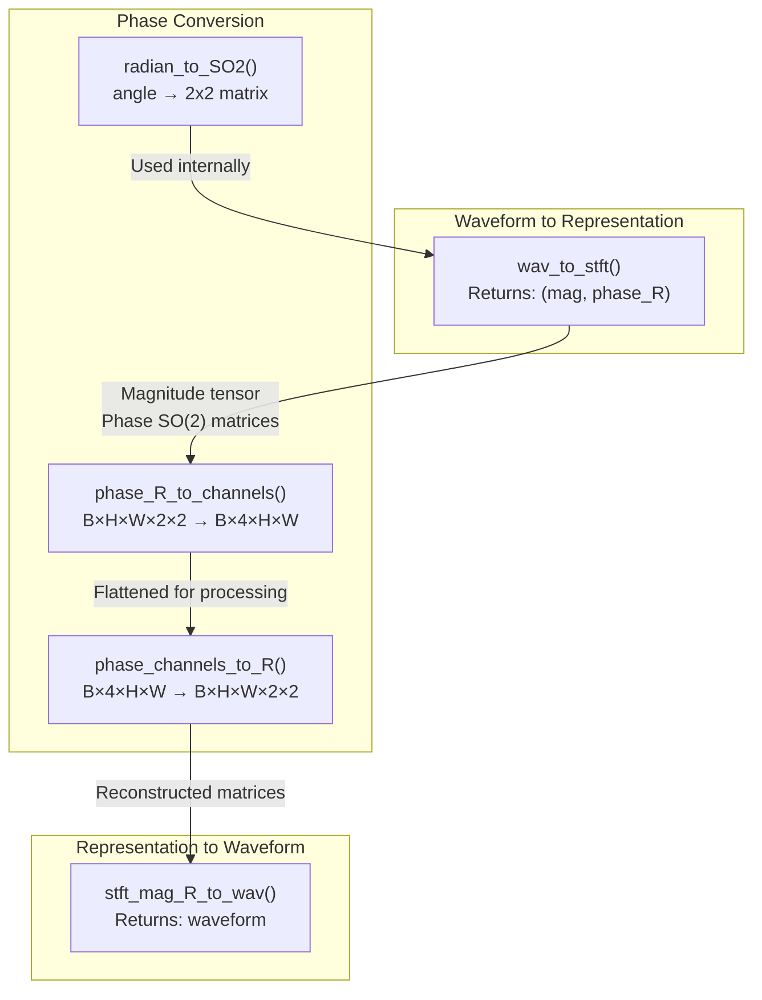

<!-- source: DeepWiki mcp.deepwiki.com · repo NVIDIA/diffusion-audio-restoration · page 5.3 Audio Representation · fetched 2026-10-26 -->

# Audio Representation

<details>
<summary>Relevant source files</summary>

The following files were used as context for generating this wiki page:

- [README.md](README.md)
- [audio_transforms/transforms.py](audio_transforms/transforms.py)
- [audio_utils.py](audio_utils.py)

</details>


This page explains A2SB's factorized audio representation system, which transforms raw waveforms into a structured 3-channel STFT representation suitable for diffusion modeling. This includes the Short-Time Fourier Transform (STFT) conversion, magnitude-instantaneous phase decomposition, and SO(2) rotation matrix encoding of phase information.

For information about how this representation is used in the diffusion process, see [Schrödinger Bridge Diffusion](#5.2). For details on the neural network architecture that processes this representation, see [Model Architecture Details](#6.3).

---

## Overview of Factorized Representation

A2SB uses a **factorized audio representation** that separates magnitude and phase information from the STFT (Short-Time Fourier Transform). Rather than working with complex-valued spectrograms directly, A2SB decomposes them into three channels:

1. **Magnitude**: Energy at each time-frequency bin
2. **cos(θ)**: Cosine of instantaneous phase
3. **sin(θ)**: Sine of instantaneous phase

This factorization enables the model to learn separate priors for magnitude and phase while maintaining mathematical consistency through SO(2) (Special Orthogonal group in 2D) rotation matrices. The representation is end-to-end, allowing direct waveform-to-waveform restoration without requiring a separate vocoder.

Sources: [README.md:19-21](), [audio_transforms/transforms.py:108-133]()

---

## STFT Configuration

A2SB uses the following STFT parameters for 44.1kHz audio:

| Parameter | Value | Purpose |
|-----------|-------|---------|
| `n_fft` | 1024 | FFT size, producing 513 frequency bins |
| `win_length` | 1024 | Window size for each frame |
| `hop_length` | 256 | Samples between consecutive frames |
| `window_fn` | Hann window | Smooth windowing function |

With these parameters and 44.1kHz sampling rate:
- **Frequency resolution**: ~43 Hz per bin (44100 / 1024)
- **Time resolution**: ~5.8 ms per frame (256 / 44100)
- **Maximum frequency**: ~22.05 kHz (Nyquist frequency)

The STFT produces a complex spectrogram with shape `(freq_bins, time_frames)` where `freq_bins = n_fft // 2 + 1 = 513`.

Sources: [audio_transforms/transforms.py:84-96](), [audio_utils.py:28-46]()

---

## Forward Transform Pipeline

The complete forward transformation from raw waveform to model input follows this sequence:



**Diagram: Forward Audio Transform Pipeline**

Each transform is implemented as a callable class that can be composed sequentially using `apply_audio_transforms()`.

Sources: [audio_transforms/transforms.py:55-80](), [audio_transforms/transforms.py:83-106](), [audio_transforms/transforms.py:108-118]()

---

## Magnitude-Instantaneous Phase Decomposition

### Complex to Magnitude-Instantaneous Phase

The `ComplexToMagInstPhase` transform converts a 2-channel complex spectrogram to a 3-channel representation:

**Input**: Complex spectrogram as 2-channel real tensor `(2 x H x W)` where:
- Channel 0: Real part
- Channel 1: Imaginary part

**Output**: Magnitude-instantaneous phase tensor `(3 x H x W)` where:
- Channel 0: `magnitude = sqrt(real² + imag²)`
- Channel 1: `cos(θ) = cos(atan2(imag, real))`
- Channel 2: `sin(θ) = sin(atan2(imag, real))`

This representation ensures that the phase information is encoded as unit vectors on the unit circle, which naturally constrains the model's predictions.

Sources: [audio_transforms/transforms.py:108-118]()

### Magnitude-Instantaneous Phase to Complex

The inverse transformation `MagInstPhaseToComplex` reconstructs complex values:

```
real = magnitude × cos(θ)
imag = magnitude × sin(θ)
```

This simple multiplication recovers the original complex representation for inverse STFT.

Sources: [audio_transforms/transforms.py:121-132]()

---

## SO(2) Phase Representation

### Rotation Matrix Encoding

Phases in A2SB can also be represented as **SO(2) rotation matrices**, which are 2×2 orthogonal matrices with determinant +1:

```
R(θ) = [ cos(θ)  -sin(θ) ]
       [ sin(θ)   cos(θ) ]
```

The `radian_to_SO2()` function converts phase angles to these matrices:



**Diagram: SO(2) Matrix Construction**

This representation is used in `audio_utils.py` for phase manipulation and in validation/inference where explicit SO(2) properties are needed.

Sources: [audio_utils.py:15-25](), [audio_utils.py:28-46]()

### SVD Phase Correction

Neural networks may produce phase predictions that don't satisfy SO(2) constraints (orthogonality, det = 1). The `SVDFixMagInstPhase` class uses **Singular Value Decomposition (SVD)** to project predictions onto the nearest valid SO(2) matrix:

1. **Construct rotation matrix**: Stack `[cos(θ), -sin(θ); sin(θ), cos(θ)]` from predicted values
2. **Apply SVD**: Decompose as `R = U Σ Vᴴ`
3. **Fix singular values**: Set `Σ₁ = 1`, `Σ₂ = det(UVᴴ)` (ensures det = ±1)
4. **Reconstruct**: Compute `R' = U Σ' Vᴴ` (now a valid rotation)
5. **Extract corrected phase**: Read `cos(θ)` and `sin(θ)` from first column of `R'`

This correction is crucial during inference to ensure physically valid phase relationships.

Sources: [audio_transforms/transforms.py:135-160]()

---

## DC Term Handling

The **DC term** (0 Hz frequency bin) is typically dropped during forward transformation and restored with zeros during inverse transformation.

### SpectrogramDropDCTerm

Removes the first frequency band (index 0):

```python
# Input:  C x H x W (where H includes DC term)
# Output: C x (H-1) x W (DC term removed)
return spec[..., 1:, :]
```

**Rationale**: The DC term represents the mean value of the signal, which is generally inconsequential for audio restoration tasks and adds unnecessary model complexity.

Sources: [audio_transforms/transforms.py:214-219]()

### SpectrogramAddDCTerm

Restores a zero-valued DC term during inverse transformation:

```python
dc_channel = spec[..., :1, :] * 0  # Create zero slice
return torch.cat((dc_channel, spec), -2)
```

This ensures the STFT has the correct shape (513 bins) for `torch.istft()`.

Sources: [audio_transforms/transforms.py:222-228]()

---

## Power Scaling

### Forward Scaling (Compression)

The `PowerScaleSpectrogram` transform applies power-law scaling to compress the dynamic range:

```
scaled_value = value × (|value|^power / (|value| + ε))
```

With `power = 0.25` (default for forward transform):
- **Large values** are compressed more aggressively
- **Small values** are relatively preserved
- **Purpose**: Helps the model learn features across different magnitude scales

The transformation can be applied to all channels or specific channels only (controlled by the `channels` parameter).

Sources: [audio_transforms/transforms.py:187-207]()

### Inverse Scaling (Expansion)

During inverse transformation, `power = 4.0` is used to reverse the compression, restoring the original dynamic range.

---

## Complete Transformation Pipeline

### Forward Pipeline Summary



**Diagram: Complete Forward Transform Pipeline with Code Entities**

Sources: [audio_transforms/transforms.py:55-80](), [audio_transforms/transforms.py:83-228]()

### Inverse Pipeline Summary



**Diagram: Complete Inverse Transform Pipeline with Code Entities**

Sources: [audio_transforms/transforms.py:163-228]()

---

## Griffin-Lim Vocoder Alternative

While A2SB is designed to be end-to-end without a vocoder, the `MagInstPhaseToGriffinLim` class provides an alternative reconstruction method using the **Griffin-Lim algorithm**.

### Griffin-Lim Process

Griffin-Lim is an iterative algorithm that reconstructs waveforms from magnitude spectrograms by estimating phase:

1. **Initialize phase**: Use predicted `cos(θ)` and `sin(θ)` as initial phase
2. **Iterative refinement**: 
   - Convert magnitude + phase to waveform via inverse STFT
   - Convert waveform back to STFT
   - Keep magnitude fixed, update phase from STFT
   - Apply momentum to stabilize convergence
3. **Converge**: After `n_iter` iterations (default 128), output final waveform

The implementation in A2SB uses:
- **Momentum**: 0.99 for fast convergence
- **Initialization**: Model's predicted phase (unlike standard Griffin-Lim which uses random phase)
- **Iterations**: 128 steps

This provides a fallback vocoder option and can be useful for debugging or comparing reconstruction quality.

Sources: [audio_transforms/transforms.py:231-258](), [audio_transforms/transforms.py:271-374]()

---

## Audio Utilities Functions

### Key Functions in audio_utils.py



**Diagram: Audio Utility Functions**

### Function Details

| Function | Input | Output | Purpose |
|----------|-------|--------|---------|
| `radian_to_SO2()` | `(B, ...)` angles | `(B, ..., 2, 2)` matrices | Convert phase angles to rotation matrices |
| `wav_to_stft()` | `(N,)` or `(B, N)` waveform | `magnitude, phase_R` | Complete waveform → STFT conversion |
| `phase_R_to_channels()` | `(B, H, W, 2, 2)` matrices | `(B, 4, H, W)` channels | Flatten SO(2) matrices to channels |
| `phase_channels_to_R()` | `(B, 4, H, W)` channels | `(B, H, W, 2, 2)` matrices | Reconstruct SO(2) matrices from channels |
| `stft_mag_R_to_wav()` | `magnitude, phase_Rch` | `(B, N)` waveform | Complete STFT → waveform conversion |

Sources: [audio_utils.py:15-86]()

---

## Design Rationale

### Why Factorized Representation?

1. **Separate Magnitude and Phase Priors**: Magnitude and phase have different statistical properties. Factorization allows the diffusion model to learn separate distributions for each.

2. **Constrained Phase Space**: Using `cos(θ)` and `sin(θ)` naturally constrains phase predictions to the unit circle, preventing invalid values.

3. **End-to-End Learning**: Unlike traditional approaches that treat phase as deterministic, A2SB learns to predict both magnitude and phase, enabling better restoration quality.

4. **Vocoder-Free**: Direct STFT inversion removes the need for a separate neural vocoder, reducing complexity and potential artifacts.

### Why SO(2) Matrices?

1. **Mathematical Consistency**: SO(2) matrices are the natural mathematical representation of rotations/phases.

2. **Projection via SVD**: When neural networks produce inconsistent phase predictions, SVD provides a principled way to project onto the nearest valid rotation.

3. **Geometric Interpretation**: Phase relationships can be understood as rotations, which aligns with the physics of audio signals.

Sources: [README.md:19-24](), [audio_transforms/transforms.py:135-160]()

---

