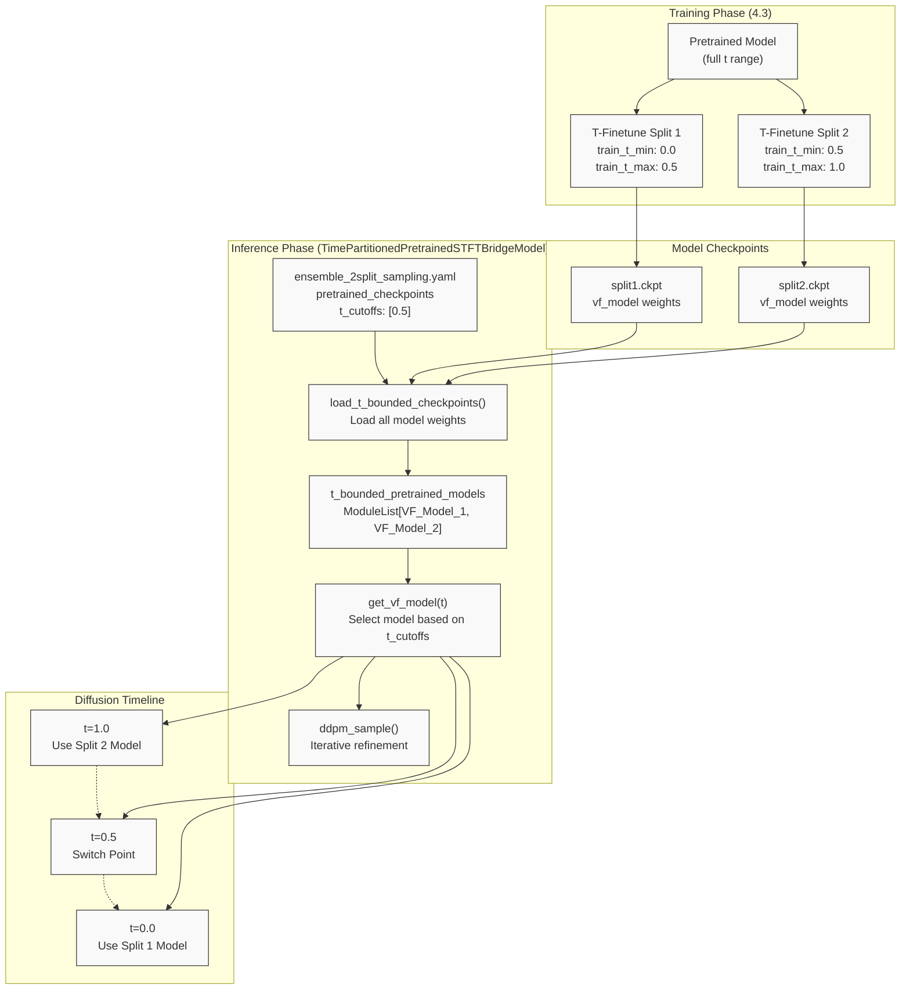
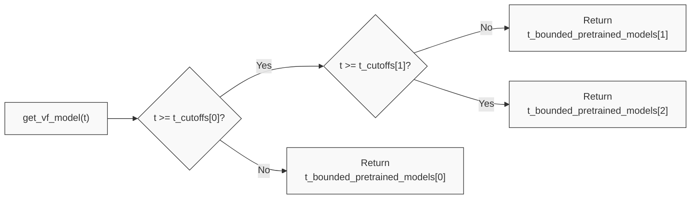
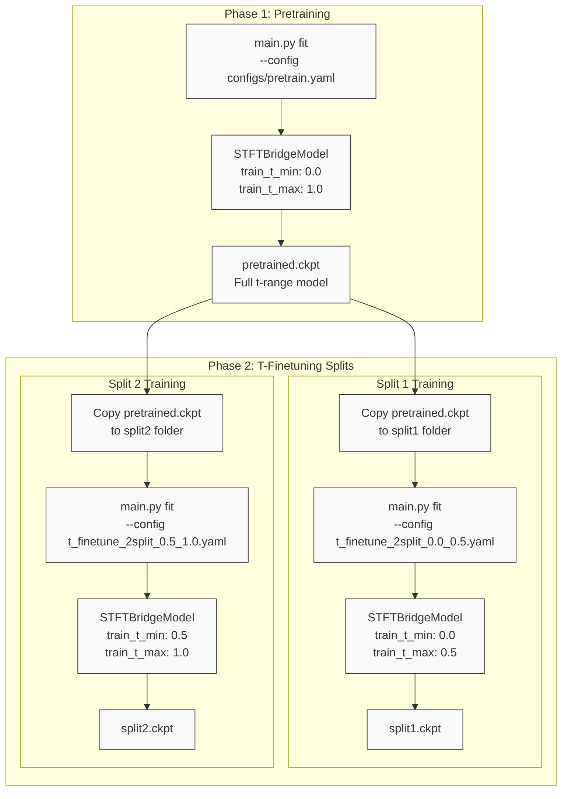
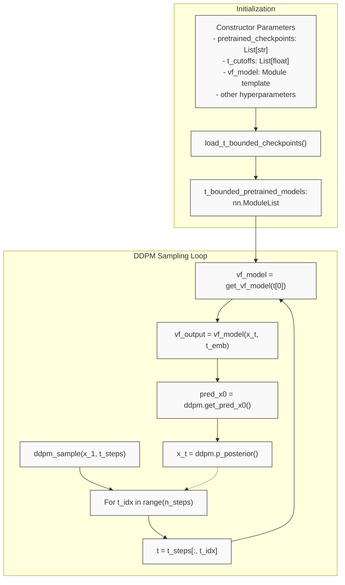
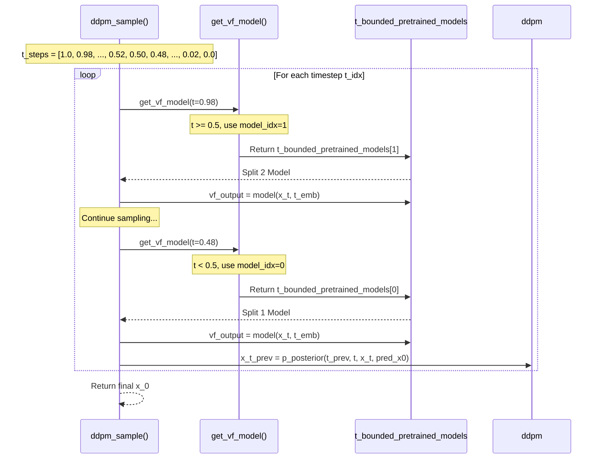
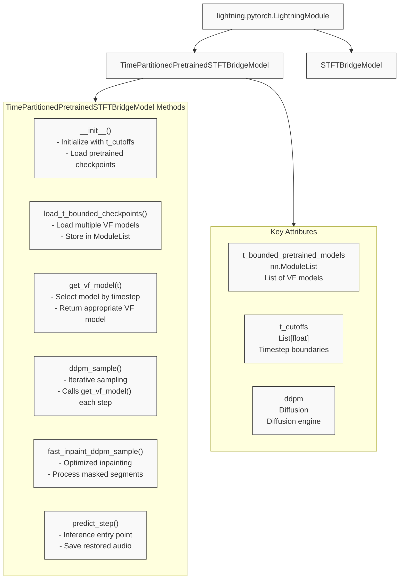

<!-- source: DeepWiki mcp.deepwiki.com · repo NVIDIA/diffusion-audio-restoration · page 5.4 Time-Partitioned Ensemble · fetched 2026-10-26 -->

# Time-Partitioned Ensemble

<details>
<summary>Relevant source files</summary>

The following files were used as context for generating this wiki page:

- [A2SB_lightning_module_api.py](A2SB_lightning_module_api.py)
- [README.md](README.md)
- [configs/ensemble_2split_sampling.yaml](configs/ensemble_2split_sampling.yaml)

</details>


## Purpose and Scope

This document explains the time-partitioned ensemble approach used in A2SB, where multiple vector field models are trained on different ranges of the diffusion timestep `t` and combined during inference. This technique improves model specialization and restoration quality by allowing different models to focus on different phases of the diffusion process.

For information about the underlying Schrödinger Bridge diffusion process, see [Schrödinger Bridge Diffusion](#5.2). For training procedures, see [T-Finetuning and Split Training](#4.3). For inference usage, see [Inference Guide](#3).

## Motivation and Benefits

The diffusion process in A2SB operates over a continuous timestep range `t ∈ [0, 1]`, where:
- `t = 1`: Maximum noise/corruption (starting point)
- `t = 0`: Clean audio (target)

A single model trained across the entire timestep range must learn to handle fundamentally different tasks:
- **High `t` values**: Broad structural restoration and denoising
- **Low `t` values**: Fine detail refinement and high-frequency recovery

The time-partitioned ensemble approach addresses this by:

1. **Specialization**: Each model focuses on a specific `t` range, learning specialized representations
2. **Improved Quality**: Models can dedicate capacity to their timestep range without interference
3. **Flexibility**: Different split configurations can be tested (2-split, 3-split, etc.)
4. **State-of-the-Art Results**: The 2-split ensemble achieves the best reported performance

**Sources:** [README.md:1-92](), [A2SB_lightning_module_api.py:35-89]()

## System Overview



**Sources:** [A2SB_lightning_module_api.py:35-89](), [configs/ensemble_2split_sampling.yaml:83-86]()

## Time Partitioning Concept

### Timestep Ranges and Model Assignment

The `t_cutoffs` parameter defines boundary points that partition the timestep range. For a 2-split ensemble with `t_cutoffs: [0.5]`:

| Timestep Range | Model Used | Training Configuration |
|----------------|------------|------------------------|
| `t ∈ [0.5, 1.0]` | Split 2 Model | `train_t_min: 0.5, train_t_max: 1.0` |
| `t ∈ [0.0, 0.5)` | Split 1 Model | `train_t_min: 0.0, train_t_max: 0.5` |

For a hypothetical 3-split ensemble with `t_cutoffs: [0.33, 0.67]`:

| Timestep Range | Model Used | Training Configuration |
|----------------|------------|------------------------|
| `t ∈ [0.67, 1.0]` | Split 3 Model | `train_t_min: 0.67, train_t_max: 1.0` |
| `t ∈ [0.33, 0.67)` | Split 2 Model | `train_t_min: 0.33, train_t_max: 0.67` |
| `t ∈ [0.0, 0.33)` | Split 1 Model | `train_t_min: 0.0, train_t_max: 0.33` |

**Sources:** [A2SB_lightning_module_api.py:42-89](), [configs/ensemble_2split_sampling.yaml:86]()

### Model Selection Logic



The implementation in `get_vf_model()`:

```python
# Pseudocode from A2SB_lightning_module_api.py:84-89
def get_vf_model(t: float):
    model_idx = 0
    for idx, thresh in enumerate(t_cutoffs):
        if t >= thresh:
            model_idx = idx + 1
    return t_bounded_pretrained_models[model_idx]
```

**Sources:** [A2SB_lightning_module_api.py:84-89]()

## Training Time-Partitioned Models

### Two-Phase Training Process



### Training Configuration Requirements

For each split, the configuration must specify:

1. **Timestep Bounds** (`model.train_t_min`, `model.train_t_max`): Restrict training to specific `t` range
2. **Checkpoint Initialization**: Copy pretrained checkpoint to experiment folder
3. **Experiment Path**: Separate output directories for each split
4. **Training Duration**: Typically continues until convergence

Example configuration modification for Split 2:

```yaml
# Modify t_finetune_2split_0.0_0.5.yaml to create split 2 config
model:
  train_t_min: 0.5  # Changed from 0.0
  train_t_max: 1.0  # Changed from 0.5
```

**Sources:** [README.md:46-58](), [A2SB_lightning_module_api.py:219-228]()

## Inference with Time-Partitioned Ensemble

### TimePartitionedPretrainedSTFTBridgeModel Architecture



**Sources:** [A2SB_lightning_module_api.py:35-149]()

### Checkpoint Loading Process

The `load_t_bounded_checkpoints()` method loads multiple pretrained models:

```python
# From A2SB_lightning_module_api.py:67-81
@torch.no_grad()
def load_t_bounded_checkpoints(pretrained_checkpoints, t_cutoffs):
    loaded_models = []
    for ckpt in pretrained_checkpoints:
        state_dict = torch.load(ckpt)['state_dict']  # Full PTL state dict
        
        # Extract only vf_model weights
        new_state_dict = OrderedDict()
        for key, value in state_dict.items():
            if 'vf_model' in key:
                new_key = key.replace('vf_model.', '')
                new_state_dict[new_key] = value
        
        # Load into model copy
        current_model = copy.deepcopy(self.vf_model)
        current_model.load_state_dict(new_state_dict)
        loaded_models.append(current_model)
    
    self.t_bounded_pretrained_models = nn.ModuleList(loaded_models)
```

**Key Implementation Details:**

1. **State Dictionary Filtering**: Only `vf_model` weights are extracted from full Lightning checkpoint
2. **Key Renaming**: Removes `vf_model.` prefix for proper loading
3. **Deep Copy**: Each model is an independent copy of the architecture
4. **ModuleList Storage**: Enables proper parameter registration and device movement

**Sources:** [A2SB_lightning_module_api.py:67-81]()

### Sampling with Model Switching

During the `ddpm_sample()` process, the ensemble seamlessly switches between models:



The switching happens transparently within the sampling loop at [A2SB_lightning_module_api.py:126-141]():

```python
# Key sampling code with model selection
for t_idx in range(n_steps):
    t_emb = self.t_to_emb(t_steps[:,t_idx]).repeat(x_1.shape[0], 1)
    t = t_steps[:, t_idx]
    t_prev = t_steps[:, t_idx+1]
    
    # Model selection happens here
    vf_model = self.get_vf_model(t[0].item())
    
    # Use selected model for this timestep
    vf_output = get_multidiffusion_vf(vf_model, x_t, t_emb, ...)
    pred_x0 = self.ddpm.get_pred_x0(t_steps[:, t_idx], x_t, vf_output)
    x_t_prev = self.ddpm.p_posterior(t_prev, t, x_t, pred_x0, ...)
    x_t = x_t_prev
```

**Sources:** [A2SB_lightning_module_api.py:106-149]()

## Configuration Reference

### Ensemble Configuration Structure

```yaml
# From configs/ensemble_2split_sampling.yaml
model:
  # Model architecture (same for all splits)
  vf_model:
    class_path: networks.AttnUNetF
    init_args:
      n_updown_levels: 5
      in_channels: 3
      hidden_channels: [128, 256, 512, 768, 1024, 2048]
      # ... other architecture parameters
  
  # Ensemble-specific parameters
  pretrained_checkpoints:
    - PATH/TO/FIRST/SPLIT.ckpt   # Split 1: handles t ∈ [0.0, 0.5)
    - PATH/TO/SECOND/SPLIT.ckpt  # Split 2: handles t ∈ [0.5, 1.0]
  
  t_cutoffs: [0.5]  # Single cutoff for 2-split ensemble
  
  # Sampling parameters
  predict_n_steps: 50
  predict_win_length: 256
  predict_hop_length: 128
  predict_batch_size: 16
  
  # Diffusion parameters
  beta_max: 1.0
  use_ot_ode: false
```

### Key Configuration Parameters

| Parameter | Type | Description | Example |
|-----------|------|-------------|---------|
| `pretrained_checkpoints` | `List[str]` | Paths to split model checkpoints. Length must be `len(t_cutoffs) + 1` | `[split1.ckpt, split2.ckpt]` |
| `t_cutoffs` | `List[float]` | Timestep boundaries for model switching. Values in ascending order | `[0.5]` for 2-split, `[0.33, 0.67]` for 3-split |
| `predict_n_steps` | `int` | Number of DDPM sampling steps during inference | `50` |
| `use_ot_ode` | `bool` | Use ODE formulation instead of SDE | `false` |
| `beta_max` | `float` | Maximum noise schedule parameter | `1.0` |

**Validation:** The constructor enforces `assert(len(t_cutoffs) + 1 == len(pretrained_checkpoints))` at [A2SB_lightning_module_api.py:62]()

**Sources:** [configs/ensemble_2split_sampling.yaml:46-86](), [A2SB_lightning_module_api.py:36-64]()

## Implementation Class Hierarchy



**Sources:** [A2SB_lightning_module_api.py:35-210]()

## Comparison: Training vs Inference Models

| Aspect | `STFTBridgeModel` (Training) | `TimePartitionedPretrainedSTFTBridgeModel` (Inference) |
|--------|------------------------------|-------------------------------------------------------|
| **File** | [A2SB_lightning_module_api.py:212-481]() | [A2SB_lightning_module_api.py:35-210]() |
| **VF Models** | Single `self.vf_model` | Multiple in `self.t_bounded_pretrained_models` |
| **Model Selection** | N/A | Dynamic via `get_vf_model(t)` |
| **Timestep Range** | Restricted by `train_t_min`, `train_t_max` | Uses all timesteps, switches models |
| **Checkpoint Loading** | Automatic via Lightning | Manual via `load_t_bounded_checkpoints()` |
| **Configuration** | `train_t_min`, `train_t_max` | `pretrained_checkpoints`, `t_cutoffs` |
| **Optimizer** | `configure_optimizers()` defined | No optimizer (inference only) |
| **Use Case** | Training splits | Production inference |

**Sources:** [A2SB_lightning_module_api.py:35-481]()

## Extended Configurations

### 3-Split Ensemble (Hypothetical)

For research purposes, the architecture supports arbitrary split counts:

```yaml
model:
  pretrained_checkpoints:
    - split1.ckpt  # t ∈ [0.0, 0.33)
    - split2.ckpt  # t ∈ [0.33, 0.67)
    - split3.ckpt  # t ∈ [0.67, 1.0]
  
  t_cutoffs: [0.33, 0.67]
```

Training configurations would require:
- `split1`: `train_t_min: 0.0, train_t_max: 0.33`
- `split2`: `train_t_min: 0.33, train_t_max: 0.67`
- `split3`: `train_t_min: 0.67, train_t_max: 1.0`

### Single Model (No Ensemble)

To use a single model without partitioning:

```yaml
model:
  pretrained_checkpoints:
    - pretrained_full_range.ckpt
  
  t_cutoffs: []  # Empty list, no cutoffs
```

This configuration uses one model for all timesteps (equivalent to standard diffusion model).

**Sources:** [A2SB_lightning_module_api.py:62]()

## Integration with Other Systems

The time-partitioned ensemble integrates with:

1. **Multidiffusion** [A2SB_lightning_module_api.py:132-134](): Long audio processing with overlapping windows
2. **Fast Inpainting** [A2SB_lightning_module_api.py:152-183](): Optimized inpainting for sparse masking
3. **Audio Transforms** [A2SB_lightning_module_api.py:92-103](): STFT vocoding pipeline
4. **Inference Scripts**: 
   - [inference/A2SB_upsample_api.py]() for single files
   - [inference/A2SB_upsample_dataset.py]() for batch processing
   - [inference/A2SB_inpaint_dataset.py]() for inpainting tasks

All inference scripts instantiate `TimePartitionedPretrainedSTFTBridgeModel` with ensemble configuration.

**Sources:** [A2SB_lightning_module_api.py:35-210](), [README.md:64-75]()

---

