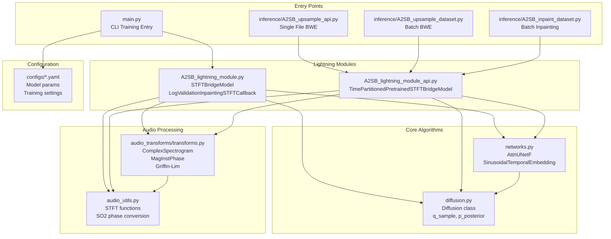
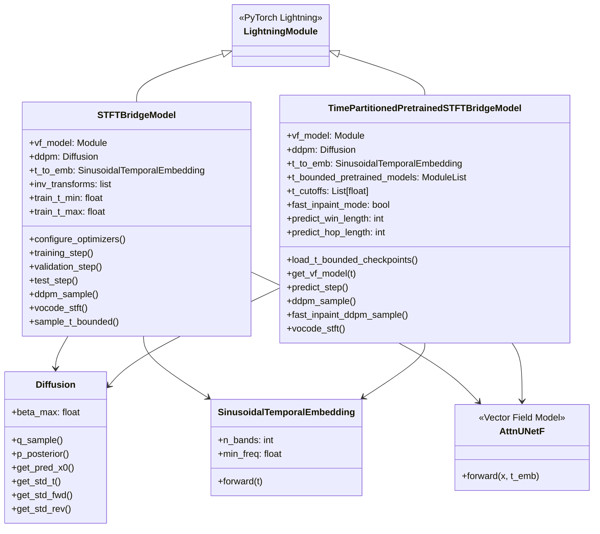
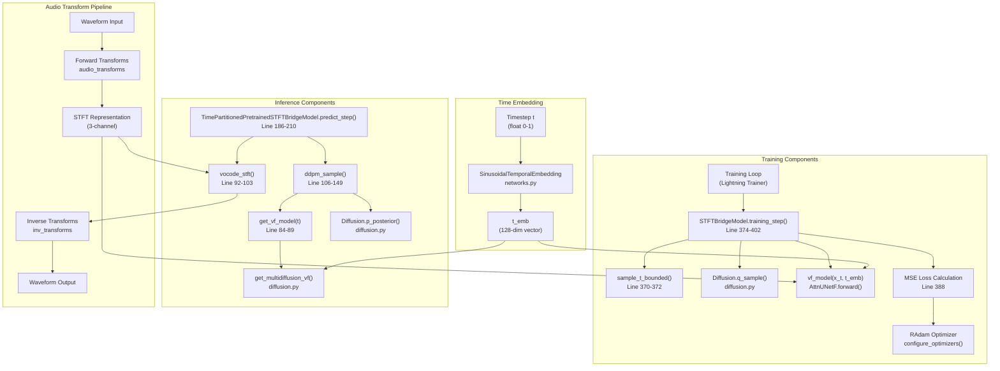
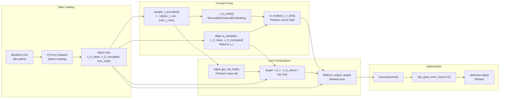
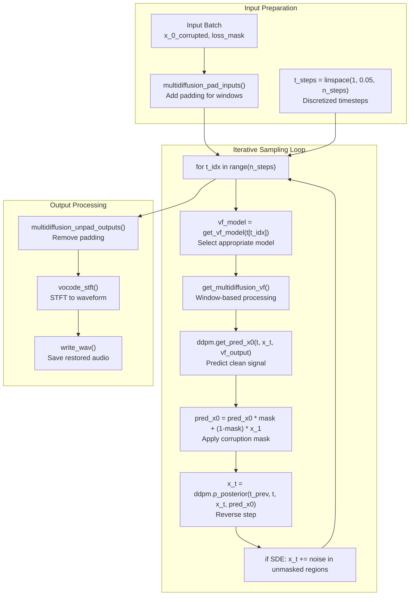
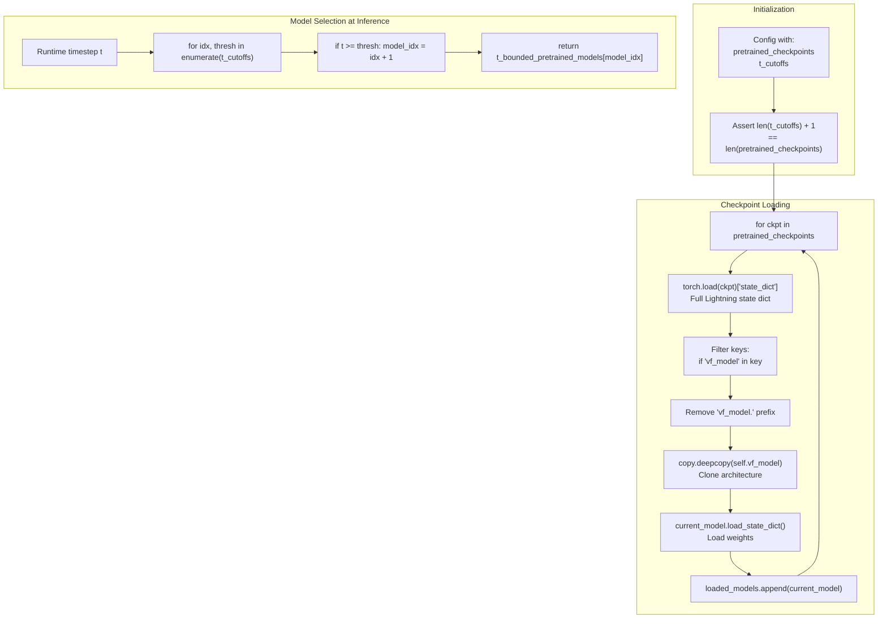

<!-- source: DeepWiki mcp.deepwiki.com · repo NVIDIA/diffusion-audio-restoration · page 6 Technical Reference · fetched 2026-10-26 -->

# Technical Reference

Relevant source files

The following files were used as context for generating this wiki page:

- [A2SB_lightning_module.py](A2SB_lightning_module.py)
- [A2SB_lightning_module_api.py](A2SB_lightning_module_api.py)

## Purpose and Scope

This technical reference provides detailed documentation of the A2SB codebase implementation, covering the core modules, classes, methods, and their interactions. This page serves as an entry point to understanding the code architecture at a detailed level.

The reference is organized into specialized sub-pages covering different aspects of the implementation:
- Lightning module implementations - see [Lightning Modules](#6.1)
- Audio processing and transformation pipeline - see [Audio Processing Pipeline](#6.2)
- Neural network architecture details - see [Model Architecture Details](#6.3)
- Diffusion algorithm implementation - see [Diffusion Process Implementation](#6.4)
- STFT utilities and phase representations - see [STFT and SO(2) Phase Utilities](#6.5)
- Transform class reference - see [Audio Transforms Reference](#6.6)

For high-level architectural concepts and theory, see [Architecture and Core Concepts](#5).

## Module Organization

The A2SB codebase is organized into distinct modules with clear responsibilities. The following diagram maps the primary Python modules to their roles in the system:

**Sources:** [A2SB_lightning_module.py:1-531](), [A2SB_lightning_module_api.py:1-535]()

## Core Lightning Modules

The system implements two primary PyTorch Lightning modules that share common components but serve different purposes:

### Module Comparison

| Aspect | `STFTBridgeModel` | `TimePartitionedPretrainedSTFTBridgeModel` |
|--------|-------------------|---------------------------------------------|
| **File** | A2SB_lightning_module.py | A2SB_lightning_module_api.py |
| **Purpose** | Training and validation | Inference with ensemble models |
| **VF Models** | Single `vf_model` | Multiple models in `t_bounded_pretrained_models` |
| **Timestep Handling** | Random sampling via `sample_t_bounded()` | Model selection via `get_vf_model(t)` |
| **Optimizer** | Configured (RAdam) | None (inference only) |
| **Key Methods** | `training_step()`, `validation_step()` | `predict_step()`, `ddpm_sample()` |
| **Multidiffusion** | Not implemented | Full support with padding/unpadding |
| **Fast Inpainting** | Not implemented | Optional `fast_inpaint_ddpm_sample()` |

**Sources:** [A2SB_lightning_module.py:208-477](), [A2SB_lightning_module_api.py:35-210]()

### Class Hierarchy and Relationships

**Sources:** [A2SB_lightning_module.py:208-477](), [A2SB_lightning_module_api.py:35-210]()

## Key Component Mapping

The following diagram maps high-level system components to specific code entities, bridging natural language descriptions to actual implementation:

**Sources:** [A2SB_lightning_module.py:374-402](), [A2SB_lightning_module_api.py:106-210]()

## Configuration Parameters

Key configuration parameters for both Lightning modules are documented below. These correspond to constructor arguments and can be set via YAML configuration files.

### STFTBridgeModel Parameters

| Parameter | Type | Default | Description |
|-----------|------|---------|-------------|
| `vf_model` | `torch.nn.Module` | Required | Vector field neural network (typically `AttnUNetF`) |
| `learning_rate` | `float` | `1e-4` | Learning rate for RAdam optimizer |
| `weight_decay` | `float` | `1e-8` | Weight decay for regularization |
| `inv_transforms` | `list` | `[]` | List of inverse audio transforms for vocoding |
| `sampling_rate` | `int` | `22050` | Audio sampling rate in Hz |
| `n_timestep_channels` | `int` | `128` | Dimensionality of time embedding |
| `beta_max` | `float` | `0.3` | Maximum noise level for diffusion |
| `use_ot_ode` | `bool` | `False` | Use ODE formulation instead of SDE |
| `train_t_min` | `float` | `0` | Minimum timestep for training (T-finetuning) |
| `train_t_max` | `float` | `1` | Maximum timestep for training (T-finetuning) |

**Sources:** [A2SB_lightning_module.py:209-236]()

### TimePartitionedPretrainedSTFTBridgeModel Parameters

| Parameter | Type | Default | Description |
|-----------|------|---------|-------------|
| `vf_model` | `torch.nn.Module` | Required | Template vector field model (architecture only) |
| `pretrained_checkpoints` | `List[str]` | Required | Paths to pretrained checkpoint files |
| `t_cutoffs` | `List[float]` | `[0.5]` | Timestep boundaries for model switching |
| `inv_transforms` | `list` | `[]` | List of inverse audio transforms |
| `sampling_rate` | `int` | `22050` | Audio sampling rate in Hz |
| `n_timestep_channels` | `int` | `128` | Dimensionality of time embedding |
| `beta_max` | `float` | `0.3` | Maximum noise level for diffusion |
| `use_ot_ode` | `bool` | `False` | Use ODE formulation instead of SDE |
| `fast_inpaint_mode` | `bool` | `False` | Enable fast inpainting for sparse masks |
| `predict_n_steps` | `int` | `50` | Number of diffusion sampling steps |
| `predict_hop_length` | `int` | `128` | Hop length for multidiffusion |
| `predict_win_length` | `int` | `256` | Window length for multidiffusion |
| `predict_batch_size` | `int` | `16` | Batch size for multidiffusion processing |

**Sources:** [A2SB_lightning_module_api.py:36-64]()

## Training Data Flow

The following diagram illustrates the complete data flow through the training system, from raw audio to loss computation:

**Sources:** [A2SB_lightning_module.py:374-402]()

## Inference Data Flow

The inference pipeline processes audio through iterative DDPM sampling with optional multidiffusion for long sequences:

**Sources:** [A2SB_lightning_module_api.py:106-210]()

## Checkpoint Loading and Ensemble Setup

The `TimePartitionedPretrainedSTFTBridgeModel` implements a sophisticated checkpoint loading mechanism for ensemble models:

**Sources:** [A2SB_lightning_module_api.py:66-89]()

## Method Reference Summary

### STFTBridgeModel Key Methods

| Method | Line Range | Purpose |
|--------|------------|---------|
| `__init__()` | 209-236 | Initialize training module with configuration |
| `configure_optimizers()` | 239-242 | Set up RAdam optimizer |
| `sample_t_bounded()` | 370-372 | Sample timesteps within `[train_t_min, train_t_max]` |
| `training_step()` | 374-402 | Execute one training iteration |
| `validation_step()` | 434-476 | Evaluate model on validation data |
| `test_step()` | 405-419 | Test model and compute audio metrics |
| `ddpm_sample()` | 244-278 | Iterative DDPM sampling for inference |
| `vocode_stft()` | 357-368 | Convert STFT representation to waveform |

**Sources:** [A2SB_lightning_module.py:208-477]()

### TimePartitionedPretrainedSTFTBridgeModel Key Methods

| Method | Line Range | Purpose |
|--------|------------|---------|
| `__init__()` | 36-64 | Initialize inference module with ensemble |
| `load_t_bounded_checkpoints()` | 66-81 | Load multiple checkpoint files into ensemble |
| `get_vf_model()` | 84-89 | Select appropriate model based on timestep |
| `ddpm_sample()` | 106-149 | Multidiffusion-enabled DDPM sampling |
| `fast_inpaint_ddpm_sample()` | 152-183 | Fast inpainting for sparse masks |
| `vocode_stft()` | 92-103 | Convert STFT representation to waveform |
| `predict_step()` | 186-210 | Process batch and save restored audio |

**Sources:** [A2SB_lightning_module_api.py:35-210]()

## Validation and Testing Infrastructure

The training module includes comprehensive validation and testing capabilities:

### Validation Process

During validation (`validation_step`), the model evaluates:

1. **Loss at Multiple Timesteps**: Computes MSE loss at `t ∈ {0.01, 0.25, 0.50, 0.75, 0.99}` to monitor learning across the diffusion trajectory
2. **Full Restoration**: Performs complete DDPM sampling with 25 steps
3. **Audio Metrics**: Computes quality metrics using `ssr_eval.metrics.AudioMetrics`

### Validation Callback

The `LogValidationInpaintingSTFTCallback` class provides TensorBoard logging:

| Logged Item | Method |
|-------------|--------|
| Original audio | `logger.experiment.add_audio()` |
| Original magnitude spectrogram | `logger.experiment.add_image()` |
| Masked magnitude spectrogram | `logger.experiment.add_image()` |
| Inpainted magnitude spectrogram | `logger.experiment.add_image()` |
| Inpainted audio | `logger.experiment.add_audio()` |

**Sources:** [A2SB_lightning_module.py:434-476](), [A2SB_lightning_module.py:479-531]()

## Fast Inpainting Mode

For inpainting tasks with sparse, well-separated corrupted regions, the `fast_inpaint_ddpm_sample()` method provides significant speedup:

**Algorithm:**
1. Identify centers of corrupted segments using `find_middle_of_zero_segments()`
2. For each corrupted segment:
   - Extract window of size `win_length` centered on corruption
   - Run full DDPM sampling on this window only
   - Replace the window in the full sequence
3. Return complete restored sequence

**Assumptions:**
- Each corrupted segment is shorter than `win_length`
- Corrupted segments are sufficiently separated
- Suitable for inpainting but not bandwidth extension

**Sources:** [A2SB_lightning_module_api.py:152-183]()

## Related Documentation

For detailed information about specific components:
- **Lightning module implementation details**: See [Lightning Modules](#6.1)
- **Audio transformation classes**: See [Audio Processing Pipeline](#6.2)
- **Neural network architectures**: See [Model Architecture Details](#6.3)
- **Diffusion algorithm mathematics**: See [Diffusion Process Implementation](#6.4)
- **STFT and phase utilities**: See [STFT and SO(2) Phase Utilities](#6.5)
- **Transform class reference**: See [Audio Transforms Reference](#6.6)

For theoretical background and high-level architecture:
- **A2SB model overview**: See [A2SB Model Overview](#5.1)
- **Schrödinger Bridge theory**: See [Schrödinger Bridge Diffusion](#5.2)
- **Audio representation theory**: See [Audio Representation](#5.3)
- **Time-partitioned ensemble explanation**: See [Time-Partitioned Ensemble](#5.4)

---

