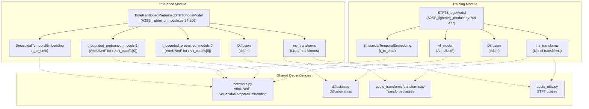
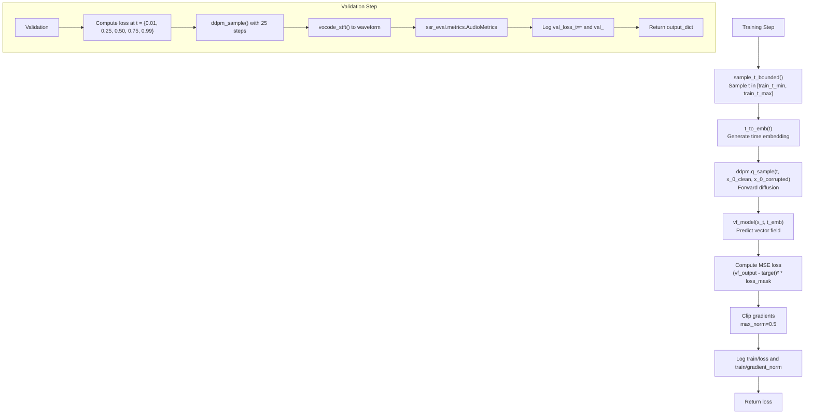
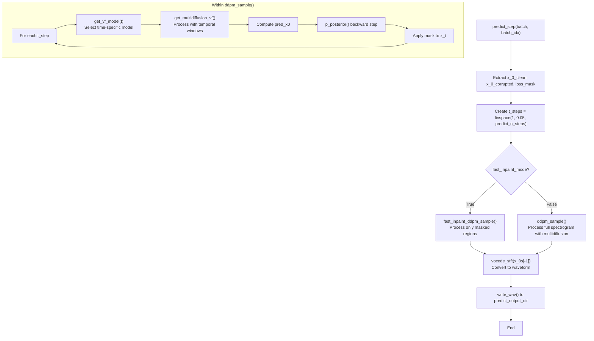
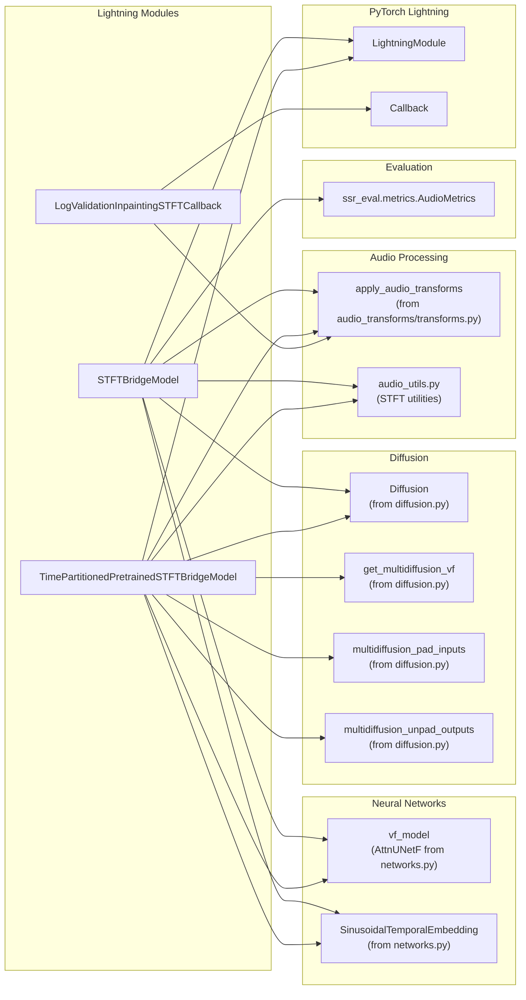

<!-- source: DeepWiki mcp.deepwiki.com · repo NVIDIA/diffusion-audio-restoration · page 6.1 Lightning Modules · fetched 2026-10-26 -->

# Lightning Modules

<details>
<summary>Relevant source files</summary>

The following files were used as context for generating this wiki page:

- [A2SB_lightning_module.py](A2SB_lightning_module.py)
- [A2SB_lightning_module_api.py](A2SB_lightning_module_api.py)

</details>


This page documents the PyTorch Lightning module implementations that orchestrate the A2SB model lifecycle. These modules serve as the primary interface between the training/inference workflows and the underlying diffusion models, handling data flow, optimization, and evaluation.

For information about the underlying diffusion process implementation, see [Diffusion Process Implementation](#6.4). For details about the vector field model architecture, see [Model Architecture Details](#6.3).

## Overview

A2SB provides two primary Lightning module implementations:

- **`STFTBridgeModel`**: Training and validation module with support for time-bounded training (t-finetuning)
- **`TimePartitionedPretrainedSTFTBridgeModel`**: Inference-optimized module with ensemble support and multidiffusion

Both modules exist in two locations:
- [A2SB_lightning_module.py:1-531]() - Original implementation for batch processing workflows
- [A2SB_lightning_module_api.py:1-535]() - API variant with modified output handling for single-file processing

The implementations are nearly identical, with the API variant making minor adjustments to the `predict_step` method to accommodate single-file restoration workflows.

**Sources**: [A2SB_lightning_module.py:1-531](), [A2SB_lightning_module_api.py:1-535]()

## Module Architecture



**Sources**: [A2SB_lightning_module.py:1-531](), [A2SB_lightning_module_api.py:1-535]()

## STFTBridgeModel (Training)

The `STFTBridgeModel` class implements the training and validation logic for A2SB models. It supports time-bounded training through the `train_t_min` and `train_t_max` parameters, enabling the two-phase training strategy.

### Initialization Parameters

| Parameter | Type | Default | Description |
|-----------|------|---------|-------------|
| `vf_model` | `torch.nn.Module` | Required | Vector field model (typically `AttnUNetF`) |
| `learning_rate` | `float` | `1e-4` | Learning rate for RAdam optimizer |
| `weight_decay` | `float` | `1e-8` | Weight decay for optimizer |
| `inv_transforms` | `List` | `[]` | Inverse transforms for spectrogram-to-waveform conversion |
| `sampling_rate` | `int` | `22050` | Audio sampling rate for vocoding |
| `n_timestep_channels` | `int` | `128` | Dimensionality of time embedding |
| `beta_max` | `float` | `0.3` | Maximum beta value for diffusion schedule |
| `use_ot_ode` | `bool` | `False` | Whether to use ODE formulation (True) or SDE (False) |
| `train_t_min` | `float` | `0` | Minimum diffusion timestep for training |
| `train_t_max` | `float` | `1` | Maximum diffusion timestep for training |

**Sources**: [A2SB_lightning_module.py:208-236](), [A2SB_lightning_module_api.py:212-240]()

### Core Methods

#### `configure_optimizers()`

Returns the RAdam optimizer with decoupled weight decay for training.

```python
# Returns: torch.optim.RAdam with configured learning rate and weight decay
```

**Sources**: [A2SB_lightning_module.py:239-242](), [A2SB_lightning_module_api.py:243-246]()

#### `sample_t_bounded(n_samples)`

Samples diffusion timesteps uniformly within the training range `[train_t_min, train_t_max]`. This method enables time-partitioned training (t-finetuning).

```python
# Returns: Tensor of shape (n_samples,) with t values in [train_t_min, train_t_max]
```

**Sources**: [A2SB_lightning_module.py:370-372](), [A2SB_lightning_module_api.py:374-376]()

#### `training_step(batch, batch_idx)`

Implements the core training logic:

1. Samples timestep `t` using `sample_t_bounded()`
2. Generates time embedding via `t_to_emb(t)`
3. Computes forward diffusion sample `x_t = q_sample(t, x_0_clean, x_0_corrupted)`
4. Predicts vector field using `vf_model(x_t, t_emb)`
5. Computes MSE loss between predicted and target vector field
6. Applies `loss_mask` to focus on regions of interest
7. Clips gradients to max norm of 0.5

**Sources**: [A2SB_lightning_module.py:374-402](), [A2SB_lightning_module_api.py:378-406]()

#### `validation_step(batch, batch_idx, dataloader_idx=0)`

Performs validation with two components:

1. **Loss evaluation at fixed timesteps**: Computes validation loss at `t ∈ {0.01, 0.25, 0.50, 0.75, 0.99}` to monitor training across the diffusion trajectory
2. **Full sampling and metrics**: Runs DDPM sampling with 25 steps and computes audio quality metrics using `ssr_eval.metrics.AudioMetrics`

Metrics logged include SNR, SI-SDR, PESQ, and STOI.

**Sources**: [A2SB_lightning_module.py:434-476](), [A2SB_lightning_module_api.py:438-480]()

### Training Lifecycle Flow



**Sources**: [A2SB_lightning_module.py:374-476]()

#### `ddpm_sample(x_1, t_steps, mask, mask_pred_x0=True)`

Implements the reverse diffusion sampling process:

1. Initializes `x_t = x_1` (corrupted input at t=1)
2. For each timestep from t=1 to t=0:
   - Computes vector field: `vf_output = vf_model(x_t, t_emb)`
   - Predicts clean target: `pred_x0 = ddpm.get_pred_x0(t, x_t, vf_output)`
   - Applies mask to prediction if provided
   - Steps backward: `x_t_prev = ddpm.p_posterior(t_prev, t, x_t, pred_x0)`
   - Applies mask to latent state (for inpainting)
3. Returns list of all predicted `x_0` at each step

**Sources**: [A2SB_lightning_module.py:244-278](), [A2SB_lightning_module_api.py:248-282]()

#### `vocode_stft(spec_out)`

Converts model output spectrograms back to waveforms by applying the inverse transform chain:

```python
# Input: spec_out (B x C x H x W) - model output in STFT domain
# Output: List[Tensor] - waveforms for each batch element
```

Iterates through batch dimension and applies `apply_audio_transforms()` with `inv_transforms` list.

**Sources**: [A2SB_lightning_module.py:357-368](), [A2SB_lightning_module_api.py:361-372]()

## TimePartitionedPretrainedSTFTBridgeModel (Inference)

The `TimePartitionedPretrainedSTFTBridgeModel` class loads multiple pretrained models and selects the appropriate model based on the current diffusion timestep. This enables the 2-split ensemble strategy where different models specialize in different timestep ranges.

### Initialization Parameters

| Parameter | Type | Default | Description |
|-----------|------|---------|-------------|
| `vf_model` | `torch.nn.Module` | Required | Template vector field model (used for structure only) |
| `inv_transforms` | `List` | `[]` | Inverse transforms for spectrogram-to-waveform conversion |
| `sampling_rate` | `int` | `22050` | Audio sampling rate |
| `n_timestep_channels` | `int` | `128` | Dimensionality of time embedding |
| `beta_max` | `float` | `0.3` | Maximum beta value for diffusion schedule |
| `use_ot_ode` | `bool` | `False` | Whether to use ODE formulation |
| `fast_inpaint_mode` | `bool` | `False` | Enable fast inpainting for sparse masks |
| `pretrained_checkpoints` | `List[str]` | Required | Paths to checkpoint files for each time partition |
| `t_cutoffs` | `List[float]` | `[0.5]` | Timestep thresholds for model selection |
| `predict_n_steps` | `int` | `50` | Number of diffusion steps during inference |
| `predict_hop_length` | `int` | `128` | Multidiffusion hop length (temporal overlap) |
| `predict_win_length` | `int` | `256` | Multidiffusion window length (temporal chunks) |
| `predict_batch_size` | `int` | `16` | Batch size for multidiffusion processing |
| `predict_output_dir` | `str` | `"output"` | Output directory for results |

**Note**: The relationship between `pretrained_checkpoints` and `t_cutoffs` must satisfy: `len(t_cutoffs) + 1 == len(pretrained_checkpoints)`

**Sources**: [A2SB_lightning_module.py:34-61](), [A2SB_lightning_module_api.py:35-64]()

### Time-Partitioned Ensemble Architecture

```mermaid
graph TB
    subgraph "Model Loading"
        Init["__init__()"]
        Load["load_t_bounded_checkpoints()"]
        Ckpt1["pretrained_checkpoints[0]<br/>Model for t < t_cutoffs[0]"]
        Ckpt2["pretrained_checkpoints[1]<br/>Model for t >= t_cutoffs[0]"]
        
        Init --> Load
        Load --> Ckpt1
        Load --> Ckpt2
    end
    
    subgraph "Model Selection During Sampling"
        Sample["ddpm_sample() iteration"]
        GetT["Current timestep t"]
        Select["get_vf_model(t)"]
        Check{"t >= t_cutoffs[0]?"}
        Model1["t_bounded_pretrained_models[0]"]
        Model2["t_bounded_pretrained_models[1]"]
        VFOut["vf_output = model(x_t, t_emb)"]
        
        Sample --> GetT
        GetT --> Select
        Select --> Check
        Check -->|No| Model1
        Check -->|Yes| Model2
        Model1 --> VFOut
        Model2 --> VFOut
    end
    
    subgraph "Example: 2-Split Configuration"
        Config["t_cutoffs = [0.5]<br/>pretrained_checkpoints = [ckpt_split1.ckpt, ckpt_split2.ckpt]"]
        Range1["Split 1: t in [0.0, 0.5)<br/>Uses ckpt_split1.ckpt"]
        Range2["Split 2: t in [0.5, 1.0]<br/>Uses ckpt_split2.ckpt"]
        
        Config --> Range1
        Config --> Range2
    end
```



**Sources**: [A2SB_lightning_module.py:34-86]()

### Core Methods

#### `load_t_bounded_checkpoints(pretrained_checkpoints, t_cutoffs)`

Loads pretrained model weights for each time partition:

1. Iterates through `pretrained_checkpoints` list
2. Loads PyTorch Lightning state dict from checkpoint file
3. Extracts only `vf_model` parameters (strips `vf_model.` prefix)
4. Creates deep copy of template `vf_model` and loads extracted weights
5. Stores in `t_bounded_pretrained_models` ModuleList

**Sources**: [A2SB_lightning_module.py:63-78](), [A2SB_lightning_module_api.py:66-81]()

#### `get_vf_model(t)`

Selects the appropriate vector field model based on timestep:

```python
# Input: t (float) - current diffusion timestep
# Output: torch.nn.Module - the model responsible for this timestep range

# Selection logic:
# - model_idx = 0 (default)
# - For each threshold in t_cutoffs:
#     if t >= threshold: model_idx += 1
# - Return t_bounded_pretrained_models[model_idx]
```

For a 2-split ensemble with `t_cutoffs=[0.5]`:
- `t < 0.5` → returns `t_bounded_pretrained_models[0]`
- `t >= 0.5` → returns `t_bounded_pretrained_models[1]`

**Sources**: [A2SB_lightning_module.py:80-86](), [A2SB_lightning_module_api.py:83-89]()

#### `ddpm_sample(x_1, t_steps, mask, mask_pred_x0, win_length, hop_length, batch_size)`

Enhanced version of sampling with multidiffusion support:

1. Pads input to accommodate multidiffusion windowing
2. For each timestep:
   - Selects appropriate model via `get_vf_model(t)`
   - Computes vector field using `get_multidiffusion_vf()` (handles temporal windowing)
   - Predicts `x_0` and applies mask if provided
   - Steps backward using `p_posterior()`
   - Applies mask to latent state
3. Unpads outputs to original width

When `hop_length < win_length`, the model processes overlapping temporal windows and averages predictions, enabling processing of arbitrarily long audio.

**Sources**: [A2SB_lightning_module.py:102-146](), [A2SB_lightning_module_api.py:105-149]()

#### `fast_inpaint_ddpm_sample(x_1, t_steps, mask, mask_pred_x0, win_length, hop_length, batch_size)`

Optimized inpainting for sparse masks with short segments:

1. Identifies centers of masked regions using `find_middle_of_zero_segments()`
2. For each masked region center:
   - Extracts window of size `win_length` centered on the gap
   - Runs full `ddpm_sample()` only on this window
   - Replaces the window in the full spectrogram
3. Returns final inpainted result

This avoids processing the entire spectrogram when only small regions need inpainting, significantly reducing computational cost.

**Sources**: [A2SB_lightning_module.py:148-180](), [A2SB_lightning_module_api.py:151-183]()

### Prediction Workflow



**Sources**: [A2SB_lightning_module.py:182-206](), [A2SB_lightning_module_api.py:185-210]()

## LogValidationInpaintingSTFTCallback

The `LogValidationInpaintingSTFTCallback` class provides visualization and logging during validation. It logs audio samples and magnitude spectrograms to TensorBoard.

### Key Methods

#### `get_mag(spec)`

Extracts magnitude from spectrogram representation:
- If `spec.shape[-3] == 2`: computes magnitude as `sqrt(sum(spec^2))` over channel dimension
- Otherwise: returns first channel `spec[:,0]`

**Sources**: [A2SB_lightning_module.py:480-486]()

#### `on_validation_batch_end(...)`

Triggered at the end of each validation batch when `batch_idx == 0` and `global_rank == 0`:

1. Samples from validation dataset
2. Logs original and masked magnitude spectrograms
3. Runs DDPM sampling to generate inpainted result
4. Logs inpainted magnitude spectrogram
5. Logs original and inpainted audio waveforms

All logging done via `pl_module.logger.experiment.add_audio()` and `add_image()`.

**Sources**: [A2SB_lightning_module.py:489-530]()

## Batch Data Format

Both modules expect batches with the following structure:

| Key | Type | Description |
|-----|------|-------------|
| `x_0_clean` | `Tensor (B, C, H, W)` | Clean target spectrogram |
| `x_0_corrupted` | `Tensor (B, C, H, W)` | Corrupted input spectrogram |
| `loss_mask` | `Tensor (B, C, H, W)` | Mask indicating regions to restore (1=restore, 0=keep) |
| `x_0_wav` | `Tensor (B, T)` | Clean target waveform (for validation metrics) |
| `output_sr` | `int` | Output sampling rate (for inference) |
| `outdir` | `List[str]` | Output subdirectory names (for inference) |

Where:
- `B` = batch size
- `C` = number of channels (typically 3 for magnitude + cos/sin phase)
- `H` = frequency dimension
- `W` = time dimension
- `T` = waveform length

**Sources**: [A2SB_lightning_module.py:374-477]()

## Differences Between Module Files

The two implementations are nearly identical, with minor differences in the `TimePartitionedPretrainedSTFTBridgeModel.predict_step()` method:

| Aspect | A2SB_lightning_module.py | A2SB_lightning_module_api.py |
|--------|-------------------------|------------------------------|
| Output directory | Uses `predict_output_dir` + `batch['outdir']` | Uses `output_audio_filename` directory |
| Output files | Writes `recon.wav` and `dirty.wav` | Writes only to `output_audio_filename` |
| Use case | Batch dataset processing | Single-file API processing |

**Sources**: [A2SB_lightning_module.py:183-206](), [A2SB_lightning_module_api.py:186-210]()

## Module Dependencies



**Sources**: [A2SB_lightning_module.py:1-31](), [A2SB_lightning_module_api.py:1-31]()

---

