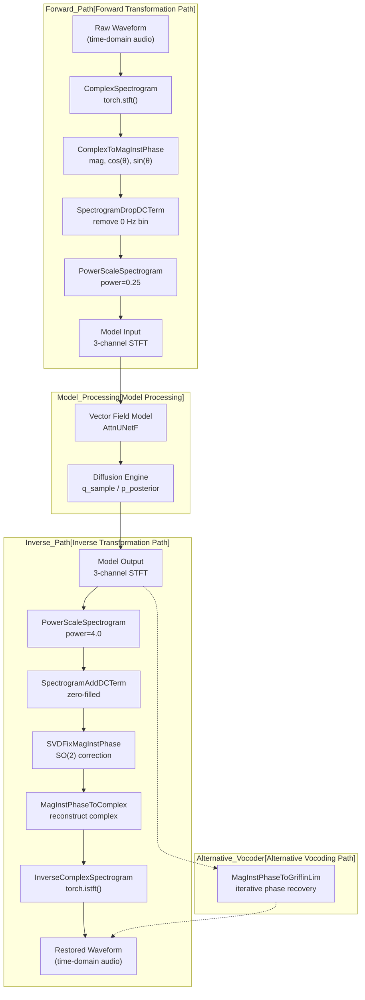
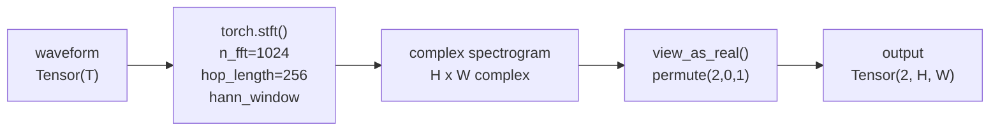
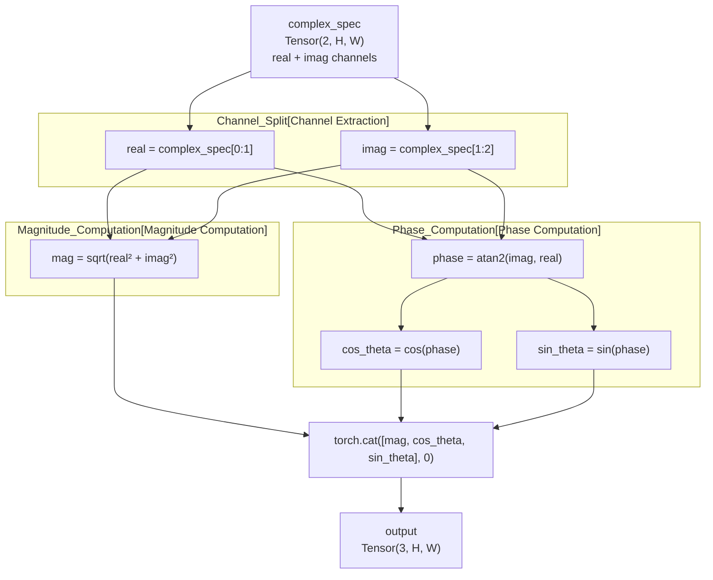
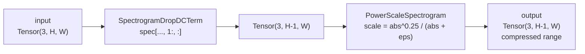
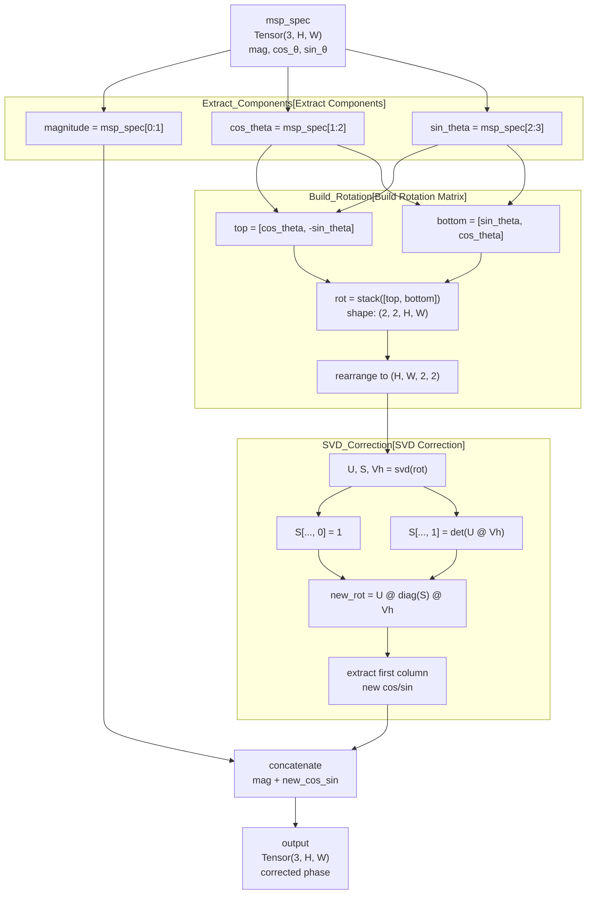
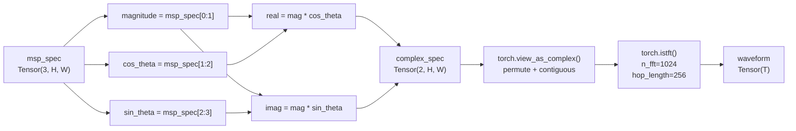
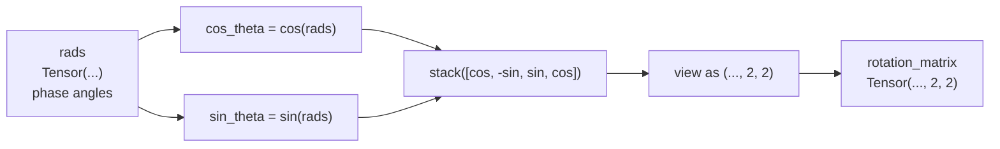
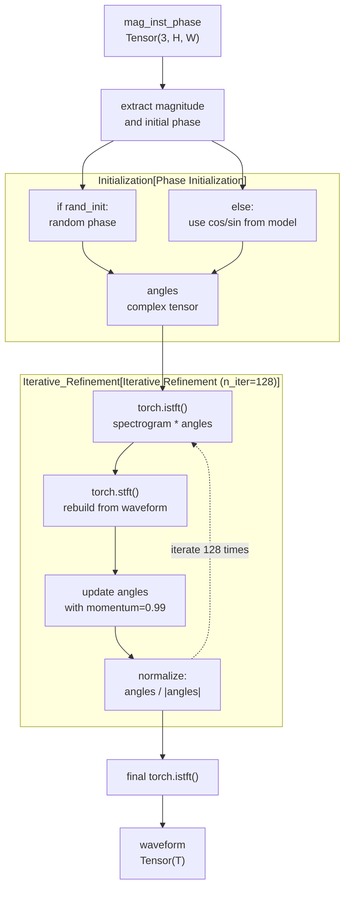
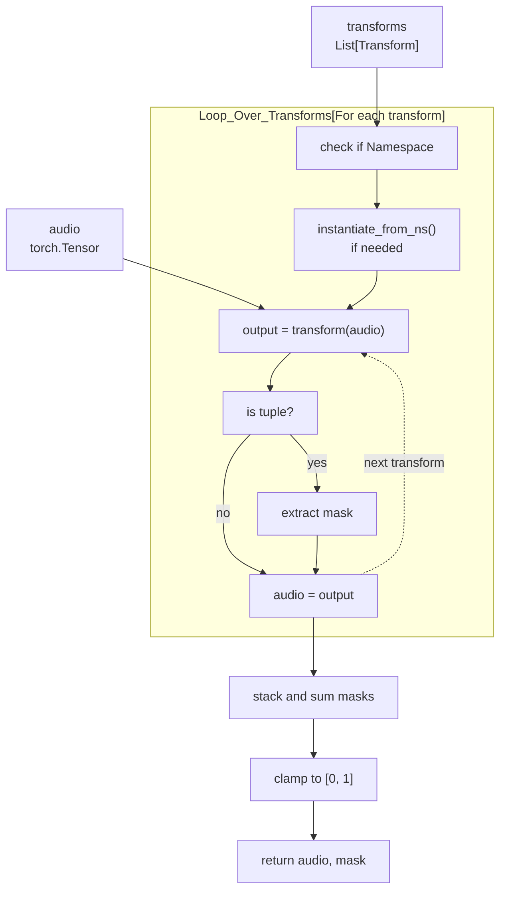

<!-- source: DeepWiki mcp.deepwiki.com · repo NVIDIA/diffusion-audio-restoration · page 6.2 Audio Processing Pipeline · fetched 2026-10-26 -->

# Audio Processing Pipeline

<details>
<summary>Relevant source files</summary>

The following files were used as context for generating this wiki page:

- [audio_transforms/transforms.py](audio_transforms/transforms.py)
- [audio_utils.py](audio_utils.py)

</details>


## Purpose and Scope

The audio processing pipeline converts between raw audio waveforms and the spectral representations used by the A2SB diffusion model. This page documents the transformation classes in [audio_transforms/transforms.py]() and utility functions in [audio_utils.py]() that handle:

- Forward transformation: Converting waveforms to magnitude-instantaneous phase STFT representations
- Inverse transformation: Converting model outputs back to waveforms
- Phase representation: SO(2) rotation matrix encoding and SVD correction
- Griffin-Lim vocoding: Alternative phase reconstruction method

For the higher-level integration of these transforms within the Lightning modules, see [Lightning Modules](#6.1). For theoretical background on the audio representation, see [Audio Representation](#5.3).

**Sources:** [audio_transforms/transforms.py:1-375](), [audio_utils.py:1-97]()

## Pipeline Architecture Overview

The audio processing pipeline operates in two primary directions: forward (waveform → model input) and inverse (model output → waveform). The pipeline is designed to preserve phase information while enabling efficient diffusion-based processing.



**Diagram: Complete Audio Processing Pipeline Architecture**

**Sources:** [audio_transforms/transforms.py:83-185](), [audio_transforms/transforms.py:214-229](), [audio_transforms/transforms.py:187-208]()

## Forward Transformation: Waveform to Model Input

The forward path converts raw time-domain audio into a 3-channel spectrogram representation suitable for the diffusion model. Each transformation step is implemented as a callable class.

### Transformation Steps

| Step | Class | Input Shape | Output Shape | Purpose |
|------|-------|-------------|--------------|---------|
| 1 | `ComplexSpectrogram` | `(T,)` | `(2, H, W)` | STFT with complex values as 2 channels |
| 2 | `ComplexToMagInstPhase` | `(2, H, W)` | `(3, H, W)` | Split into mag, cos(θ), sin(θ) |
| 3 | `SpectrogramDropDCTerm` | `(3, H, W)` | `(3, H-1, W)` | Remove DC bin (0 Hz) |
| 4 | `PowerScaleSpectrogram` | `(3, H-1, W)` | `(3, H-1, W)` | Apply power=0.25 compression |

### ComplexSpectrogram Transform

Converts time-domain waveform to frequency-domain complex STFT using PyTorch's built-in STFT implementation.



**Diagram: ComplexSpectrogram Conversion Process**

**Key Parameters:**
- `n_fft=1024`: FFT size (default), determines frequency resolution
- `win_length=1024`: Window size for each frame
- `hop_length=256`: Stride between frames (75% overlap)
- `window_fn=torch.hann_window`: Hann window for smooth transitions

**Sources:** [audio_transforms/transforms.py:83-105]()

### ComplexToMagInstPhase Transform

Decomposes the complex spectrogram into three channels: magnitude, cos(phase), and sin(phase). This representation avoids phase wrapping issues that occur with raw phase angles.



**Diagram: Complex to Magnitude-Instantaneous Phase Decomposition**

The instantaneous phase representation as `(cos(θ), sin(θ))` forms a point on the unit circle, naturally encoding phase without discontinuities. This is mathematically equivalent to representing phase as a 2D rotation matrix in SO(2).

**Sources:** [audio_transforms/transforms.py:108-118]()

### DC Term Removal and Power Scaling

The DC term (0 Hz frequency bin) is typically removed as it carries minimal perceptual information and can be restored with zeros during inverse transformation. Power scaling compresses the dynamic range for more stable training.



**Diagram: DC Term Removal and Power Compression**

The power scaling formula: `spec_scaled = spec * (|spec|^power / (|spec| + eps))` compresses large values while preserving small values, improving numerical stability during training.

**Sources:** [audio_transforms/transforms.py:214-229](), [audio_transforms/transforms.py:187-208]()

## Inverse Transformation: Model Output to Waveform

The inverse path reconstructs time-domain audio from the model's 3-channel spectrogram output. This involves reversing the forward transforms and applying phase correction.

### Inverse Transformation Steps

| Step | Class | Input Shape | Output Shape | Purpose |
|------|-------|-------------|--------------|---------|
| 1 | `PowerScaleSpectrogram` | `(3, H-1, W)` | `(3, H-1, W)` | Apply power=4.0 expansion |
| 2 | `SpectrogramAddDCTerm` | `(3, H-1, W)` | `(3, H, W)` | Restore DC bin with zeros |
| 3 | `SVDFixMagInstPhase` | `(3, H, W)` | `(3, H, W)` | Correct phase to valid SO(2) |
| 4 | `MagInstPhaseToComplex` | `(3, H, W)` | `(2, H, W)` | Reconstruct complex values |
| 5 | `InverseComplexSpectrogram` | `(2, H, W)` | `(T,)` | Inverse STFT to waveform |

### SVDFixMagInstPhase: SO(2) Phase Correction

The model may produce phase predictions that don't perfectly lie on the unit circle. `SVDFixMagInstPhase` uses Singular Value Decomposition to project the predicted `(cos(θ), sin(θ))` values onto the nearest valid SO(2) rotation matrix.



**Diagram: SVD-Based Phase Correction to SO(2) Manifold**

The SVD correction ensures that the 2×2 rotation matrix has singular values of [1, ±1], projecting it onto the SO(2) manifold (special orthogonal group). This guarantees that the phase representation is valid before converting back to complex values.

**Sources:** [audio_transforms/transforms.py:135-160]()

### MagInstPhaseToComplex and Inverse STFT

After phase correction, the magnitude-instantaneous phase representation is converted back to complex form and then to waveform using inverse STFT.



**Diagram: Reconstruction of Complex Spectrogram and Inverse STFT**

**Sources:** [audio_transforms/transforms.py:121-133](), [audio_transforms/transforms.py:163-184]()

## SO(2) Phase Utilities

The [audio_utils.py]() module provides utility functions for converting between different phase representations, particularly the SO(2) rotation matrix encoding.

### radian_to_SO2

Converts phase angles (in radians) to 2×2 rotation matrices in the special orthogonal group SO(2).



**Diagram: Conversion of Phase Angles to SO(2) Rotation Matrices**

The resulting rotation matrix has the form:
```
R(θ) = [ cos(θ)  -sin(θ) ]
       [ sin(θ)   cos(θ) ]
```

**Sources:** [audio_utils.py:15-25]()

### wav_to_stft and stft_mag_R_to_wav

These functions provide alternative interfaces for STFT conversion that directly output magnitude and phase as SO(2) matrices, and reconstruct waveforms from this representation.

```mermaid
graph TB
    subgraph "wav_to_stft[wav_to_stft Function]"
        WAV1["wav<br/>Tensor(N) or (B, N)"]
        STFT1["torch.stft()<br/>return_complex=True"]
        DROP1["drop DC if requested"]
        ABS["magnitudes = abs(stft)"]
        ATAN["phase = atan2(imag, real)"]
        R2SO["phase_R = radian_to_SO2(phase)"]
        OUT1["magnitudes: (..., H, W)<br/>phase_R: (..., H, W, 2, 2)"]
        
        WAV1 --> STFT1
        STFT1 --> DROP1
        DROP1 --> ABS
        DROP1 --> ATAN
        ATAN --> R2SO
        ABS --> OUT1
        R2SO --> OUT1
    end
    
    subgraph "stft_mag_R_to_wav[stft_mag_R_to_wav Function]"
        MAG2["stft_mag<br/>Tensor(B, 1, H, L)"]
        R2["stft_Rch<br/>Tensor(B, 4, H, L)<br/>flattened rotations"]
        EXTRACT["extract cos/sin<br/>from channels 0, 2"]
        MULT["x_real = mag * cos<br/>x_imag = mag * sin"]
        TOCMPLX2["torch.view_as_complex()"]
        ADDDC["add DC term<br/>if requested"]
        ISTFT2["torch.istft()"]
        WAV2["wav_out<br/>Tensor(B, N)"]
        
        MAG2 --> MULT
        R2 --> EXTRACT
        EXTRACT --> MULT
        MULT --> TOCMPLX2
        TOCMPLX2 --> ADDDC
        ADDDC --> ISTFT2
        ISTFT2 --> WAV2
    end
```



**Diagram: SO(2)-Based STFT Conversion Functions**

**Sources:** [audio_utils.py:28-46](), [audio_utils.py:70-86]()

### Phase Channel Conversions

Utility functions convert between SO(2) matrix representation (B, H, W, 2, 2) and flattened channel representation (B, 4, H, W) for compatibility with convolutional neural networks.

| Function | Input Shape | Output Shape | Purpose |
|----------|-------------|--------------|---------|
| `phase_R_to_channels` | `(B, H, W, 2, 2)` | `(B, 4, H, W)` | Flatten matrices to channels |
| `phase_channels_to_R` | `(B, 4, H, W)` | `(B, H, W, 2, 2)` | Unflatten channels to matrices |

**Sources:** [audio_utils.py:48-67]()

## Griffin-Lim Vocoder Alternative

The `MagInstPhaseToGriffinLim` class provides an alternative vocoding path that doesn't rely on the model's phase predictions. Instead, it uses the Griffin-Lim algorithm for iterative phase recovery from magnitude spectra.

### Griffin-Lim Algorithm

Griffin-Lim iteratively refines phase estimates by alternating between time-domain and frequency-domain projections.



**Diagram: Griffin-Lim Iterative Phase Recovery Process**

### Modified Griffin-Lim Implementation

The A2SB implementation modifies the standard Griffin-Lim algorithm to accept initial phase estimates from the model, potentially accelerating convergence.

**Key Parameters:**
- `n_iter=128`: Number of refinement iterations
- `momentum=0.99`: Fast Griffin-Lim momentum parameter
- `rand_init=True`: Whether to use random initialization (ignoring model phase) or model's predicted phase
- `power=1`: Spectrogram power (1 for magnitude, 2 for power)

The momentum update formula: `angles = angles - momentum * tprev` accelerates convergence compared to standard Griffin-Lim.

**Sources:** [audio_transforms/transforms.py:231-259](), [audio_transforms/transforms.py:271-374]()

## Transform Composition with apply_audio_transforms

The `apply_audio_transforms` function chains multiple transforms together and accumulates masks from transforms that produce them.



**Diagram: Transform Composition and Mask Accumulation**

This function enables flexible configuration-driven transform pipelines where transforms can be specified in YAML configs and dynamically instantiated.

**Sources:** [audio_transforms/transforms.py:55-80]()

## Usage Patterns in the Codebase

### Training Pipeline Usage

During training, the forward transforms are applied in the Lightning module's data preprocessing:


**Diagram: Training Pipeline Transform Usage**

The forward transforms convert the loaded audio into the 3-channel magnitude-instantaneous phase representation that the model operates on.

### Inference Pipeline Usage

During inference, both forward and inverse transforms are used to restore audio:


**Diagram: Inference Pipeline Transform Usage**

The inverse transforms reconstruct the final waveform from the model's output spectrogram, applying SVD phase correction and inverse STFT.

### Alternative Griffin-Lim Path

When using Griffin-Lim vocoding instead of direct inverse STFT:


**Diagram: Griffin-Lim Alternative Vocoding Path**

This path bypasses the `SVDFixMagInstPhase`, `MagInstPhaseToComplex`, and `InverseComplexSpectrogram` steps, using iterative phase recovery instead.

**Sources:** [audio_transforms/transforms.py:231-259]()

## Summary Table: Core Transform Classes

| Class | Module | Direction | Input | Output | Key Operation |
|-------|--------|-----------|-------|--------|---------------|
| `ComplexSpectrogram` | transforms.py | Forward | Waveform | 2-ch complex | `torch.stft()` |
| `ComplexToMagInstPhase` | transforms.py | Forward | 2-ch complex | 3-ch mag/phase | Magnitude + trigonometric phase |
| `SpectrogramDropDCTerm` | transforms.py | Forward | 3-ch STFT | 3-ch STFT | Remove first frequency bin |
| `PowerScaleSpectrogram` | transforms.py | Both | C-ch STFT | C-ch STFT | `spec * (abs^power / (abs+eps))` |
| `SpectrogramAddDCTerm` | transforms.py | Inverse | 3-ch STFT | 3-ch STFT | Prepend zero-filled bin |
| `SVDFixMagInstPhase` | transforms.py | Inverse | 3-ch mag/phase | 3-ch mag/phase | SVD projection to SO(2) |
| `MagInstPhaseToComplex` | transforms.py | Inverse | 3-ch mag/phase | 2-ch complex | `mag * cos(θ) + i*mag*sin(θ)` |
| `InverseComplexSpectrogram` | transforms.py | Inverse | 2-ch complex | Waveform | `torch.istft()` |
| `MagInstPhaseToGriffinLim` | transforms.py | Inverse | 3-ch mag/phase | Waveform | Iterative phase recovery |

**Sources:** [audio_transforms/transforms.py:1-375]()

## Summary Table: Utility Functions

| Function | Module | Input | Output | Purpose |
|----------|--------|-------|--------|---------|
| `radian_to_SO2` | audio_utils.py | Tensor(...) radians | Tensor(..., 2, 2) | Convert phase angles to rotation matrices |
| `wav_to_stft` | audio_utils.py | Waveform | magnitudes, phase_R | STFT with SO(2) phase representation |
| `stft_mag_R_to_wav` | audio_utils.py | magnitudes, phase_Rch | Waveform | Reconstruct waveform from SO(2) representation |
| `phase_R_to_channels` | audio_utils.py | (B,H,W,2,2) | (B,4,H,W) | Flatten SO(2) matrices to channels |
| `phase_channels_to_R` | audio_utils.py | (B,4,H,W) | (B,H,W,2,2) | Unflatten channels to SO(2) matrices |
| `apply_audio_transforms` | transforms.py | audio, transforms list | transformed audio, mask | Chain multiple transforms with mask accumulation |

**Sources:** [audio_utils.py:1-97](), [audio_transforms/transforms.py:55-80]()

---

