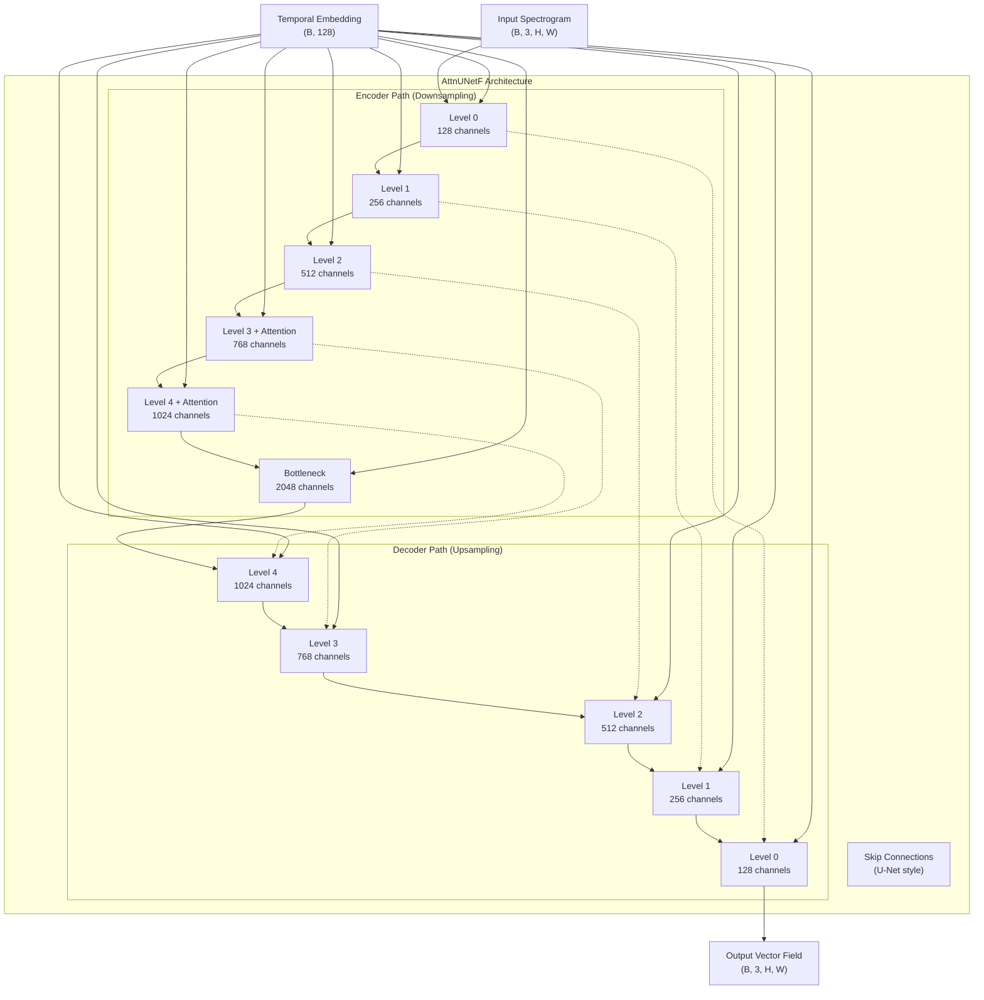
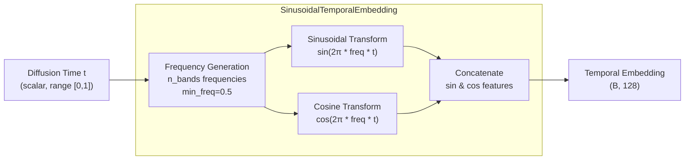
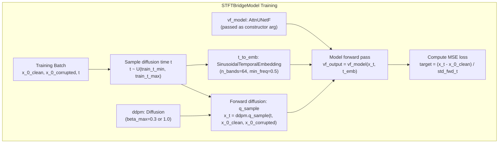
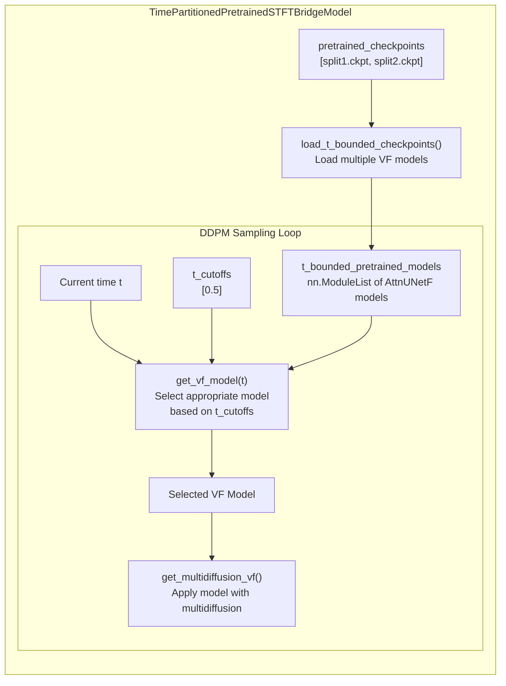

<!-- source: DeepWiki mcp.deepwiki.com · repo NVIDIA/diffusion-audio-restoration · page 6.3 Model Architecture Details · fetched 2026-10-26 -->

# Model Architecture Details

<details>
<summary>Relevant source files</summary>

The following files were used as context for generating this wiki page:

- [A2SB_lightning_module.py](A2SB_lightning_module.py)
- [configs/ensemble_2split_sampling.yaml](configs/ensemble_2split_sampling.yaml)

</details>


This page provides technical documentation of the neural network architectures used in A2SB, specifically the `AttnUNetF` vector field model and the `SinusoidalTemporalEmbedding` temporal encoding system. This page focuses on the neural network implementation details and architectural design choices.

For theoretical background on how these models are used within the Schrödinger Bridge framework, see [Schrödinger Bridge Diffusion](#5.2). For information about the Lightning module wrappers that manage these models during training and inference, see [Lightning Modules](#6.1). For details about the diffusion sampling process, see [Diffusion Process Implementation](#6.4).

## Vector Field Model Concept

The core of A2SB is a **vector field model** that learns to predict the score function (gradient of the log probability) in the Schrödinger Bridge framework. Rather than directly predicting the clean audio from noisy input, the model predicts the direction and magnitude of the vector field that guides the diffusion process from corrupted audio (at time `t=1`) to restored audio (at time `t=0`).

### Mathematical Formulation

The vector field model learns to predict:

```
vf_output = (x_t - x_0) / std_fwd_t
```

Where:
- `x_t` is the noisy state at diffusion time `t`
- `x_0` is the clean target
- `std_fwd_t` is the forward diffusion standard deviation at time `t`

This formulation is evident in the training loss computation at [A2SB_lightning_module.py:386-388]().

### Model Input and Output

The vector field model processes:
- **Input**: Noisy STFT spectrogram `x_t` (shape: `B x 3 x H x W`) + temporal embedding (shape: `B x 128`)
- **Output**: Predicted vector field (shape: `B x 3 x H x W`, same as input)

The 3 channels represent magnitude, cosine of instantaneous phase, and sine of instantaneous phase (see [Audio Representation](#5.3) for details).

**Sources:** [A2SB_lightning_module.py:381-388](), [A2SB_lightning_module.py:256]()

## AttnUNetF Architecture

The `AttnUNetF` class implements an attention-augmented U-Net architecture specifically designed for processing STFT spectrograms in the frequency domain. The architecture is defined in `networks.py` and instantiated in both training and inference configurations.

### Architecture Overview



**Sources:** [configs/ensemble_2split_sampling.yaml:48-62]()

### Configuration Parameters

The `AttnUNetF` architecture is configured with the following parameters, as shown in the ensemble configuration:

| Parameter | Value | Description |
|-----------|-------|-------------|
| `n_updown_levels` | 5 | Number of encoder/decoder levels |
| `in_channels` | 3 | Input channels (mag + cos/sin phase) |
| `hidden_channels` | [128, 256, 512, 768, 1024, 2048] | Channel dimensions at each level |
| `out_channels` | 3 | Output channels (same as input) |
| `emb_channels` | 128 | Temporal embedding dimension |
| `rotary_dims` | 16 | Dimensions for rotary positional encoding |
| `band_embedding_dim` | 16 | Frequency band embedding dimension |
| `n_attn_heads` | 8 | Number of attention heads |
| `attention_levels` | [3, 4] | Levels where attention is applied |
| `use_attn_input_norm` | true | Enable layer normalization before attention |
| `num_res_blocks` | 2 | Residual blocks per level |

**Sources:** [configs/ensemble_2split_sampling.yaml:48-62]()

### Key Architectural Features

#### 1. Hierarchical U-Net Structure

The model uses 5 downsampling/upsampling levels with progressively increasing channel dimensions. Each level contains residual blocks for feature extraction:

- **Encoder**: 128 → 256 → 512 → 768 → 1024 → 2048 channels
- **Bottleneck**: 2048 channels (deepest representation)
- **Decoder**: 2048 → 1024 → 768 → 512 → 256 → 128 channels

#### 2. Attention Mechanisms

Attention is applied at specific levels (levels 3 and 4) where the spatial resolution is reduced but semantic understanding is most important. The attention uses:
- 8 attention heads (`n_attn_heads: 8`)
- Input normalization (`use_attn_input_norm: true`)
- Multi-head self-attention for capturing long-range dependencies

#### 3. Frequency-Specific Features

- **Band Embedding**: 16-dimensional embeddings for different frequency bands, allowing the model to learn frequency-dependent behaviors
- **Rotary Positional Encoding**: 16 dimensions of rotary embeddings for position-aware processing

#### 4. Temporal Conditioning

The temporal embedding (128 dimensions) is injected at every level of both the encoder and decoder, ensuring time-aware processing throughout the network.

**Sources:** [configs/ensemble_2split_sampling.yaml:48-62]()

## Temporal Embedding System

### SinusoidalTemporalEmbedding

The `SinusoidalTemporalEmbedding` class converts scalar diffusion timestep values `t ∈ [0, 1]` into high-dimensional embeddings that the network can process. This is implemented in `networks.py` and instantiated in both training and inference modules.



### Implementation Details

The embedding is created with:
- **n_bands**: 64 (producing 128 total dimensions after sin/cos)
- **min_freq**: 0.5 (minimum frequency for sinusoidal encoding)

This is instantiated in both training and inference modules:

```python
self.t_to_emb = SinusoidalTemporalEmbedding(
    n_bands=int(n_timestep_channels//2), 
    min_freq=0.5
)
```

### Usage in Model Forward Pass

During forward propagation, the temporal embedding is computed and repeated for the batch:

```python
t_emb = self.t_to_emb(t).repeat(x_1.shape[0], 1)
vf_output = self.vf_model(x_t, t_emb)
```

This pattern is used consistently in:
- Training step: [A2SB_lightning_module.py:380-383]()
- Validation step: [A2SB_lightning_module.py:445-448]()
- DDPM sampling: [A2SB_lightning_module.py:124](), [A2SB_lightning_module.py:253]()

**Sources:** [A2SB_lightning_module.py:53](), [A2SB_lightning_module.py:223](), [A2SB_lightning_module.py:380]()

## Model Integration in Training and Inference

### Training Module Integration

In the `STFTBridgeModel` class, the vector field model is instantiated and used during training:



The training step implements time-bounded sampling for t-finetuning:

```python
def sample_t_bounded(self, n_samples):
    t_range = self.train_t_max - self.train_t_min
    return torch.rand(n_samples) * t_range + self.train_t_min
```

This allows training specialized models for different time ranges (e.g., t ∈ [0.0, 0.5] vs t ∈ [0.5, 1.0]) as described in [Time-Partitioned Ensemble](#5.4).

**Sources:** [A2SB_lightning_module.py:208-224](), [A2SB_lightning_module.py:370-388]()

### Inference Module Integration

In the `TimePartitionedPretrainedSTFTBridgeModel` class, multiple vector field models are loaded and selected based on the current diffusion time:



The model selection logic:

```python
def get_vf_model(self, t: float):
    model_idx = 0
    for idx, thresh in enumerate(self.t_cutoffs):
        if t >= thresh:
            model_idx = idx + 1
    return self.t_bounded_pretrained_models[model_idx]
```

For example, with `t_cutoffs=[0.5]`:
- If `t >= 0.5`: Use model at index 1 (second checkpoint)
- If `t < 0.5`: Use model at index 0 (first checkpoint)

This enables the time-partitioned ensemble strategy where different models specialize in different phases of the diffusion process.

**Sources:** [A2SB_lightning_module.py:34-86](), [A2SB_lightning_module.py:81-86](), [A2SB_lightning_module.py:128-131]()

## Architecture Variations

### Training Configuration

During training (pretrain and t-finetune), a single `AttnUNetF` model is used with the following typical settings:

| Parameter | Pretrain Value | Notes |
|-----------|----------------|-------|
| `beta_max` | 0.3 or 1.0 | Controls diffusion strength |
| `n_timestep_channels` | 128 | Temporal embedding size |
| `use_ot_ode` | false | Use SDE formulation by default |
| `train_t_min` | 0.0 | Start of time range |
| `train_t_max` | 1.0 | End of time range |

For t-finetuning, `train_t_min` and `train_t_max` are adjusted to train on specific time ranges (e.g., [0.0, 0.5] or [0.5, 1.0]).

**Sources:** [A2SB_lightning_module.py:209-219]()

### Inference Configuration

During inference, the architecture parameters remain the same, but multiple models are loaded:

| Parameter | Typical Value | Purpose |
|-----------|---------------|---------|
| `pretrained_checkpoints` | List of 2+ paths | Paths to trained model checkpoints |
| `t_cutoffs` | [0.5] | Thresholds for model selection |
| `predict_n_steps` | 50 | Number of diffusion sampling steps |
| `predict_win_length` | 256 | Multidiffusion window length |
| `predict_hop_length` | 128 | Multidiffusion hop length |
| `predict_batch_size` | 16 | Batch size for multidiffusion |

**Sources:** [A2SB_lightning_module.py:34-61](), [configs/ensemble_2split_sampling.yaml:83-86]()

## Model Instantiation Pattern

### From Configuration Files

The model is instantiated using PyTorch Lightning's class path configuration pattern:

```yaml
model:
  vf_model:
    class_path: networks.AttnUNetF
    init_args:
      n_updown_levels: 5
      in_channels: 3
      hidden_channels: [128, 256, 512, 768, 1024, 2048]
      out_channels: 3
      emb_channels: 128
      # ... additional parameters
```

This configuration is passed to the Lightning CLI, which instantiates the model and injects it into either `STFTBridgeModel` (for training) or `TimePartitionedPretrainedSTFTBridgeModel` (for inference).

### Constructor Signature Pattern

Both Lightning modules use a common pattern for accepting the vector field model:

```python
def __init__(self, vf_model: torch.nn.Module, ...):
    super().__init__()
    # Store all constructor arguments as instance attributes
    for item in inspect.signature(ClassName).parameters:
        setattr(self, item, eval(item))
```

This pattern automatically stores all constructor arguments as instance attributes, making the model configuration easily accessible.

**Sources:** [A2SB_lightning_module.py:209-219](), [A2SB_lightning_module.py:34-50](), [configs/ensemble_2split_sampling.yaml:47-62]()

---

