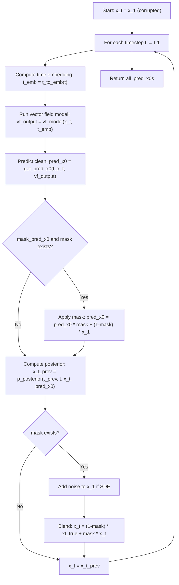
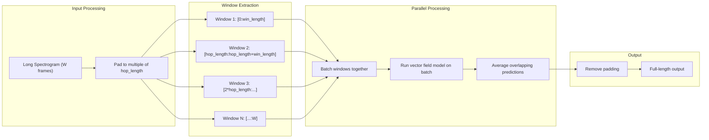
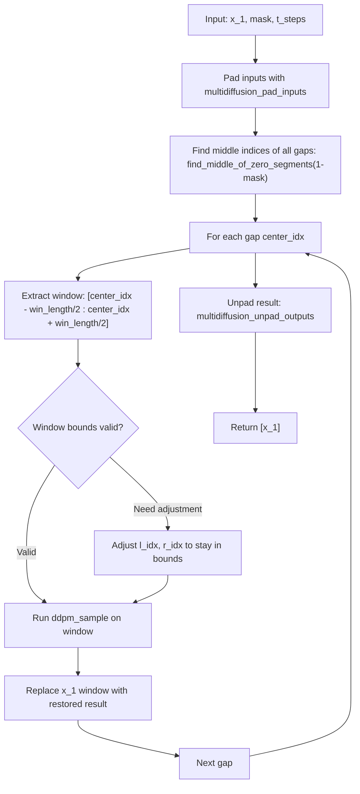

<!-- source: DeepWiki mcp.deepwiki.com · repo NVIDIA/diffusion-audio-restoration · page 6.4 Diffusion Process Implementation · fetched 2026-10-26 -->

# Diffusion Process Implementation

<details>
<summary>Relevant source files</summary>

The following files were used as context for generating this wiki page:

- [A2SB_lightning_module.py](A2SB_lightning_module.py)
- [A2SB_lightning_module_api.py](A2SB_lightning_module_api.py)

</details>


## Purpose and Scope

This document covers the implementation details of the diffusion process in A2SB, including the core `Diffusion` class, forward/reverse sampling procedures, DDPM sampling algorithms, and specialized optimizations like multidiffusion and fast inpainting. The diffusion process forms the mathematical foundation for the Schrödinger Bridge formulation used throughout A2SB.

For the theoretical background on Schrödinger Bridge diffusion, see [Schrödinger Bridge Diffusion](#5.2). For how the Lightning modules orchestrate training and inference workflows that use these diffusion primitives, see [Lightning Modules](#6.1).

---

## Core Diffusion Class

The `Diffusion` class implements the mathematical operations required for Schrödinger Bridge diffusion. It is instantiated with a `beta_max` parameter that controls the noise schedule:

```python
self.ddpm = Diffusion(beta_max=beta_max)
```

The class is instantiated in both `STFTBridgeModel` [A2SB_lightning_module.py:220]() and `TimePartitionedPretrainedSTFTBridgeModel` [A2SB_lightning_module.py:51]() with the same configuration.

**Key responsibilities:**
- Computing forward diffusion from clean to corrupted data (`q_sample`)
- Computing reverse posterior distributions (`p_posterior`)
- Predicting clean data from noisy observations (`get_pred_x0`)
- Managing variance schedules for both forward and reverse processes

**Sources:** [A2SB_lightning_module.py:16](), [A2SB_lightning_module.py:51](), [A2SB_lightning_module.py:220]()

---

## Forward Process: q_sample

The forward process transforms data from the clean distribution (x₀) toward the corrupted distribution (x₁) by interpolating between them with added noise. This is implemented through the `q_sample` method.

### Training Usage

During training, `q_sample` generates noisy samples at random timesteps:

```python
t = self.sample_t_bounded(x_0_clean.shape[0]).to(x_0_clean.device)
x_t = self.ddpm.q_sample(t, x_0_clean, x_0_corrupted, ot_ode=self.use_ot_ode)
```

The method signature is:
```python
q_sample(t, x_0_clean, x_0_corrupted, ot_ode=False)
```

**Parameters:**
- `t`: Timestep values in [0, 1], where t=0 is clean and t=1 is corrupted
- `x_0_clean`: Target clean spectrogram (B×C×H×W)
- `x_0_corrupted`: Source corrupted spectrogram (B×C×H×W)  
- `ot_ode`: Boolean flag for ODE vs SDE formulation

### Time-Bounded Sampling

For T-finetuning, timesteps are sampled within a restricted range:

```python
def sample_t_bounded(self, n_samples):
    t_range = self.train_t_max - self.train_t_min
    return torch.rand(n_samples) * t_range + self.train_t_min
```

This allows training separate models for different portions of the diffusion trajectory (e.g., t ∈ [0.0, 0.5] and t ∈ [0.5, 1.0]).

**Sources:** [A2SB_lightning_module.py:370-372](), [A2SB_lightning_module.py:379-382]()

---

## Reverse Process: DDPM Sampling

The reverse process iteratively refines a corrupted sample toward the clean distribution. The core sampling loop is implemented in the `ddpm_sample` method.

### Basic DDPM Sampling Algorithm



### Implementation in Training Module

The training module implements a simpler version without multidiffusion:

```python
def ddpm_sample(self, x_1, t_steps=None, mask=None, mask_pred_x0=True):
    n_steps = t_steps.shape[1] - 1
    x_t = x_1.clone()
    all_pred_x0s = []
    
    for t_idx in range(n_steps):
        t_emb = self.t_to_emb(t_steps[:,t_idx]).repeat(x_1.shape[0], 1)
        t = t_steps[:, t_idx] 
        t_prev = t_steps[:, t_idx+1]
        
        vf_output = self.vf_model(x_t, t_emb)
        pred_x0 = self.ddpm.get_pred_x0(t_steps[:, t_idx], x_t, vf_output)
        
        if mask is not None and mask_pred_x0:
            pred_x0 = pred_x0 * mask + (1-mask) * x_1
            
        all_pred_x0s.append(pred_x0.cpu())
        x_t_prev = self.ddpm.p_posterior(t_prev, t, x_t, pred_x0, ot_ode=self.use_ot_ode)
        x_t = x_t_prev
        
        if mask is not None:
            xt_true = x_1
            if not self.use_ot_ode:
                std_sb = self.ddpm.get_std_t(t_prev)
                xt_true = xt_true + std_sb * torch.randn_like(xt_true)
            x_t = (1. - mask) * xt_true + mask * x_t
            
    return all_pred_x0s
```

**Key steps:**
1. **Time embedding**: Convert scalar timestep to 128-dim embedding
2. **Vector field prediction**: Query neural network for denoising direction
3. **x₀ prediction**: Estimate clean sample from current noisy state
4. **Mask application**: Preserve known clean regions (for inpainting)
5. **Posterior computation**: Step backward in diffusion time
6. **Masked blending**: Re-inject known clean data with appropriate noise

**Sources:** [A2SB_lightning_module.py:244-278](), [A2SB_lightning_module_api.py:248-282]()

### Posterior Computation: p_posterior

The `p_posterior` method computes the reverse diffusion step from x_t to x_{t-1}:

```python
x_t_prev = self.ddpm.p_posterior(t_prev, t, x_t, pred_x0, ot_ode=self.use_ot_ode)
```

This method implements different formulations based on the `ot_ode` flag:
- **SDE formulation** (`ot_ode=False`): Adds stochastic noise at each step
- **ODE formulation** (`ot_ode=True`): Deterministic trajectory following optimal transport

**Sources:** [A2SB_lightning_module.py:262](), [A2SB_lightning_module.py:137]()

---

## Prediction Methods

### get_pred_x0: Clean Sample Prediction

The `get_pred_x0` method estimates the clean sample x₀ from the current noisy observation x_t and the predicted vector field:

```python
pred_x0 = self.ddpm.get_pred_x0(t_steps[:, t_idx], x_t, vf_output)
```

This is a critical step because:
1. The vector field model outputs a velocity/direction in latent space
2. `get_pred_x0` converts this to an actual clean sample estimate
3. This estimate is used to compute the posterior for the next reverse step

The predicted x₀ is stored at each timestep for monitoring convergence:

```python
all_pred_x0s.append(pred_x0.cpu())
```

**Sources:** [A2SB_lightning_module.py:257](), [A2SB_lightning_module.py:132]()

---

## Standard Deviation Schedules

The diffusion process uses multiple variance schedules depending on the context:

### Training Loss Computation

During training, the vector field target is normalized by the forward standard deviation:

```python
std_fwd_t = self.ddpm.get_std_fwd(t)
std_fwd_t_expanded = std_fwd_t.view(std_fwd_t.shape[0], 1, 1, 1)
target = (x_t - x_0_clean)/std_fwd_t_expanded
```

### Sampling Noise Addition

When blending masked regions during sampling with SDE formulation:

```python
if not self.use_ot_ode:
    std_sb = self.ddpm.get_std_t(t_prev)
    xt_true = xt_true + std_sb * torch.randn_like(xt_true)
```

### Methods Available

| Method | Purpose |
|--------|---------|
| `get_std_fwd(t)` | Forward process standard deviation at time t |
| `get_std_rev(t)` | Reverse process standard deviation at time t |
| `get_std_t(t)` | Schrödinger Bridge standard deviation at time t |

**Sources:** [A2SB_lightning_module.py:382-389](), [A2SB_lightning_module.py:270-271](), [A2SB_lightning_module.py:142-143]()

---

## Multidiffusion Implementation

For processing long audio sequences that exceed GPU memory, A2SB uses a multidiffusion approach that processes overlapping windows and blends the predictions.

### Multidiffusion Windowing Strategy



### Multidiffusion Helper Functions

The implementation uses three key functions imported from `diffusion.py`:

1. **multidiffusion_pad_inputs**: Pads inputs to align with window/hop parameters
```python
x_1 = multidiffusion_pad_inputs(x_1, win_length, hop_length)
mask = multidiffusion_pad_inputs(mask, win_length, hop_length)
```

2. **get_multidiffusion_vf**: Processes the full spectrogram in overlapping windows
```python
vf_output = get_multidiffusion_vf(
    vf_model, x_t, t_emb, 
    win_length=win_length,
    hop_length=hop_length, 
    batch_size=batch_size
)
```

3. **multidiffusion_unpad_outputs**: Removes padding to restore original width
```python
all_pred_x0s = [multidiffusion_unpad_outputs(pred, original_width) for pred in all_pred_x0s]
```

### Multidiffusion DDPM Sampling

The inference module's `ddpm_sample` extends the basic algorithm with multidiffusion:

```python
@torch.no_grad()
def ddpm_sample(self, x_1, t_steps=None, mask=None, mask_pred_x0=True,
                win_length=256, hop_length=256, batch_size=16):
    assert hop_length <= win_length
    n_steps = t_steps.shape[1] - 1
    original_width = x_1.shape[-1]
    
    # Pad inputs for windowing
    x_1 = multidiffusion_pad_inputs(x_1, win_length, hop_length)
    mask = multidiffusion_pad_inputs(mask, win_length, hop_length)
    
    x_t = x_1.clone()
    all_pred_x0s = []
    
    for t_idx in tqdm(range(n_steps)):
        t_emb = self.t_to_emb(t_steps[:,t_idx]).repeat(x_1.shape[0], 1)
        t = t_steps[:, t_idx]
        t_prev = t_steps[:, t_idx+1]
        
        # Use multidiffusion for vector field prediction
        vf_model = self.get_vf_model(t[0].item())
        vf_output = get_multidiffusion_vf(
            vf_model, x_t, t_emb, 
            win_length=win_length,
            hop_length=hop_length, 
            batch_size=batch_size
        )
        
        pred_x0 = self.ddpm.get_pred_x0(t_steps[:, t_idx], x_t, vf_output)
        # ... rest of sampling loop
        
    # Unpad results
    all_pred_x0s = [multidiffusion_unpad_outputs(pred, original_width) 
                    for pred in all_pred_x0s]
    return all_pred_x0s
```

**Configuration parameters:**
- `win_length`: Temporal window size (e.g., 256 frames)
- `hop_length`: Step size between windows (e.g., 128 frames for 50% overlap)
- `batch_size`: Number of windows to process simultaneously

**Sources:** [A2SB_lightning_module.py:103-146](), [A2SB_lightning_module_api.py:106-149](), [A2SB_lightning_module.py:16]()

---

## Fast Inpainting Mode

For inpainting tasks where gaps are small and well-separated, the `fast_inpaint_ddpm_sample` method provides an optimization that only processes local regions around each gap.

### Fast Inpaint Algorithm



### Implementation Details

```python
@torch.no_grad()
def fast_inpaint_ddpm_sample(self, x_1, t_steps=None, mask=None, mask_pred_x0=True,
                win_length=256, hop_length=256, batch_size=16):
    """
    assumes any masked segment is shorter win_length and sufficiently suparated
    """
    original_width = x_1.shape[-1]
    x_1 = x_1.clone()
    x_1 = multidiffusion_pad_inputs(x_1, win_length, hop_length)
    mask = multidiffusion_pad_inputs(mask, win_length, hop_length, padding_constant=0)
    
    # Find centers of all gaps
    middle_indices = find_middle_of_zero_segments(1-mask[0,0,0])
    
    for center_idx in middle_indices:
        # Extract window around gap
        l_idx = int(center_idx - win_length/2)
        r_idx = int(center_idx + win_length/2)
        
        # Boundary handling
        if l_idx < 0:
            r_idx -= l_idx
            l_idx = 0
        if r_idx > x_1.shape[-1]:
            l_idx -= (r_idx - x_1.shape[-1])
            r_idx = x_1.shape[-1]
            
        # Process window only
        curr_x_1 = x_1[:,:,:,l_idx:r_idx]
        curr_mask = mask[:,:,:,l_idx:r_idx]
        new_x_0 = self.ddpm_sample(curr_x_1, t_steps, mask=curr_mask, 
                                    mask_pred_x0=mask_pred_x0, 
                                    win_length=win_length, 
                                    hop_length=hop_length, 
                                    batch_size=batch_size)
        x_1[:,:,:,l_idx:r_idx] = new_x_0[-1]
        
    x_1 = multidiffusion_unpad_outputs(x_1, original_width)
    return [x_1]
```

**Key advantages:**
- Only processes small windows around gaps instead of entire sequence
- Dramatically faster for sparse inpainting (e.g., 20ms gaps every 500ms)
- Maintains quality since context around gaps is preserved

**Assumptions:**
- Each masked segment is shorter than `win_length`
- Masked segments are sufficiently separated
- Known regions don't need processing

**Sources:** [A2SB_lightning_module.py:149-180](), [A2SB_lightning_module_api.py:152-183](), [A2SB_lightning_module.py:28]()

---

## SDE vs ODE Formulations

A2SB supports two mathematical formulations for the diffusion process, controlled by the `use_ot_ode` flag:

### Configuration

The formulation is set during initialization:

```python
self.use_ot_ode = use_ot_ode
if self.use_ot_ode:
    print("Using ODE formulation")
else:
    print("Using SDE formulation")
```

### SDE Formulation (Stochastic Differential Equation)

When `use_ot_ode=False` (default):
- Adds Gaussian noise at each reverse step
- Provides stochastic trajectories
- Better exploration of the solution space

**Noise injection during sampling:**
```python
if not self.use_ot_ode:
    std_sb = self.ddpm.get_std_t(t_prev)
    xt_true = xt_true + std_sb * torch.randn_like(xt_true)
```

**Training target:**
```python
std_fwd_t = self.ddpm.get_std_fwd(t)
std_fwd_t_expanded = std_fwd_t.view(std_fwd_t.shape[0], 1, 1, 1)
target = (x_t - x_0_clean)/std_fwd_t_expanded
```

### ODE Formulation (Ordinary Differential Equation)

When `use_ot_ode=True`:
- Deterministic trajectories following optimal transport
- No added noise during reverse process
- More stable but less diverse outputs

**Impact on implementation:**
- The `q_sample` method uses different noise schedules
- The `p_posterior` method computes deterministic updates
- No noise injection in masked region blending

### Comparison Table

| Aspect | SDE (`use_ot_ode=False`) | ODE (`use_ot_ode=True`) |
|--------|--------------------------|-------------------------|
| **Trajectory** | Stochastic | Deterministic |
| **Noise in reverse** | Yes, at each step | No |
| **Variance schedule** | `get_std_t()` | Optimal transport path |
| **Diversity** | Higher | Lower |
| **Stability** | Can vary | More consistent |
| **Speed** | Similar | Similar |

**Sources:** [A2SB_lightning_module.py:214](), [A2SB_lightning_module.py:231-235](), [A2SB_lightning_module.py:270-275](), [A2SB_lightning_module.py:381]()

---

## Gaussian Product Coefficient (Alternative Formulations)

The codebase includes alternative sampling methods that compute Gaussian product coefficients for the masked blending step:

### compute_gaussian_product_coef

This function computes coefficients for combining two Gaussian distributions:

```python
sigma_fwd = self.ddpm.get_std_fwd(t_prev)
sigma_rev = self.ddpm.get_std_rev(t_prev)
coef1, coef2, var = compute_gaussian_product_coef(sigma_fwd, sigma_rev)
std_sb = torch.sqrt(var)
xt_true = xt_true + std_sb * torch.randn_like(xt_true)
```

### Alternative Sampling Methods

The training module includes two alternative DDPM sampling implementations:

1. **ddpm_sample_i2sb_way**: Uses Gaussian product for masked noise
   [A2SB_lightning_module.py:280-316]()

2. **ddpm_sample_i2sb_change_order**: Applies mask before posterior computation
   [A2SB_lightning_module.py:318-355]()

These alternatives differ in:
- When the mask is applied (before or after posterior computation)
- How noise variance is computed for masked regions
- The order of operations in the sampling loop

**Note:** The default `ddpm_sample` method is used in production; these alternatives are retained for experimentation.

**Sources:** [A2SB_lightning_module.py:16](), [A2SB_lightning_module.py:280-355]()

---

## Time-Partitioned Model Selection

During inference with the ensemble approach, different vector field models are selected based on the current timestep:

### get_vf_model

```python
@torch.no_grad()
def get_vf_model(self, t: float):
    model_idx = 0
    for idx, thresh in enumerate(self.t_cutoffs):
        if t >= thresh:
            model_idx = idx + 1
    return self.t_bounded_pretrained_models[model_idx]
```

**Selection logic:**
- For 2-split ensemble with `t_cutoffs=[0.5]`:
  - If t < 0.5: Use model 0 (trained on t ∈ [0.0, 0.5])
  - If t ≥ 0.5: Use model 1 (trained on t ∈ [0.5, 1.0])

**Usage in sampling:**
```python
vf_model = self.get_vf_model(t[0].item())
vf_output = get_multidiffusion_vf(vf_model, x_t, t_emb, ...)
```

This allows each specialized model to focus on its trained time range during inference.

**Sources:** [A2SB_lightning_module.py:81-86](), [A2SB_lightning_module.py:128](), [A2SB_lightning_module_api.py:84-89](), [A2SB_lightning_module_api.py:131]()

---

## Validation and Test Sampling

### Validation Step Usage

During validation, the diffusion process generates samples for quality metrics:

```python
n_steps = 25
t_steps = torch.linspace(1, 1.0/n_steps, int(n_steps)).unsqueeze(0).to(x_0_corrupted.device)
x_0s = self.ddpm_sample(x_0_corrupted, t_steps=t_steps, mask=loss_mask, mask_pred_x0=True)
inpainted_audio = self.vocode_stft(x_0s[-1].cpu())
```

**Timestep schedule:**
- Uses 25 steps by default
- Linear schedule from t=1.0 to t=0.04 (1.0/25)
- Each step: Δt = 0.04

### Loss Computation at Multiple Timesteps

Validation also computes loss at fixed timestep scales:

```python
scales = [0.01, 0.25, 0.50, 0.75, 0.99]
for scale in scales:
    t = scale * torch.ones(x_0_clean.shape[0]).to(x_0_clean.device)
    t_emb = self.t_to_emb(t)
    x_t = self.ddpm.q_sample(t, x_0_clean, x_0_corrupted, ot_ode=self.use_ot_ode)
    std_fwd_t = self.ddpm.get_std_fwd(t)
    vf_output = self.vf_model(x_t, t_emb)
    std_fwd_t_expanded = std_fwd_t.view(std_fwd_t.shape[0], 1, 1, 1)
    target = (x_t - x_0_clean)/std_fwd_t_expanded
    loss = (((vf_output - target.detach()) ** 2 ) * loss_mask).sum() / loss_mask.sum()
    self.log("val_loss_t={}".format(scale), loss)
```

This provides insight into model performance at different stages of the diffusion trajectory.

**Sources:** [A2SB_lightning_module.py:434-476](), [A2SB_lightning_module.py:442-457]()

---

## Summary of Key Methods

### Core Diffusion Operations

| Method | Purpose | Module |
|--------|---------|--------|
| `q_sample(t, x_0, x_1, ot_ode)` | Forward diffusion from clean to noisy | `Diffusion` |
| `p_posterior(t_prev, t, x_t, pred_x0, ot_ode)` | Reverse step computation | `Diffusion` |
| `get_pred_x0(t, x_t, vf_output)` | Predict clean sample from noisy | `Diffusion` |
| `get_std_fwd(t)` | Forward process std deviation | `Diffusion` |
| `get_std_rev(t)` | Reverse process std deviation | `Diffusion` |
| `get_std_t(t)` | Bridge std deviation | `Diffusion` |

### Sampling Methods

| Method | Purpose | Key Features |
|--------|---------|--------------|
| `ddpm_sample()` | Basic reverse sampling | Training and simple inference |
| `ddpm_sample()` with multidiffusion | Long sequence sampling | Windowing + blending |
| `fast_inpaint_ddpm_sample()` | Optimized inpainting | Only processes gaps |

### Multidiffusion Utilities

| Function | Purpose |
|----------|---------|
| `multidiffusion_pad_inputs()` | Pad to window boundaries |
| `get_multidiffusion_vf()` | Process overlapping windows |
| `multidiffusion_unpad_outputs()` | Remove padding |

### Supporting Functions

| Function | Purpose |
|----------|---------|
| `compute_gaussian_product_coef()` | Variance combination for masking |
| `find_middle_of_zero_segments()` | Locate gap centers for fast inpaint |

**Sources:** [A2SB_lightning_module.py:16](), [A2SB_lightning_module.py:244-355](), [A2SB_lightning_module.py:103-180]()

---

