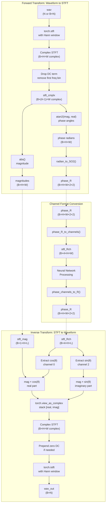
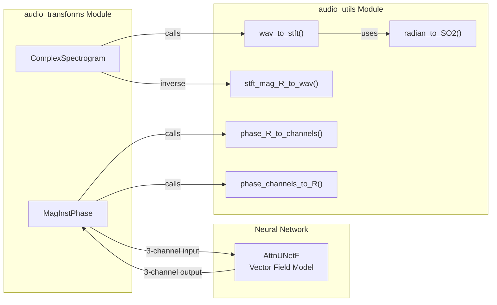

<!-- source: DeepWiki mcp.deepwiki.com · repo NVIDIA/diffusion-audio-restoration · page 6.5 STFT and SO(2) Phase Utilities · fetched 2026-10-26 -->

# STFT and SO(2) Phase Utilities

<details>
<summary>Relevant source files</summary>

The following files were used as context for generating this wiki page:

- [audio_utils.py](audio_utils.py)

</details>


## Purpose and Scope

This page documents the low-level utility functions in `audio_utils.py` that handle Short-Time Fourier Transform (STFT) computation and SO(2) rotation matrix phase representation. These functions form the foundational layer for converting between waveforms and the factorized audio representation used throughout A2SB.

For the conceptual explanation of why A2SB uses SO(2) matrices for phase representation, see [Audio Representation](#5.3). For the higher-level transform classes that build upon these utilities, see [Audio Transforms Reference](#6.6). For the complete audio processing pipeline context, see [Audio Processing Pipeline](#6.2).

**Sources:** [audio_utils.py:1-97]()

## Overview

The `audio_utils.py` module provides the core mathematical operations for A2SB's audio representation. The key innovation is representing STFT phase as SO(2) rotation matrices rather than raw phase angles, which provides several advantages:

- **Continuity**: SO(2) matrices avoid phase wrapping discontinuities
- **Differentiability**: Rotation matrices are smooth and differentiable
- **Compatibility**: Matrix representation works naturally with neural networks

The module handles bidirectional conversion:
- **Forward**: Waveform → STFT (magnitude + SO(2) phase)
- **Inverse**: STFT (magnitude + SO(2) phase) → Waveform

**Sources:** [audio_utils.py:1-97]()

## Core Functions

### Radian to SO(2) Conversion

The `radian_to_SO2` function converts phase angles (in radians) to 2×2 rotation matrices.

```python
def radian_to_SO2(rads: torch.Tensor) -> torch.Tensor
```

**Mathematical Representation:**

For a phase angle θ, the SO(2) rotation matrix is:

```
[cos(θ)  -sin(θ)]
[sin(θ)   cos(θ)]
```

**Tensor Shape Transformation:**
- Input: `B × ...` (any shape)
- Output: `B × ... × 2 × 2` (appends 2×2 matrix dimensions)

**Implementation Details:**

The function computes `cos(θ)` and `sin(θ)` separately, then stacks them in the correct order to form the rotation matrix. The matrix is reshaped from a flat 4-element tensor to a 2×2 matrix format.

**Sources:** [audio_utils.py:15-25]()

### Waveform to STFT Conversion

The `wav_to_stft` function performs STFT analysis and extracts magnitude and SO(2) phase representation.

```python
def wav_to_stft(wav: torch.Tensor, fft_size: int, hop_size: int, 
                win_length: int, drop_dc_term=True) -> Tuple[torch.Tensor, torch.Tensor]
```

**Parameters:**

| Parameter | Type | Description |
|-----------|------|-------------|
| `wav` | `torch.Tensor` | Waveform samples (N or B×N) |
| `fft_size` | `int` | FFT size (number of frequency bins) |
| `hop_size` | `int` | Number of samples between STFT frames |
| `win_length` | `int` | Window length for STFT |
| `drop_dc_term` | `bool` | Whether to remove DC (0 Hz) frequency bin |

**Returns:**

| Output | Shape | Description |
|--------|-------|-------------|
| `magnitudes` | `... × H × W` | STFT magnitude spectrogram |
| `phase_R` | `... × H × W × 2 × 2` | Phase as SO(2) rotation matrices |

**Processing Steps:**

1. Compute complex STFT using `torch.stft` with Hann window
2. Optionally drop DC term (first frequency bin)
3. Extract magnitude using complex absolute value
4. Compute phase angles using `atan2` on real/imaginary parts
5. Convert phase angles to SO(2) matrices

**Sources:** [audio_utils.py:28-46]()

### Phase Channel Conversions

Two functions handle reshaping SO(2) matrices for neural network processing:

#### `phase_R_to_channels`

```python
def phase_R_to_channels(stft_R: torch.Tensor) -> torch.Tensor
```

Converts SO(2) matrix representation to channel format for CNN processing.

**Shape Transformation:**
- Input: `B × H × W × 2 × 2` (SO(2) matrices)
- Output: `B × 4 × H × W` (4 channels: cos, -sin, sin, cos)

**Rationale:** Neural networks expect channel-first format (B×C×H×W), while SO(2) matrices are naturally stored in spatial format. This function flattens the 2×2 matrix into 4 channels.

**Sources:** [audio_utils.py:48-58]()

#### `phase_channels_to_R`

```python
def phase_channels_to_R(stft_channels: torch.Tensor) -> torch.Tensor
```

Inverse operation: converts 4-channel representation back to SO(2) matrices.

**Shape Transformation:**
- Input: `B × 4 × H × W` (4 channels)
- Output: `B × H × W × 2 × 2` (SO(2) matrices)

**Sources:** [audio_utils.py:61-67]()

### STFT to Waveform Reconstruction

The `stft_mag_R_to_wav` function performs inverse STFT to reconstruct waveforms.

```python
def stft_mag_R_to_wav(stft_mag: torch.Tensor, stft_Rch: torch.Tensor, 
                      n_fft: int, hop_length: int, win_length: int,
                      append_dc_term=True) -> torch.Tensor
```

**Parameters:**

| Parameter | Type | Shape | Description |
|-----------|------|-------|-------------|
| `stft_mag` | `torch.Tensor` | `B × 1 × H × L` | STFT magnitude |
| `stft_Rch` | `torch.Tensor` | `B × 4 × H × L` | Flattened SO(2) rotation matrices |
| `n_fft` | `int` | - | FFT size |
| `hop_length` | `int` | - | Hop size between frames |
| `win_length` | `int` | - | Window length |
| `append_dc_term` | `bool` | - | Whether to add zero DC term |

**Returns:**
- `wav_out`: `torch.Tensor` - Reconstructed waveform samples

**Processing Steps:**

1. Extract `cos(θ)` from channel 0 and `sin(θ)` from channel 2
2. Multiply magnitude by cos/sin to get complex components: `magnitude × cos(θ)` and `magnitude × sin(θ)`
3. Stack real and imaginary parts to form complex tensor
4. Optionally prepend zero DC term if it was dropped during forward transform
5. Apply inverse STFT using `torch.istft` with Hann window

**Sources:** [audio_utils.py:70-86]()

## Data Flow Diagram



**Sources:** [audio_utils.py:28-86]()

## SO(2) Matrix Structure

The SO(2) representation stores phase information in a 2×2 rotation matrix format. Each frequency bin at each time frame has its own rotation matrix.

### Matrix Layout

For a phase angle θ at frequency bin `h` and time frame `w`:

```
phase_R[b, h, w, :, :] = [[cos(θ),  -sin(θ)],
                           [sin(θ),   cos(θ)]]
```

### Channel Flattening

When converted to channel format for neural network processing:

```
stft_Rch[b, :, h, w] = [cos(θ), -sin(θ), sin(θ), cos(θ)]
                        └─ch 0─┘ └─ch 1─┘ └─ch 2┘ └─ch 3┘
```

The reconstruction process only uses channels 0 and 2 (cos and sin), as these are sufficient to recover the complex representation when multiplied by magnitude.

**Sources:** [audio_utils.py:48-86]()

## DC Term Handling

The DC term (0 Hz frequency bin) is typically dropped during forward transformation and re-added as zero during inverse transformation.

### Rationale for Dropping DC

- The DC term represents the average signal level, which is typically removed or normalized in audio processing
- Dropping it reduces the dimensionality by one frequency bin
- Most audio signals have negligible DC content

### DC Term Addition During Reconstruction

When `append_dc_term=True` in `stft_mag_R_to_wav`, a zero-valued DC term is prepended:

```python
dct = torch.zeros(_b, 1, _w, device=new_stft_cmplx.device)
new_stft_cmplx = torch.cat((dct, new_stft_cmplx), 1)
```

This ensures the frequency dimension matches the expected size for `torch.istft`.

**Sources:** [audio_utils.py:28-86]()

## Tensor Shape Reference

The following table summarizes tensor shapes throughout the transformation pipeline:

| Stage | Tensor Name | Shape | Description |
|-------|-------------|-------|-------------|
| Input | `wav` | `B × N` | Raw waveform samples |
| STFT | `stft_cmplx` | `B × H × W` (complex) | Complex-valued STFT |
| After DC drop | `stft_cmplx` | `B × (H-1) × W` (complex) | STFT without DC term |
| Magnitude | `magnitudes` | `B × H × W` | STFT magnitude |
| Phase (radians) | `phase` | `B × H × W` | Phase angles in radians |
| Phase (SO2) | `phase_R` | `B × H × W × 2 × 2` | Phase as rotation matrices |
| Phase (channels) | `stft_Rch` | `B × 4 × H × W` | Flattened for CNN |
| Output | `wav_out` | `B × N` | Reconstructed waveform |

Where:
- `B` = batch size
- `N` = number of waveform samples
- `H` = number of frequency bins (typically `n_fft // 2 + 1` minus DC)
- `W` = number of time frames

**Sources:** [audio_utils.py:28-86]()

## Complex Dtype Utility

The `_get_complex_dtype` helper function maps real tensor dtypes to their complex counterparts:

```python
def _get_complex_dtype(real_dtype: torch.dtype) -> torch.dtype
```

| Real Dtype | Complex Dtype |
|------------|---------------|
| `torch.double` | `torch.cdouble` |
| `torch.float` | `torch.cfloat` |
| `torch.half` | `torch.complex32` |

This utility ensures type consistency when converting between real and complex tensor representations.

**Sources:** [audio_utils.py:89-96]()

## Integration with Audio Transforms

These utilities are used by the transform classes in `audio_transforms/`:



The transform classes provide a higher-level interface that combines these utilities with additional processing steps like power scaling and DC term management. See [Audio Transforms Reference](#6.6) for details.

**Sources:** [audio_utils.py:1-97]()

## Usage Example Pattern

While we don't show new code, the typical usage pattern is:

1. **Forward (used by transforms):**
   - Call `wav_to_stft()` to get magnitude and SO(2) phase
   - Call `phase_R_to_channels()` to convert to CNN-friendly format
   - Apply power scaling and other processing
   - Feed 3-channel representation (mag + 2 phase channels) to model

2. **Inverse (used by transforms):**
   - Receive 3-channel output from model
   - Undo power scaling
   - Call `phase_channels_to_R()` to reconstruct SO(2) matrices
   - Call `stft_mag_R_to_wav()` to reconstruct waveform

This pattern is implemented in the `ComplexSpectrogram` and `MagInstPhase` transform classes documented in [Audio Transforms Reference](#6.6).

**Sources:** [audio_utils.py:1-97]()

---

