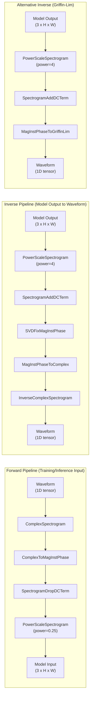
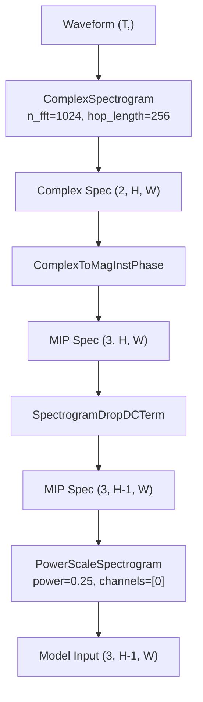
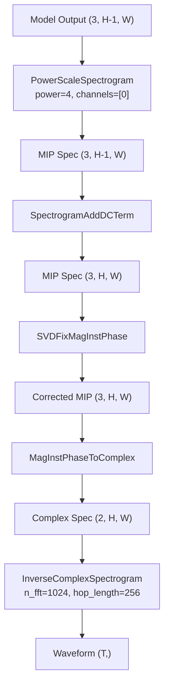

<!-- source: DeepWiki mcp.deepwiki.com · repo NVIDIA/diffusion-audio-restoration · page 6.6 Audio Transforms Reference · fetched 2026-10-26 -->

# Audio Transforms Reference

<details>
<summary>Relevant source files</summary>

The following files were used as context for generating this wiki page:

- [audio_transforms/transforms.py](audio_transforms/transforms.py)

</details>


This page provides a comprehensive technical reference for all audio transform classes in the `audio_transforms/transforms.py` module. These transforms handle the conversion between waveform and spectrogram representations, phase encoding, and various spectrogram manipulations that form the core of A2SB's audio processing pipeline.

For information about how these transforms integrate into the overall audio processing pipeline, see [Audio Processing Pipeline](#6.2). For the underlying STFT utilities and SO(2) phase operations, see [STFT and SO(2) Phase Utilities](#6.5). For theoretical background on the audio representation, see [Audio Representation](#5.3).

## Overview

The audio transforms module provides a modular, composable set of transformation classes that implement A2SB's audio processing pipeline. The system operates on spectrograms with a 3-channel magnitude-instantaneous phase representation, which encodes phase information as cosine and sine components rather than complex values.

**Sources:** [audio_transforms/transforms.py:1-375]()

## Transform Pipeline Architecture

The following diagram shows how transforms are typically chained together in A2SB's forward and inverse pipelines:



**Sources:** [audio_transforms/transforms.py:55-80](), [audio_transforms/transforms.py:83-375]()

## Transform Composition

### apply_audio_transforms Function

The `apply_audio_transforms` function applies a list of transforms sequentially and accumulates any masks produced by individual transforms.

**Function Signature:**
```python
def apply_audio_transforms(audio: torch.Tensor, transforms: List[T]) -> Tuple[torch.Tensor, Optional[torch.Tensor]]
```

| Parameter | Type | Description |
|-----------|------|-------------|
| `audio` | `torch.Tensor` | Input audio tensor (format depends on first transform) |
| `transforms` | `List[T]` | List of transform functions or Namespace objects |

**Returns:** Tuple of `(audio_transformed, mask)` where `mask` is the accumulated mask from all transforms (or `None` if no masks were produced).

**Behavior:**
- Iterates through transforms sequentially
- Automatically instantiates transforms from `jsonargparse.Namespace` objects
- Accumulates masks from transforms that return tuples `(output, mask)`
- Clamps accumulated mask to [0, 1] range

**Sources:** [audio_transforms/transforms.py:55-80]()

### instantiate_from_ns Function

Helper function to instantiate transform objects from JSON argument parser namespaces.

**Function Signature:**
```python
def instantiate_from_ns(ns: Namespace) -> Union[object, partial]
```

**Sources:** [audio_transforms/transforms.py:26-52]()

## Transform Classes Reference

### Waveform ↔ Spectrogram Transforms

#### ComplexSpectrogram

Converts time-domain waveform to complex-valued STFT spectrogram using `torch.stft`.

**Class:** `ComplexSpectrogram`

| Parameter | Type | Default | Description |
|-----------|------|---------|-------------|
| `n_fft` | `int` | `1024` | FFT size |
| `win_length` | `int` | `1024` | Window length |
| `hop_length` | `int` | `256` | Hop length between frames |
| `eps` | `float` | `1e-9` | Small epsilon for numerical stability |

**Input:** 
- `waveform`: 1D tensor of shape `(T,)` representing time-domain audio

**Output:**
- Complex spectrogram: 3D tensor of shape `(2, H, W)` where:
  - Channel 0: Real part
  - Channel 1: Imaginary part
  - `H = n_fft // 2 + 1` (frequency bins)
  - `W` is number of time frames

**Implementation Details:**
- Uses Hann window for windowing
- Returns complex values viewed as 2-channel real tensor
- Permutes dimensions to put channels first: `(2, freq, time)`

**Sources:** [audio_transforms/transforms.py:83-105]()

---

#### InverseComplexSpectrogram

Converts complex-valued STFT spectrogram back to time-domain waveform using `torch.istft`.

**Class:** `InverseComplexSpectrogram`

| Parameter | Type | Default | Description |
|-----------|------|---------|-------------|
| `n_fft` | `int` | `1024` | FFT size (must match forward transform) |
| `win_length` | `int` | `1024` | Window length |
| `hop_length` | `int` | `256` | Hop length between frames |
| `eps` | `float` | `1e-9` | Small epsilon for numerical stability |

**Input:**
- `spec`: 3D tensor of shape `(2, H, W)` representing complex spectrogram as 2-channel real values

**Output:**
- `waveform`: 1D tensor of shape `(T,)` representing time-domain audio

**Implementation Details:**
- Permutes channels to end and converts to complex type
- Uses Hann window for overlap-add reconstruction
- Automatically handles perfect reconstruction with matching parameters

**Sources:** [audio_transforms/transforms.py:163-184]()

---

### Complex ↔ Magnitude-Instantaneous Phase Transforms

#### ComplexToMagInstPhase

Converts complex spectrogram to magnitude-instantaneous phase (MIP) representation with 3 channels: magnitude, cos(phase), sin(phase).

**Class:** `ComplexToMagInstPhase`

**Input:**
- `complex_spec`: 3D tensor of shape `(2, H, W)` where channel 0 is real, channel 1 is imaginary

**Output:**
- 3D tensor of shape `(3, H, W)` where:
  - Channel 0: Magnitude `sqrt(real² + imag²)`
  - Channel 1: `cos(phase)` where `phase = atan2(imag, real)`
  - Channel 2: `sin(phase)`

**Mathematical Formulation:**
```
magnitude = sqrt(real² + imag²)
phase = atan2(imag, real)
output = [magnitude, cos(phase), sin(phase)]
```

**Sources:** [audio_transforms/transforms.py:108-118]()

---

#### MagInstPhaseToComplex

Converts magnitude-instantaneous phase representation back to complex spectrogram.

**Class:** `MagInstPhaseToComplex`

**Input:**
- `msp_spec`: 3D tensor of shape `(3, H, W)` with channels [magnitude, cos(phase), sin(phase)]

**Output:**
- Complex spectrogram: 3D tensor of shape `(2, H, W)` with channels [real, imaginary]

**Mathematical Formulation:**
```
real = magnitude * cos(phase)
imag = magnitude * sin(phase)
output = [real, imag]
```

**Sources:** [audio_transforms/transforms.py:121-132]()

---

### Phase Correction Transforms

#### SVDFixMagInstPhase

Cleans up inconsistent phase predictions by using Singular Value Decomposition (SVD) to project onto the SO(2) manifold, ensuring phase components form valid rotation matrices.

**Class:** `SVDFixMagInstPhase`

**Input:**
- `msp_spec`: 3D tensor of shape `(3, H, W)` with channels [magnitude, cos(phase), sin(phase)]

**Output:**
- Corrected 3D tensor of shape `(3, H, W)` with valid SO(2) phase components

**Algorithm:**
1. Constructs 2×2 rotation matrices from cos/sin pairs at each time-frequency bin
2. Applies SVD: `R = U @ S @ Vh`
3. Projects to SO(2) by setting singular values to `[1, det(U @ Vh)]`
4. Reconstructs corrected rotation matrix: `R' = U @ S' @ Vh`
5. Extracts corrected cos/sin phase components

**Mathematical Details:**
The transform ensures that the phase representation satisfies the SO(2) constraint:
```
[cos(θ)  -sin(θ)]
[sin(θ)   cos(θ)]
```
is a valid rotation matrix with determinant +1.

**Sources:** [audio_transforms/transforms.py:135-160]()

---

### Spectrogram Manipulation Transforms

#### PowerScaleSpectrogram

Applies power-law scaling to spectrogram channels, typically used for dynamic range compression or expansion.

**Class:** `PowerScaleSpectrogram`

| Parameter | Type | Default | Description |
|-----------|------|---------|-------------|
| `power` | `float` | `0.5` | Power exponent for scaling |
| `channels` | `Optional[List[int]]` | `None` | Specific channels to scale (None = all channels) |
| `eps` | `float` | `1e-9` | Small epsilon to prevent division by zero |

**Input:**
- `spec`: Tensor of shape `(C, H, W)` where C is number of channels

**Output:**
- Scaled tensor of same shape `(C, H, W)`

**Mathematical Formulation:**
```
spec_abs = abs(spec)
scale = spec_abs^power / (spec_abs + eps)
output = spec * scale
```

**Common Usage:**
- **Forward pass:** `power=0.25` compresses dynamic range for model input
- **Inverse pass:** `power=4` expands dynamic range back to original scale

**Sources:** [audio_transforms/transforms.py:187-207]()

---

#### SpectrogramDropDCTerm

Removes the DC term (0 Hz frequency bin) from the spectrogram, which is typically the first frequency bin.

**Class:** `SpectrogramDropDCTerm`

**Input:**
- `spec`: Tensor of shape `(C, H, W)`

**Output:**
- Tensor of shape `(C, H-1, W)` with first frequency bin removed

**Rationale:** The DC term is often inconsequential for audio restoration tasks and can be safely discarded to reduce model complexity.

**Sources:** [audio_transforms/transforms.py:210-219]()

---

#### SpectrogramAddDCTerm

Restores the DC term by prepending a zero-filled frequency bin.

**Class:** `SpectrogramAddDCTerm`

**Input:**
- `spec`: Tensor of shape `(C, H, W)`

**Output:**
- Tensor of shape `(C, H+1, W)` with zero-filled DC bin prepended

**Implementation:** Creates a zero-filled slice matching the input channels and time dimension, then concatenates along the frequency axis.

**Sources:** [audio_transforms/transforms.py:222-228]()

---

### Vocoder Transforms

#### MagInstPhaseToGriffinLim

Griffin-Lim vocoder that converts magnitude-instantaneous phase representation directly to waveform using iterative phase reconstruction.

**Class:** `MagInstPhaseToGriffinLim` (inherits from `nn.Module`)

| Parameter | Type | Default | Description |
|-----------|------|---------|-------------|
| `n_fft` | `int` | `1024` | FFT size |
| `win_length` | `int` | `1024` | Window length |
| `hop_length` | `int` | `256` | Hop length between frames |

**Input:**
- `mag_inst_phase`: Tensor of shape `(3, H, W)` with channels [magnitude, cos(phase), sin(phase)]

**Output:**
- `waveform`: 1D tensor representing time-domain audio

**Algorithm Parameters (hardcoded):**
- Iterations: 128
- Momentum: 0.99 (fast Griffin-Lim variant)
- Power: 1 (magnitude spectrogram)
- Random initialization: True

**Implementation Notes:**
- Uses the provided instantaneous phase (cos/sin) to initialize the Griffin-Lim iterations
- Calls custom `griffinlim` function that accepts phase initialization
- Applies momentum-based acceleration for faster convergence

**Sources:** [audio_transforms/transforms.py:231-258]()

---

## Griffin-Lim Implementation

### griffinlim Function

Modified Griffin-Lim algorithm that accepts initialized phase information instead of random phase.

**Function Signature:**
```python
def griffinlim(
    specgram: Tensor,
    init_phase_cos: Optional[Tensor],
    init_phase_sin: Optional[Tensor],
    window: Tensor,
    n_fft: int,
    hop_length: int,
    win_length: int,
    power: float,
    n_iter: int,
    momentum: float,
    length: Optional[int],
    rand_init: bool,
) -> Tensor
```

| Parameter | Type | Description |
|-----------|------|-------------|
| `specgram` | `Tensor` | Magnitude spectrogram of shape `(..., freq, frames)` |
| `init_phase_cos` | `Optional[Tensor]` | Cosine of initial phase |
| `init_phase_sin` | `Optional[Tensor]` | Sine of initial phase |
| `window` | `Tensor` | Window function (e.g., Hann window) |
| `n_fft` | `int` | FFT size |
| `hop_length` | `int` | Hop length between STFT windows |
| `win_length` | `int` | Window size |
| `power` | `float` | Exponent for magnitude spectrogram (must be > 0) |
| `n_iter` | `int` | Number of iterations for phase recovery |
| `momentum` | `float` | Momentum parameter for fast Griffin-Lim (0 = standard, near 1 = faster) |
| `length` | `Optional[int]` | Expected output array length |
| `rand_init` | `bool` | If True, use random phase initialization; if False, use provided phase |

**Algorithm:**
1. Normalize momentum: `momentum = momentum / (1 + momentum)`
2. Apply inverse power scaling: `specgram = specgram^(1/power)`
3. Initialize phase from `init_phase_cos` and `init_phase_sin` (or randomly if `rand_init=True`)
4. For each iteration:
   - Compute inverse STFT with current phase estimate
   - Recompute STFT from waveform
   - Extract phase from reconstructed STFT
   - Apply momentum update: `angles = rebuilt - momentum * tprev`
   - Normalize phase
5. Return final waveform

**Key Differences from Standard Griffin-Lim:**
- Accepts pre-initialized phase from model predictions
- Uses momentum-based acceleration (fast Griffin-Lim variant)
- Handles complex initialization from separate cos/sin components

**Sources:** [audio_transforms/transforms.py:261-374]()

---

## Transform Pipeline Examples

### Standard Forward Pipeline

The typical forward pipeline for converting waveform to model input:



**Sources:** [audio_transforms/transforms.py:83-219]()

---

### Standard Inverse Pipeline

The typical inverse pipeline for converting model output to waveform:



**Sources:** [audio_transforms/transforms.py:163-228]()

---

## Summary Table of All Transforms

| Transform Class | Input Shape | Output Shape | Primary Purpose |
|----------------|-------------|--------------|-----------------|
| `ComplexSpectrogram` | `(T,)` | `(2, H, W)` | Waveform → Complex STFT |
| `InverseComplexSpectrogram` | `(2, H, W)` | `(T,)` | Complex STFT → Waveform |
| `ComplexToMagInstPhase` | `(2, H, W)` | `(3, H, W)` | Complex → Mag-Inst-Phase |
| `MagInstPhaseToComplex` | `(3, H, W)` | `(2, H, W)` | Mag-Inst-Phase → Complex |
| `SVDFixMagInstPhase` | `(3, H, W)` | `(3, H, W)` | Phase correction via SVD |
| `PowerScaleSpectrogram` | `(C, H, W)` | `(C, H, W)` | Dynamic range scaling |
| `SpectrogramDropDCTerm` | `(C, H, W)` | `(C, H-1, W)` | Remove DC frequency bin |
| `SpectrogramAddDCTerm` | `(C, H, W)` | `(C, H+1, W)` | Restore DC frequency bin |
| `MagInstPhaseToGriffinLim` | `(3, H, W)` | `(T,)` | Phase-aware vocoder |

**Note:** 
- `T` = number of time-domain samples
- `H` = number of frequency bins (`n_fft // 2 + 1`)
- `W` = number of time frames
- `C` = number of channels (typically 2 or 3)

**Sources:** [audio_transforms/transforms.py:83-375]()

---

