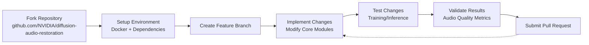
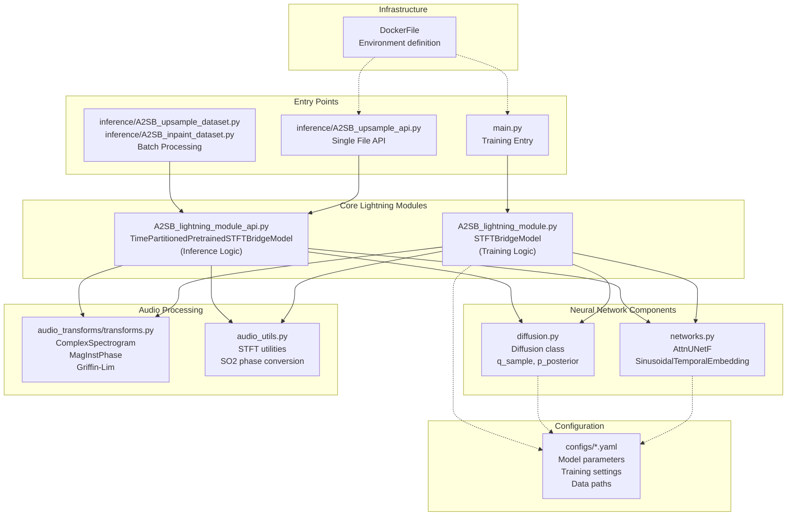
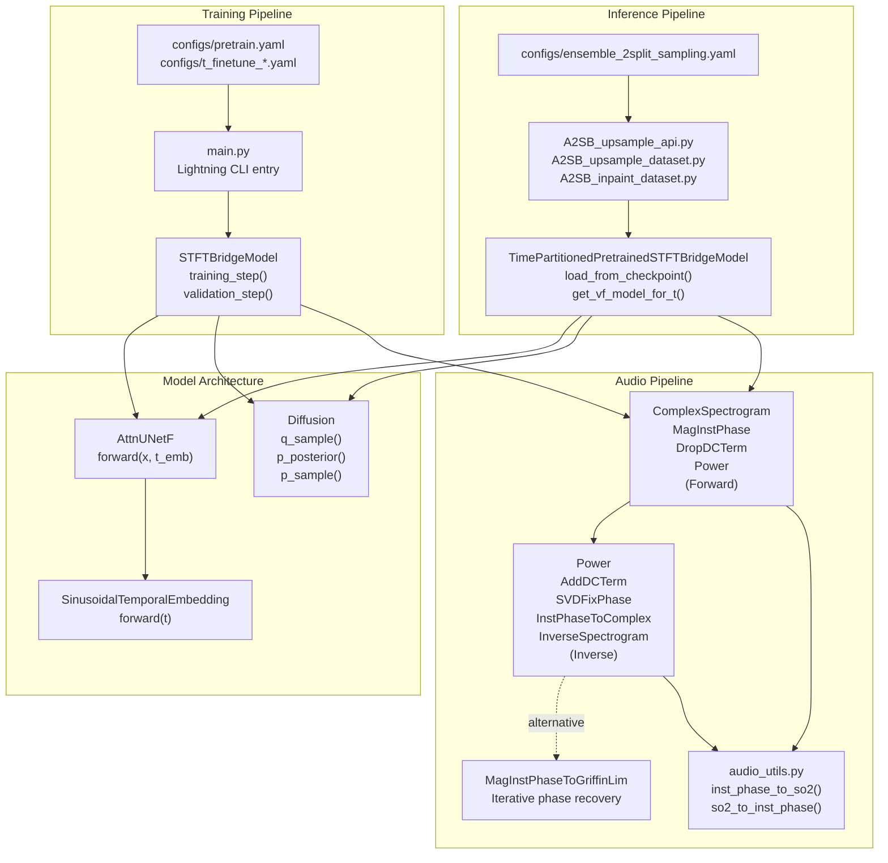
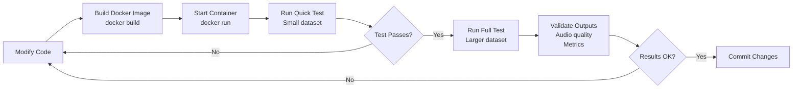

<!-- source: DeepWiki mcp.deepwiki.com · repo NVIDIA/diffusion-audio-restoration · page 7 Development and Contributing · fetched 2026-10-26 -->

# Development and Contributing

<details>
<summary>Relevant source files</summary>

The following files were used as context for generating this wiki page:

- [CODE_OF_CONDUCT.md](CODE_OF_CONDUCT.md)
- [DockerFile](DockerFile)
- [LICENSE](LICENSE)

</details>


## Purpose and Scope

This document provides guidance for developers who want to contribute to, extend, or modify the A2SB codebase. It covers the development workflow, environment setup overview, community guidelines, and licensing requirements. For detailed environment configuration, see [Development Environment](#7.1). For architectural details useful when implementing new features, see [Architecture and Core Concepts](#5).

## Overview

A2SB is an open-source research project under the NVIDIA Source Code License. Contributions are welcome in several areas:

- **Model improvements**: Enhancements to the vector field architecture, diffusion algorithms, or training strategies
- **New tasks**: Additional audio restoration tasks beyond bandwidth extension and inpainting
- **Audio processing**: Improvements to STFT transforms, phase representations, or vocoding methods
- **Infrastructure**: Performance optimizations, distributed training improvements, or inference efficiency
- **Documentation**: Clarifications, examples, or tutorials

## Development Workflow

The typical development cycle for A2SB involves:



**Sources:** General software development practices

### Contribution Areas by Module

Contributors should identify which modules their changes affect:



**Sources:** [main.py](), [A2SB_lightning_module.py](), [A2SB_lightning_module_api.py](), [networks.py](), [diffusion.py](), [audio_transforms/transforms.py](), [audio_utils.py](), [configs/](), [DockerFile]()

## Development Environment Overview

A2SB uses a Docker-based development environment for reproducibility. The environment is defined in [DockerFile:1-11]() and includes:

| Component | Version | Purpose |
|-----------|---------|---------|
| PyTorch | 2.2.2 | Deep learning framework |
| CUDA | 12.1 | GPU acceleration |
| cuDNN | 8 | Neural network primitives |
| Python packages | See below | Audio processing and training |

### Core Python Dependencies

The following packages are installed via pip in [DockerFile:9]():

- `lightning` - PyTorch Lightning training framework
- `tensorboard` - Training visualization
- `torchaudio` - Audio I/O and transforms
- `torch-audiomentations` - Audio augmentation
- `scipy`, `librosa` - Audio signal processing
- `rotary-embedding-torch` - Positional embeddings
- `einops` - Tensor operations
- `inflect`, `moviepy`, `gradio` - Utilities
- `jsonargparse[signatures]` - CLI configuration
- `lmdb`, `h5py` - Data storage

FFmpeg is installed via conda for audio codec support [DockerFile:10]().

For detailed setup instructions and troubleshooting, see [Development Environment](#7.1).

**Sources:** [DockerFile:1-11]()

## Code Organization for Development

Understanding the codebase structure helps target contributions effectively:



**Sources:** [main.py](), [A2SB_lightning_module.py](), [A2SB_lightning_module_api.py](), [networks.py](), [diffusion.py](), [audio_transforms/transforms.py](), [audio_utils.py]()

### Key Entry Points by Task

| Task | Entry File | Key Classes/Functions |
|------|-----------|----------------------|
| Training (pretrain) | `main.py` | `STFTBridgeModel`, `LightningCLI` |
| Training (t-finetune) | `main.py` | `STFTBridgeModel`, `train_t_min`, `train_t_max` |
| Inference (single file) | `inference/A2SB_upsample_api.py` | `TimePartitionedPretrainedSTFTBridgeModel` |
| Inference (batch BWE) | `inference/A2SB_upsample_dataset.py` | `TimePartitionedPretrainedSTFTBridgeModel` |
| Inference (batch inpaint) | `inference/A2SB_inpaint_dataset.py` | `TimePartitionedPretrainedSTFTBridgeModel` |

**Sources:** [main.py](), [inference/A2SB_upsample_api.py](), [inference/A2SB_upsample_dataset.py](), [inference/A2SB_inpaint_dataset.py]()

## Typical Development Tasks

### Adding a New Audio Transform

New audio processing transforms should be added to [audio_transforms/transforms.py](). Transforms should inherit from `torch.nn.Module` and be composable with existing transforms:

```
audio_transforms/transforms.py
  - Add new transform class inheriting from nn.Module
  - Implement forward() and optionally inverse()
  - Add to the transform pipeline in STFTBridgeModel
```

**Sources:** [audio_transforms/transforms.py]()

### Modifying the Vector Field Network

The vector field model is defined in [networks.py](). The `AttnUNetF` class implements the U-Net architecture with attention mechanisms:

```
networks.py
  - AttnUNetF class: Main U-Net architecture
  - SinusoidalTemporalEmbedding: Time embedding
  - Modify encoder/decoder blocks
  - Adjust attention mechanisms
```

**Sources:** [networks.py]()

### Extending the Diffusion Process

The diffusion algorithm is implemented in [diffusion.py](). Key methods include:

- `q_sample()` - Forward diffusion (add noise)
- `p_posterior()` - Compute posterior mean and variance
- `p_sample()` - Reverse diffusion sampling step
- `p_sample_loop()` - Full sampling loop with DDPM or ODE

**Sources:** [diffusion.py]()

### Adding Configuration Parameters

Configuration files are located in [configs/](). To add new parameters:

1. Add parameter to appropriate YAML file (`pretrain.yaml`, `t_finetune_*.yaml`, or `ensemble_2split_sampling.yaml`)
2. Update the corresponding class that reads the config (usually in `A2SB_lightning_module.py` or `A2SB_lightning_module_api.py`)
3. Document the parameter's purpose and valid values

**Sources:** [configs/](), [A2SB_lightning_module.py](), [A2SB_lightning_module_api.py]()

## Testing Changes

### Local Testing Workflow



**Sources:** [DockerFile]()

### Validation Checklist

When testing changes, verify:

- **Training convergence**: Loss decreases over iterations
- **Audio quality**: Listen to generated samples
- **Metrics**: LSD, VISQOL, or other objective metrics improve or remain stable
- **Backward compatibility**: Existing checkpoints still load correctly
- **Configuration**: New parameters have sensible defaults
- **Documentation**: Code comments and docstrings are updated

## Community Guidelines

A2SB follows the Contributor Covenant Code of Conduct. Key principles include:

- **Welcoming environment**: Use inclusive language and be respectful
- **Constructive feedback**: Focus on improving the code and project
- **Collaboration**: Work together towards common goals
- **Professionalism**: Maintain professional behavior in all interactions

Unacceptable behaviors include harassment, trolling, personal attacks, and publishing private information without consent.

For full details, see [Code of Conduct](#7.2).

**Sources:** [CODE_OF_CONDUCT.md:1-85]()

## Licensing Requirements

A2SB is released under the **NVIDIA Source Code License**, which has important restrictions:

### Key License Terms

| Aspect | Requirement |
|--------|-------------|
| **Use limitation** | Non-commercial use only (research/evaluation) |
| **NVIDIA exception** | NVIDIA and affiliates may use commercially |
| **Redistribution** | Must include complete license copy |
| **Derivative works** | Must apply same non-commercial restriction |
| **Attribution** | Retain copyright and attribution notices |
| **Patent claims** | Rights terminate if patent claims are made |

### Non-Commercial Restriction

The Work and derivative works may only be used for **research or evaluation purposes** (non-commercial). Commercial use is prohibited except for NVIDIA and its affiliates [LICENSE:37-39]().

### Redistribution Requirements

When distributing A2SB or derivative works:

1. Include complete copy of the license [LICENSE:27-29]()
2. Retain all copyright, patent, trademark, and attribution notices [LICENSE:27-29]()
3. Distribute under this same license [LICENSE:27-29]()

For complete licensing terms and conditions, see [License](#7.3).

**Sources:** [LICENSE:1-64]()

## Pull Request Guidelines

When submitting a pull request:

1. **Clear description**: Explain what changes are made and why
2. **Test results**: Include metrics or audio samples demonstrating improvements
3. **Code quality**: Follow existing code style and conventions
4. **Documentation**: Update relevant documentation and comments
5. **Commit messages**: Write clear, descriptive commit messages
6. **License compliance**: Ensure changes comply with NVIDIA Source Code License

## Getting Help

For questions or discussions:

- **Issues**: Open GitHub issues for bugs or feature requests
- **Conduct violations**: Report to GitHub_Conduct@nvidia.com [CODE_OF_CONDUCT.md:66]()
- **Technical questions**: Refer to architecture documentation in [Architecture and Core Concepts](#5)

---

For detailed environment setup, see [Development Environment](#7.1).  
For community guidelines, see [Code of Conduct](#7.2).  
For complete licensing terms, see [License](#7.3).

---

