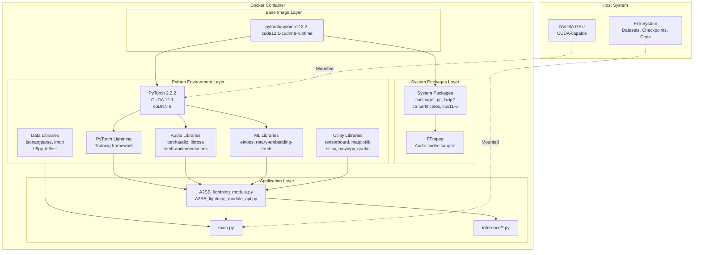
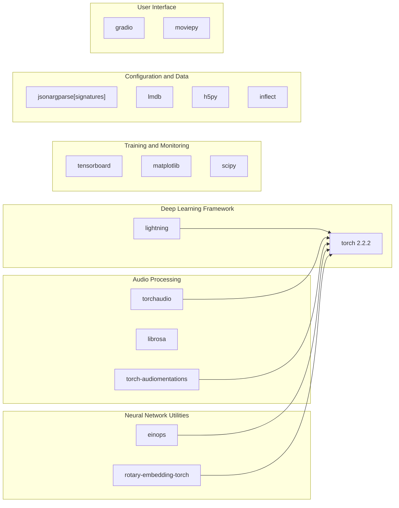
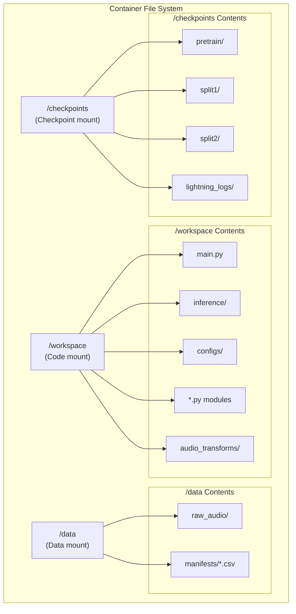
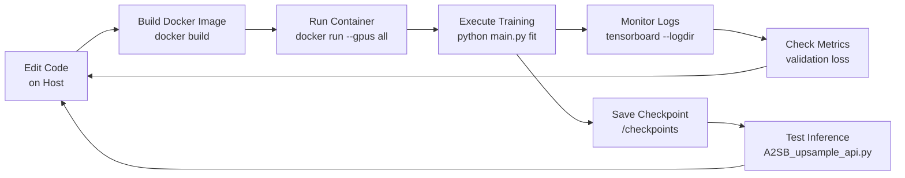

<!-- source: DeepWiki mcp.deepwiki.com · repo NVIDIA/diffusion-audio-restoration · page 7.1 Development Environment · fetched 2026-10-26 -->

# Development Environment

<details>
<summary>Relevant source files</summary>

The following files were used as context for generating this wiki page:

- [DockerFile](DockerFile)

</details>


## Purpose and Scope

This page documents the development environment for the A2SB audio restoration system, including the Docker container configuration, runtime dependencies, and development workflow. For information about training models, see [Training Guide](#4). For production inference deployment, see [Inference Guide](#3).

## Overview

The A2SB development environment is containerized using Docker to ensure reproducibility across different hardware configurations. The environment is built on top of PyTorch's official CUDA-enabled runtime image and includes all necessary dependencies for training, inference, and audio processing.

### Environment Architecture



**Sources:** [DockerFile:1-11]()

## Docker Container Specification

### Base Image

The development environment uses the official PyTorch runtime image with CUDA support:

```
pytorch/pytorch:2.2.2-cuda12.1-cudnn8-runtime
```

This base image provides:
- **PyTorch**: Version 2.2.2
- **CUDA**: Version 12.1
- **cuDNN**: Version 8
- **Python**: 3.x (version included with PyTorch 2.2.2)
- **Conda**: Package management

The runtime variant is used (rather than devel) to minimize image size while retaining all necessary runtime libraries for inference and training.

**Sources:** [DockerFile:1]()

### System Dependencies

The container installs essential system packages for audio processing and development:

| Package | Purpose |
|---------|---------|
| `curl`, `wget` | HTTP clients for downloading files |
| `ca-certificates` | SSL/TLS certificate validation |
| `git` | Version control and repository cloning |
| `bzip2` | Compression utility |
| `libx11-6` | X11 libraries for display support |
| `ffmpeg` | Audio/video codec support via Conda |

**Sources:** [DockerFile:2-10]()

## Python Dependencies

### Core Framework Dependencies



**Sources:** [DockerFile:9]()

### Dependency Roles

#### Training Framework
- **`lightning`**: PyTorch Lightning framework for training orchestration, callbacks, and distributed training (DDP strategy)
- **`tensorboard`**: Logging and visualization of training metrics
- **`jsonargparse[signatures]`**: CLI argument parsing with type signatures, used by PyTorch Lightning CLI

#### Audio Processing
- **`torchaudio`**: Core audio I/O and transforms, STFT/iSTFT operations
- **`librosa`**: Additional audio analysis utilities
- **`torch-audiomentations`**: Audio augmentation during training
- **`ffmpeg`**: Backend codec support for various audio formats

#### Neural Network Operations
- **`einops`**: Tensor manipulation with readable notation, used in `networks.py`
- **`rotary-embedding-torch`**: Rotary positional embeddings for attention mechanisms in `AttnUNetF`

#### Scientific Computing
- **`scipy`**: Scientific utilities, signal processing functions
- **`matplotlib`**: Plotting and visualization
- **`numpy`**: (Implicit via other packages) Numerical operations

#### Data Management
- **`lmdb`**: Lightning Memory-Mapped Database for efficient dataset storage
- **`h5py`**: HDF5 file format support for large datasets
- **`inflect`**: Natural language processing utilities

#### User Interfaces
- **`gradio`**: Web UI components for demos
- **`moviepy`**: Video/audio editing utilities

**Sources:** [DockerFile:9-10]()

## Installation Procedure

### Building the Docker Image

```bash
docker build -t a2sb:latest -f DockerFile .
```

This command:
1. Downloads the base PyTorch image (~5 GB)
2. Installs system packages via `apt-get`
3. Installs Python packages via `pip3`
4. Installs FFmpeg via `conda`

### Running the Container

```bash
docker run --gpus all \
    -v /path/to/code:/workspace \
    -v /path/to/data:/data \
    -v /path/to/checkpoints:/checkpoints \
    -it a2sb:latest bash
```

Mount points:
- `/workspace`: A2SB codebase
- `/data`: Audio datasets and manifests
- `/checkpoints`: Model checkpoints and training outputs

**Sources:** [DockerFile:1-11]()

## Development Workflow

### Directory Structure in Container



### Training Development Cycle



**Sources:** [DockerFile:1-11]()

## Hardware Requirements

### GPU Requirements

The A2SB system requires NVIDIA GPUs with CUDA compute capability 7.0 or higher:

| Component | Minimum | Recommended |
|-----------|---------|-------------|
| GPU Memory | 12 GB | 24+ GB |
| CUDA Version | 12.1 | 12.1+ |
| GPU Count | 1 | 2-8 (for DDP) |
| Compute Capability | 7.0 | 8.0+ |

### Memory Considerations

Training memory usage depends on:
- `batch_size`: Number of audio samples per batch
- `audio_len`: Length of audio samples in seconds
- `num_workers`: DataLoader worker processes
- Model size: `AttnUNetF` architecture parameters

Typical memory consumption:
- **Training**: 10-20 GB GPU memory per batch
- **Inference**: 4-8 GB GPU memory per file (with multidiffusion)

### Storage Requirements

| Data Type | Size | Location |
|-----------|------|----------|
| Docker Image | ~8 GB | Local Docker storage |
| Training Data | 10-500 GB | `/data` mount |
| Model Checkpoints | 500 MB - 2 GB each | `/checkpoints` mount |
| Lightning Logs | 100 MB - 1 GB | `/checkpoints/lightning_logs` |

**Sources:** [DockerFile:1]()

## Environment Variables

### CUDA Configuration

```bash
# Set visible GPUs
export CUDA_VISIBLE_DEVICES=0,1,2,3

# CUDA memory allocation strategy
export PYTORCH_CUDA_ALLOC_CONF=max_split_size_mb:512
```

### PyTorch Lightning Configuration

```bash
# Distributed training backend
export PL_TORCH_DISTRIBUTED_BACKEND=nccl

# Number of threads
export OMP_NUM_THREADS=8
```

### TensorBoard Configuration

```bash
# TensorBoard logging directory
export TENSORBOARD_DIR=/checkpoints/lightning_logs

# Launch TensorBoard
tensorboard --logdir=$TENSORBOARD_DIR --port=6006
```

**Sources:** [DockerFile:1]()

## Dependency Version Matrix

### Core Dependencies

| Package | Version | Purpose |
|---------|---------|---------|
| `pytorch` | 2.2.2 | Deep learning framework |
| `cuda` | 12.1 | GPU acceleration |
| `cudnn` | 8 | Neural network primitives |
| `lightning` | Latest | Training orchestration |
| `torchaudio` | Compatible with PyTorch 2.2.2 | Audio processing |

### Compatibility Notes

- PyTorch 2.2.2 requires CUDA 11.8 or 12.1
- cuDNN 8 is compatible with CUDA 12.1
- TorchAudio version must match PyTorch version
- Lightning is compatible with PyTorch 2.x
- All audio processing libraries (librosa, torch-audiomentations) work with TorchAudio's tensor format

**Sources:** [DockerFile:1-10]()

## Development Best Practices

### Container Management

1. **Use volume mounts** for code, data, and checkpoints rather than copying into the container
2. **Rebuild the image** when dependencies change in `DockerFile`
3. **Use `--gpus all`** flag to expose all GPUs to the container
4. **Tag images** with meaningful versions (e.g., `a2sb:v1.0`, `a2sb:dev`)

### Code Development

1. Edit code on the host system using your preferred IDE
2. Mount code directory into container at `/workspace`
3. Run training/inference commands inside the container
4. Checkpoints and logs persist on host via volume mounts

### Resource Management

1. Monitor GPU utilization with `nvidia-smi` inside container
2. Set `num_workers` in DataLoader based on available CPU cores
3. Use `CUDA_VISIBLE_DEVICES` to restrict GPU access
4. Clear PyTorch cache periodically: `torch.cuda.empty_cache()`

**Sources:** [DockerFile:1-11]()

## Troubleshooting

### Common Issues

| Issue | Cause | Solution |
|-------|-------|----------|
| `CUDA out of memory` | Batch size too large | Reduce `batch_size` in config |
| `FFmpeg not found` | FFmpeg not installed | Verify `conda install ffmpeg` succeeded |
| `Module not found` | Missing Python package | Check `pip3 install` command in DockerFile |
| `Permission denied` | Volume mount permissions | Use `-u $(id -u):$(id -g)` with docker run |
| `GPU not detected` | Missing `--gpus all` flag | Add `--gpus all` to docker run command |

### Verification Commands

```bash
# Verify CUDA availability
python -c "import torch; print(torch.cuda.is_available())"

# Check PyTorch version
python -c "import torch; print(torch.__version__)"

# List installed packages
pip list

# Check GPU status
nvidia-smi
```

**Sources:** [DockerFile:1-11]()

## Extensions and Customization

### Adding New Dependencies

To add a new Python package:

1. Edit `DockerFile:9`
2. Add package name to the `pip3 install` command
3. Rebuild the Docker image

### Using Different Base Images

To use a different PyTorch/CUDA version:

1. Modify `FROM` directive in `DockerFile:1`
2. Update CUDA/PyTorch version references in documentation
3. Test compatibility with all dependencies

### Multi-Stage Builds

For production deployment, consider multi-stage Docker builds:
- Stage 1: Build with full development tools
- Stage 2: Copy only necessary runtime files
- Results in smaller final image size

**Sources:** [DockerFile:1-11]()

---

