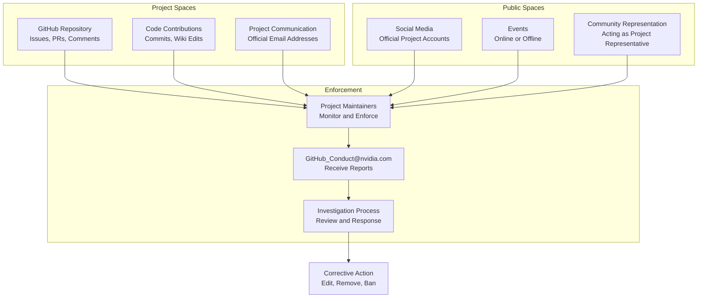
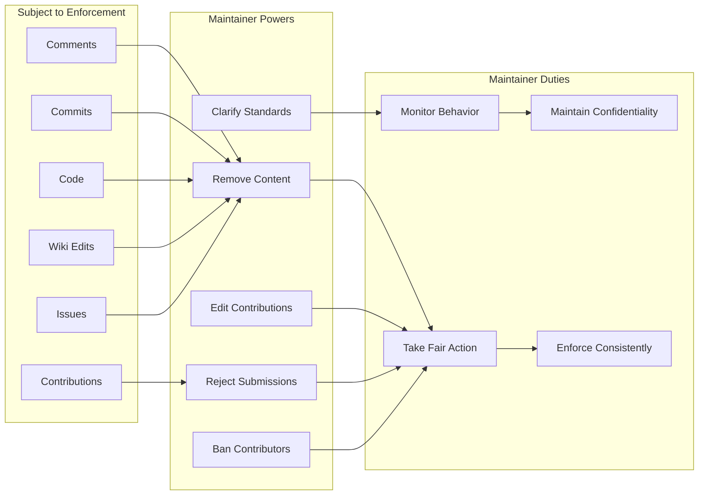
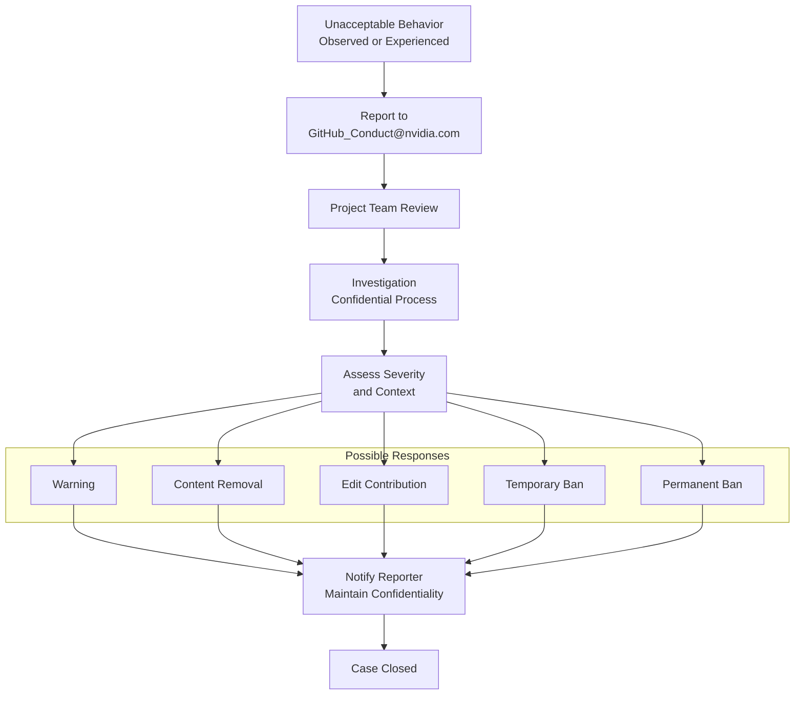
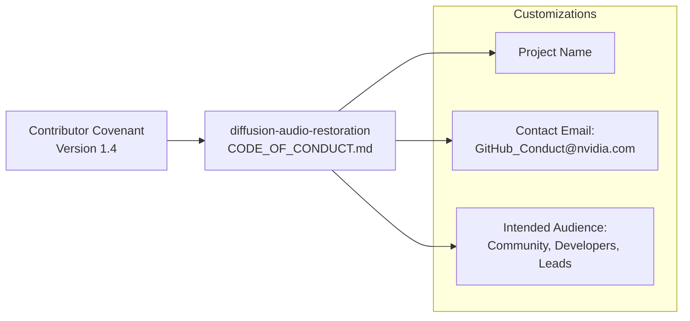

<!-- source: DeepWiki mcp.deepwiki.com · repo NVIDIA/diffusion-audio-restoration · page 7.2 Code of Conduct · fetched 2026-10-26 -->

# Code of Conduct

Relevant source files

The following files were used as context for generating this wiki page:

- [CODE_OF_CONDUCT.md](CODE_OF_CONDUCT.md)

This page documents the community guidelines and behavioral expectations for contributors to the diffusion-audio-restoration project. The Code of Conduct defines standards for participation and provides enforcement mechanisms to maintain a welcoming, professional environment.

For information about technical development practices and environment setup, see [Development Environment](#7.1). For licensing terms and usage restrictions, see [License](#7.3).

## Overview

The diffusion-audio-restoration project follows the Contributor Covenant Code of Conduct version 1.4. The Code of Conduct is defined in [CODE_OF_CONDUCT.md:1-85]() and applies to all project participants including contributors, maintainers, and community members.

**Intended Audience**: Community members, developers, and project leads

**Primary Contact**: GitHub_Conduct@nvidia.com

Sources: [CODE_OF_CONDUCT.md:1-10]()

## Pledge and Core Principles

The project community pledges to maintain a harassment-free environment for all participants, regardless of personal characteristics including age, body size, disability, ethnicity, gender identity and expression, level of experience, education, socio-economic status, nationality, appearance, race, religion, or sexual identity and orientation.

Sources: [CODE_OF_CONDUCT.md:11-18]()

## Behavioral Standards

### Acceptable Behavior

The following behaviors contribute to creating a positive environment:

| Behavior | Description |
|----------|-------------|
| Welcoming language | Using inclusive and respectful communication |
| Respect for differences | Being respectful of differing viewpoints and experiences |
| Accepting criticism | Gracefully accepting constructive feedback |
| Community focus | Focusing on what is best for the community |
| Empathy | Showing empathy towards other community members |

Sources: [CODE_OF_CONDUCT.md:20-29]()

### Unacceptable Behavior

The following behaviors are considered unacceptable:

| Behavior | Description |
|----------|-------------|
| Sexualized language | Use of sexualized language, imagery, or unwelcome sexual attention |
| Trolling | Trolling, insulting/derogatory comments, personal or political attacks |
| Harassment | Public or private harassment of any form |
| Privacy violations | Publishing others' private information without explicit permission |
| Professional misconduct | Other conduct inappropriate in a professional setting |

Sources: [CODE_OF_CONDUCT.md:31-40]()

## Scope of Application

The Code of Conduct applies in two contexts:

1. **Project Spaces**: GitHub repository, issues, pull requests, code commits, wiki edits, and any official project communication channels
2. **Public Spaces**: When an individual represents the project or its community, including:
   - Using official project email addresses
   - Posting via official social media accounts
   - Acting as an appointed representative at events

Sources: [CODE_OF_CONDUCT.md:54-61]()

## Maintainer Responsibilities

Project maintainers have specific responsibilities outlined in [CODE_OF_CONDUCT.md:42-52]():

**Rights**:
- Remove, edit, or reject comments, commits, code, wiki edits, issues, and other contributions not aligned with the Code of Conduct
- Temporarily or permanently ban contributors for inappropriate, threatening, offensive, or harmful behavior

**Responsibilities**:
- Clarify standards of acceptable behavior
- Take appropriate and fair corrective action in response to unacceptable behavior
- Enforce the Code of Conduct consistently and in good faith

Maintainers who fail to enforce the Code of Conduct in good faith may face consequences from project leadership.

Sources: [CODE_OF_CONDUCT.md:42-74]()

## Enforcement Process

### Reporting Process

Instances of abusive, harassing, or otherwise unacceptable behavior should be reported by:

1. **Contact**: Email GitHub_Conduct@nvidia.com with details of the incident
2. **Review**: All complaints will be reviewed and investigated
3. **Response**: The project team will provide a response deemed necessary and appropriate to the circumstances
4. **Confidentiality**: The project team maintains confidentiality regarding the reporter's identity

Sources: [CODE_OF_CONDUCT.md:64-70]()

### Response Actions

Based on the severity and nature of the violation, project maintainers may take actions including:

| Action | Scope | Duration |
|--------|-------|----------|
| Warning | Individual notification | N/A |
| Content Removal | Delete or edit specific contributions | Permanent |
| Content Rejection | Refuse pull requests or submissions | Per incident |
| Temporary Ban | Suspend participation rights | Time-limited |
| Permanent Ban | Revoke all participation rights | Indefinite |

All enforcement actions aim to maintain a professional and welcoming environment for the community.

Sources: [CODE_OF_CONDUCT.md:42-52]()

## Attribution and Adaptation

The diffusion-audio-restoration Code of Conduct is adapted from the Contributor Covenant, version 1.4:
- **Source**: https://www.contributor-covenant.org/version/1/4/code-of-conduct.html
- **Homepage**: https://www.contributor-covenant.org
- **FAQ**: https://www.contributor-covenant.org/faq

The Code of Conduct follows the standard Contributor Covenant structure with project-specific contact information and audience definitions.

Sources: [CODE_OF_CONDUCT.md:76-84]()

## Integration with Project Structure

The Code of Conduct integrates with other project documentation and processes:

| Document | Relationship | Purpose |
|----------|--------------|---------|
| [CODE_OF_CONDUCT.md:1-85]() | Primary document | Canonical source of community standards |
| [Development Environment](#7.1) | Technical complement | Defines technical development practices |
| [License](#7.3) | Legal complement | Defines usage rights and restrictions |
| GitHub Issues/PRs | Application space | Where standards are actively enforced |

The Code of Conduct applies throughout the development lifecycle, from initial contribution through code review, issue discussion, and community interaction.

Sources: [CODE_OF_CONDUCT.md:1-85]()

---

