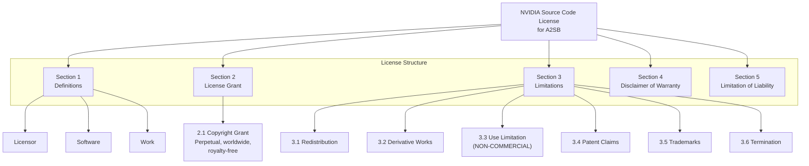
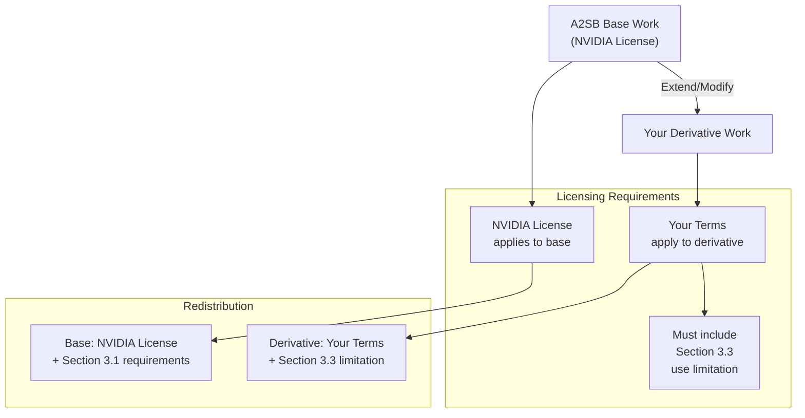
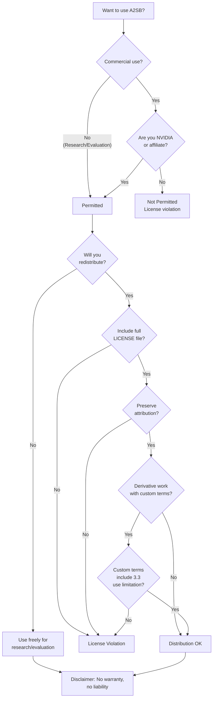

<!-- source: DeepWiki mcp.deepwiki.com · repo NVIDIA/diffusion-audio-restoration · page 7.3 License · fetched 2026-10-26 -->

# License

<details>
<summary>Relevant source files</summary>

The following files were used as context for generating this wiki page:

- [LICENSE](LICENSE)

</details>


This page documents the licensing terms that govern the use, distribution, and modification of the A2SB codebase. It provides a technical reference to the NVIDIA Source Code License and clarifies usage restrictions, particularly for commercial applications.

**Note**: This documentation provides a technical summary of licensing terms. For legal advice or specific use cases, consult the full license text and appropriate legal counsel.

## License Type and Structure

The A2SB codebase is distributed under the **NVIDIA Source Code License for A2SB**, a custom license agreement that permits research and evaluation use while restricting commercial applications.



**Sources**: [LICENSE:1-64]()

## Key Definitions

The license establishes specific terminology that determines its scope:

| Term | Definition | Importance |
|------|------------|------------|
| **Licensor** | Any person or entity that distributes the Work | NVIDIA is the licensor for A2SB |
| **Software** | The original work of authorship made available under this License | The A2SB codebase as distributed |
| **Work** | The Software and any additions to or derivative works of the Software | Includes modifications and extensions |

These definitions apply U.S. copyright law meanings to "reproduce," "reproduction," "derivative works," and "distribution."

**Sources**: [LICENSE:1-17]()

## License Grant

### Copyright Grant (Section 2.1)

The license provides a **perpetual, worldwide, non-exclusive, royalty-free copyright license** with the following permissions:

- ✅ Reproduce the Work
- ✅ Prepare derivative works
- ✅ Publicly display
- ✅ Publicly perform
- ✅ Sublicense
- ✅ Distribute the Work and derivatives

**Important**: All these permissions are subject to the limitations in Section 3, particularly the non-commercial use restriction.

**Sources**: [LICENSE:19-23]()

## Limitations and Restrictions

### 3.1 Redistribution Requirements

When redistributing A2SB code, you **must**:

| Requirement | Description |
|-------------|-------------|
| License Inclusion | Include a complete copy of the NVIDIA Source Code License |
| Preserve Notices | Retain all copyright, patent, trademark, and attribution notices without modification |
| Same Terms | Distribute under this same license |

**Sources**: [LICENSE:27-29]()

### 3.2 Derivative Works

You may create derivative works with custom terms, but:

1. **Your custom terms must include** the non-commercial use limitation from Section 3.3
2. **You must identify** which specific derivative works are subject to your terms
3. **The original license** continues to apply to the base A2SB Work



**Sources**: [LICENSE:31-35]()

### 3.3 Use Limitation (Critical)

This is the **most restrictive clause** in the license:

> The Work and any derivative works thereof **only may be used or intended for use non-commercially**.

**Definition of "non-commercially"**: For research or evaluation purposes only.

**Exception**: NVIDIA and its affiliates may use the Work commercially.

#### Permitted Uses

- ✅ Academic research
- ✅ Educational purposes
- ✅ Algorithm evaluation
- ✅ Internal testing and experimentation
- ✅ Non-profit research applications

#### Prohibited Uses

- ❌ Commercial products or services
- ❌ Production audio restoration services
- ❌ Commercial audio enhancement tools
- ❌ Any application generating revenue
- ❌ Integration into commercial software

**Sources**: [LICENSE:37-39]()

### 3.4 Patent Claims

If you initiate or threaten patent litigation against any Licensor claiming the Work infringes your patents, **your license rights terminate immediately**.

**Sources**: [LICENSE:41-43]()

### 3.5 Trademarks

The license does **not** grant rights to use:
- NVIDIA's name
- NVIDIA's logos
- NVIDIA's trademarks
- NVIDIA affiliates' branding

**Exception**: You may use these as necessary to reproduce required license notices.

**Sources**: [LICENSE:45-46]()

### 3.6 Termination

Your license rights terminate immediately upon violation of any license term.

**Sources**: [LICENSE:48-49]()

## Warranty and Liability

### Disclaimer of Warranty (Section 4)

```
THE WORK IS PROVIDED "AS IS" WITHOUT WARRANTIES OR CONDITIONS OF ANY KIND,
EITHER EXPRESS OR IMPLIED
```

The software comes with:
- ❌ No warranty of merchantability
- ❌ No warranty of fitness for a particular purpose
- ❌ No warranty of non-infringement
- ❌ No title warranty

**You bear all risk** of using the software under this license.

**Sources**: [LICENSE:51-55]()

### Limitation of Liability (Section 5)

Licensors are **not liable** for:
- Direct damages
- Indirect damages
- Special damages
- Incidental damages
- Consequential damages

This includes (but is not limited to):
- Loss of goodwill
- Business interruption
- Lost profits or data
- Computer failure or malfunction
- Any other commercial damages or losses

This limitation applies even if the licensor was advised of possible damages.

**Sources**: [LICENSE:57-64]()

## Usage Decision Tree



**Sources**: [LICENSE:1-64]()

## Practical Guidance for Contributors

### If You Are Contributing to A2SB

When contributing code to the A2SB repository:

1. **Understand your contributions** become part of the Work under the NVIDIA Source Code License
2. **Ensure your contributions** can be licensed under these terms
3. **Do not include** third-party code with incompatible licenses
4. **Review** the Code of Conduct ([see page 7.2](#7.2)) for behavioral guidelines

### If You Are Creating a Derivative Work

When building upon A2SB:

1. **Retain the LICENSE file** in your distribution
2. **Keep attribution notices** intact in all source files
3. **Apply the non-commercial limitation** to your derivative work
4. **Document clearly** which portions are derivative and subject to additional terms
5. **Do not remove or modify** copyright notices from A2SB source files

### If You Are Using A2SB for Research

For academic and research use:

- ✅ Cite the A2SB paper in publications
- ✅ Acknowledge NVIDIA's work
- ✅ Share research findings openly
- ✅ Follow best practices for reproducible research
- ❌ Do not commercialize results without proper licensing

## License File Location

The complete license text is located at:

```
/LICENSE
```

All users, contributors, and distributors should review the complete license text before using the A2SB codebase.

## Comparison with Common Open Source Licenses

For context, here's how the NVIDIA Source Code License differs from common open source licenses:

| License | Commercial Use | Derivative Works | Redistribution | Patent Protection |
|---------|----------------|------------------|----------------|-------------------|
| **NVIDIA (A2SB)** | ❌ No (except NVIDIA) | ✅ Yes (with restrictions) | ✅ Yes (with requirements) | ✅ Yes |
| MIT | ✅ Yes | ✅ Yes | ✅ Yes | ❌ No |
| Apache 2.0 | ✅ Yes | ✅ Yes | ✅ Yes | ✅ Yes |
| GPL v3 | ✅ Yes | ✅ Yes (must be GPL) | ✅ Yes (must be GPL) | ✅ Yes |
| BSD 3-Clause | ✅ Yes | ✅ Yes | ✅ Yes | ❌ No |

The NVIDIA Source Code License is more restrictive than typical open source licenses due to the **non-commercial use limitation**.

**Sources**: [LICENSE:1-64]()

## Summary

The NVIDIA Source Code License for A2SB provides broad permissions for research and evaluation while restricting commercial use. Key points:

| Aspect | Summary |
|--------|---------|
| **Type** | Custom NVIDIA source code license |
| **Permissions** | Reproduce, modify, distribute for non-commercial purposes |
| **Key Restriction** | Non-commercial use only (research/evaluation) |
| **Redistribution** | Permitted with full license inclusion and attribution |
| **Warranty** | None - "AS IS" |
| **Liability** | None - use at your own risk |

For questions about commercial licensing or specific use cases, contact NVIDIA directly.

**Sources**: [LICENSE:1-64]()