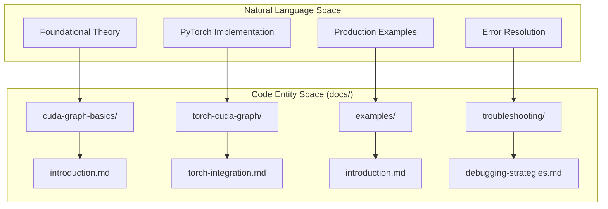
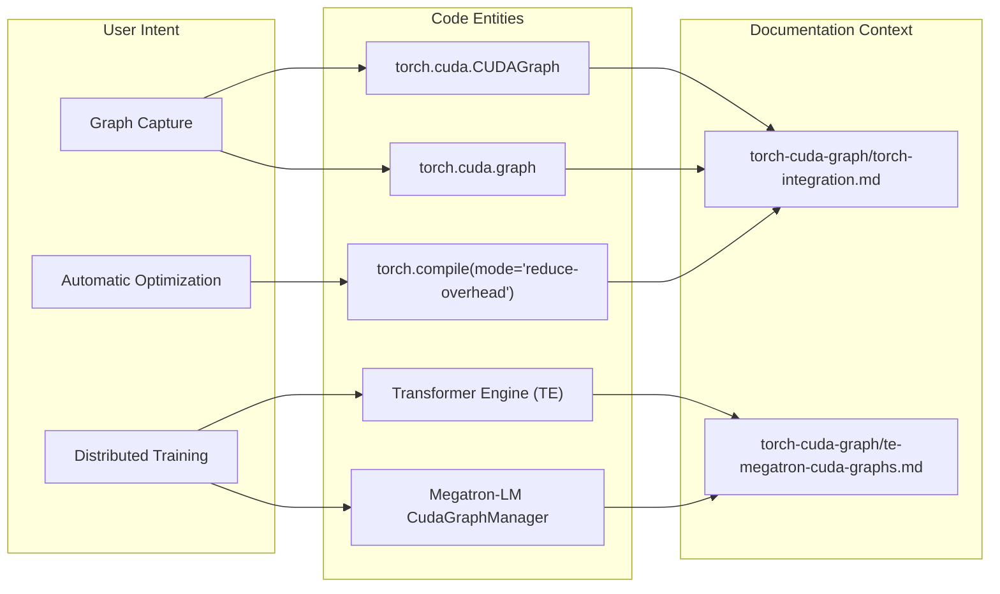

<!-- source: DeepWiki mcp.deepwiki.com · repo NVIDIA/dl-cuda-graph-doc · page 1 Overview · fetched 2026-10-26 -->

# Overview

Relevant source files

The following files were used as context for generating this wiki page:

- [CONTRIBUTING.md](CONTRIBUTING.md)
- [README.md](README.md)
- [docs/index.md](docs/index.md)

Welcome to the technical documentation for using CUDA Graphs effectively within the PyTorch ecosystem. This repository serves as a comprehensive guide for optimizing deep learning workloads by minimizing CPU-side overhead and maximizing GPU throughput through graph-based execution [README.md:1-3]().

## Repository Purpose and Scope

The primary objective of this documentation is to bridge the gap between low-level CUDA Graph mechanics and high-level framework usage in PyTorch [docs/index.md:8-12](). It targets Machine Learning Engineers, Framework Developers, and CUDA Practitioners who need to scale models or reduce latency in production environments.

The project utilizes a dual-licensing model:
*   **Documentation Content**: Licensed under [CC-BY-4.0](LICENSE-DOCS) [README.md:42]().
*   **Code and Scripts**: Licensed under the [MIT License](LICENSE) [README.md:43]().

For a detailed breakdown of the project goals, target personas, and legal notices, see [Repository Purpose and Scope](#1.1).

**Sources:** [README.md:1-3](), [README.md:40-45](), [docs/index.md:8-12]()

---

## Content Organization

The documentation is structured into five core pillars, moving from foundational theory to complex multi-node implementations and troubleshooting.

### Documentation Component Mapping
The following diagram maps high-level documentation concepts to the physical directory structure and key entry points.

**Sources:** [CONTRIBUTING.md:32-43](), [docs/index.md:132-184]()

---

## Navigation and Learning Paths

This guide is designed to be consumed in three distinct ways depending on user expertise and immediate needs:

1.  **Systematic Learning Path**: A step-by-step journey from understanding the "Launch Overhead Problem" to implementing "Sync-Free Code" [docs/index.md:26-35]().
2.  **Quick-Reference Reference**: Targeted links for users facing specific runtime issues like `Capture Failures` or `Numerical Errors` [docs/index.md:36-47]().
3.  **Framework-Specific Paths**: Specialized tracks for standard PyTorch users (focusing on `torch.compile`) vs. large-scale model developers using `Megatron-LM` or `Transformer Engine` [docs/index.md:50-55]().

For details on how to navigate these paths and an explanation of the `toctree` structure, see [Navigation and Learning Paths](#1.2).

### Technical Interface Overview
This diagram bridges the user's intent (e.g., "I want to capture a graph") to the specific PyTorch and NVIDIA framework entities discussed in the guide.

**Sources:** [docs/index.md:50-55](), [docs/index.md:149-159](), [README.md:12-14]()

---

## Major Sections

| Section | Description | Key Topics |
| :--- | :--- | :--- |
| **CUDA Graph Basics** | Fundamental theory of GPU execution. | Launch overhead, DAG models, constraints [docs/index.md:16](). |
| **PyTorch Integration** | Framework-specific APIs and best practices. | `CUDAGraph`, `torch.compile`, Sync-free code [docs/index.md:17](). |
| **Real-World Examples** | MLPerf benchmark implementations. | Llama 3.1, GPT-3, Stable Diffusion [docs/index.md:18](). |
| **Troubleshooting** | Resolving runtime and performance bugs. | Memory leaks, process hangs, NaN/Inf errors [docs/index.md:19](). |
| **Infrastructure** | Build system and contribution guide. | Sphinx, MyST, local development [CONTRIBUTING.md:48-66](). |

**Sources:** [docs/index.md:16-20](), [CONTRIBUTING.md:32-43](), [README.md:9-14]()

---

