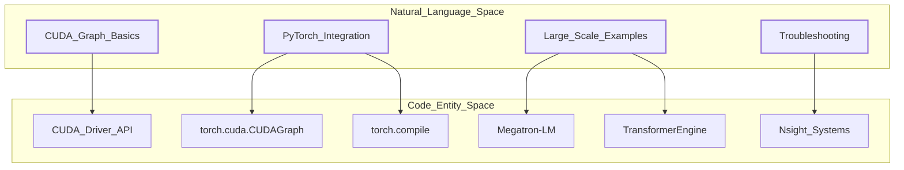
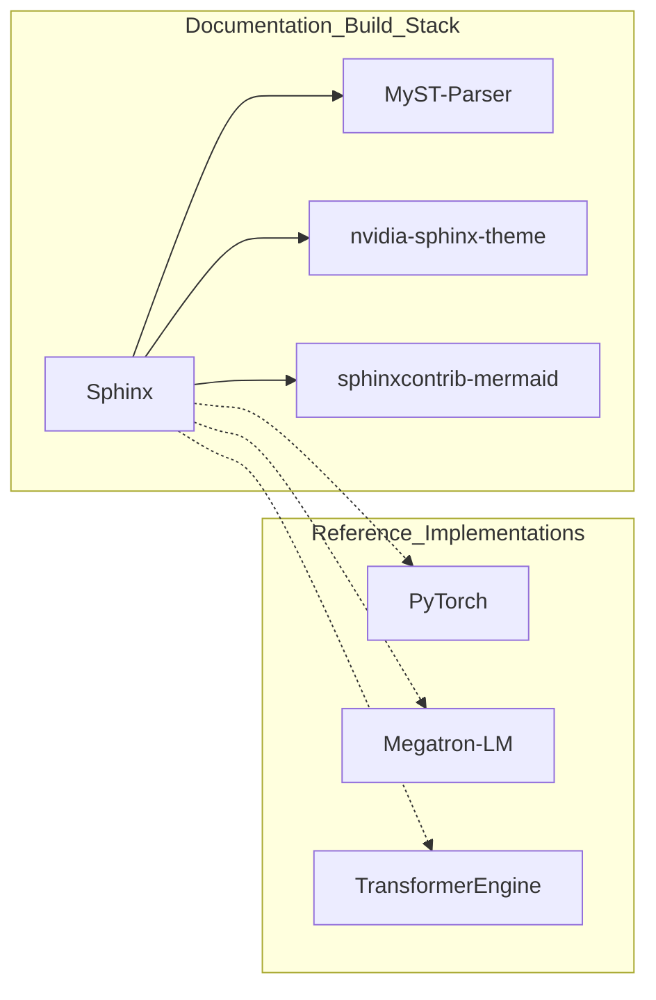

<!-- source: DeepWiki mcp.deepwiki.com · repo NVIDIA/dl-cuda-graph-doc · page 1.1 Repository Purpose and Scope · fetched 2026-10-26 -->

# Repository Purpose and Scope

Relevant source files

The following files were used as context for generating this wiki page:

- [LICENSE](LICENSE)
- [LICENSE-DOCS](LICENSE-DOCS)
- [README.md](README.md)
- [THIRD-PARTY-NOTICES.md](THIRD-PARTY-NOTICES.md)

The `dl-cuda-graph-doc` repository serves as a comprehensive technical guide for optimizing Deep Learning (DL) workloads using **CUDA Graphs** within the PyTorch ecosystem [README.md:1-3](). It addresses the critical need for reducing CPU-side overhead in high-performance training and inference, particularly for large-scale models like Llama 3.1 and GPT-3 [README.md:9-15]().

## Core Documentation Scope

The project provides a structured knowledge base covering the entire lifecycle of CUDA Graph adoption, from theoretical fundamentals to large-scale distributed implementation [README.md:9-15]().

| Domain | Technical Coverage |
| :--- | :--- |
| **CUDA Fundamentals** | Kernel launch overhead, graph nodes/edges, and stream capture mechanics [README.md:11](). |
| **Framework Integration** | PyTorch `CUDAGraph` APIs, `torch.compile` (reduce-overhead), and Transformer Engine [README.md:12](). |
| **Distributed Scaling** | Implementation details for Megatron-LM, including 4D parallelism (TP/PP/DP/CP) [README.md:12-13](). |
| **Real-world Examples** | MLPerf Training benchmarks (Stable Diffusion v2, GPT-3 175B, Llama 3.1 405B) [README.md:13](). |
| **Operational Support** | Debugging capture failures, numerical stability, and memory management [README.md:14](). |

**Sources:** [README.md:1-15]()

## Target Audience

This documentation is engineered for three primary technical personas:

1.  **Machine Learning Engineers**: Focused on accelerating training throughput and reducing latency in production pipelines using PyTorch and PyTorch Lightning [README.md:3,13]().
2.  **Framework Developers**: Users of low-level libraries such as **Transformer Engine** or **Megatron-LM** who need to understand how CUDA Graphs interact with FP8 precision and complex parallelism [README.md:12-13]().
3.  **CUDA Developers**: Engineers looking to bridge the gap between native CUDA Graph features and high-level framework abstractions [README.md:11-12]().

## System Context: Documentation to Code Entities

The following diagram maps the documentation sections to the specific technologies and codebases they reference.

**Documentation Knowledge Mapping**

**Sources:** [README.md:9-15](), [THIRD-PARTY-NOTICES.md:17-28]()

## Licensing Model

The repository operates under a dual-licensing model to distinguish between instructional content and functional tooling [README.md:38-44]().

### Documentation License: CC-BY-4.0
All Markdown content and visual assets are licensed under **Creative Commons Attribution 4.0 International** [LICENSE-DOCS:1-5]().
*   **Permissions**: Users are free to share, copy, and adapt the material for any purpose, including commercial use [LICENSE-DOCS:9-14]().
*   **Requirements**: Attribution must be provided to NVIDIA Corporation [LICENSE-DOCS:18-21]().

### Code License: MIT
The underlying infrastructure, including build scripts (`scripts/sphinx-serve.sh`) and configuration files (`docs/conf.py`), is licensed under the **MIT License** [LICENSE:1-2](), [README.md:43-44]().
*   **Permissions**: Broad usage, modification, and distribution rights with minimal restrictions [LICENSE:4-8]().
*   **Warranty**: Provided "as is" without warranty of any kind [LICENSE:14-16]().

**Sources:** [LICENSE:1-20](), [LICENSE-DOCS:1-28](), [README.md:38-44]()

## Dependency Landscape

The project integrates several third-party components to build and render the documentation suite.

**Infrastructure and Dependency Map**

| Component | Role | License |
| :--- | :--- | :--- |
| `Sphinx` | Primary build engine [THIRD-PARTY-NOTICES.md:9]() | BSD-2-Clause |
| `MyST-Parser` | Markdown support [THIRD-PARTY-NOTICES.md:14]() | MIT |
| `nvidia-sphinx-theme` | Visual styling [THIRD-PARTY-NOTICES.md:15]() | NVIDIA Proprietary |
| `PyTorch` | Target framework [THIRD-PARTY-NOTICES.md:23]() | BSD-3-Clause |
| `Megatron-LM` | Distributed training examples [THIRD-PARTY-NOTICES.md:27]() | BSD-3-Clause |

**Sources:** [THIRD-PARTY-NOTICES.md:1-28]()

---

