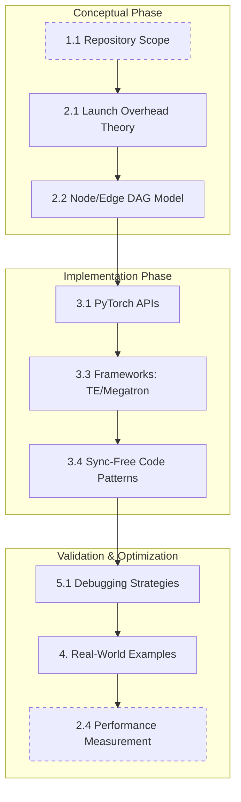
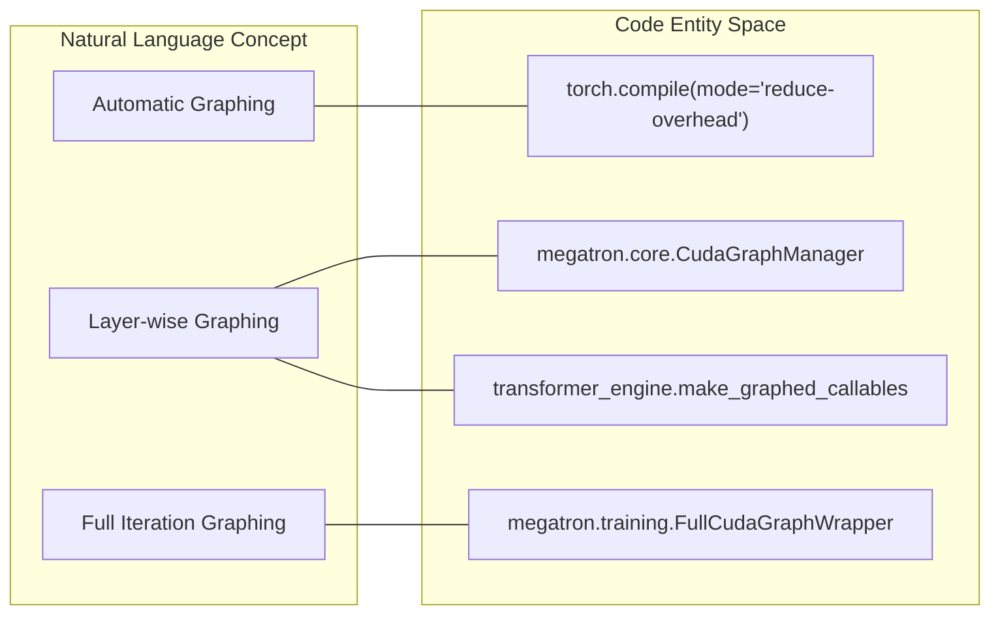

<!-- source: DeepWiki mcp.deepwiki.com · repo NVIDIA/dl-cuda-graph-doc · page 1.2 Navigation and Learning Paths · fetched 2026-10-26 -->

# Navigation and Learning Paths

Relevant source files

The following files were used as context for generating this wiki page:

- [docs/contributing.md](docs/contributing.md)
- [docs/index.md](docs/index.md)
- [docs/reference.md](docs/reference.md)

This page describes the organizational structure of the `dl-cuda-graph-doc` repository and outlines three distinct navigation modes designed to assist users based on their expertise level and specific technical requirements. The guide is structured to transition from fundamental CUDA concepts to high-level framework implementations and real-world performance optimization.

## Documentation Structure and Toctree

The documentation is organized into six major functional blocks, managed via a hierarchical `toctree` structure [docs/index.md:132-192](). This structure ensures that foundational knowledge precedes implementation details and troubleshooting.

### Structural Overview

| Section | Content Scope | Target Audience |
| :--- | :--- | :--- |
| **1. Overview** | High-level purpose, scope, and navigation paths. | All users |
| **2. CUDA Graph Basics** | Launch overhead theory, DAG models, and constraints. | New users, CUDA developers |
| **3. PyTorch Integration** | APIs (`CUDAGraph`, `torch.compile`), TE, and Megatron-LM. | ML Engineers, Framework Devs |
| **4. Examples** | MLPerf Training implementations (Llama 3.1, GPT-3, SDv2). | Performance Engineers |
| **5. Troubleshooting** | Debugging capture, numerical errors, and memory. | All users (reactive) |
| **6. Infrastructure** | Sphinx build system and contribution guides. | Contributors |

### Logic Flow Diagram
The following diagram illustrates how the `toctree` sections relate to the software development lifecycle of a CUDA-graphed application.

**Development Lifecycle and Document Mapping**

Sources: [docs/index.md:15-20](), [docs/index.md:132-192]()

---

## Learning Path: Systematic Understanding

For users new to CUDA Graphs, the guide recommends a linear progression. This path focuses on the "Define-Instantiate-Execute" lifecycle before moving to complex framework abstractions [docs/index.md:26-35]().

1.  **Foundations**: Start with **CUDA Graph Basics** to understand the CPU-GPU producer-consumer bottleneck and the source of kernel launch overhead.
2.  **PyTorch Mechanics**: Move to **PyTorch Integration** to learn the low-level `torch.cuda.CUDAGraph` class and the `torch.cuda.graph()` context manager.
3.  **Code Adaptation**: Study **Writing Sync-Free Code** and **Handling Dynamic Patterns** to identify and eliminate host-device synchronizations that break capture.
4.  **Verification**: Use the **Troubleshooting** section to validate numerical parity between eager mode and graphed execution.

Sources: [docs/index.md:30-34]()

---

## Quick Reference: Problem Solving

The documentation provides a reactive path for users who have already implemented CUDA Graphs but are encountering runtime or performance issues [docs/index.md:36-49]().

### Issue-to-Resolution Mapping

| Symptom | Code Entity / Section | Link |
| :--- | :--- | :--- |
| **Illegal Memory Access** | `torch.cuda.CUDAGraph` Memory Pool | [Memory Issues](troubleshooting/memory-issues.md) |
| **Runtime Error during Capture** | `torch.cuda.graph` context | [Capture Failures](troubleshooting/capture-failures.md) |
| **Losses diverge / NaNs** | RNG states, `manual_seed` | [Numerical Errors](troubleshooting/numerical-errors.md) |
| **No Speedup** | `nvidia-smi`, Nsight Systems | [Performance Issues](troubleshooting/performance-issues.md) |
| **Process Stalls** | NCCL Watchdog, `ProcessGroup` | [Process Hang](troubleshooting/process-hang.md) |

Sources: [docs/index.md:40-47]()

---

## Framework-Specific Paths

Advanced users working with specialized NVIDIA libraries can bypass general PyTorch documentation to access framework-specific implementations [docs/index.md:50-55]().

### Megatron-LM and Transformer Engine (TE)
Users training large-scale models (e.g., GPT-3, Llama 3.1) should focus on the interaction between model parallelism and graph capture [docs/index.md:52]().

*   **`make_graphed_callables` (TE)**: Optimized for FP8 precision and pipeline parallelism.
*   **`CudaGraphManager` (Megatron-LM)**: Handles per-layer graphing to balance memory overhead and performance.
*   **`FullCudaGraphWrapper` (Megatron-LM)**: Captures the entire training iteration for maximum overhead reduction in massive scale-out scenarios.

### Pure PyTorch and torch.compile
Users looking for automated solutions should investigate the `reduce-overhead` mode of `torch.compile` [docs/index.md:54]().

*   **CUDAGraph Trees**: Internal mechanism for managing shared memory pools across multiple graph segments.
*   **Inductor Integration**: How the compiler automatically partitions code into graphable and non-graphable regions.

**Framework Entity Association**

Sources: [docs/index.md:52-55](), [docs/reference.md:29-32]()

---

## Documentation Infrastructure

The guide is built using a modern Sphinx pipeline to ensure technical accuracy and readability [docs/contributing.md:1-19]().

*   **Build System**: Uses `Sphinx` with `MyST-Parser` for Markdown support and `nvidia-sphinx-theme` for visual consistency [docs/index.md:1-4]().
*   **Version Control**: Managed via `docs/versions.json` for multi-version documentation support.
*   **Interactive Components**: Includes `sphinx-copybutton` for code snippets and `mermaid` for architectural diagrams.

Sources: [docs/contributing.md:10-18](), [docs/reference.md:42-43]()

---

