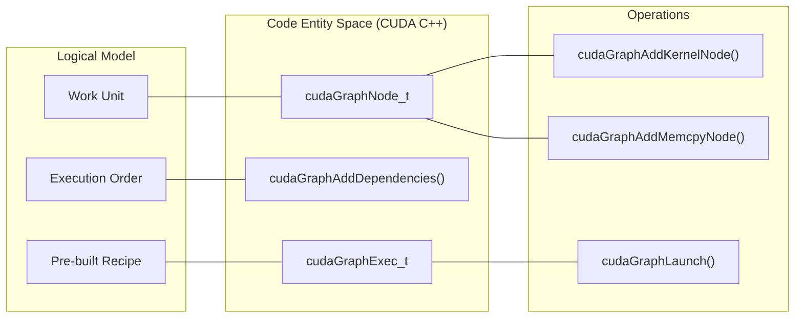
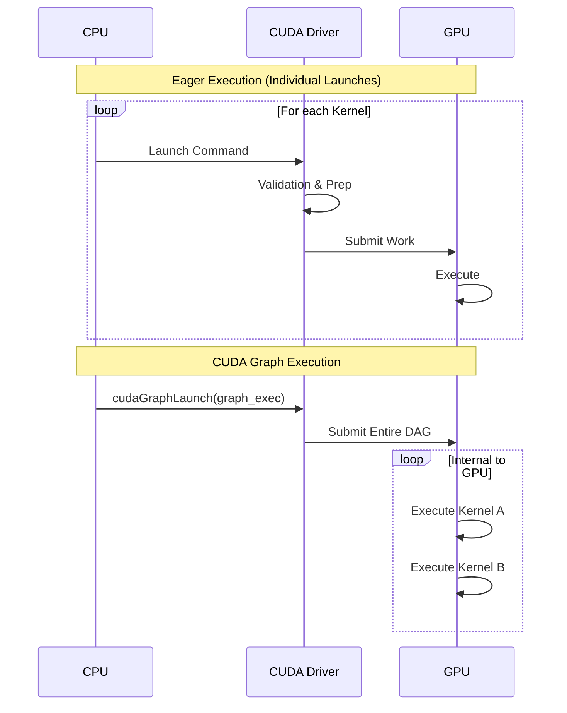

<!-- source: DeepWiki mcp.deepwiki.com · repo NVIDIA/dl-cuda-graph-doc · page 2 CUDA Graph Fundamentals · fetched 2026-10-26 -->

# CUDA Graph Fundamentals

Relevant source files

The following files were used as context for generating this wiki page:

- [docs/cuda-graph-basics/cuda-graph.md](docs/cuda-graph-basics/cuda-graph.md)
- [docs/cuda-graph-basics/introduction.md](docs/cuda-graph-basics/introduction.md)

This section provides a technical overview of the core concepts, architecture, and operational model of CUDA Graphs. It introduces the fundamental problem of kernel launch overhead in high-performance computing and explains how the CUDA Graph framework addresses these bottlenecks through a "define-instantiate-execute" lifecycle.

## The Launch Overhead Problem and CUDA Graph Solution

In traditional CUDA programming, the CPU and GPU operate in a producer-consumer relationship. The CPU orchestrates work by launching individual kernels, while the GPU executes them. However, as GPU throughput has increased, the CPU-side overhead required to manage these launches has become a primary bottleneck [docs/cuda-graph-basics/introduction.md:21-24]().

### Sources of Overhead
Every individual kernel launch (e.g., a `torch.matmul()` call) incurs cumulative latency from four primary stages:
1.  **Language Transitions**: Crossing the Python/C++ boundary and GIL management [docs/cuda-graph-basics/introduction.md:31-35]().
2.  **Runtime Processing**: Dispatch logic, parameter validation, and algorithm selection (e.g., cuDNN heuristics) [docs/cuda-graph-basics/introduction.md:37-44]().
3.  **Driver Operations**: Command buffer management and parameter validation [docs/cuda-graph-basics/introduction.md:45-49]().
4.  **Hardware Submission**: PCIe communication and hardware scheduling [docs/cuda-graph-basics/introduction.md:51-55]().

### The CUDA Graph Solution
CUDA Graphs solve this by shifting the "work preparation" from the critical path of execution to a one-time setup phase. Instead of launching kernels individually, developers bundle operations into a graph that is submitted to the GPU as a single unit [docs/cuda-graph-basics/cuda-graph.md:17-18]().

For details on the CPU-GPU bottleneck and the lifecycle of a graph, see **[The Launch Overhead Problem and CUDA Graph Solution](#2.1)**.

---

## CUDA Graph Structure: Nodes, Edges, and Creation

A CUDA Graph is represented as a **Directed Acyclic Graph (DAG)** where nodes represent work units and edges represent dependencies [docs/cuda-graph-basics/cuda-graph.md:44-45]().

### Node Types
Nodes encapsulate specific GPU operations, including:
*   **Kernel Nodes**: Computational work [docs/cuda-graph-basics/cuda-graph.md:50]().
*   **Memory Nodes**: Data transfers (D2D, H2D, D2H) and management (alloc/free) [docs/cuda-graph-basics/cuda-graph.md:51-52]().
*   **Host Nodes**: CPU-side functions synchronized with the GPU [docs/cuda-graph-basics/cuda-graph.md:53]().
*   **Empty Nodes**: Synchronization points for coordinating complex dependencies [docs/cuda-graph-basics/cuda-graph.md:54]().

### Creation Methods
There are two primary workflows for generating these structures:
1.  **Explicit Construction**: Manually building the DAG using the CUDA API (e.g., `cudaGraphAddKernelNode`) [docs/cuda-graph-basics/cuda-graph.md:93-125]().
2.  **Stream Capture**: Recording existing stream-based work into a graph, which is the preferred method for complex frameworks like PyTorch [docs/cuda-graph-basics/cuda-graph.md:162-170]().

**Diagram: Mapping Concepts to CUDA API Entities**

Sources: [docs/cuda-graph-basics/cuda-graph.md:108-140]()

For details on the DAG model and creation mechanics, see **[CUDA Graph Structure: Nodes, Edges, and Creation Methods](#2.2)**.

---

## CUDA Graph Constraints

To achieve high-performance replay, CUDA Graphs impose several strict runtime constraints. These restrictions ensure that the GPU driver can optimize the execution path without checking for CPU-side state changes during replay.

*   **Static Topology**: The number of nodes and their dependency edges cannot change after instantiation [docs/cuda-graph-basics/cuda-graph.md:56-57]().
*   **Asynchronous Restrictions**: Operations that require CPU-GPU synchronization (e.g., `cudaStreamSynchronize`, `cudaMemcpy` to host) are generally forbidden during capture [docs/cuda-graph-basics/introduction.md:70]().
*   **Static Parameters**: While some parameters can be updated, the underlying memory addresses and kernel configurations are typically fixed at instantiation [docs/cuda-graph-basics/cuda-graph.md:56-57]().

For a complete list of runtime and memory restrictions, see **[CUDA Graph Constraints](#2.3)**.

---

## Quantitative Benefits and Measurement

The primary goal of CUDA Graphs is to increase GPU utilization by reducing the time the GPU spends idle while waiting for the CPU to dispatch work [docs/cuda-graph-basics/introduction.md:68-70]().

### Performance Metrics
*   **GPU Utilization**: Measured via tools like `nvidia-smi`; graphs aim to eliminate the "sawtooth" pattern caused by launch gaps.
*   **Jitter Reduction**: Graphs provide more deterministic execution times by removing variable CPU-side software latencies [docs/cuda-graph-basics/introduction.md:27-28]().
*   **Profiling**: Using Nsight Systems to visualize the elimination of gaps between kernels in the timeline.

**Diagram: Execution Workflow Comparison**

Sources: [docs/cuda-graph-basics/cuda-graph.md:19-34](), [docs/cuda-graph-basics/introduction.md:27-28]()

For details on measurement techniques and break-even analysis, see **[Quantitative Benefits and Measurement](#2.4)**.

---

