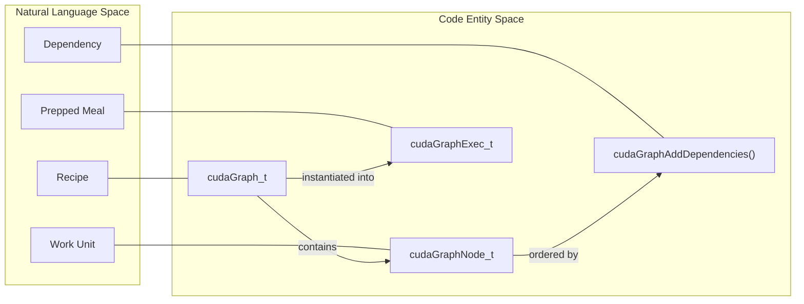
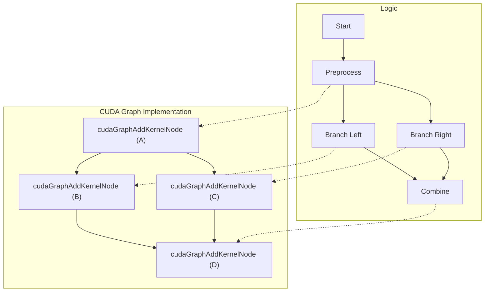

<!-- source: DeepWiki mcp.deepwiki.com · repo NVIDIA/dl-cuda-graph-doc · page 2.1 The Launch Overhead Problem and CUDA Graph Solution · fetched 2026-10-26 -->

# The Launch Overhead Problem and CUDA Graph Solution

Relevant source files

The following files were used as context for generating this wiki page:

- [docs/cuda-graph-basics/cuda-graph.md](docs/cuda-graph-basics/cuda-graph.md)
- [docs/cuda-graph-basics/introduction.md](docs/cuda-graph-basics/introduction.md)

This page details the technical challenges of the CPU-GPU producer-consumer bottleneck in deep learning and explains how CUDA Graphs provide a structural solution to these inefficiencies. It covers the specific phases of kernel launch overhead and the define-instantiate-execute lifecycle used to mitigate them.

## The Producer-Consumer Bottleneck

In modern deep learning applications, the CPU and GPU operate in a producer-consumer relationship [docs/cuda-graph-basics/introduction.md:21-23](). The CPU acts as the orchestrator, dispatching operations, while the GPU driver queues these operations for hardware execution.

As GPU compute power has grown exponentially, the performance gap between CPU orchestration and GPU execution has widened [docs/cuda-graph-basics/introduction.md:21-23](). When a GPU executes a kernel in microseconds, the CPU can become the bottleneck if it cannot prepare the next operation fast enough. This leads to GPU underutilization, where the hardware sits idle waiting for the next command [docs/cuda-graph-basics/introduction.md:23-24]().

### Sources of Launch Overhead

Every time a framework like PyTorch executes a CUDA operation (e.g., `torch.matmul()`), it incurs a cumulative overhead across four primary layers:

| Layer | Duration (Typical) | Key Operations |
| :--- | :--- | :--- |
| **1. Language Transitions** | 10-100 μs | Python/C++ boundary crossing, GIL acquisition, object marshalling [docs/cuda-graph-basics/introduction.md:31-35](). |
| **2. Runtime Processing** | 5-20 μs | Operator dispatch logic, workspace memory preparation, library transitions (cuDNN/cuBLAS) [docs/cuda-graph-basics/introduction.md:37-43](). |
| **3. Driver Operations** | 5-15 μs | Parameter validation, command buffer management, submission to hardware queue [docs/cuda-graph-basics/introduction.md:45-49](). |
| **4. Hardware Submission** | 1-5 μs | PCIe communication, GPU command processor ingestion, hardware scheduling [docs/cuda-graph-basics/introduction.md:51-55](). |

**Sources:** [docs/cuda-graph-basics/introduction.md:29-60]()

## The CUDA Graph Solution

CUDA Graph addresses the launch overhead problem by allowing developers to define a workflow of multiple operations and their dependencies once, then launch the entire sequence as a single unit [docs/cuda-graph-basics/cuda-graph.md:17-18]().

### The Define-Instantiate-Execute Lifecycle

CUDA Graphs move the heavy lifting of kernel preparation from the hot path (execution) to an upfront setup phase.

1.  **Definition**: The user describes the operations (nodes) and their execution order (edges). This creates a Directed Acyclic Graph (DAG) [docs/cuda-graph-basics/cuda-graph.md:38-38]().
2.  **Instantiation**: The CUDA runtime validates the graph, pre-allocates resources, and builds optimized launch descriptors. This "bakes" the graph into an executable form (`cudaGraphExec_t`) [docs/cuda-graph-basics/cuda-graph.md:39-40]().
3.  **Execution**: The prepared graph is launched via a single CPU call (e.g., `cudaGraphLaunch`). The GPU driver handles the entire sequence without further CPU intervention [docs/cuda-graph-basics/cuda-graph.md:40-40]().

### Mapping Concepts to Code Entities

The following diagram bridges the conceptual "recipe" of a CUDA Graph to the actual CUDA C++ API entities used to implement them.

**Diagram: CUDA Graph API Entity Mapping**

**Sources:** [docs/cuda-graph-basics/cuda-graph.md:38-40](), [docs/cuda-graph-basics/cuda-graph.md:107-134]()

## Graph Structure: Nodes and Edges

A CUDA Graph is a Directed Acyclic Graph (DAG) representing the execution flow of GPU operations [docs/cuda-graph-basics/cuda-graph.md:44-44]().

### Nodes (Work Units)
Nodes encapsulate specific operations. Once a graph is instantiated, nodes are immutable, though some parameters like memory addresses can be updated via specialized APIs [docs/cuda-graph-basics/cuda-graph.md:56-56]().
*   **Kernel Nodes**: Computational work (e.g., matrix multiplication) [docs/cuda-graph-basics/cuda-graph.md:50-50]().
*   **Memory Nodes**: Copies (H2D, D2H, D2D) or memory management (alloc/free) [docs/cuda-graph-basics/cuda-graph.md:51-52]().
*   **Host Nodes**: CPU-side functions triggered during graph execution [docs/cuda-graph-basics/cuda-graph.md:53-53]().
*   **Empty Nodes**: Used for synchronization and grouping dependencies [docs/cuda-graph-basics/cuda-graph.md:54-54]().

### Edges (Dependencies)
Edges define the execution order [docs/cuda-graph-basics/cuda-graph.md:58-58]().
*   **Sequential**: Node B follows Node A [docs/cuda-graph-basics/cuda-graph.md:62-62]().
*   **Parallel**: Independent nodes (B and C) can run simultaneously if GPU resources allow [docs/cuda-graph-basics/cuda-graph.md:63-63]().

**Diagram: Logical Flow to Node Dependencies**

**Sources:** [docs/cuda-graph-basics/cuda-graph.md:72-87](), [docs/cuda-graph-basics/cuda-graph.md:119-130]()

## Implementation: Explicit Construction

In the explicit construction method, the developer manually manages the graph object and its components. This provides the highest level of control but requires significant low-level management.

| Function | Purpose |
| :--- | :--- |
| `cudaGraphCreate()` | Initializes a new `cudaGraph_t` object [docs/cuda-graph-basics/cuda-graph.md:109-109](). |
| `cudaGraphAddKernelNode()` | Adds a computation node with specific `cudaKernelNodeParams` [docs/cuda-graph-basics/cuda-graph.md:120-121](). |
| `cudaGraphAddDependencies()` | Connects nodes to define the execution DAG [docs/cuda-graph-basics/cuda-graph.md:129-130](). |
| `cudaGraphInstantiate()` | Compiles the `cudaGraph_t` into a runnable `cudaGraphExec_t` [docs/cuda-graph-basics/cuda-graph.md:134-134](). |
| `cudaGraphLaunch()` | Submits the entire instantiated graph to a `cudaStream_t` [docs/cuda-graph-basics/cuda-graph.md:138-138](). |

**Sources:** [docs/cuda-graph-basics/cuda-graph.md:107-140]()

---

