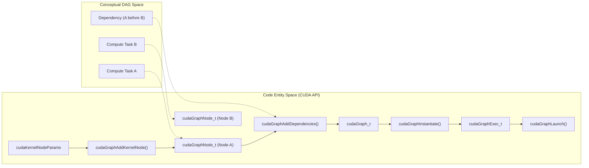
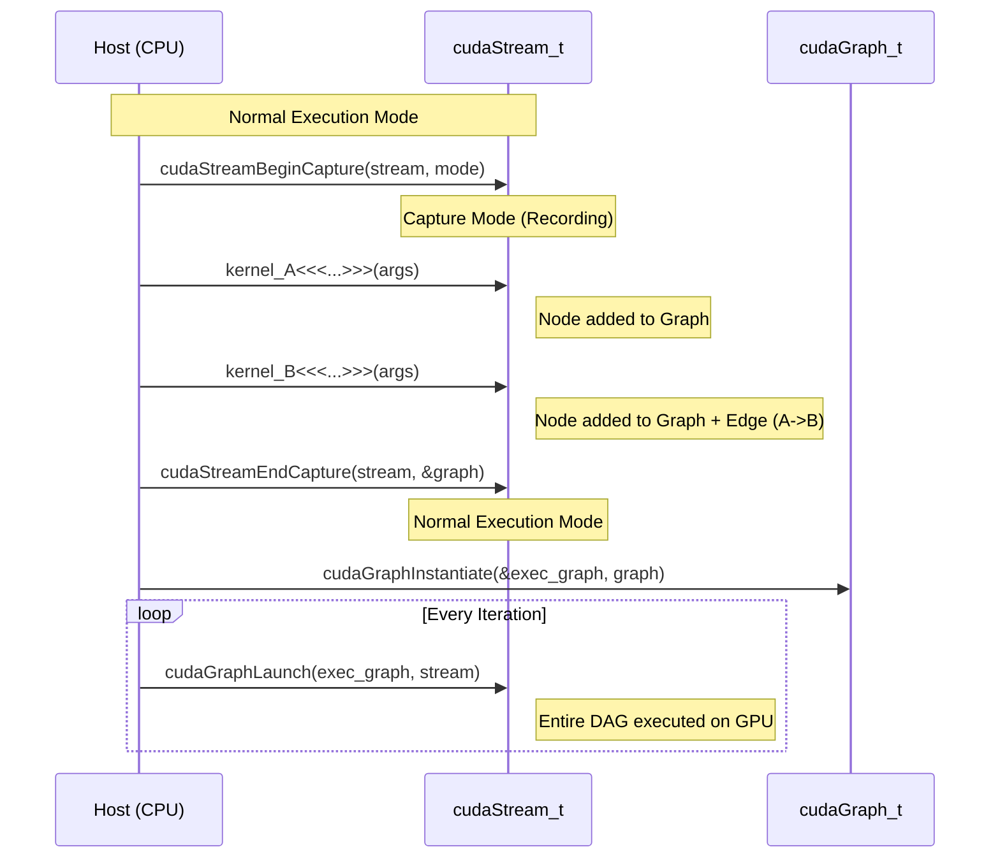

<!-- source: DeepWiki mcp.deepwiki.com · repo NVIDIA/dl-cuda-graph-doc · page 2.2 CUDA Graph Structure: Nodes, Edges, and Creation Methods · fetched 2026-10-26 -->

# CUDA Graph Structure: Nodes, Edges, and Creation Methods

Relevant source files

The following files were used as context for generating this wiki page:

- [docs/cuda-graph-basics/cuda-graph.md](docs/cuda-graph-basics/cuda-graph.md)

This page details the technical architecture of CUDA Graphs, focusing on the Directed Acyclic Graph (DAG) model, the specific types of operations (nodes) supported, and the mechanisms for defining dependencies (edges). It also compares the two primary methods of graph creation: explicit construction and stream capture.

## The DAG Model

A CUDA Graph is represented as a Directed Acyclic Graph (DAG) [docs/cuda-graph-basics/cuda-graph.md:42-44](). This model allows the CUDA runtime to understand the entire workflow upfront, enabling optimizations that are impossible in the traditional stream-based "fire-and-forget" model.

### Nodes: The Units of Work
Nodes represent the functional units of a graph. Each node encapsulates a specific GPU or synchronization operation [docs/cuda-graph-basics/cuda-graph.md:46-48]().

| Node Type | Description |
| :--- | :--- |
| **Kernel Nodes** | Represent computational work such as matrix multiplications or convolutions [docs/cuda-graph-basics/cuda-graph.md:50-50](). |
| **Memory Nodes** | Handle data movement (Host-to-Device, Device-to-Device) and memory management (allocation/freeing) [docs/cuda-graph-basics/cuda-graph.md:51-52](). |
| **Host Nodes** | CPU-side functions triggered during graph execution, synchronized with the GPU workflow [docs/cuda-graph-basics/cuda-graph.md:53-53](). |
| **Empty Nodes** | Contain no work; used as logical synchronization points to simplify complex dependency structures [docs/cuda-graph-basics/cuda-graph.md:54-54](). |
| **Child Graph Nodes** | Allow nesting of graphs, enabling modular graph design. |

Nodes are immutable once the graph is instantiated; while certain parameters like memory addresses can be updated via specialized APIs, the operation type itself cannot change [docs/cuda-graph-basics/cuda-graph.md:56-56]().

### Edges: The Dependency Logic
Edges define the execution constraints between nodes [docs/cuda-graph-basics/cuda-graph.md:58-58](). An edge from Node A to Node B ensures that Node B does not begin execution until Node A has completed.

*   **Sequential Dependencies**: Create a strict linear order (e.g., Forward Pass $\rightarrow$ Backward Pass) [docs/cuda-graph-basics/cuda-graph.md:61-61]().
*   **Parallel Opportunities**: Nodes with no mutual dependencies can be scheduled concurrently by the hardware (e.g., parallel branches in a multi-head attention layer) [docs/cuda-graph-basics/cuda-graph.md:62-62]().
*   **Fork-Join Model**: A single node can have multiple outgoing edges (fork) or multiple incoming edges (join/synchronization point) [docs/cuda-graph-basics/cuda-graph.md:63-64]().

**Sources:** [docs/cuda-graph-basics/cuda-graph.md:42-66]()

---

## Creation Methods

There are two primary ways to generate a `cudaGraph_t` object: Explicit Construction and Stream Capture.

### 1. Explicit Graph Construction
This method involves manually calling CUDA Driver or Runtime APIs to add nodes and define dependencies. It provides the highest level of control but requires significant boilerplate code.

**Key API Entities:**
*   `cudaGraphCreate`: Initializes the graph object [docs/cuda-graph-basics/cuda-graph.md:109-109]().
*   `cudaGraphAddKernelNode`: Adds a compute kernel with specific `cudaKernelNodeParams` [docs/cuda-graph-basics/cuda-graph.md:120-121]().
*   `cudaGraphAddDependencies`: Manually links nodes to form edges [docs/cuda-graph-basics/cuda-graph.md:129-130]().

**Implementation Flow:**
1.  Define kernel parameters (grid/block dimensions, function pointers).
2.  Add nodes to the graph.
3.  Define edges.
4.  Instantiate via `cudaGraphInstantiate` [docs/cuda-graph-basics/cuda-graph.md:134-134]().

**Sources:** [docs/cuda-graph-basics/cuda-graph.md:93-140]()

### 2. Stream Capture
Stream capture is the preferred method for most deep learning applications because it allows developers to "record" existing stream-based code without major refactoring.

**How it works:**
The user initiates capture on a specific CUDA stream using `cudaStreamBeginCapture`. All subsequent work launched into that stream (and its joined branches) is redirected into a graph instead of being executed immediately [docs/cuda-graph-basics/cuda-graph.md:166-172]().

**The Fork-Join Model in Capture:**
Capture handles complex dependencies via the stream's natural synchronization primitives:
*   **Fork**: Launching kernels into different streams that were branched from the capturing stream.
*   **Join**: Using `cudaEventRecord` and `cudaStreamWaitEvent` to merge parallel work back into the capturing stream [docs/cuda-graph-basics/cuda-graph.md:175-177]().

**Sources:** [docs/cuda-graph-basics/cuda-graph.md:156-177]()

---

## Visualizing Graph Lifecycle and Entities

The following diagrams illustrate how the conceptual DAG relates to specific CUDA API entities and the lifecycle of a graph from definition to execution.

### Diagram 1: Conceptual DAG to Code Entity Mapping
This diagram maps the components of a CUDA Graph to the specific C++ structures and functions used in the `cuda-graph-basics` examples.

**Sources:** [docs/cuda-graph-basics/cuda-graph.md:107-140]()

### Diagram 2: Stream Capture Lifecycle
This diagram shows the state transition of a CUDA Stream during the capture process, highlighting the functions that manage the "Recording" phase.

**Sources:** [docs/cuda-graph-basics/cuda-graph.md:166-174](), [docs/cuda-graph-basics/cuda-graph.md:36-40]()

---

## Comparison: Explicit vs. Capture

| Feature | Explicit Construction | Stream Capture |
| :--- | :--- | :--- |
| **Ease of Use** | Low (Verbose) | High (Wraps existing code) |
| **Control** | Absolute control over every node/edge | Limited to what is launched in stream |
| **Flexibility** | High (Can build non-linear logic easily) | Moderate (Requires events for fork/join) |
| **Maintenance** | High (API changes require code updates) | Low (Captures logic automatically) |
| **Use Case** | Custom library primitives, dynamic graphs | DL Frameworks (PyTorch, TensorFlow) |

**Sources:** [docs/cuda-graph-basics/cuda-graph.md:142-154](), [docs/cuda-graph-basics/cuda-graph.md:179-188]()

---

