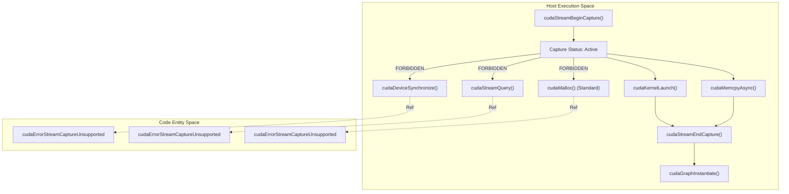
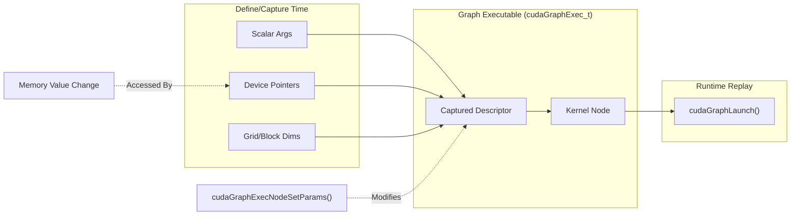

<!-- source: DeepWiki mcp.deepwiki.com · repo NVIDIA/dl-cuda-graph-doc · page 2.3 CUDA Graph Constraints · fetched 2026-10-26 -->

# CUDA Graph Constraints

Relevant source files

The following files were used as context for generating this wiki page:

- [docs/cuda-graph-basics/constraints.md](docs/cuda-graph-basics/constraints.md)

This page documents the fundamental runtime constraints imposed by the CUDA driver and runtime on CUDA Graphs. Understanding these limitations is essential for determining workload suitability and ensuring correct implementation during the define-instantiate-execute lifecycle.

## 1. Asynchronous Restrictions

CUDA Graphs are built upon an asynchronous execution model where the CPU submits work to the GPU and continues without waiting. This model prohibits any operations that would force immediate coordination between the host and device during the capture phase.

### No Host-Device Synchronization
Operations that synchronize the CPU with the GPU are strictly prohibited during stream capture [docs/cuda-graph-basics/constraints.md:19-21](). Prohibited operations include:
*   `cudaDeviceSynchronize()`: Blocks the CPU until all device work completes [docs/cuda-graph-basics/constraints.md:23-23]().
*   `cudaStreamSynchronize()`: Forbidden on the capturing stream as it blocks the CPU until the stream completes [docs/cuda-graph-basics/constraints.md:24-24]().
*   `cudaEventSynchronize()`: Blocks the CPU until a specific event is signaled [docs/cuda-graph-basics/constraints.md:25-25]().
*   **Synchronous Memory Operations**: Any `cudaMemcpy` call without the `Async` suffix is prohibited because the driver cannot record operations requiring immediate CPU-GPU coordination [docs/cuda-graph-basics/constraints.md:26-28]().

### No Default Stream
Graph capture must occur on a non-default stream [docs/cuda-graph-basics/constraints.md:30-32](). The default stream (stream 0) possesses special semantics and implicit synchronization behavior that conflict with the requirements of the capture process.

### No Stream/Event Query Operations
Querying the runtime state is incompatible with graph capture. Developers cannot use `cudaStreamQuery()` or `cudaEventQuery()` during capture because these operations require inspecting active runtime state rather than recording a command [docs/cuda-graph-basics/constraints.md:34-41]().

---
**Sources:** [docs/cuda-graph-basics/constraints.md:15-42]()

## 2. Static Topology and Parameters

A CUDA Graph represents a fixed execution plan. Once a graph is instantiated, its internal structure and most of its launch parameters are frozen.

### Static Graph Topology
The graph records a fixed set of nodes and dependency edges [docs/cuda-graph-basics/constraints.md:43-45](). 
*   **Data-Dependent Branching**: Control flow decisions based on values computed during execution (e.g., `if (value > threshold) launch_kernel_a()`) are prohibited [docs/cuda-graph-basics/constraints.md:52-61]().
*   **Variable Loops**: Loop counts determined by GPU computation results cannot be captured [docs/cuda-graph-basics/constraints.md:63-63]().
*   **Conditional Nodes (CUDA 12.3+)**: While `cudaGraphConditionalHandle` allows GPU-side branching, the topology remains static—all possible execution paths must be defined at capture time [docs/cuda-graph-basics/constraints.md:47-50]().

### Static Parameters and Shapes
By default, the graph captures exact pointers and kernel descriptors at definition time [docs/cuda-graph-basics/constraints.md:68-70]().
*   **Memory Addresses**: Every graph launch reads from and writes to the same virtual memory addresses used during capture [docs/cuda-graph-basics/constraints.md:72-74]().
*   **Kernel Configurations**: Grid dimensions, block dimensions, and shared memory sizes are stored in the launch descriptor and cannot be changed between launches without using Graph Update APIs (`cudaGraphExecNodeSetParams`) [docs/cuda-graph-basics/constraints.md:78-80]().
*   **Static Shapes**: Data shapes must remain constant. Changing shapes typically violates multiple constraints: it alters kernel configurations, memory access patterns, and often requires new memory allocations [docs/cuda-graph-basics/constraints.md:87-96]().

| Constraint Type | Description | Workaround |
| :--- | :--- | :--- |
| **Topology** | Nodes and edges are fixed. | Use Conditional Nodes (CUDA 12.3+) or multiple graphs. |
| **Memory** | Virtual addresses are captured. | Update values at fixed addresses or use Graph Update APIs. |
| **Kernels** | Arguments and grid dims are frozen. | Pass data via device memory instead of scalar arguments. |

---
**Sources:** [docs/cuda-graph-basics/constraints.md:43-98]()

## 3. Capture Scope and Execution Rules

The capture process is strictly bounded by the stream state and the environment in which the capture is initiated.

### Self-Contained Stream Capture
A graph capture must be self-contained within the stream(s) involved.
*   **Fork-Join Model**: Capture can involve multiple streams via `cudaStreamWaitEvent`, but all work must eventually join back to the primary capturing stream before `cudaStreamEndCapture` is called [docs/cuda-graph-basics/constraints.md:104-106]().
*   **Unjoined Work**: If work is launched on a forked stream but not joined back to the capturing stream, the capture will fail [docs/cuda-graph-basics/constraints.md:108-110]().

### CPU Code Exclusion
Only GPU operations are recorded. Any CPU-side logic (calculations, logging, or print statements) executed during the capture phase is executed **once** during capture and is **not** part of the recorded graph [docs/cuda-graph-basics/constraints.md:112-117]().

### Multi-threading Constraints
Graph capture is thread-local. A stream can only be in capture mode in one thread at a time [docs/cuda-graph-basics/constraints.md:119-121]().
*   **Global Capture**: `cudaStreamBeginCapture` with `cudaStreamCaptureModeGlobal` fails if any other thread in the process is capturing [docs/cuda-graph-basics/constraints.md:123-125]().
*   **Thread Local Capture**: `cudaStreamCaptureModeThreadLocal` allows concurrent captures across different threads, provided they use different streams [docs/cuda-graph-basics/constraints.md:127-129]().

---
**Sources:** [docs/cuda-graph-basics/constraints.md:100-131]()

## 4. Memory Management and Lifetimes

Memory operations within graphs are subject to strict lifecycle rules to prevent use-after-free errors or invalid pointer references.

### Memory API Restrictions
Standard `cudaMalloc` and `cudaFree` are prohibited during capture unless using **Stream Capture with Memory Pools** (CUDA 11.4+) [docs/cuda-graph-basics/constraints.md:135-137]().
*   **Traditional Capture**: Allocations must occur before capture begins [docs/cuda-graph-basics/constraints.md:139-140]().
*   **Relaxed Capture**: `cudaMallocAsync` and `cudaFreeAsync` can be captured into nodes, but the resulting addresses are managed by the CUDA driver's internal graph memory pool [docs/cuda-graph-basics/constraints.md:142-144]().

### Lifetime Requirements
All memory addresses referenced by a graph must remain valid for the entire lifetime of the `cudaGraphExec_t` (the executable graph) [docs/cuda-graph-basics/constraints.md:148-150](). Freeing a buffer that is used by an instantiated graph and then launching that graph results in undefined behavior (usually a device-side illegal memory access) [docs/cuda-graph-basics/constraints.md:152-154]().

### Multi-Device Considerations
A single CUDA Graph is associated with a specific GPU device. While a graph can contain nodes that execute on different devices (using `cudaSetDevice` during capture), the management of peer-to-peer access and memory visibility must be handled explicitly [docs/cuda-graph-basics/constraints.md:158-164]().

---
**Sources:** [docs/cuda-graph-basics/constraints.md:133-164]()

## 5. System Mapping: Constraints to Code Entities

The following diagrams illustrate how the conceptual constraints described above map to specific CUDA API functions and runtime behaviors.

### Diagram: Capture State and Forbidden Operations
This diagram shows how the `cudaStreamCaptureStatus` transition restricts the use of specific API calls.

**Sources:** [docs/cuda-graph-basics/constraints.md:19-41](), [docs/cuda-graph-basics/constraints.md:135-137]()

### Diagram: Parameter Persistence vs. Updates
This diagram illustrates the data flow for kernel parameters and the role of Graph Update APIs in bypassing static constraints.

**Sources:** [docs/cuda-graph-basics/constraints.md:68-85]()

---

