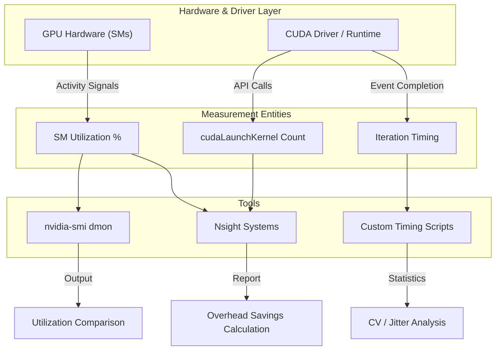
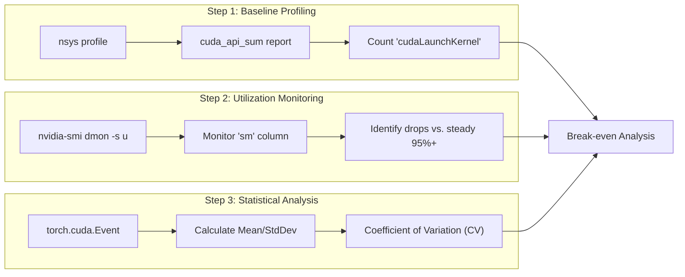

<!-- source: DeepWiki mcp.deepwiki.com · repo NVIDIA/dl-cuda-graph-doc · page 2.4 Quantitative Benefits and Measurement · fetched 2026-10-26 -->

# Quantitative Benefits and Measurement

<details>
<summary>Relevant source files</summary>

The following files were used as context for generating this wiki page:

- [docs/cuda-graph-basics/quantitative-benefits.md](docs/cuda-graph-basics/quantitative-benefits.md)

</details>


This section provides practical methods to quantify the performance advantages of CUDA Graphs within an application. Measuring these benefits involves analyzing GPU utilization, calculating kernel launch overhead reduction, and assessing improvements in timing consistency (jitter).

## Common CUDA Graph Benefits

CUDA Graphs provide three primary quantifiable performance improvements:

1.  **Higher GPU Utilization**: By eliminating the CPU-side launch bottleneck, the GPU spends more time executing kernels and less time idling. This is critical when the CPU cannot queue work fast enough to keep the GPU pipeline full [docs/cuda-graph-basics/quantitative-benefits.md:17-20]().
2.  **Reduced Kernel Launch Overhead**: Graphs reduce driver-side and hardware-side overhead by submitting an entire sequence of operations as a single unit. This bypasses per-kernel command buffer management and hardware scheduling logic [docs/cuda-graph-basics/quantitative-benefits.md:21-24]().
3.  **Improved Timing Consistency (Less Jitter)**: Graphs provide deterministic execution. This reduces **Run-to-run jitter** (variation in a single process) and **Rank-to-rank jitter** (variation across multiple GPUs in distributed training), which helps prevent "stragglers" from slowing down collective operations [docs/cuda-graph-basics/quantitative-benefits.md:25-31]().

## Measuring GPU Utilization

Monitoring SM (Streaming Multiprocessor) utilization is the most direct way to observe the efficiency gains from CUDA Graphs.

### Using nvidia-smi
The `nvidia-smi dmon` command monitors SM utilization in real-time [docs/cuda-graph-basics/quantitative-benefits.md:36-40]().

```bash
nvidia-smi dmon -s u
```

| Execution Mode | Typical SM Utilization | Observation |
| :--- | :--- | :--- |
| **Without Graphs** | 50% - 80% | Periodic drops; GPU frequently waits for CPU to launch the next kernel [docs/cuda-graph-basics/quantitative-benefits.md:44-45](). |
| **With Graphs** | 90% - 100% | Consistent and high; GPU has a continuous stream of pre-queued work [docs/cuda-graph-basics/quantitative-benefits.md:45-46](). |

### Using Nsight Systems
For a visual representation, Nsight Systems can show GPU active periods. Using the flag `--gpu-metrics-devices=all` includes `SMs Active` metrics in the timeline to visualize GPU saturation over time [docs/cuda-graph-basics/quantitative-benefits.md:72-73]().

**Sources:** [docs/cuda-graph-basics/quantitative-benefits.md:34-75]()

## Estimating Kernel Launch Overhead Reduction

To quantify the overhead saved, you must count the individual kernel launches that are replaced by a single graph launch.

### Measurement Workflow
1.  **Profile the Baseline**: Run the application through Nsight Systems: `nsys profile -o baseline python script.py` [docs/cuda-graph-basics/quantitative-benefits.md:81-83]().
2.  **Analyze API Stats**: Generate a summary report: `nsys stats --report cuda_api_sum baseline.nsys-rep` [docs/cuda-graph-basics/quantitative-benefits.md:87-89]().
3.  **Count Launches**: Identify the number of `cudaLaunchKernel` or `cudaLaunchKernelExC` calls per iteration [docs/cuda-graph-basics/quantitative-benefits.md:95-96]().

### Calculation Logic
The total savings can be estimated using the following formula [docs/cuda-graph-basics/quantitative-benefits.md:93-98]():

$$\text{Total Savings} = \text{Number of Kernels} \times \text{Overhead per Kernel}$$

*   **Estimated Overhead**: Typically **1-5 μs** per kernel for driver and hardware processing [docs/cuda-graph-basics/quantitative-benefits.md:96-97]().
*   **Significance**: In models with thousands of small kernels (e.g., Transformers without fusion), this overhead can exceed the actual GPU execution time.

**Sources:** [docs/cuda-graph-basics/quantitative-benefits.md:77-103]()

## Measuring Jitter Reduction

Jitter is the variation in execution time. CUDA Graphs reduce this by bypassing the dynamic dispatch path of the CUDA driver.

### Run-to-Run Jitter (Single GPU)
Measure the **Coefficient of Variation (CV)** over ~100 iterations ($CV = \frac{\sigma}{\mu}$) [docs/cuda-graph-basics/quantitative-benefits.md:108-110]().
*   **Without Graphs**: CV is typically **3-10%** due to CPU scheduling and driver state [docs/cuda-graph-basics/quantitative-benefits.md:112-113]().
*   **With Graphs**: CV is typically **<1-2%** [docs/cuda-graph-basics/quantitative-benefits.md:113-114]().

### Rank-to-Rank Jitter (Multi-GPU)
In distributed environments, different ranks experience different CPU overheads.
*   **Without Graphs**: Variation between ranks is often **5-20%** [docs/cuda-graph-basics/quantitative-benefits.md:125-126]().
*   **With Graphs**: Variation drops to **<2%** as all ranks execute pre-compiled graphs with minimal CPU interaction [docs/cuda-graph-basics/quantitative-benefits.md:126-127]().

**Sources:** [docs/cuda-graph-basics/quantitative-benefits.md:104-127]()

## Measurement Data Flow and Tooling

The following diagram illustrates how performance data flows from the hardware and driver levels to the measurement tools used for quantification.

### Performance Data Flow

**Sources:** [docs/cuda-graph-basics/quantitative-benefits.md:36-40](), [docs/cuda-graph-basics/quantitative-benefits.md:87-91](), [docs/cuda-graph-basics/quantitative-benefits.md:108-110]()

## Profiling and Analysis Process

This diagram maps the natural language steps of performance analysis to the specific code-level entities and CLI tools provided by NVIDIA.

### Profiling to Quantification Mapping

**Sources:** [docs/cuda-graph-basics/quantitative-benefits.md:38-39](), [docs/cuda-graph-basics/quantitative-benefits.md:81-89](), [docs/cuda-graph-basics/quantitative-benefits.md:110-111]()

---

