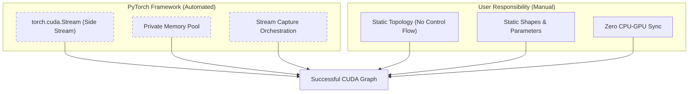
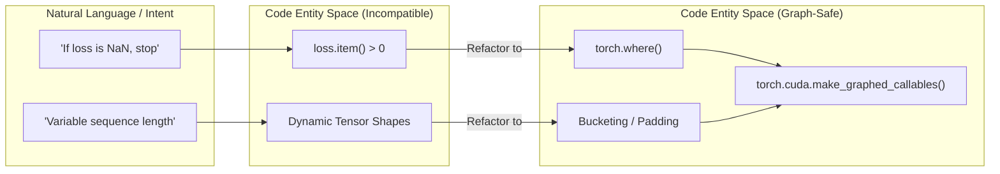

<!-- source: DeepWiki mcp.deepwiki.com · repo NVIDIA/dl-cuda-graph-doc · page 3 PyTorch CUDA Graph Integration · fetched 2026-10-26 -->

# PyTorch CUDA Graph Integration

Relevant source files

The following files were used as context for generating this wiki page:

- [docs/torch-cuda-graph/introduction.md](docs/torch-cuda-graph/introduction.md)
- [docs/torch-cuda-graph/torch-integration.md](docs/torch-cuda-graph/torch-integration.md)

This section provides a high-level overview of how PyTorch bridges its dynamic, eager-execution design with the static requirements of CUDA Graphs. While PyTorch is optimized for flexibility and research, CUDA Graphs prioritize maximum performance by eliminating kernel launch overhead and enabling full asynchrony.

## Design Philosophy

The integration of CUDA Graphs into PyTorch is built on a "opt-in" performance model. Because PyTorch typically uses a dynamic computation graph, the framework provides specialized APIs that allow users to freeze specific sections of their workload into a static `cudaGraph_t` for repeated execution.

### Key Integration Principles
*   **Stream Capture Only**: PyTorch exclusively uses the stream capture method to create graphs, avoiding manual node-by-node construction [docs/torch-cuda-graph/torch-integration.md:27-29]().
*   **Memory Pool Isolation**: To prevent the PyTorch caching allocator from corrupting graph-managed memory, PyTorch uses a private memory pool for CUDA Graph allocations [docs/torch-cuda-graph/torch-integration.md:58-58]().
*   **Minimal API Surface**: PyTorch does not expose graph update APIs; if parameters like tensor shapes change, the graph must be recaptured [docs/torch-cuda-graph/torch-integration.md:30-31]().

### Responsibility Bridge
The following diagram illustrates how responsibilities are divided between the PyTorch framework and the developer to ensure a successful graph capture.

**Diagram: Responsibility Mapping**

Sources: [docs/torch-cuda-graph/torch-integration.md:52-85]()

---

## PyTorch CUDA Graph APIs

PyTorch offers three distinct levels of API for interacting with CUDA Graphs, ranging from low-level handles to high-level wrappers that support autograd.

*   **`torch.cuda.CUDAGraph`**: A low-level class that wraps the underlying CUDA types (`cudaGraph_t` and `cudaGraphExec_t`) [docs/torch-cuda-graph/torch-integration.md:37-37]().
*   **`torch.cuda.graph()`**: A context manager used for manual stream capture. It manages side streams and capture states [docs/torch-cuda-graph/torch-integration.md:38-38]().
*   **`torch.cuda.make_graphed_callables()`**: The highest-level API. It is designed for modules and functions, handling warmup iterations and separately capturing forward and backward passes for autograd compatibility [docs/torch-cuda-graph/torch-integration.md:43-43]().

For detailed API usage, warmup requirements, and RNG management, see **[PyTorch CUDA Graph APIs](#3.1)**.

---

## Automatic and Framework-Specific Integrations

Beyond manual APIs, PyTorch and NVIDIA provide tools to automate graph capture for complex models and distributed training.

### Automatic Capture with `torch.compile`
The `torch.compile` feature includes a `reduce-overhead` mode that uses "CUDAGraph Trees." This system automatically partitions models into graphed segments and manages a shared memory pool to handle multiple execution paths without manual intervention.
For details, see **[Automatic CUDA Graphs with torch.compile](#3.2)**.

### Large-Scale Distributed Training
Frameworks like **Transformer Engine (TE)** and **Megatron-LM** provide specialized managers to handle the complexities of FP8 dynamic scaling and pipeline parallelism.
*   **Megatron-LM**: Uses `CudaGraphManager` for per-layer graphing and `FullCudaGraphWrapper` for capturing entire iterations [docs/torch-cuda-graph/introduction.md:31-31]().
*   **Transformer Engine**: Extends `make_graphed_callables` to support FP8 weight caching and GPU-controlled no-ops [docs/torch-cuda-graph/introduction.md:27-28]().

For details, see **[Transformer Engine and Megatron-LM CUDA Graph Support](#3.3)**.

---

## Developer Guides: Writing Compatible Code

To use CUDA Graphs effectively, PyTorch code must be "graph-safe." This involves two primary efforts: eliminating synchronizations and managing dynamic behaviors.

### Sync-Free Code and Dynamic Patterns
CUDA Graphs cannot capture operations that require CPU-GPU synchronization (e.g., `.item()`, `.tolist()`, or print statements). Furthermore, any dynamic control flow (Python `if/else`) or dynamic shapes must be converted into static equivalents or handled via workarounds like `torch.where()`.

**Diagram: Code Transformation Space**

Sources: [docs/torch-cuda-graph/introduction.md:41-53](), [docs/torch-cuda-graph/torch-integration.md:62-70]()

*   For identifying and removing hidden syncs, see **[Writing Sync-Free Code](#3.4)**.
*   For techniques to handle dynamic shapes and control flow, see **[Handling Dynamic Patterns](#3.5)**.
*   For a systematic adoption strategy and pre-capture checklist, see **[Best Practices and Quick Checklist](#3.6)**.

---

