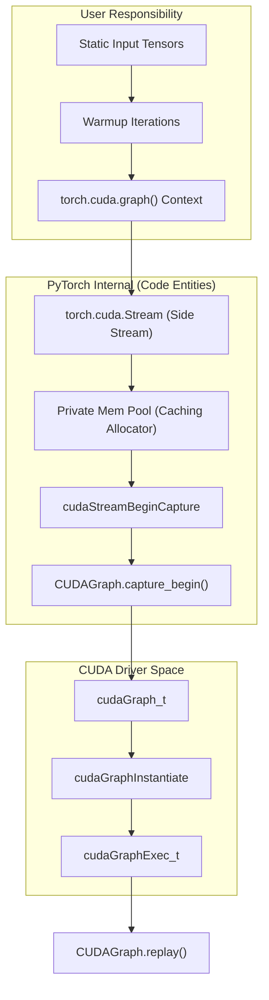
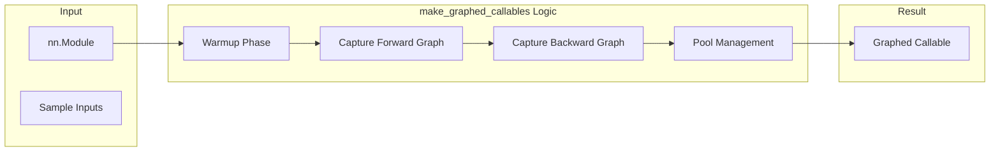

<!-- source: DeepWiki mcp.deepwiki.com · repo NVIDIA/dl-cuda-graph-doc · page 3.1 PyTorch CUDA Graph APIs · fetched 2026-10-26 -->

# PyTorch CUDA Graph APIs

Relevant source files

The following files were used as context for generating this wiki page:

- [docs/torch-cuda-graph/torch-integration.md](docs/torch-cuda-graph/torch-integration.md)

This page provides a technical deep dive into the three primary APIs PyTorch provides for CUDA Graph integration. It details the division of responsibility between the framework and the user, the mandatory execution requirements like warmups, and the specialized management of RNG states and memory caches.

## API Overview and Design Philosophy

PyTorch integrates CUDA Graphs by bridging its dynamic, eager-execution nature with the static requirements of CUDA Graphs. The integration is built on three core principles:
1.  **Stream capture only**: PyTorch exclusively uses stream capture (wrapping `cudaStreamBeginCapture`/`cudaStreamEndCapture`) rather than explicit node-by-node graph construction [docs/torch-cuda-graph/torch-integration.md:27-29]().
2.  **No graph updates**: The framework does not expose CUDA's graph update APIs. If parameters or topology change, the graph must be recaptured [docs/torch-cuda-graph/torch-integration.md:30-30]().
3.  **Memory Pool Isolation**: PyTorch uses a private memory pool for CUDA Graph allocations to prevent the caching allocator from reusing addresses that must remain static for the graph's lifetime [docs/torch-cuda-graph/torch-integration.md:58-58]().

### The Three PyTorch APIs

| API | Level | Primary Use Case |
|:---|:---|:---|
| `torch.cuda.CUDAGraph` | Low-level | A Python class wrapping `cudaGraph_t` and `cudaGraphExec_t`. Used for direct replay control [docs/torch-cuda-graph/torch-integration.md:37-37](). |
| `torch.cuda.graph()` | Mid-level | A context manager that orchestrates stream capture and side-stream management [docs/torch-cuda-graph/torch-integration.md:38-38](). |
| `torch.cuda.make_graphed_callables()` | High-level | An autograd-aware wrapper that handles forward/backward passes and memory pool sharing [docs/torch-cuda-graph/torch-integration.md:43-43](). |

---

## Responsibility Sharing

While PyTorch automates the boilerplate of CUDA stream management, the user remains responsible for the integrity of the captured code.

### Mapping Framework Responsibility to Code Entities

The following diagram illustrates how PyTorch's internal entities manage the transition from Eager Space to Graph Space.

**Title: PyTorch CUDA Graph Orchestration Flow**

Sources: [docs/torch-cuda-graph/torch-integration.md:54-60](), [docs/torch-cuda-graph/torch-integration.md:91-107]()

### Responsibility Matrix

| Constraint | PyTorch Handles | User Responsible For |
|:---|:---|:---|
| **Stream Management** | Side stream setup and `wait_stream` [docs/torch-cuda-graph/torch-integration.md:56-57]() | Ensuring no external stream dependencies [docs/torch-cuda-graph/torch-integration.md:67-67]() |
| **Memory Addresses** | Internal allocations via private pool [docs/torch-cuda-graph/torch-integration.md:58-58]() | Fixed graph inputs; use `.copy_()` for data updates [docs/torch-cuda-graph/torch-integration.md:81-81]() |
| **Synchronization** | N/A | Eliminating CPU-GPU syncs (e.g., `.item()`, `.cpu()`) [docs/torch-cuda-graph/torch-integration.md:64-64]() |
| **Topology** | N/A | Ensuring a deterministic execution path [docs/torch-cuda-graph/torch-integration.md:65-65]() |

---

## Mandatory Requirements for Successful Capture

### 1. Warmup Iterations
Before capturing a graph, the workload must be run several times (typically 2-3 iterations) on the capture stream [docs/torch-cuda-graph/torch-integration.md:99-103](). This "warms up" the PyTorch caching allocator and internal frameworks (like cuDNN or MKLDNN), ensuring that memory addresses and internal state stabilize before they are "baked" into the graph [docs/torch-cuda-graph/torch-integration.md:102-103]().

### 2. RNG State Management
PyTorch's Random Number Generator (RNG) state (e.g., for Dropout) is normally managed on the CPU. During CUDA Graph replay, the CPU is bypassed. To ensure correct stochastic behavior, PyTorch must sync the RNG state to the GPU during capture so the graph can increment the seed/offset autonomously during replay [docs/torch-cuda-graph/torch-integration.md:120-125]().

### 3. AMP Cache Requirements
When using Automatic Mixed Precision (AMP), PyTorch maintains a cache for autocast types. This cache must be cleared or stabilized before capture to prevent the graph from capturing stale or invalid type-casting logic [docs/torch-cuda-graph/torch-integration.md:120-125]().

---

## High-Level API: `make_graphed_callables`

For modules requiring Autograd (training), `torch.cuda.make_graphed_callables()` is the preferred interface. It automates several complex tasks:
*   **Forward/Backward Separation**: It captures the forward pass and backward pass as distinct graphs, allowing Autograd to orchestrate them correctly [docs/torch-cuda-graph/torch-integration.md:43-43]().
*   **Memory Pool Sharing**: It allows multiple callables to share the same memory pool, reducing memory fragmentation [docs/torch-cuda-graph/torch-integration.md:43-43]().

**Title: make_graphed_callables Internal Structure**

Sources: [docs/torch-cuda-graph/torch-integration.md:43-45]()

---

## DDP and Distributed Setup

Using CUDA Graphs with `DistributedDataParallel` (DDP) requires specific configurations due to the asynchronous nature of collective communications (NCCL).

1.  **Static Graph Requirement**: DDP must be configured with `static_graph=True` in the constructor [docs/torch-cuda-graph/torch-integration.md:130-135](). This informs DDP that the set of gradients involved in the all-reduce will not change between iterations.
2.  **No Find Unused Parameters**: The `find_unused_parameters` flag must be `False` [docs/torch-cuda-graph/torch-integration.md:130-135]().
3.  **Communication Overlap**: Because CUDA Graphs capture all kernels, the overlap between computation and communication (the "bucket" all-reduce) is fixed at capture time [docs/torch-cuda-graph/torch-integration.md:130-135]().

Sources: [docs/torch-cuda-graph/torch-integration.md:1-135]()

---

