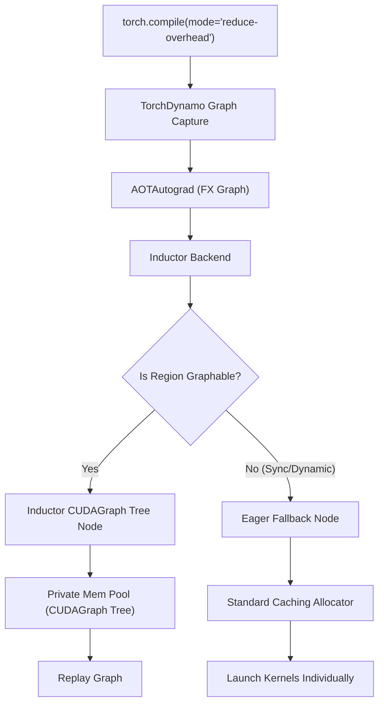
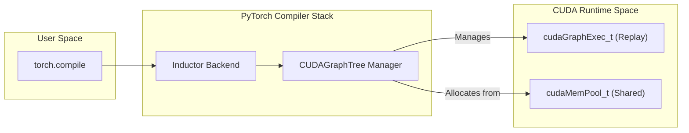

<!-- source: DeepWiki mcp.deepwiki.com · repo NVIDIA/dl-cuda-graph-doc · page 3.2 Automatic CUDA Graphs with torch.compile · fetched 2026-10-26 -->

# Automatic CUDA Graphs with torch.compile

<details>
<summary>Relevant source files</summary>

The following files were used as context for generating this wiki page:

- [docs/torch-cuda-graph/best-practices.md](docs/torch-cuda-graph/best-practices.md)
- [docs/torch-cuda-graph/torch-integration.md](docs/torch-cuda-graph/torch-integration.md)

</details>


This page details the automated integration of CUDA Graphs via `torch.compile`. While manual capture using `torch.cuda.CUDAGraph` or `torch.cuda.make_graphed_callables()` provides fine-grained control, `torch.compile` offers a "reduce-overhead" mode that automates graph management, partitioning, and memory handling through a system known as CUDAGraph Trees.

## Overview of `reduce-overhead` Mode

`torch.compile` is the primary entry point for PyTorch's compiler stack (Inductor). By setting the `mode` parameter to `"reduce-overhead"`, the compiler automatically attempts to wrap the generated kernels in CUDA Graphs [docs/torch-cuda-graph/best-practices.md:112-114]().

This mode addresses several manual capture pain points:
1.  **Automatic Partitioning**: It automatically identifies graph-compatible segments and breaks the graph at synchronization points or unsupported operations [docs/torch-cuda-graph/best-practices.md:121-123]().
2.  **Memory Management**: It integrates with the Inductor memory planner to ensure static addresses are maintained [docs/torch-cuda-graph/best-practices.md:125-127]().
3.  **Warmup Handling**: It manages the necessary warmup iterations required to stabilize the caching allocator before capture [docs/torch-cuda-graph/best-practices.md:129-131]().

### Usage Example
```python
import torch

model = MyModel().cuda()
# The "reduce-overhead" mode enables automatic CUDA Graphing
optimized_model = torch.compile(model, mode="reduce-overhead")

# First calls will trigger compilation and graph capture
output = optimized_model(input_data)
```
Sources: [docs/torch-cuda-graph/best-practices.md:112-131]()

## CUDAGraph Trees

CUDAGraph Trees represent the underlying implementation within `torch.compile` (specifically the Inductor backend) that manages multiple execution paths. In a dynamic environment like PyTorch, a single "compiled" function might encounter different conditions (e.g., varying input shapes or scalar values) that lead to different kernel sequences.

### Tree Structure and Smart Partitioning
Instead of a single monolithic graph, `torch.compile` maintains a tree of graphs. Each node in the tree represents a captured CUDA Graph. If a graph execution reaches a point where a dynamic branch occurs, the system can transition to a different branch in the tree or fall back to eager execution.

| Feature | Implementation Detail |
| :--- | :--- |
| **Shared Memory Pool** | All graphs in a tree share a common memory pool to minimize fragmentation [docs/torch-cuda-graph/best-practices.md:135-137](). |
| **Node Types** | Nodes can be "Graphed" (CUDA Graph) or "Eager" (standard kernel launches). |
| **Transitions** | Handled by the Inductor runtime to ensure zero-copy data passing between graphs. |

### Data Flow: Eager to CUDAGraph Tree
The following diagram illustrates how `torch.compile` transforms a standard PyTorch model into a CUDAGraph-enabled execution plan.

**Inductor Compilation Flow for CUDA Graphs**

Sources: [docs/torch-cuda-graph/best-practices.md:112-131](), [docs/torch-cuda-graph/torch-integration.md:41-45]()

## Trade-offs: Automatic vs. Manual Capture

While `torch.compile` simplifies adoption, there are technical trade-offs compared to manual methods like `torch.cuda.make_graphed_callables()` or framework-specific managers like Megatron's `CudaGraphManager`.

### Performance and Flexibility Comparison

| Feature | `torch.compile` (Automatic) | Manual (`CUDAGraph` / `make_graphed_callables`) |
| :--- | :--- | :--- |
| **Ease of Use** | High: Single line of code. | Low: Requires manual warmup and input management. |
| **Capture Scope** | Granular: Automatically partitions graphs. | Coarse: Typically graphs entire modules/passes. |
| **Overhead** | Lower than Eager, but slightly higher than manual due to tree management. | Lowest: Direct replay of the entire sequence. |
| **Dynamic Shapes** | Limited support via multiple graphs in a tree. | Very limited: Usually requires manual bucketing [docs/torch-cuda-graph/best-practices.md:103-105](). |
| **Memory Efficiency** | High: Shared pool across tree nodes. | Variable: Depends on user implementation of `pool`. |

### System Mapping: Code Entities to Execution Logic
This diagram maps the high-level concepts to the specific code-level entities used in the PyTorch integration.

**Code Entity Mapping for Automatic CUDA Graphs**

Sources: [docs/torch-cuda-graph/torch-integration.md:37-45](), [docs/torch-cuda-graph/best-practices.md:112-131]()

## Implementation Details

### Shared Memory Pool
To prevent Out-of-Memory (OOM) errors when using multiple graphs, `torch.compile` uses a shared memory pool. This is crucial because each CUDA Graph normally requires its own static memory assignments. By sharing a pool, the Inductor memory planner can overlap the memory used by different tree nodes that are known to be mutually exclusive in execution [docs/torch-cuda-graph/torch-integration.md:58-59]().

### Smart Partitioning
`torch.compile` monitors for "graph-breaking" operations during its analysis phase. These include:
*   **Data-dependent control flow**: `if tensor.item() > 0:`.
*   **CPU-GPU Synchronizations**: `.item()`, `.tolist()`, or explicit `torch.cuda.synchronize()`.
*   **Unsupported Operations**: Kernels that cannot be captured (e.g., certain custom extensions or legacy ops).

When these are encountered, Inductor ends the current graph, executes the breaking operation in eager mode, and attempts to start a new graph capture for the subsequent kernels [docs/torch-cuda-graph/best-practices.md:121-123]().

Sources: [docs/torch-cuda-graph/torch-integration.md:52-59](), [docs/torch-cuda-graph/best-practices.md:112-131]()

---

