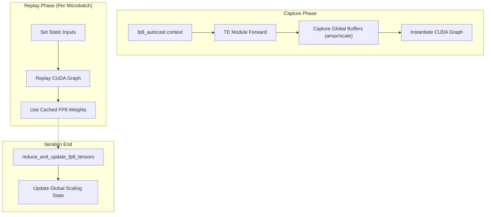
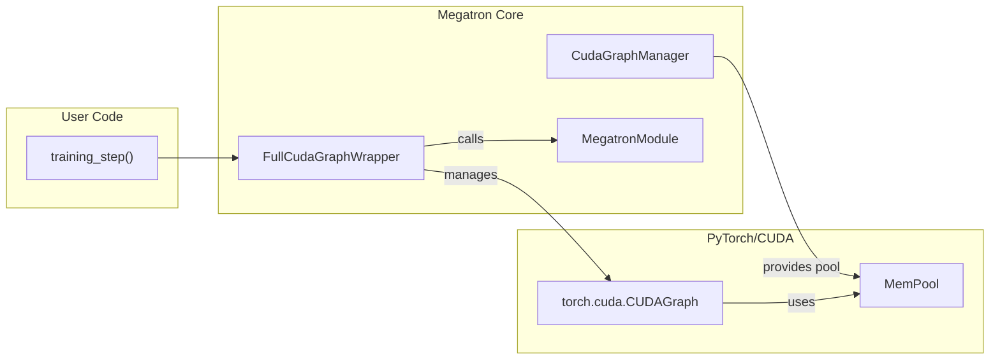

<!-- source: DeepWiki mcp.deepwiki.com · repo NVIDIA/dl-cuda-graph-doc · page 3.3 Transformer Engine and Megatron-LM CUDA Graph Support · fetched 2026-10-26 -->

# Transformer Engine and Megatron-LM CUDA Graph Support

Relevant source files

The following files were used as context for generating this wiki page:

- [docs/torch-cuda-graph/te-megatron-cuda-graphs.md](docs/torch-cuda-graph/te-megatron-cuda-graphs.md)

This section documents specialized CUDA Graph implementations optimized for large-scale distributed training. While PyTorch provides native APIs, Transformer Engine (TE) and Megatron-LM extend these to handle the unique complexities of FP8 precision and Pipeline Parallelism (PP).

## Overview

Transformer Engine and Megatron-LM provide three primary interfaces for CUDA Graph integration, ranging from manual per-callable wrappers to fully automatic iteration capture.

| Implementation | Scope | Key Features |
| :--- | :--- | :--- |
| **TE `make_graphed_callables`** | Per-layer/Callable | FP8 support, manual PP schedule handling. |
| **Megatron `CudaGraphManager`** | Per-layer/Module | Automatic graphing of transformer layers. |
| **Megatron `FullCudaGraphWrapper`** | Full Iteration | Captures entire training step (Fwd + Bwd + Opt). |

Sources: [docs/torch-cuda-graph/te-megatron-cuda-graphs.md:13-27]()

## Challenges with FP8 and Pipeline Parallelism

Specialized implementations are required to address specific bottlenecks in distributed training that standard PyTorch APIs do not natively manage.

### The FP8 Challenge
FP8 training introduces dynamic scaling and global buffer management that conflict with the static requirements of CUDA Graphs:
*   **Global Buffer Management**: TE uses global buffers for FP8 metadata (amax history, scales). In eager mode, these are dynamically resized. For CUDA Graphs, TE ensures these have static, persistent memory addresses [docs/torch-cuda-graph/te-megatron-cuda-graphs.md:43-45]().
*   **Dynamic Scaling**: Scaling factors must be updated globally via `reduce_and_update_fp8_tensors()` once per iteration. If captured inside per-layer graphs, this would cause redundant communication and incorrect scaling [docs/torch-cuda-graph/te-megatron-cuda-graphs.md:49-59]().
*   **Weight Caching**: FP8 requires expensive weight quantization and transposes. TE implements caching mechanisms to avoid re-quantizing weights across microbatches within a graph [docs/torch-cuda-graph/te-megatron-cuda-graphs.md:60-68]().

### The Pipeline Parallelism Challenge
Pipeline Parallelism (PP) executes microbatches in interleaved patterns (e.g., 1F1B).
*   **Replay Order**: Graphs sharing a memory pool must be replayed in the exact order they were captured. Any deviation leads to memory corruption where one microbatch overwrites another's buffers [docs/torch-cuda-graph/te-megatron-cuda-graphs.md:74-84]().

## Transformer Engine: `make_graphed_callables`

Transformer Engine provides a wrapper around PyTorch's `make_graphed_callables` specifically tuned for FP8 and interleaved schedules.

### Implementation Details
The TE implementation handles the FP8 state by ensuring that global scaling buffers are treated as static inputs to the graph. It also provides mechanisms to bypass FP8 scaling updates during graph replay, allowing the user to perform a single global update outside the graphed region.

### Data Flow for FP8 Graphed Callables
The following diagram illustrates how TE manages FP8 state during the capture and replay of a module.

**TE FP8 Graph Logic**

Sources: [docs/torch-cuda-graph/te-megatron-cuda-graphs.md:19-19](), [docs/torch-cuda-graph/te-megatron-cuda-graphs.md:49-53]()

## Megatron-LM: `CudaGraphManager`

The `CudaGraphManager` provides an automated way to graph individual transformer layers. It is designed to handle the complexity of Megatron's core transformer implementation.

### Key Features
*   **Automatic Layer Graphing**: Automatically identifies and wraps `MegatronModule` instances [megatron/core/transformer/cuda_graphs.py:953]().
*   **Microbatch Awareness**: Manages multiple graph instances if different microbatch sizes are used.
*   **Memory Pool Management**: Ensures that all layer graphs share a common `torch.cuda.graph_pool` to minimize memory fragmentation.

Sources: [docs/torch-cuda-graph/te-megatron-cuda-graphs.md:23-23](), [megatron/core/transformer/cuda_graphs.py:953]()

## Megatron-LM: `FullCudaGraphWrapper`

For maximum performance, `FullCudaGraphWrapper` captures the entire training iteration, including forward, backward, and optimizer updates.

### Workflow
1.  **Warmup**: Runs several eager iterations to stabilize memory and autotuning (e.g., cuDNN heuristics).
2.  **Capture**: Starts stream capture across the entire training loop for one iteration [megatron/core/full_cuda_graph.py:91]().
3.  **Replay**: Replays the single large graph for all subsequent iterations.

### System to Code Mapping: FullCudaGraphWrapper
This diagram maps the logical training components to the Megatron-LM code entities involved in full-iteration graphing.

**FullCudaGraphWrapper Architecture**

Sources: [megatron/core/full_cuda_graph.py:91](), [megatron/core/transformer/cuda_graphs.py:953](), [docs/torch-cuda-graph/te-megatron-cuda-graphs.md:24-26]()

## Comparison of Approaches

| Feature | TE `make_graphed_callables` | Megatron `CudaGraphManager` | Megatron `FullCudaGraphWrapper` |
| :--- | :--- | :--- | :--- |
| **Granularity** | Manual (per function) | Automatic (per layer) | Full Iteration |
| **FP8 Support** | Native (TE-specific) | Via TE integration | Full Iteration Support |
| **PP Support** | Manual ordering | Automatic layer-wise | Captured in Graph |
| **Memory Overhead** | Low (shared pool) | Low (shared pool) | Higher (full iteration state) |
| **Complexity** | High (manual setup) | Low (config flag) | Medium (requires static shapes) |

Sources: [docs/torch-cuda-graph/te-megatron-cuda-graphs.md:13-33](), [docs/torch-cuda-graph/te-megatron-cuda-graphs.md:37-84]()

---

