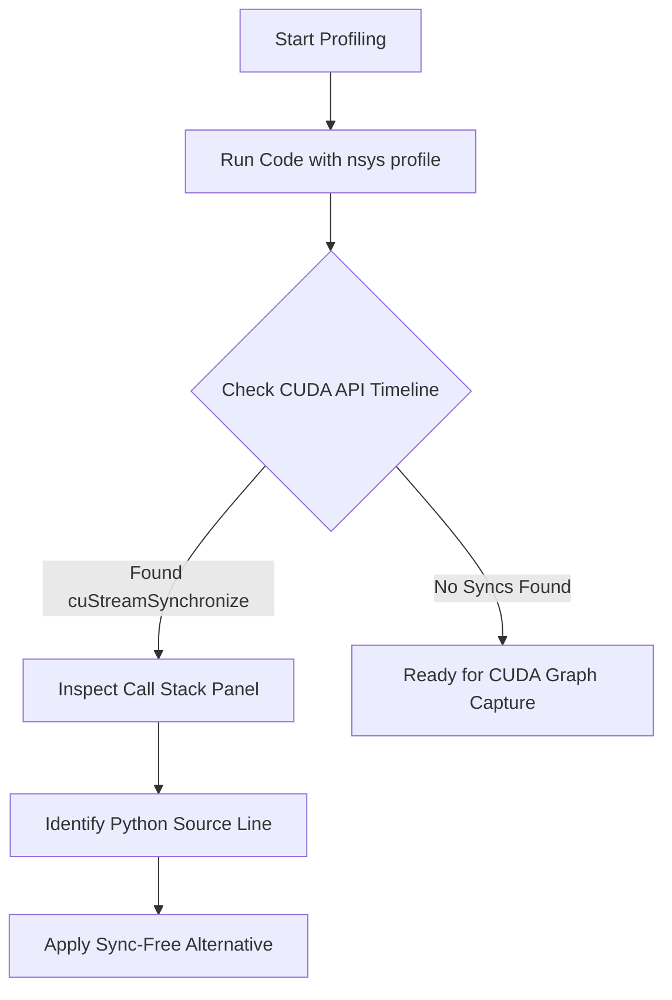

<!-- source: DeepWiki mcp.deepwiki.com · repo NVIDIA/dl-cuda-graph-doc · page 3.4 Writing Sync-Free Code · fetched 2026-10-26 -->

# Writing Sync-Free Code

<details>
<summary>Relevant source files</summary>

The following files were used as context for generating this wiki page:

- [docs/torch-cuda-graph/sync-free-code.md](docs/torch-cuda-graph/sync-free-code.md)

</details>


Writing sync-free code is a fundamental requirement for achieving high performance in GPU-accelerated applications and is a strict prerequisite for using CUDA Graphs in PyTorch. This page details how to identify, categorize, and eliminate host-device synchronizations to prepare codebases for graph capture.

## What is Sync-Free Code?

**Sync-free code** refers to a programming pattern where the CPU continuously queues work to the GPU without waiting for any individual GPU operation to complete [docs/torch-cuda-graph/sync-free-code.md:13-15](). In a typical asynchronous execution model, the CPU "launches" kernels and returns immediately to the next line of Python code, while the GPU processes those kernels in the background.

A synchronization occurs when the CPU is forced to wait (block) until the GPU reaches a certain state. This is problematic for two reasons:
1.  **Performance Stalls**: Synchronizations create "bubbles" where the GPU may become idle while waiting for the CPU to finish its next task after a sync [docs/torch-cuda-graph/sync-free-code.md:19-20]().
2.  **CUDA Graph Incompatibility**: CUDA Graph capture cannot include synchronization points. Any operation that triggers a sync during capture will cause the process to fail [docs/torch-cuda-graph/sync-free-code.md:20-21]().

### Low-Level Synchronization Mechanics

When PyTorch synchronizes, it invokes specific CUDA Driver APIs that block the CPU thread [docs/torch-cuda-graph/sync-free-code.md:22-28]():

| API | Behavior |
| :--- | :--- |
| `cuEventSynchronize` | CPU blocks until a specific event is signaled by the GPU. |
| `cuStreamSynchronize` | CPU blocks until all work in a specific stream is finished. |
| `cuCtxSynchronize` | CPU blocks until all work on the entire device (all streams) is finished. |

**Sources:** [docs/torch-cuda-graph/sync-free-code.md:13-28]()

## Categories of Synchronizations

Synchronizations are generally classified into two categories based on whether they are necessary for the program's logic.

### 1. False Dependencies (Avoidable)
These are synchronizations where the CPU does not actually need the result of a GPU operation to continue, but a sync is triggered anyway due to implementation choices [docs/torch-cuda-graph/sync-free-code.md:34-36]().

*   **Unconscious Behavior**: Debug prints, logging, or calling `.item()` on a tensor just to print its value [docs/torch-cuda-graph/sync-free-code.md:38-39]().
*   **Blocking Data Movement**: Using `.cuda()` instead of `.to('cuda', non_blocking=True)`, which forces the CPU to wait for the transfer to finish [docs/torch-cuda-graph/sync-free-code.md:43-44]().
*   **Implicit Transfers**: Moving data back and forth between CPU and GPU because the developer did not track which device the tensor resided on [docs/torch-cuda-graph/sync-free-code.md:42-43]().

### 2. True Dependencies (Requires Restructuring)
These occur when the CPU logic genuinely depends on a value calculated by the GPU [docs/torch-cuda-graph/sync-free-code.md:45-47]().

*   **Control Flow**: Using a GPU-calculated value in an `if` statement (e.g., checking if `loss < threshold`) [docs/torch-cuda-graph/sync-free-code.md:49-50]().
*   **Dynamic Allocation**: Creating a tensor whose size is determined by a GPU result, such as the output of `torch.nonzero()` or `torch.masked_select()` [docs/torch-cuda-graph/sync-free-code.md:53-54]().
*   **Host-Side Statistics**: Updating learning rates or saving checkpoints based on metrics computed on the GPU [docs/torch-cuda-graph/sync-free-code.md:54-55]().

**Sources:** [docs/torch-cuda-graph/sync-free-code.md:32-57]()

## Identifying Hidden Syncs

Before eliminating syncs, they must be located. Two primary tools are used for this purpose.

### PyTorch Sync Debug Mode
PyTorch provides a built-in mechanism to detect stream synchronizations. By calling `torch.cuda.set_sync_debug_mode()`, the framework will either warn or error when a sync occurs [docs/torch-cuda-graph/sync-free-code.md:62-75]().

```python
import torch
# 'warn' prints a stack trace; 'error' raises an exception
torch.cuda.set_sync_debug_mode('warn') 
```

### Nsight Systems Profiling
For a deeper analysis, Nsight Systems can visualize the timeline of CUDA API calls and correlate them with Python source code [docs/torch-cuda-graph/sync-free-code.md:81-94]().

**Sync Identification Workflow**


**Sources:** [docs/torch-cuda-graph/sync-free-code.md:62-94]()

## Strategies for Elimination

### Code Patterns and Alternatives
The following table maps common syncing patterns to their sync-free counterparts:

| Syncing Pattern | Sync-Free Alternative | Reason |
| :--- | :--- | :--- |
| `val = tensor.item()` | Use `tensor` directly in GPU ops | `.item()` forces a host-side scalar conversion. |
| `x.to('cpu')` | `x.to('cpu', non_blocking=True)` | Allows CPU to continue while data moves. |
| `if x.sum() > 0:` | `torch.where()` or masking | Avoids host-side branching on GPU data. |
| `x[idx_cpu] = 0` | `x[idx_gpu] = zero_tensor` | Keeps indices and values on the device. |
| `x.type(torch.LongTensor)` | `x.to(torch.long)` | Avoids potential host-side type dispatching. |

### Architectural Mapping: Sync-Free Data Flow
This diagram illustrates the transition from a syncing execution model to a sync-free model suitable for CUDA Graphs.

**Execution Flow Comparison**
```mermaid
sequenceDiagram
    participant CPU as "Python (CPU)"
    participant GPU as "CUDA Device (GPU)"

    rect rgb(240, 240, 240)
    Note over CPU, GPU: Syncing Pattern (Standard PyTorch)
    CPU->>GPU: Launch Kernel A
    CPU->>GPU: Launch Kernel B
    CPU->>GPU: Data Transfer (Blocking)
    Note right of GPU: GPU Working...
    GPU-->>CPU: Transfer Complete (Sync)
    Note left of CPU: CPU Idle/Waiting
    CPU->>GPU: Launch Kernel C
    end

    rect rgb(220, 220, 220)
    Note over CPU, GPU: Sync-Free Pattern (Graph Ready)
    CPU->>GPU: Launch Kernel A
    CPU->>GPU: Launch Kernel B
    CPU->>GPU: Data Transfer (Non-blocking)
    CPU->>GPU: Launch Kernel C
    Note right of GPU: GPU processes queue continuously
    Note left of CPU: CPU never blocks; queues all work
    end
```

### Handling Dynamic Patterns
When true dependencies cannot be removed, developers must use specific workarounds:
1.  **Padding/Bucketing**: Use fixed-size tensors that are large enough for all expected inputs to avoid dynamic allocations [docs/torch-cuda-graph/sync-free-code.md:53-54]().
2.  **GPU-Side Logic**: Use `torch.where()` or `torch.clamp()` to implement conditional logic entirely within GPU kernels [docs/torch-cuda-graph/sync-free-code.md:56-57]().
3.  **Graph Splitting**: If a sync is unavoidable (e.g., a mid-iteration checkpoint), capture two separate graphs—one before the sync and one after [docs/torch-cuda-graph/sync-free-code.md:122-126]().

**Sources:** [docs/torch-cuda-graph/sync-free-code.md:96-126]()

---

